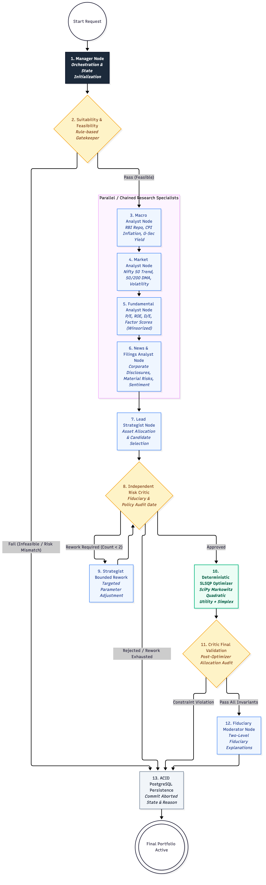
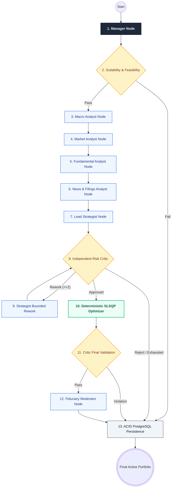

# Lucid — Agentic AI Architecture & LangGraph Workflow

This document details the multi-agent artificial intelligence framework powering **Lucid**, implemented with LangGraph and executing across 13 specialized nodes.

---

## Agentic AI Topology & State Transitions

---

## Detailed Node Specifications

| # | Node Name | Execution Type | Primary Responsibilities | Input State Keys | Output State Keys |
|---|---|---|---|---|---|
| **1** | `manager_node` | Orchestration | Decomposes user request, parses financial goals and capital constraints, initializes state | `user_profile`, `goal`, `capital`, `risk_category` | `workflow_stage`, `target_return`, `active_constraints` |
| **2** | `suitability_check_node` | Rule-based | Validates investor risk capacity against regulatory bounds and verifies minimum capital viability (₹10,000) | `risk_category`, `capital`, `horizon_years` | `suitability_passed`, `suitability_notes` |
| **3** | `macro_analyst_node` | LLM + Tool | Analyzes RBI monetary policy, repo rate (6.50%), CPI inflation, and yield curve spreads | `macro_data`, `risk_category` | `macro_regime`, `equity_allocation_boundary` |
| **4** | `market_analyst_node` | LLM + Tool | Classifies NIFTY 50 trend, 50/200 DMA breadth, and market volatility regime | `nifty_historical_prices`, `india_vix` | `market_regime`, `market_trend_notes` |
| **5** | `fundamental_analyst_node` | LLM + Tool | Evaluates corporate quality (ROE > 15%), P/E valuation, debt leverage, and multi-factor Z-scores | `candidate_universe`, `fundamental_metrics` | `ranked_candidates`, `factor_scores` |
| **6** | `news_analyst_node` | LLM + Tool | Evaluates corporate disclosures, quarterly earnings announcements, and material sentiment risks | `ranked_candidates`, `market_news` | `news_risk_flags`, `candidate_sentiment` |
| **7** | `analyst_node` (Lead Strategist) | LLM | Synthesizes macroeconomic, market, and fundamental findings into a tactical portfolio selection (10–18 stocks) | `ranked_candidates`, `macro_regime`, `market_regime` | `selected_securities`, `preliminary_weights` |
| **8** | `critic_node` (Risk Critic) | Rule + LLM | Adversarially audits allocations against single-stock (10%) and sector (30%) concentration caps and minimum liquidity | `selected_securities`, `preliminary_weights` | `critic_verdict_status`, `critic_approved`, `critic_notes` |
| **9** | `strategist_rework_node` | LLM | Adjusts proposed candidates and weights based on Critic audit feedback (bounded to max 2 iterations) | `selected_securities`, `critic_notes`, `rework_count` | `selected_securities`, `rework_count` |
| **10** | `deterministic_optimizer_node` | Mathematical | Solves Markowitz quadratic utility via SciPy SLSQP; converts weights to integer shares via floor division | `selected_securities`, `active_constraints`, `capital` | `optimized_allocations`, `unallocated_cash`, `validation_passed` |
| **11** | `critic_final_validation_node` | Rule-based | Verifies post-optimizer integer share sizing and unallocated cash against policy caps | `optimized_allocations`, `unallocated_cash` | `critic_final_output`, `can_proceed` |
| **12** | `moderator_explanation_node` | LLM | Formulates dual-level fiduciary explanations: Level 1 Retail Summary and Level 2 Institutional Fact Sheet | `optimized_allocations`, `macro_regime`, `factor_scores` | `explanations`, `retail_summary`, `quant_factsheet` |
| **13** | `persistence_node` | Database | Commits portfolio, versions, individual security decisions, and audit events within an ACID PostgreSQL transaction | Complete `PortfolioAgentState` | `portfolio_id`, `version_id`, `status` |

---

## Fiduciary Safeguards & Anti-Hallucination Design

1. **Decoupled Mathematical Optimization**: The LLM never invents portfolio weights. Optimization is performed strictly by SciPy's numerical SLSQP solver in Python (`backend/portfolio_engine/optimizer.py`).
2. **Double-Critic Architecture**:
   - `critic_node` audits the strategic thesis *before* numerical optimization.
   - `critic_final_validation_node` audits the integer-lot allocations *after* numerical optimization.
3. **Hard Bounded Loops**: Rework loops between the Lead Strategist and Critic are strictly capped at `max_rework_count = 2`. If consensus is not reached, the system halts with a transparent rejection report.
4. **Mandatory Safe Harbor Notice**: Every explanation delivered to the investor includes statutory SEBI safe harbor disclosures, preventing the AI from presenting algorithmic forecasts as guaranteed financial returns.
