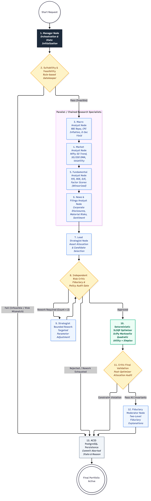

# Lucid — Complete Agent Architecture & LangGraph Multi-Agent Specification

**Document Version:** 2026.11-v2.0  
**Authoritative Date:** 2026-11-08  
**Target Audience:** AI/ML Engineers, Quantitative Strategists, Software Architects, Security & Fiduciary Auditors  
**Scope:** Architectural specification, graph topology, state schema, and node execution mechanics of the Lucid Multi-Agent Portfolio Reasoning System.

---

## Executive Summary

The Lucid agentic architecture is an implementation of **Agentic AI for Investment Research and Portfolio Formulation**. Rather than deploying a single unconstrained Large Language Model (LLM) to invent portfolio allocations, Lucid employs a **13-node LangGraph StateGraph** where:
1. Specialist AI research agents analyze macroeconomic conditions, market regime indicators, equity fundamentals, and corporate filings.
2. An independent **Risk Critic Agent** audits portfolio proposals against SEBI investor protection regulations and portfolio constraints.
3. All numerical portfolio weight calculations and whole-share lot allocations are strictly delegated to a **Deterministic SLSQP Numerical Optimizer** and mathematical rounding algorithms.
4. LLMs are strictly prohibited from exerting numerical authority over financial allocations.

---

## Table of Contents

1. [Agent Architecture Overview](#1-agent-architecture-overview)
2. [Actual Graph Topology & Execution Flow](#2-actual-graph-topology--execution-flow)
3. [Shared Agent State (`PortfolioAgentState`) Schema](#3-shared-agent-state-portfolioagentstate-schema)
4. [Individual Agent Node Specifications (13 Nodes)](#4-individual-agent-node-specifications-13-nodes)
   - [Node 1: Manager Node](#node-1-manager-node)
   - [Node 2: Suitability & Feasibility Node](#node-2-suitability--feasibility-node)
   - [Node 3: Macro Analyst Node](#node-3-macro-analyst-node)
   - [Node 4: Market Analyst Node](#node-4-market-analyst-node)
   - [Node 5: Fundamental Analyst Node](#node-5-fundamental-analyst-node)
   - [Node 6: News & Corporate Filings Analyst Node](#node-6-news--corporate-filings-analyst-node)
   - [Node 7: Lead Strategist Node](#node-7-lead-strategist-node)
   - [Node 8: Independent Risk Critic Node](#node-8-independent-risk-critic-node)
   - [Node 9: Strategist Bounded Rework Node](#node-9-strategist-bounded-rework-node)
   - [Node 10: Deterministic SLSQP Optimizer Node](#node-10-deterministic-slsqp-optimizer-node)
   - [Node 11: Critic Final Validation Node](#node-11-critic-final-validation-node)
   - [Node 12: Fiduciary Moderator Node](#node-12-fiduciary-moderator-node)
   - [Node 13: ACID PostgreSQL Persistence Node](#node-13-acid-postgresql-persistence-node)
5. [Agent-Specific Data Flow & Extraction Lineage](#5-agent-specific-data-flow--extraction-lineage)
6. [Agent Communication & State Transitions](#6-agent-communication--state-transitions)
7. [Agentic Reasoning Trace & Audit Persistence](#7-agentic-reasoning-trace--audit-persistence)
8. [Fiduciary Safeguards & Non-Numerical LLM Boundaries](#8-fiduciary-safeguards--non-numerical-llm-boundaries)

---

## 1. Agent Architecture Overview

### 1.1 Why Lucid Uses an Agentic Workflow
In professional Indian asset management, portfolio construction is not performed by an individual generalist. It is conducted through an institutional division of labor:
- **Macro Economists** evaluate RBI interest rate policy, CPI inflation, and fiscal dynamics.
- **Market Technicians** evaluate liquidity dispersion, volatility regimes (India VIX), and market breadth.
- **Fundamental Equity Analysts** evaluate corporate financial statements, ROCE, debt-to-equity ratios, and competitive moats.
- **Governance & News Analysts** monitor corporate announcements, regulatory filings, and audit qualifications on NSE/BSE.
- **Investment Strategists** synthesize these inputs into asset allocation hypotheses.
- **Risk Officers (Critics)** audit proposals against client risk tolerance and concentration mandates.
- **Quantitative Engineers** run convex optimization algorithms to calculate exact integer positions and cash buffers.

Lucid mirrors this institutional investment committee architecture using a compiled LangGraph workflow.

### 1.2 Separation of Concerns: LLM vs. Deterministic Optimization
A core design invariant of Lucid is the **strict separation between qualitative reasoning and quantitative computation**:
- **LLM Responsibility:** Contextual synthesis, thesis generation, corporate filing analysis, ethical exclusion filtering, and explainable client narratives.
- **Deterministic Algorithm Responsibility:** Sharpe ratio maximization, covariance matrix calculation, SLSQP quadratic programming, discrete integer share lot sizing, transaction cost friction modeling, and hard constraint enforcement.

---

## 2. Actual Graph Topology & Execution Flow

The workflow is compiled in `backend/agent/graph.py` using `langgraph.graph.StateGraph`.



### 2.1 Graph Assembly Code (`create_portfolio_graph`)

```python
builder = StateGraph(PortfolioAgentState)

# 1. Register 13 Nodes
builder.add_node("manager", manager_node)
builder.add_node("suitability", lambda state: suitability_check_node(state, db))
builder.add_node("macro_analyst", lambda state: macro_analyst_node(state, db))
builder.add_node("market_analyst", lambda state: market_analyst_node(state, db))
builder.add_node("fundamental_analyst", lambda state: fundamental_analyst_node(state, db))
builder.add_node("news_analyst", lambda state: news_analyst_node(state, db))
builder.add_node("analyst", analyst_node)
builder.add_node("critic", critic_node)
builder.add_node("strategist_rework", strategist_rework_node)
builder.add_node("optimizer", deterministic_optimizer_node)
builder.add_node("critic_final_validation", critic_final_validation_node)
builder.add_node("moderator", moderator_explanation_node)
builder.add_node("persistence", lambda state: persistence_node(state, db))

# 2. Graph Edges & Conditional Routing
builder.set_entry_point("manager")
builder.add_edge("manager", "suitability")

builder.add_conditional_edges(
    "suitability",
    lambda state: "macro_analyst" if state.get("suitability_passed", False) else "persistence",
    {"macro_analyst": "macro_analyst", "persistence": "persistence"}
)

builder.add_edge("macro_analyst", "market_analyst")
builder.add_edge("market_analyst", "fundamental_analyst")
builder.add_edge("fundamental_analyst", "news_analyst")
builder.add_edge("news_analyst", "analyst")
builder.add_edge("analyst", "critic")

builder.add_conditional_edges(
    "critic",
    route_critic,
    {"optimizer": "optimizer", "strategist_rework": "strategist_rework", "persistence": "persistence"}
)

builder.add_edge("strategist_rework", "critic")

builder.add_conditional_edges(
    "optimizer",
    route_optimizer,
    {"critic_final_validation": "critic_final_validation", "strategist_rework": "strategist_rework", "persistence": "persistence"}
)

builder.add_conditional_edges(
    "critic_final_validation",
    route_final_critic,
    {"moderator": "moderator", "persistence": "persistence"}
)

builder.add_edge("moderator", "persistence")
builder.add_edge("persistence", END)
```

### 2.2 Bounded Rework Loops & Termination Invariants
- **Critic Rework Loop:** If the Risk Critic discovers constraint violations, it issues structured objections and routes execution to `strategist_rework`.
- **Hard Limit:** Rework is strictly bounded by `max_rework_count = 2`.
- **Termination Guarantee:** If the Strategist fails to resolve objections after 2 rework cycles, the workflow routes directly to `persistence`, records `workflow_status = 'BLOCKED'`, and refuses to recommend an unverified portfolio.

---

## 3. Shared Agent State (`PortfolioAgentState`) Schema

The workflow state is defined as a typed dictionary in `backend/agent/state.py`. It contains exactly **35 active fields**:

| Field Name | Type | Required? | Purpose | Set By | Consumed By |
|---|---|---|---|---|---|
| `generation_request_id` | `str` | Yes | Unique UUID of the portfolio generation request | Router | Manager, Persistence |
| `portfolio_id` | `str` | Yes | Target portfolio UUID in PostgreSQL | Router | Manager, Persistence |
| `user_id` | `str` | Yes | Owner user UUID | Router | Manager, Persistence |
| `investment_amount` | `float` | Yes | Total INR capital to allocate (e.g., ₹5,00,000) | Router / Input | Suitability, Optimizer |
| `currency_code` | `str` | Yes | ISO currency code (default: 'INR') | Router / Input | Suitability, Persistence |
| `investment_horizon_months` | `int` | Yes | Investment horizon (min: 3, max: 360) | Router / Input | Suitability, Strategist |
| `risk_category` | `str` | Yes | Risk tolerance (CONSERVATIVE to AGGRESSIVE) | Router / Input | Suitability, Critic |
| `goal_type` | `Optional[str]` | No | Financial goal classification | Router / Input | Strategist, Moderator |
| `user_prompt` | `Optional[str]` | No | Natural language preferences / sector bias | Router / Input | Suitability, Strategist |
| `preferences` | `Dict[str, Any]` | No | Structured ethical exclusions / tilt constraints | Router / Input | Suitability, Strategist |
| `user_profile` | `Dict[str, Any]` | Yes | Complete user profile snapshot | Router / DB | Suitability, Critic |
| `suitability_passed` | `bool` | Yes | Fiduciary suitability gate status | Suitability Node | Conditional Edge Router |
| `suitability_notes` | `List[str]` | Yes | Suitability observations / warnings | Suitability Node | Critic, Moderator |
| `eligible_candidates` | `List[Dict[str, Any]]` | Yes | Liquid securities eligible for recommendation | Suitability Node | Research Analysts, Strategist |
| `macro_output` | `Optional[Dict[str, Any]]` | No | Structured macro indicators and sector outlook | Macro Analyst | Strategist, Moderator |
| `market_output` | `Optional[Dict[str, Any]]` | No | Market breadth, VIX, and technical signals | Market Analyst | Strategist, Moderator |
| `fundamental_output` | `Optional[Dict[str, Any]]` | No | Financial health, ROCE, debt assessments | Fundamental Analyst | Strategist, Moderator |
| `news_output` | `Optional[Dict[str, Any]]` | No | BSE/NSE corporate disclosures and sentiment | News Analyst | Strategist, Moderator |
| `strategist_output` | `Optional[Dict[str, Any]]` | No | Proposed portfolio candidate roles and weights | Strategist Node | Critic, Optimizer |
| `critic_output` | `Optional[Dict[str, Any]]` | No | Risk Critic audit verdict and findings | Risk Critic Node | Conditional Edge, Rework |
| `critic_verdict_status` | `Optional[str]` | Yes | APPROVED, REWORK_REQUIRED, or BLOCKED | Risk Critic Node | Conditional Edge Router |
| `critic_approved` | `bool` | Yes | Boolean approval flag | Risk Critic Node | Conditional Edge Router |
| `critic_iteration` | `int` | Yes | Current iteration counter | Risk Critic Node | Critic, Persistence |
| `rework_count` | `int` | Yes | Number of rework cycles executed | Strategist Rework | Conditional Edge Router |
| `max_rework_count` | `int` | Yes | Hard ceiling on rework attempts (fixed: 2) | Manager Node | Conditional Edge Router |
| `allocations` | `List[Dict[str, Any]]` | Yes | Optimized whole-share positions and amounts | Optimizer Node | Critic Final, Persistence |
| `total_invested` | `float` | Yes | Total capital actually deployed in equities | Optimizer Node | Critic Final, Persistence |
| `unallocated_cash` | `float` | Yes | Exact residual unallocated cash reserve | Optimizer Node | Critic Final, Persistence |
| `risk_metrics` | `Dict[str, float]` | Yes | Sharpe ratio, volatility, VaR, Max Drawdown | Optimizer Node | Moderator, Persistence |
| `validation_passed` | `bool` | Yes | Post-optimization mathematical validation flag | Optimizer Node | Conditional Edge Router |
| `critic_final_output` | `Optional[Dict[str, Any]]` | No | Audit of optimized integer share allocations | Critic Final Node | Conditional Edge Router |
| `can_proceed` | `bool` | Yes | Final fiduciary approval flag | Critic Final Node | Conditional Edge Router |
| `explanations` | `List[Dict[str, Any]]` | Yes | Two-level stock-specific justifications | Moderator Node | Persistence, Client UI |
| `evidence_items` | `List[Dict[str, Any]]` | Yes | Structured citations and empirical data points | All Agents | Persistence, Client UI |
| `execution_trace` | `List[Dict[str, Any]]` | Yes | Step-by-step telemetry audit log | All Agents | Persistence, Client UI |

---

## 4. Individual Agent Node Specifications (13 Nodes)

### Node 1: Manager Node

**1. Implementation Reference:**
- File: `backend/agent/nodes.py`
- Function: `manager_node()`
- Graph Identifier: `builder.add_node('manager', ...)`
- Invocation Mechanism: LangGraph StateGraph execution loop

**2. Purpose:**
Initializes workflow execution, validates initial state payload, and sets execution telemetry registries.

**3. Input Fields:**
`generation_request_id, portfolio_id, user_id, investment_amount, user_profile`

**4. Data Sources:**
FastAPI request payload, PostgreSQL app_users table

**5. Processing Logic:**
Extracts initial investment parameters, initializes empty trace arrays, sets rework ceilings (max_rework_count = 2), and establishes audit timestamps.

**6. Prompt Construction & Model Configuration:**
None (Strictly Deterministic)

**7. Output Schema & State Mutations:**
`current_stage: 'suitability', status: 'running', workflow_status: 'RUNNING', rework_count: 0, execution_trace: [...]`

**8. Next Workflow Component:**
`suitability_check_node`

**9. Failure Behavior & Fallback Path:**
Fails fast if investment_amount < 10,000 or essential user context is missing.

**10. Decision Classification:**
`Deterministic`

**11. Numerical Authority:**
**None (Administrative Orchestration)**

---

### Node 2: Suitability & Feasibility Node

**1. Implementation Reference:**
- File: `backend/agent/nodes.py`
- Function: `suitability_check_node()`
- Graph Identifier: `builder.add_node('suitability', ...)`
- Invocation Mechanism: LangGraph StateGraph execution loop

**2. Purpose:**
Evaluates investor risk capacity versus willingness, enforces SEBI suitability mandates, and screens liquid candidate stocks.

**3. Input Fields:**
`user_profile, investment_amount, investment_horizon_months, risk_category, user_prompt`

**4. Data Sources:**
PostgreSQL user_profiles table, policy constraints engine (policy.py), CandidateUniverseSelector

**5. Processing Logic:**
1. Executes suitability_assessment_tool to evaluate risk profile alignment.
2. Runs CandidateUniverseSelector to retrieve liquid equity candidates (~504 stocks).
3. Evaluates pre-optimization capital feasibility (check_portfolio_feasibility).

**6. Prompt Construction & Model Configuration:**
None (Deterministic Rule Engine & Tool Execution)

**7. Output Schema & State Mutations:**
`suitability_passed: bool, eligible_candidates: List[Dict], policy_constraints: Dict, suitability_notes: List[str]`

**8. Next Workflow Component:**
`macro_analyst_node (if passed) or persistence_node (if aborted)`

**9. Failure Behavior & Fallback Path:**
If capital is insufficient for minimum diversification (e.g. < ₹10,000 for equity basket) or horizon < 3 months, sets suitability_passed = False and halts workflow.

**10. Decision Classification:**
`Deterministic`

**11. Numerical Authority:**
**Gatekeeper (Can abort workflow, cannot allocate capital)**

---

### Node 3: Macro Analyst Node

**1. Implementation Reference:**
- File: `backend/agent/nodes.py`
- Function: `macro_analyst_node()`
- Graph Identifier: `builder.add_node('macro_analyst', ...)`
- Invocation Mechanism: LangGraph StateGraph execution loop

**2. Purpose:**
Evaluates Indian macroeconomic indicators, RBI interest rate stance, CPI inflation, and sector tailwinds.

**3. Input Fields:**
`investment_horizon_months, market_regime, user_prompt`

**4. Data Sources:**
PostgreSQL economic_indicators and economic_observations tables, macro_data_tool

**5. Processing Logic:**
Extracts repo rate, inflation metrics, GDP trends, and constructs a structured macroeconomic summary with sector outlooks.

**6. Prompt Construction & Model Configuration:**
Model: gemini-3.8-flash, Temperature: 0.2, Structured Output: MacroAnalystOutput. Fallback: Rule-based macro heuristics.

**7. Output Schema & State Mutations:**
`macro_output: { outlook: str, favored_sectors: List[str], disfavored_sectors: List[str], rbi_stance: str }`

**8. Next Workflow Component:**
`market_analyst_node`

**9. Failure Behavior & Fallback Path:**
If Gemini API times out or fails, applies deterministic default macro posture (Neutral/Long-term Growth).

**10. Decision Classification:**
`Hybrid (LLM with Rule Fallback)`

**11. Numerical Authority:**
**Advisory / Interpretive (Zero financial allocation authority)**

---

### Node 4: Market Analyst Node

**1. Implementation Reference:**
- File: `backend/agent/nodes.py`
- Function: `market_analyst_node()`
- Graph Identifier: `builder.add_node('market_analyst', ...)`
- Invocation Mechanism: LangGraph StateGraph execution loop

**2. Purpose:**
Evaluates market technical conditions, India VIX volatility dispersion, and index trend indicators.

**3. Input Fields:**
`eligible_candidates, market_regime, macro_output`

**4. Data Sources:**
PostgreSQL market_prices table, regime detector (regime.py), market_technical_tool

**5. Processing Logic:**
Analyzes market regime (e.g. BULL_TREND vs HIGH_VOLATILITY), 50-day/200-day moving averages, and technical market breadth.

**6. Prompt Construction & Model Configuration:**
Model: gemini-3.8-flash, Temperature: 0.2, Structured Output: MarketAnalystOutput. Fallback: Factor-based technical heuristics.

**7. Output Schema & State Mutations:**
`market_output: { regime: str, volatility_assessment: str, beta_preference: str, technical_signals: Dict }`

**8. Next Workflow Component:**
`fundamental_analyst_node`

**9. Failure Behavior & Fallback Path:**
Falls back to deterministic VIX threshold rules if LLM invocation fails.

**10. Decision Classification:**
`Hybrid (LLM with Rule Fallback)`

**11. Numerical Authority:**
**Advisory / Interpretive (Zero financial allocation authority)**

---

### Node 5: Fundamental Analyst Node

**1. Implementation Reference:**
- File: `backend/agent/nodes.py`
- Function: `fundamental_analyst_node()`
- Graph Identifier: `builder.add_node('fundamental_analyst', ...)`
- Invocation Mechanism: LangGraph StateGraph execution loop

**2. Purpose:**
Performs industry-aware financial statement analysis across candidate equities (ROCE, ROE, operating margin, leverage).

**3. Input Fields:**
`eligible_candidates, macro_output, market_output`

**4. Data Sources:**
PostgreSQL fundamental_metrics, metric_definitions tables, fundamental_research_tool

**5. Processing Logic:**
Ranks candidates by quality and value metrics, distinguishes financial institutions (NPA/CASA) from industrials (ROCE/Debt-to-Equity).

**6. Prompt Construction & Model Configuration:**
Model: gemini-3.8-flash, Temperature: 0.2, Structured Output: FundamentalAnalystOutput. Fallback: Deterministic ROCE/ROE ranking.

**7. Output Schema & State Mutations:**
`fundamental_output: { top_candidates: List[Dict], company_assessments: Dict[str, CompanyFundamentalAssessment] }`

**8. Next Workflow Component:**
`news_analyst_node`

**9. Failure Behavior & Fallback Path:**
Falls back to quantitative Winsorized Z-score ranking if LLM fails.

**10. Decision Classification:**
`Hybrid (LLM with Rule Fallback)`

**11. Numerical Authority:**
**Advisory / Screening (Zero financial allocation authority)**

---

### Node 6: News & Corporate Filings Analyst Node

**1. Implementation Reference:**
- File: `backend/agent/nodes.py`
- Function: `news_analyst_node()`
- Graph Identifier: `builder.add_node('news_analyst', ...)`
- Invocation Mechanism: LangGraph StateGraph execution loop

**2. Purpose:**
Audits NSE/BSE corporate announcements, quarterly earnings disclosures, regulatory actions, and governance alerts.

**3. Input Fields:**
`eligible_candidates, fundamental_output`

**4. Data Sources:**
PostgreSQL market_news_articles, news_article_securities tables, news_filings_audit_tool

**5. Processing Logic:**
Evaluates corporate disclosures, identifies promoter pledging changes, SEBI inquiries, or adverse auditor qualifications.

**6. Prompt Construction & Model Configuration:**
Model: gemini-3.8-flash, Temperature: 0.2, Structured Output: NewsAnalystOutput. Fallback: Disclosure keyword classifier.

**7. Output Schema & State Mutations:**
`news_output: { corporate_actions: Dict, governance_flags: List[str], sentiment_scores: Dict[str, float] }`

**8. Next Workflow Component:**
`analyst_node (Lead Strategist)`

**9. Failure Behavior & Fallback Path:**
If news feed is unavailable, marks governance status as 'UNVERIFIED_NEUTRAL' without halting workflow.

**10. Decision Classification:**
`Hybrid (LLM with Rule Fallback)`

**11. Numerical Authority:**
**Advisory / Governance Screening (Zero financial allocation authority)**

---

### Node 7: Lead Strategist Node

**1. Implementation Reference:**
- File: `backend/agent/nodes.py`
- Function: `analyst_node()`
- Graph Identifier: `builder.add_node('analyst', ...)`
- Invocation Mechanism: LangGraph StateGraph execution loop

**2. Purpose:**
Synthesizes all specialist research outputs into an initial portfolio proposal, assigning candidate roles and weight targets.

**3. Input Fields:**
`macro_output, market_output, fundamental_output, news_output, user_profile, policy_constraints`

**4. Data Sources:**
Prior specialist agent outputs in PortfolioAgentState

**5. Processing Logic:**
Assigns securities into portfolio roles (CORE, GROWTH, DEFENSIVE, DIVERSIFICATION), proposes target weights respecting constraints.

**6. Prompt Construction & Model Configuration:**
Model: gemini-3.8-flash, Temperature: 0.2, Structured Output: StrategistOutput.

**7. Output Schema & State Mutations:**
`strategist_output: { proposed_portfolio: List[PortfolioCandidate], investment_thesis: str, cash_buffer_target: float }`

**8. Next Workflow Component:**
`critic_node (Independent Risk Critic)`

**9. Failure Behavior & Fallback Path:**
Falls back to quantitative benchmark-tilted portfolio proposal if LLM fails.

**10. Decision Classification:**
`Hybrid`

**11. Numerical Authority:**
**Provisional Proposal (Subject to Risk Critic audit and SLSQP optimization)**

---

### Node 8: Independent Risk Critic Node

**1. Implementation Reference:**
- File: `backend/agent/nodes.py`
- Function: `critic_node()`
- Graph Identifier: `builder.add_node('critic', ...)`
- Invocation Mechanism: LangGraph StateGraph execution loop

**2. Purpose:**
Audits the Strategist proposal against investor risk profile, SEBI concentration rules, and liquidity mandates.

**3. Input Fields:**
`strategist_output, user_profile, policy_constraints, eligible_candidates`

**4. Data Sources:**
PortfolioAgentState, policy constraints engine (policy.py), critic_fiduciary_audit_tool

**5. Processing Logic:**
Evaluates single-stock caps (e.g. 20%), sector limits (e.g. 30%), liquidity thresholds, and suitability alignment.

**6. Prompt Construction & Model Configuration:**
Model: gemini-3.8-flash, Temperature: 0.1, Structured Output: CriticOutput. Fallback: Deterministic constraint auditor.

**7. Output Schema & State Mutations:**
`critic_output: { verdict: CriticVerdictStatus, approved: bool, objections: List[CriticObjection], rework_instructions: List[str] }`

**8. Next Workflow Component:**
`Conditional Edge: optimizer (if APPROVED), strategist_rework (if REWORK), persistence (if BLOCKED)`

**9. Failure Behavior & Fallback Path:**
Fail-closed invariant: Missing or unparseable critic output NEVER counts as approval; defaults to REWORK_REQUIRED.

**10. Decision Classification:**
`Hybrid (Auditing Authority)`

**11. Numerical Authority:**
**Veto Authority (Can reject proposal, cannot compute mathematical weights)**

---

### Node 9: Strategist Bounded Rework Node

**1. Implementation Reference:**
- File: `backend/agent/nodes.py`
- Function: `strategist_rework_node()`
- Graph Identifier: `builder.add_node('strategist_rework', ...)`
- Invocation Mechanism: LangGraph StateGraph execution loop

**2. Purpose:**
Modifies the portfolio proposal to resolve specific objections raised by the Risk Critic.

**3. Input Fields:**
`critic_output, strategist_output, rework_count, eligible_candidates`

**4. Data Sources:**
PortfolioAgentState, rework_instructions, objection list

**5. Processing Logic:**
Increments rework_count, removes flagged tickers, substitutes alternative candidates from eligible pool.

**6. Prompt Construction & Model Configuration:**
Model: gemini-3.8-flash, Temperature: 0.2, Structured Output: StrategistOutput.

**7. Output Schema & State Mutations:**
`strategist_output: updated proposal, rework_count: rework_count + 1`

**8. Next Workflow Component:**
`critic_node (Re-audit by Risk Critic)`

**9. Failure Behavior & Fallback Path:**
If rework_count >= max_rework_count (2), routes directly to persistence_node with status BLOCKED.

**10. Decision Classification:**
`Hybrid`

**11. Numerical Authority:**
**Provisional Revision**

---

### Node 10: Deterministic SLSQP Optimizer Node

**1. Implementation Reference:**
- File: `backend/agent/nodes.py`
- Function: `deterministic_optimizer_node()`
- Graph Identifier: `builder.add_node('optimizer', ...)`
- Invocation Mechanism: LangGraph StateGraph execution loop

**2. Purpose:**
Computes exact whole-share allocations and cash reserves using SciPy SLSQP numerical optimization.

**3. Input Fields:**
`strategist_output, investment_amount, policy_constraints`

**4. Data Sources:**
Historical returns & covariance matrices from PostgreSQL market_prices table

**5. Processing Logic:**
1. Executes SciPy SLSQP mean-variance quadratic optimization to maximize Sharpe ratio.
2. Executes calculate_integer_shares_and_amounts() for discrete whole shares.
3. Allocates residual cash respecting constraints.
4. Validates final allocations against hard limits.

**6. Prompt Construction & Model Configuration:**
None (Strictly Deterministic Mathematical Optimization)

**7. Output Schema & State Mutations:**
`allocations: List[Dict], total_invested: float, unallocated_cash: float, risk_metrics: Dict, validation_passed: bool`

**8. Next Workflow Component:**
`critic_final_validation_node (if valid) or strategist_rework_node (if invalid and rework available)`

**9. Failure Behavior & Fallback Path:**
If numerical solver does not converge, falls back to inverse-volatility parity weighting.

**10. Decision Classification:**
`Deterministic`

**11. Numerical Authority:**
**Sole Numerical Allocation Authority**

---

### Node 11: Critic Final Validation Node

**1. Implementation Reference:**
- File: `backend/agent/nodes.py`
- Function: `critic_final_validation_node()`
- Graph Identifier: `builder.add_node('critic_final_validation', ...)`
- Invocation Mechanism: LangGraph StateGraph execution loop

**2. Purpose:**
Verifies that post-optimization integer share allocations and residual cash do not breach any hard policy limits.

**3. Input Fields:**
`allocations, total_invested, unallocated_cash, policy_constraints`

**4. Data Sources:**
PortfolioAgentState, critic_final_validation_tool

**5. Processing Logic:**
Performs deterministic arithmetic checks: single-stock ceiling $\le 20\%$, sector ceiling $\le 30\%$, total cash $\ge 0$, total invested $\le C_{total}$.

**6. Prompt Construction & Model Configuration:**
None (Strictly Deterministic Verification)

**7. Output Schema & State Mutations:**
`critic_final_output: { decision: 'APPROVED' | 'BLOCKED_VIOLATION', can_proceed: bool }`

**8. Next Workflow Component:**
`moderator_explanation_node (if approved) or persistence_node (if blocked)`

**9. Failure Behavior & Fallback Path:**
If any constraint is breached by discrete share rounding, marks can_proceed = False and halts.

**10. Decision Classification:**
`Deterministic`

**11. Numerical Authority:**
**Hard Numerical Gatekeeper**

---

### Node 12: Fiduciary Moderator Node

**1. Implementation Reference:**
- File: `backend/agent/nodes.py`
- Function: `moderator_explanation_node()`
- Graph Identifier: `builder.add_node('moderator', ...)`
- Invocation Mechanism: LangGraph StateGraph execution loop

**2. Purpose:**
Synthesizes multi-agent research findings into two-level explainable client narratives with verifiable evidence citations.

**3. Input Fields:**
`allocations, fundamental_output, market_output, macro_output, news_output`

**4. Data Sources:**
PortfolioAgentState, evidence_registry

**5. Processing Logic:**
Constructs Level 1 executive summary and Level 2 deep factor rationales for each recommended security.

**6. Prompt Construction & Model Configuration:**
Model: gemini-3.8-flash, Temperature: 0.2, Structured Output: ModeratorOutput.

**7. Output Schema & State Mutations:**
`explanations: List[Dict], evidence_items: List[Dict], final_recommendation: Dict`

**8. Next Workflow Component:**
`persistence_node`

**9. Failure Behavior & Fallback Path:**
Falls back to pre-indexed company theses (COMPANY_THESES) if LLM generation fails.

**10. Decision Classification:**
`Hybrid`

**11. Numerical Authority:**
**Explanatory Narrative Synthesis**

---

### Node 13: ACID PostgreSQL Persistence Node

**1. Implementation Reference:**
- File: `backend/agent/nodes.py`
- Function: `persistence_node()`
- Graph Identifier: `builder.add_node('persistence', ...)`
- Invocation Mechanism: LangGraph StateGraph execution loop

**2. Purpose:**
Persists the completed portfolio version, holdings, decisions, evidence items, and execution traces into PostgreSQL in an atomic transaction.

**3. Input Fields:**
`Entire PortfolioAgentState dictionary`

**4. Data Sources:**
PostgreSQL 16 connection via SQLAlchemy Session

**5. Processing Logic:**
Commits records across PortfolioVersion, PortfolioSecurityDecision, RecommendationExplanation, EvidenceItem, and AgentExecutionRun tables.

**6. Prompt Construction & Model Configuration:**
None (Strictly Deterministic Relational Storage)

**7. Output Schema & State Mutations:**
`status: 'succeeded' | 'failed', workflow_status: 'COMPLETED' | 'BLOCKED', database entity IDs`

**8. Next Workflow Component:**
`END (Workflow Completion)`

**9. Failure Behavior & Fallback Path:**
Invokes db.rollback() upon database transaction failure, preventing corrupted state persistence.

**10. Decision Classification:**
`Deterministic`

**11. Numerical Authority:**
**Authoritative State Storage**

---

## 5. Agent-Specific Data Flow & Extraction Lineage

Every piece of data consumed by the multi-agent system traces back to verifiable database records and external API sources:

| Consuming Agent Node | Consumed Data Fields | Source API / Table | Data Format & Transformation | Reaches LLM Prompt? |
|---|---|---|---|---|
| `suitability` | `age`, `risk_score`, `investment_amount`, `horizon` | `user_profiles`, `risk_assessments` | Normalized demographic and psychometric scores | No (Rule Tool) |
| `macro_analyst` | `repo_rate`, `cpi_inflation`, `gdp_growth` | `economic_indicators`, `economic_observations` | Summarized time-series statistics | Yes (Context JSON) |
| `market_analyst` | `india_vix`, `nifty50_close`, `sma_50`, `sma_200` | `market_prices` (NIFTY 50) | Derived moving averages and regime tokens | Yes (Context JSON) |
| `fundamental_analyst`| `roce`, `roe`, `operating_margin`, `debt_equity`, `pe` | `fundamental_metrics`, `metric_definitions` | Winsorized factor metrics & sector rankings | Yes (Top 30 JSON) |
| `news_analyst` | `headline`, `announcement_type`, `filing_date` | `market_news_articles`, `news_article_securities`| Categorized corporate filings & sentiment | Yes (Filtered JSON) |
| `analyst` | All specialist outputs, proposed candidates | Prior agent outputs in `PortfolioAgentState` | Structured specialist output summaries | Yes (Complete JSON) |
| `critic` | Proposed tickers, candidate weights, user limits | `strategist_output`, `policy_constraints` | Proposal schema vs constraint table | Yes (Proposal JSON) |
| `optimizer` | Candidate symbols, historical daily returns | `market_prices` (250-504 daily bars) | Continuous covariance matrix $\Sigma$ | **No (SLSQP Math)** |
| `critic_final` | Whole shares, allocated amounts, residual cash | `allocations`, `unallocated_cash` | Discrete arithmetic totals | **No (Math Audit)** |
| `moderator` | Final allocations, fundamental metrics, news | `allocations`, `fundamental_output`, `news_output` | High-conviction security profiles | Yes (Securities JSON) |

---

## 6. Agent Communication & State Transitions

Nodes in Lucid communicate exclusively via the immutable message-passing pattern of **LangGraph StateGraph**. No node writes directly to another node's private memory or external global state.

```mermaid
flowchart TD
    Mgr["1. Manager Node"] --> Suit["2. Suitability & Feasibility"]
    Suit -->|Passed| Macro["3. Macro Analyst"]
    Suit -->|Failed| Persist["13. ACID PostgreSQL Persistence"]
    
    Macro --> Mkt["4. Market Analyst"]
    Mkt --> Fund["5. Fundamental Analyst"]
    Fund --> News["6. News & Filings Analyst"]
    News --> Strat["7. Lead Strategist Node"]
    
    Strat --> Critic{"8. Independent Risk Critic"}
    Critic -->|APPROVED| Opt["10. Deterministic SLSQP Optimizer"]
    Critic -->|REWORK (Count < 2)| Rewk["9. Strategist Rework"]
    Rewk --> Critic
    Critic -->|BLOCKED / Max Rework| Persist
    
    Opt --> CritVal{"11. Critic Final Validation"}
    CritVal -->|APPROVED| Mod["12. Fiduciary Moderator"]
    CritVal -->|VIOLATION| Persist
    
    Mod --> Persist
    Persist --> Term([END: User Response Delivered])
```

---

## 7. Agentic Reasoning Trace & Audit Persistence

Lucid records the complete cognitive trajectory of the multi-agent system into PostgreSQL:
1. **`agent_execution_runs`:** Records execution timestamp, duration, token usage, LLM model version (`gemini-3.8-flash`), input payload, structured output JSON, and error logs for every node invocation.
2. **`evidence_items`:** Persists empirical financial facts (e.g., ROCE = 52.4%, Debt-to-Equity = 0.0) with direct URLs to official BSE/NSE disclosures.
3. **`recommendation_explanations`:** Stores Level 1 and Level 2 justifications linked to specific portfolio versions.

This permanent audit trail enables compliance officers, auditors, and investors to inspect the exact reasoning chain behind every recommended asset allocation.

---

## 8. Fiduciary Safeguards & Non-Numerical LLM Boundaries

Lucid enforces **six absolute architectural guardrails**:

1. **Zero Numerical Authority for LLMs:** LLMs never compute share counts, investment amounts, or portfolio covariance matrices. All numerical operations are executed by SciPy SLSQP and deterministic Python rounding functions.
2. **Fail-Closed Critic Approval:** A missing, malformed, or unparseable critic response is treated as a rejection (`APPROVED = False`).
3. **Hard Constraint Ceilings:** Single-stock allocations are capped at 20% (Conservative/Balanced) or 25% (Aggressive); sector allocations are capped at 30%.
4. **Strict Rework Ceilings:** The Strategist-to-Critic rework loop terminates after exactly 2 iterations to prevent infinite recursion.
5. **Whole-Share Discrete Lots:** All equity positions are converted to discrete integer shares with an explicit cash reserve ($C_{cash} \ge 0$). Fractional shares and leverage are strictly prohibited.
6. **Statutory Transaction Friction Preview:** All recommended rebalancing trades include exact estimates of Indian statutory friction (STT, GST, Exchange charges, Stamp Duty).
