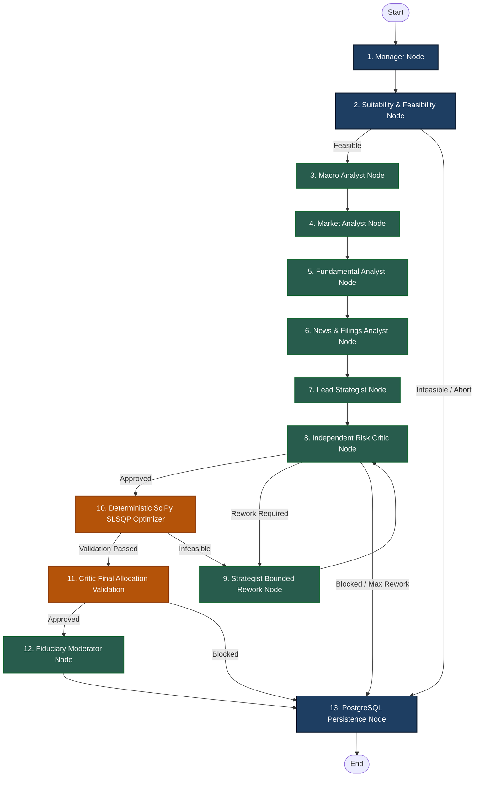

# Lucid — LangGraph Multi-Agent Architecture & Agent Data Reference Specifications

**Document Version:** 2026.11-v2.0  
**Authoritative Date:** November 8, 2026  
**Target Codebase:** Lucid Multi-Agent Pipeline (`/Users/ankur/Documents/MajorProject/app/backend/agent/`)

---

## 1. Master Agent Graph Topology

The active LangGraph pipeline compiles **13 specialized nodes** into an acyclic state machine with a bounded rework loop:



---

## 2. Mandatory Agent Data-Flow Specification Table

| # | Agent / Node Name | Python Module & Function | Exact Input State Fields | Database Queries & External APIs | Processing Mode | Exact Output State Fields | Next Destination Node |
|---|---|---|---|---|---|---|---|
| **1** | **Manager** | `nodes.py:manager_node` | `generation_request_id`, `user_profile`, `investment_amount`, `currency_code` | Reads user and request metadata from state | Deterministic | `status='running'`, `workflow_status='RUNNING'`, `current_stage='manager'`, `execution_trace` | `suitability` |
| **2** | **Suitability & Feasibility** | `nodes.py:suitability_check_node` | `user_profile`, `investment_amount`, `investment_horizon_months`, `preferences` | `db.query(Security).filter(active)` via `CandidateUniverseSelector` | Deterministic | `suitability_passed`, `suitability_notes`, `eligible_candidates` (~504), `feasibility_result` | `macro_analyst` (if passed) or `persistence` |
| **3** | **Macro Analyst** | `nodes.py:macro_analyst_node` | `eligible_candidates`, `user_prompt` | `db.query(EconomicObservation)`, `detect_market_regime()`, `^INDIAVIX` via yfinance | LLM + Rule Fallback | `macro_output`, `market_regime` (`BULL`, `NORMAL`, `VOLATILE`), `cash_buffer_pct`, `macro_evidence` | `market_analyst` |
| **4** | **Market Analyst** | `nodes.py:market_analyst_node` | `eligible_candidates`, `market_regime` | `db.query(MarketPrice)`, Nifty 50 50/200 DMA trend via yfinance | LLM + Rule Fallback | `market_output`, `market_breadth`, `nifty_trend`, `candidate_technicals` | `fundamental_analyst` |
| **5** | **Fundamental Analyst** | `nodes.py:fundamental_analyst_node` | `eligible_candidates`, `user_prompt` | `db.query(FundamentalMetric)`, ROE, PE, PB, D/E via `fundamental_research_tool` | LLM + Rule Fallback | `fundamental_output`, `vetted_securities`, `valuation_evidence`, `fiduciary_flags` | `news_analyst` |
| **6** | **News Analyst** | `nodes.py:news_analyst_node` | `eligible_candidates`, `vetted_securities` | `exchange_registry.py`, verified BSE/NSE announcements, sentiment scores | LLM + Rule Fallback | `news_output`, `governance_flags`, `verified_exchange_filings`, `management_pledge_status` | `analyst` (Lead Strategist) |
| **7** | **Lead Strategist** | `nodes.py:analyst_node` | `macro_output`, `market_output`, `fundamental_output`, `news_output`, `user_profile` | Cross-agent synthesis; calls `factor_ranking_tool` to select top 8–15 assets | LLM + Rule Fallback | `strategist_output`, `selected_candidates` (8-15), `thematic_strategy`, `target_factor_weights` | `critic` |
| **8** | **Independent Risk Critic** | `nodes.py:critic_node` | `strategist_output`, `user_profile`, `preferences` | Evaluates single-stock ceiling (≤25%), sector ceiling (≤40%), negative preferences | LLM + Rule Fallback | `critic_output`, `critic_approved` (bool), `critic_verdict_status`, `rework_instructions` | `optimizer` (if approved) or `strategist_rework` |
| **9** | **Strategist Rework** | `nodes.py:strategist_rework_node` | `rework_instructions`, `removable_tickers`, `rework_count` | Replaces criticized tickers from backup candidate pool; enforces `rework_count < 2` | Deterministic + LLM | `strategist_output` (refined), `rework_count = rework_count + 1` | `critic` (Re-audit) |
| **10** | **Deterministic Optimizer** | `nodes.py:deterministic_optimizer_node` | `selected_candidates`, `risk_category`, `investment_amount`, `cash_buffer_pct` | Computes covariance matrix $\mathbf{\Sigma}$ from `market_prices`; executes SciPy SLSQP | **Strictly Deterministic** (Zero LLM) | `allocations` ($w_i$, $Q_i$, $P_i$), `total_invested`, `unallocated_cash`, `validation_passed` | `critic_final_validation` |
| **11** | **Critic Final Validation** | `nodes.py:critic_final_validation_node` | `allocations`, `unallocated_cash`, `validation_output` | Post-optimizer audit: verifies $\sum w_i + \text{cash} = 100\%$, whole shares $Q_i \in \mathbb{Z}_{\ge 0}$, $\max(w_i) \le 25\%$ | **Strictly Deterministic** | `critic_final_output`, `can_proceed` (bool), `decision='APPROVED'` | `moderator` (if approved) or `persistence` |
| **12** | **Fiduciary Moderator** | `nodes.py:moderator_explanation_node` | `allocations`, `macro_output`, `fundamental_output`, `news_output`, `user_profile` | Synthesizes portfolio-level and stock-level explanations | LLM + Rule Fallback | `moderator_output`, `explanations` (plain-English thesis for every holding) | `persistence` |
| **13** | **Persistence** | `nodes.py:persistence_node` | Full `PortfolioAgentState` payload | Commits `portfolio_versions`, `portfolio_security_decisions`, `audit_logs` to PostgreSQL | **ACID PostgreSQL Transaction** | `status='succeeded'`, `workflow_status='COMPLETED'`, `final_recommendation` | `END` |

---

## 3. Representative Agent Input & Output JSON Payloads

### 3.1 Macro Analyst Node Input Payload
```json
{
  "market_regime": {
    "regime": "MODERATE",
    "india_vix": 14.2,
    "trend": "UPTREND",
    "cash_buffer_pct": 2.5,
    "guidance": "Balanced equity accumulation with standard 2.5% liquid buffer."
  },
  "macro_indicators": {
    "RBI_REPO_RATE": 6.50,
    "INDIA_CPI_INFLATION": 5.10,
    "INDIA_GDP_GROWTH": 7.20,
    "INDIA_10Y_GSEC_YIELD": 7.04,
    "REAL_POLICY_RATE": 1.40
  },
  "eligible_candidates_count": 504
}
```

### 3.2 Fundamental Analyst Node Output Payload (`FundamentalAnalystOutput`)
```json
{
  "execution_status": "SUCCESS",
  "model_name": "gemini-3.8-flash",
  "tool_calls": 1,
  "vetted_count": 12,
  "candidates": [
    {
      "symbol": "RELIANCE",
      "company_name": "Reliance Industries Limited",
      "sector": "Energy & Petrochemicals",
      "metrics": {
        "roe": 0.098,
        "pe": 26.4,
        "pb": 2.1,
        "debt_to_equity": 0.42,
        "dividend_yield": 0.0035,
        "beta": 0.88,
        "market_cap_crores": 1985000.0
      },
      "fiduciary_pass": true,
      "audit_note": "Integrated energy leader with robust operating cash flows and conservative leverage."
    },
    {
      "symbol": "TCS",
      "company_name": "Tata Consultancy Services Limited",
      "sector": "Information Technology",
      "metrics": {
        "roe": 0.495,
        "pe": 29.8,
        "pb": 13.2,
        "debt_to_equity": 0.01,
        "dividend_yield": 0.0185,
        "beta": 0.72,
        "market_cap_crores": 1420000.0
      },
      "fiduciary_pass": true,
      "audit_note": "Exceptional return on equity (49.5%), debt-free balance sheet, and market-leading margin stability."
    }
  ]
}
```

### 3.3 Deterministic Optimizer Output Payload (`SLSQPOptimizerOutput`)
```json
{
  "optimization_status": "OPTIMAL",
  "objective_function": "MINIMIZE_PORTFOLIO_VARIANCE_AND_MAXIMIZE_SHARPE",
  "solver": "scipy.optimize.minimize (SLSQP)",
  "total_portfolio_value": 500000.0,
  "total_equity_invested": 492054.0,
  "unallocated_cash": 7946.0,
  "cash_buffer_pct": 1.59,
  "allocations": [
    {
      "security_id": "a1b2c3d4-0001-4000-8000-000000000001",
      "symbol": "TCS",
      "company_name": "Tata Consultancy Services Limited",
      "sector_name": "Information Technology",
      "shares_quantity": 14,
      "reference_price": 3906.16,
      "allocated_amount": 54686.24,
      "target_weight_pct": 10.94,
      "fiduciary_ceiling_pct": 25.0
    },
    {
      "security_id": "a1b2c3d4-0002-4000-8000-000000000002",
      "symbol": "NESTLEIND",
      "company_name": "Nestle India Limited",
      "sector_name": "Fast Moving Consumer Goods",
      "shares_quantity": 31,
      "reference_price": 2372.76,
      "allocated_amount": 73555.56,
      "target_weight_pct": 14.71,
      "fiduciary_ceiling_pct": 25.0
    }
  ],
  "portfolio_metrics": {
    "expected_annual_return_pct": 11.90,
    "expected_annual_volatility_pct": 9.70,
    "sharpe_ratio": 0.51,
    "diversification_score": 99.3,
    "max_single_stock_weight_pct": 14.71,
    "max_sector_weight_pct": 29.80
  },
  "constraints_satisfied": {
    "integer_share_quantities": true,
    "zero_fractional_shares": true,
    "single_stock_cap_under_25pct": true,
    "sector_cap_under_40pct": true,
    "positive_cash_invariant": true
  }
}
```

---

## 4. LLM Prompt Construction & Token Optimization

### 4.1 System Instruction Architecture
Every agent that calls Gemini (`gemini-3.8-flash`) inherits a structured system prompt prefix:
```text
You are an expert SEBI-compliant Fiduciary Financial Research Specialist serving Indian retail investors.
Your duty is strict fiduciary transparency, objective risk appraisal, and zero hallucination.
CITE ONLY verifiable economic data, NSE/BSE filings, and audited financial statements provided in your context.
NEVER invent metrics, tickers, or regulatory circulars. If data is unavailable, state 'UNABLE_TO_VERIFY'.
```

### 4.2 Context Slicing & Context Trimming Rules
To eliminate token waste and guarantee responses fit within 1,024 output tokens:
1. **No Raw JSON Blobs:** Data is passed as formatted key-value bullet points (e.g. `• TCS: ROE 49.5%, PE 29.8, D/E 0.01`).
2. **Top-K Asset Filtering:** Only the top 8–15 vetted securities are passed to the Lead Strategist and Critic prompts.
3. **Structured Pydantic Extraction:** Responses are parsed into typed Pydantic models (`MacroAnalystOutput`, `CriticAgentOutput`) using strict schema validation. If parsing fails, the agent retries once before switching to deterministic rule fallback.
