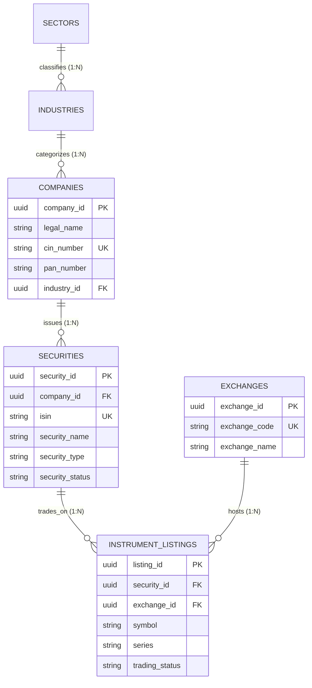

# Lucid — Database Architecture & Entity-Relationship Specifications

This document provides the authoritative structural and relational specification of Lucid's database, implemented in PostgreSQL 16 and managed via SQLAlchemy 2.0 ORM and Alembic migrations.

---

## 1. Master Relational Topology & Database Summary

Lucid's operational persistence layer consists of **62 relational tables** containing **565 structured attributes** connected by **102 foreign-key constraints** partitioned across **8 functional domains**:

| Domain # | Functional Domain Name | Table Count | Attribute Count | Primary Purpose |
|---|---|---|---|---|
| **Domain 1** | User Identity, Authentication & Security | 7 | 59 | Manages user credentials, RBAC roles, audit sessions, tokens, and multi-factor auth |
| **Domain 2** | Investor Suitability, Profiling & Goals | 5 | 47 | Captures SEBI risk psychometrics, investor suitability tiers, and financial targets |
| **Domain 3** | Security Master & Corporate Taxonomy | 9 | 56 | Canonical asset directory (2,639 securities, 2,715 listings across NSE & BSE) |
| **Domain 4** | Market Data, Fundamentals & News | 11 | 101 | Stores OHLCV prices, multi-factor scores, economic indicators, and news sentiment |
| **Domain 5** | Portfolio Engine, Optimization & Explanations | 13 | 133 | Persists portfolio versions, SLSQP decisions, integer lots, and dual-level explanations |
| **Domain 6** | Broker Accounts & Order Execution | 6 | 55 | Tracks broker connections (Zerodha, Upstox), trade orders, and historical performance |
| **Domain 7** | Demat Statement Diagnosis & Rebalancing | 4 | 38 | Ingests CAS statements, computes HHI concentration, and tracks rebalance proposals |
| **Domain 8** | Multi-Agent Telemetry & System Auditing | 7 | 76 | Records step-by-step LangGraph node executions, LLM token costs, and notifications |
| **TOTAL** | **8 Operational Domains** | **62 Tables** | **565 Columns** | **100% Relational Integrity (PostgreSQL)** |

---

## 2. Security Master Relational Model (Domain 3)

The Security Master resolves the fundamental real-world distinction between **Companies**, **Securities**, and **Exchange Listings**:

### Relational Hierarchy:
1. **`Company`**: Represents the underlying legal entity (e.g. *Tata Consultancy Services Limited*, CIN: `L22210MH1995PLC084781`).
2. **`Security`**: Represents the distinct financial asset issued by that company, globally identified by its unique International Securities Identification Number (ISIN, e.g. `INE467B01029`).
3. **`InstrumentListing`**: Represents where and how that security is actively traded on a specific exchange:
   - On the **National Stock Exchange (NSE)**, it trades under ticker `TCS` with series `EQ`.
   - On the **Bombay Stock Exchange (BSE)**, it trades under scrip code `532540` / ticker `TCS`.

### Ingestion Scale Verification:
- **Total Registered Companies**: 2,639
- **Total Securities (Unique ISINs)**: 2,639 (100% unique)
- **Total Listings**: 2,715
  - NSE Listings: 2,640 (Series EQ, BE, BZ)
  - BSE Verified Listings: 72
  - Synthetic Demo Listings: 3
- **Active Tradeable Listings**: 2,606 (Series EQ and BE on NSE)
- **Suspended Listings**: 34 (Series BZ on NSE, retained for portfolio diagnosis of legacy demat accounts)

---

## 3. Detailed Specifications of the 8 Domains

### Domain 1: User Identity & Authentication (7 Tables)
- **`app_users`**: Core user accounts, email, hashed password, role (`investor`, `admin`, `advisor`), status.
- **`user_profiles`**: Investor KYC metadata, phone number, PAN status, onboarding completion timestamp.
- **`user_preferences`**: Currency display preference, theme, notification channels.
- **`user_consents`**: Fiduciary safe harbor acknowledgement, terms of service consent, SEBI disclaimer signatures.
- **`user_verification_codes`**: Temporary OTP codes for multi-factor authentication and email confirmation.
- **`revoked_tokens`**: Blacklisted JWT token identifiers (JTI) for instantaneous session invalidation.
- **`user_profile_versions`**: Audit log capturing historical modifications to user KYC parameters.

### Domain 2: Investor Suitability & Goals (5 Tables)
- **`financial_goals`**: Individual targets (e.g., "Retirement Fund", "Down Payment"), target capital, horizon months, priority.
- **`risk_questions`**: Standardized psychometric questionnaire items evaluating loss tolerance and investment experience.
- **`risk_question_options`**: Weighted answer choices contributing to the numerical risk score.
- **`risk_assessments`**: Evaluated assessment sessions mapping raw scores to risk categories (`conservative`, `moderate`, `aggressive`).
- **`risk_assessment_answers`**: Specific answers submitted by the investor, preserving evidentiary audit trails.

### Domain 3: Security Master & Corporate Taxonomy (9 Tables)
- **`companies`**: Legal corporate entities, incorporation date, CIN, headquarter location.
- **`exchanges`**: Registered stock exchanges (NSE, BSE, DEMOEX).
- **`sectors`**: Macro sectors (e.g., Financials, Technology, Industrials, Healthcare).
- **`industries`**: Granular industries linked to parent sectors.
- **`company_industries`**: Cross-reference association mapping multi-segment conglomerates.
- **`securities`**: Unique asset definitions tied to ISINs and currency codes.
- **`instrument_listings`**: Specific exchange scrip symbols, tick sizes, lot sizes, and trading series.
- **`user_sector_preferences`**: Investor-configured sector whitelists or exclusion overrides.
- **`user_security_preferences`**: Investor-configured stock exclusions (e.g. tobacco, defense).

### Domain 4: Market Data, Prices & Fundamentals (11 Tables)
- **`data_sources`**: Ingestion registry tracking external providers (NSE, BSE, Yahoo Finance, RBI).
- **`data_ingestion_runs`**: Ingestion batch records tracking status, start/end timestamps, and record counts.
- **`data_ingestion_errors`**: Detailed ingestion failure logs storing raw payloads and HTTP status codes.
- **`source_instrument_mappings`**: Translation table bridging exchange tickers to vendor tickers (e.g., `RELIANCE` $	o$ `RELIANCE.NS`).
- **`market_prices`**: Historical and latest OHLCV price observations and trading volumes.
- **`metric_definitions`**: Canonical definitions of fundamental indicators (P/E, ROE, ROCE, D/E).
- **`fundamental_metrics`**: Normalized financial ratios and Winsorized factor scores.
- **`economic_indicators`**: Macroeconomic indicators (RBI Repo Rate, CPI Inflation, G-Sec Yield).
- **`economic_observations`**: Time-series observation values for macroeconomic indicators.
- **`market_news_articles`**: Market headlines, corporate disclosure summaries, and sentiment scores.
- **`news_article_securities`**: Many-to-many association mapping news events to impacted securities.

### Domain 5: Portfolio Engine, Optimization & Explanations (13 Tables)
- **`investor_portfolios`**: Top-level portfolio containers linking investors to investment goals.
- **`portfolio_generation_requests`**: Asynchronous generation requests tracking multi-agent execution state.
- **`strategy_definitions`**: Mathematical allocation strategy rules, risk parameters, and asset bounds.
- **`strategy_versions`**: Versioned snapshots of investment strategies over time.
- **`portfolio_versions`**: Versioned portfolio states (v1, v2, v3...) tracking revisions and rebalance bumps.
- **`portfolio_security_decisions`**: Specific holding allocations storing target weight %, integer shares, and actual invested amounts.
- **`portfolio_version_constraints`**: Snapshot of hard policy constraints enforced during optimization.
- **`evidence_items`**: Atomic financial facts (e.g. ROE=24.5%, Beta=0.85) cited during generation.
- **`recommendation_explanations`**: Dual-level text explanations (Retail Plain English + Institutional Quant Fact Sheet).
- **`explanation_evidences`**: Association table linking explanations to underlying evidence items.
- **`portfolio_validation_runs`**: Pre- and post-optimization constraint audit execution logs.
- **`portfolio_validation_results`**: Individual constraint test outcomes (e.g. Single-Stock-Cap: PASS).
- **`portfolio_scenarios`**: Stress test simulations (e.g. 2008 Crash, 2020 COVID shock, Rate Spike).

### Domain 6: Broker Accounts & Execution Models (6 Tables — Non-Custodial Decision Support)
> [!NOTE]
> Domain 6 models are defined in the schema for decision-support trade instructions and historical performance snapshots. In accordance with Lucid's non-custodial fiduciary architecture, live broker order routing is **PLANNED / DEFERRED** to preserve retail non-custodial boundaries.
- **`broker_providers`**: Registry of supported broker interfaces (Zerodha, Upstox, Groww).
- **`user_broker_accounts`**: Broker configuration metadata and account status.
- **`broker_orders`**: Individual trade orders generated for investor manual review during initial allocation or rebalancing.
- **`broker_order_events`**: Audit lifecycle events (SUBMITTED, ACKNOWLEDGED, FILLED, REJECTED).
- **`broker_executions`**: Execution fill records storing simulated or reported fill prices and quantities.
- **`portfolio_performance_snapshots`**: Periodic portfolio valuation, NAV, and return records.

### Domain 7: Demat Diagnosis & Rebalancing (4 Tables)
- **`existing_portfolios`**: Investor Demat portfolios entered manually or imported via structured CAS statement data.
- **`existing_portfolio_holdings`**: Individual parsed holding lines (ISIN, quantity, acquisition cost, market value).
- **`portfolio_diagnoses`**: Comprehensive health assessment results (HHI concentration score, sector overlap, risk flags).
- **`rebalance_suggestions`**: Specific suggested whole-share BUY/SELL trades to remediate health flags.

### Domain 8: Multi-Agent Telemetry & Auditing (7 Tables)
- **`agent_definitions`**: Registry of the 13 specialized agent nodes and their operational personas.
- **`agent_versions`**: Version control for agent prompts, toolsets, and system instructions.
- **`agent_execution_runs`**: Granular per-node execution telemetry (latency, tokens consumed, prompt, response).
- **`knowledge_documents`**: Vector-indexed fiduciary rules, SEBI guidelines, and financial research documents.
- **`user_feedbacks`**: Explicit investor feedback on generated portfolios and explanations.
- **`notifications`**: Transactional in-app notifications (Drift alerts, rebalance previews, security notices).
- **`audit_events`**: Immutable system audit trail capturing every state change, trade approval, and policy override.
