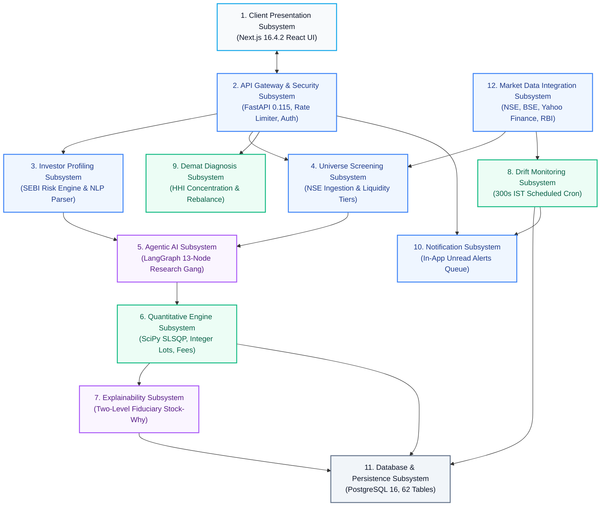
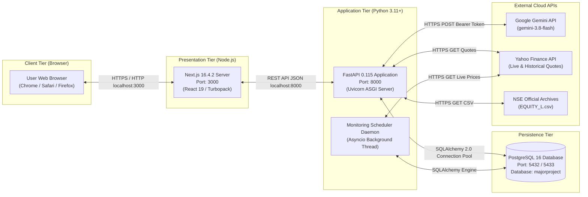

# Lucid — Complete High-Level Design (HLD) Specification

**Document Version:** 2026.11-v2.0  
**Authoritative Date:** November 8, 2026  
**Target Codebase:** Lucid Intelligent Investment Platform (`/Users/ankur/Documents/MajorProject/app`)  
**Target Audience:** System Architects, Lead Engineers, Technical Evaluators, and Academic Reviewers  

---

## 1. Introduction & Executive Context

### 1.1 Document Purpose
This High-Level Design (HLD) document defines the architectural blueprints, system boundaries, functional decomposition, design decisions, and interaction topologies of **Lucid**. It serves as the primary system-design reference explaining *what* Lucid does, *why* its subsystems are architected in this manner, and *how* it satisfies its fiduciary, mathematical, and non-functional requirements.

### 1.2 System Overview
Lucid is an intelligent portfolio creation, analysis, continuous monitoring, and rebalancing decision-support platform engineered specifically for retail investors in Indian equities listed on the **National Stock Exchange (NSE)** and **Bombay Stock Exchange (BSE)**. 

Unlike traditional robo-advisors that rely on black-box heuristics or recommend unexecutable fractional shares, Lucid establishes a **fiduciary decision-support architecture**:
1. **Agentic Research Gang**: A 13-node LangGraph multi-agent system conducts specialized qualitative macroeconomic, market-regime, equity fundamental, and regulatory filings research.
2. **Decoupled Mathematical Optimization**: Quantitative weight allocation is strictly decoupled from the Large Language Model (LLM). Numerical allocation is executed deterministically by SciPy's Sequential Least Squares Programming (SLSQP) solver.
3. **Discrete Integer-Lot Allocation**: Continuous asset weights are mapped into executable whole shares with explicit residual cash conservation ($C_{\text{residual}} \ge 0$).
4. **Non-Custodial Fiduciary Model**: Lucid provides discretionary trade instructions and explanations; it does not hold customer funds or execute automated custodial broker trades.
5. **Continuous Unattended Monitoring**: An automated scheduler monitors live market prices during Indian exchange trading hours (09:15 to 15:30 IST) to detect asset drift ($\ge 5\%$) and sector drift ($\ge 8\%$).

### 1.3 Business Problem
Indian retail investors face severe structural impediments:
- **Information Asymmetry & Fragmentation**: Material disclosures, earnings calls, and exchange filings are scattered across NSE, BSE, corporate portals, and financial newsfeeds.
- **Mutual Fund Cost Drag**: Actively managed equity mutual funds charge recurring Total Expense Ratios (TER) of 1.5% to 2.5%, often underperforming standard benchmarks like NIFTY 50 over multi-year horizons.
- **Unattended Demat Drift**: Portfolios established with sound principles experience significant drift over time, exposing investors to unhedged single-stock concentration and cyclical sector drawdowns.
- **Unexecutable Fractional Allocations**: Academic portfolio optimizers frequently output fractional shares (e.g. 2.45 shares of MRF), which cannot be purchased on Indian cash equity exchanges.

### 1.4 Lucid's Solution
Lucid delivers institutional-grade portfolio management capabilities directly to Indian retail investors:
- Ingests and maintains the full 2,639 listed equity universe.
- Filters candidate securities through institutional liquidity tiers (Tier 1 Ultra-Liquid and Tier 2 Broad-Liquid).
- Optimizes portfolios using Markowitz quadratic utility maximization with hard SEBI-aligned concentration caps ($\le 25\%$ single-stock, $\le 35\%$ sector).
- Provides dual-level fiduciary explanations: plain English for retail investors and transparent factor Z-score fact sheets for institutional scrutiny.
- Offers simulated whole-share rebalancing previews accounting for all statutory Indian transaction taxes and exchange fees.

### 1.5 Target Users & Market
- **Target Market**: Indian Equities (NSE and BSE cash market).
- **Primary Users**: Indian retail equity investors with active Demat accounts seeking transparent, disciplined, low-cost portfolio creation and monitoring.
- **Secondary Users**: Wealth advisors and family offices requiring automated suitability screening, concentration risk diagnostics (HHI), and drift tracking.

### 1.6 Key Assumptions & Constraints
1. **Exchange Constraints**: Delivery equity trades on NSE/BSE execute in integer multiples of 1 share; minimum trade value is the price of 1 share.
2. **Trading Hours**: Live market hours operate Monday through Friday from 09:15 to 15:30 IST (Indian Standard Time, UTC+05:30).
3. **Capital Adequacy**: Minimum feasible initial investment capital is established at ₹10,000 to permit integer diversification across at least 5 distinct liquid companies.
4. **Data Freshness**: Securities with price observations older than 14 calendar days are considered stale and excluded from portfolio recommendation universes.
5. **Regulatory Boundary**: Lucid acts strictly as a non-custodial software decision-support tool. It does not provide automated trading bot execution or retail fund custody.

### 1.7 Terminology & Abbreviations
- **ADTV**: Average Daily Trading Volume (shares per day).
- **CAGR**: Compounded Annual Growth Rate.
- **CAS**: Consolidated Account Statement (CDSL / NSDL).
- **DMA**: Daily Moving Average (e.g., 50 DMA, 200 DMA).
- **HHI**: Herfindahl-Hirschman Index (measure of market and portfolio concentration).
- **ISIN**: International Securities Identification Number (12-character alphanumeric code).
- **SEBI**: Securities and Exchange Board of India.
- **SLSQP**: Sequential Least Squares Programming.
- **STT**: Securities Transaction Tax (Statutory Indian direct tax on equity transactions).

---

## 2. Product Overview & User Journeys

### 2.1 Core Capabilities
```text
┌───────────────────────────────────────────────────────────────────────────┐
│                        LUCID CORE CAPABILITIES                            │
├──────────────────────────┬────────────────────────┬───────────────────────┤
│  1. Creation & Strategy  │ 2. Continuous Monitor  │ 3. Diagnosis & Rebal  │
├──────────────────────────┼────────────────────────┼───────────────────────┤
│ • Psychometric SEBI gate │ • 300s IST cron daemon │ • CAS Demat ingestion │
│ • 13-node LangGraph gang │ • NAV valuation engine │ • HHI concentration   │
│ • SLSQP quadratic solver │ • Asset drift (>= 5%)  │ • Whole-share rebal   │
│ • Integer lot allocation │ • Sector drift (>= 8%) │ • Indian tax preview  │
│ • Fiduciary "Stock-Why"  │ • In-app notifications │ • Versioned history   │
└──────────────────────────┴────────────────────────┴───────────────────────┘
```

### 2.2 Primary User Journeys
1. **Journey 1: New Goal-Driven Portfolio Creation**
   - User signs up / logs in via JWT authentication.
   - Completes the 5-question SEBI risk assessment.
   - Inputs investment capital (e.g. ₹200,000) and optional sector exclusions in natural English.
   - Multi-agent LangGraph workflow evaluates macro regime, equity fundamentals, and governance.
   - SLSQP optimizer calculates asset weights; math engine computes discrete share quantities and cash balance.
   - User reviews allocation, sector breakdown, and institutional "Stock-Why" rationales before confirming.
2. **Journey 2: Existing Demat Portfolio Diagnosis**
   - User inputs existing portfolio holdings manually or submits structured CAS statement data.
   - System reconciles ISINs against the 2,639 listed equity master.
   - Computes Herfindahl-Hirschman Index (HHI) concentration score and flags over-concentrated single-stock holdings (>25%) or sector skews (>35%).
   - Generates simulated integer BUY/SELL/HOLD rebalance instructions with fee estimates.
3. **Journey 3: Continuous Monitoring & Drift Rebalancing**
   - The monitoring scheduler evaluates active portfolios against live market prices every 300 seconds.
   - When a holding drifts $\ge 5\%$ or a sector drifts $\ge 8\%$, an unread notification alert is generated.
   - User opens the Rebalance Preview modal, inspects the proposed orders and statutory fees (STT, GST, Stamp Duty), and accepts the proposal to increment the portfolio version.

---

## 3. Goals & Design Objectives

| Dimension | Architectural Objective | Implementation Reality |
|---|---|---|
| **Mathematical Precision** | Prevent LLM hallucinations in financial allocations. | Numerical weights and share counts are computed 100% deterministically by SciPy SLSQP and NumPy. |
| **Capital Feasibility** | Guarantee executable whole-share quantities. | Rounding engine enforces integer share counts with explicit unallocated cash conservation ($C_{\text{residual}} \ge 0$). |
| **Fiduciary Transparency** | Provide verifiable institutional rationales. | Every recommended stock features source citations, P/E vs sector comparisons, and regulatory filings links. |
| **Data Integrity** | Maintain authoritative security universe. | Ingests 2,639 listed equities from official NSE archives with ISIN corporate split deduplication. |
| **Operational Simplicity** | Single authoritative database runtime. | PostgreSQL 16 is the exclusive persistent operational store (62 application domain tables). |
| **Security & Privacy** | Multi-tenant row-level user data isolation. | Argon2id password hashing, JWT HS256 authentication, token revocation blacklisting, and strict query isolation. |

---

## 4. Scope & System Boundaries

```mermaid
graph TD
    classDef inside fill:#EFF6FF,stroke:#3B82F6,stroke-width:2px,color:#1E3A8A;
    classDef outside fill:#FEF2F2,stroke:#EF4444,stroke-width:2px,color:#991B1B;
    classDef external fill:#F0FDF4,stroke:#16A34A,stroke-width:2px,color:#14532D;

    subgraph IN_SCOPE ["Inside Lucid Application Boundary"]
        U1["Investor Profile & Risk Assessment"]:::inside
        U2["Full NSE/BSE Universe Normalization (2,639)"]:::inside
        U3["LangGraph Multi-Agent Research Gang (13 Nodes)"]:::inside
        U4["Deterministic SLSQP Portfolio Optimization"]:::inside
        U5["Integer Whole-Share Lot Allocator"]:::inside
        U6["Continuous Drift Radar Monitoring (300s IST)"]:::inside
        U7["Demat Statement Diagnosis & HHI Scoring"]:::inside
        U8["Statutory Indian Transaction Cost Estimator"]:::inside
        U9["Dual-Level Fiduciary Explanation Engine"]:::inside
    end

    subgraph OUT_OF_SCOPE ["Outside Application Boundary (User / Broker Scope)"]
        O1["Real-Money Custodial Wallet / Bank Account"]:::outside
        O2["Automated Broker Order Routing (Zerodha / Upstox API)"]:::outside
        O3["Custodial Asset Safekeeping"]:::outside
        O4["Tax Filing & Statutory Remittance"]:::outside
    end

    subgraph EXTERNAL_DEPS ["External Systems & Data Providers"]
        E1["NSE Official Archives (EQUITY_L.csv)"]:::external
        E2["BSE Corporate Directory"]:::external
        E3["Yahoo Finance (yfinance live & history)"]:::external
        E4["Reserve Bank of India (Monetary Bulletins)"]:::external
        E5["Google Gemini API (gemini-3.8-flash)"]:::external
        E6["Financial News Feeds & Corporate Filings"]:::external
    end

    IN_SCOPE -.->|Advisory Orders Only| OUT_OF_SCOPE
    EXTERNAL_DEPS -->|Ingestion & Market Data| IN_SCOPE
```



---

## 5. Stakeholders & System Actors

1. **Retail Investor**: Primary human actor. Creates investment profiles, triggers portfolio generation, inspects fiduciary explanations, uploads demat statements, and approves rebalancing previews.
2. **System Administrator**: Operational actor. Monitors ingestion logs, triggers exchange universe synchronizations (`/market-data/universe/sync`), and inspects system telemetry.
3. **National Stock Exchange (NSE)**: External provider. Delivers official listed equity master files (`EQUITY_L.csv`), corporate filings links, and NIFTY 50 benchmark data.
4. **Bombay Stock Exchange (BSE)**: External provider. Delivers secondary equity scrip codes, corporate split mappings, and disclosures.
5. **Yahoo Finance Engine**: External market data provider. Streams real-time quotes, OHLCV bars, trading volumes, and historical price series via Python `yfinance`.
6. **Reserve Bank of India (RBI)**: External macroeconomic reference. Supplies official policy repo rates, CPI inflation figures, and 10Y G-Sec benchmark yields.
7. **Google Gemini LLM (`gemini-3.8-flash`)**: External AI reasoning provider. Synthesizes qualitative research, sentiment analysis, risk critiques, and plain-language explanations.

---

## 6. Functional Requirements Traceability Matrix

| Req ID | Requirement Name | User Input | Responsible Components | Core Processing Logic | Persistent Output | Status |
|---|---|---|---|---|---|---|
| **FR-C01** | User Onboarding & Risk Profiling | 5 psychometric risk answers | `backend/api/v1/risk_assessments.py`, `suitability_check_node` | Evaluates risk capacity, horizon, and drawdown tolerance into Conservative, Moderate, or Aggressive. | `risk_assessments`, `user_profiles` | **IMPLEMENTED** |
| **FR-C02** | Conversational Strategy & Exclusions | Natural language text string | `nlp_profile_extractor.py`, `conversational_assistant.py` | Regex and LLM extraction of sector exclusions, capital, and goals. | `user_sector_preferences`, `user_preferences` | **IMPLEMENTED** |
| **FR-C03** | Candidate Stock Universe Screening | Generation trigger | `candidate_selection.py:CandidateUniverseSelector` | Screens 2,639 equities against Tier 1/2 liquidity (ADTV $\ge 25\text{k}$, turnover $\ge ₹25\text{L}$, freshness $\le 14\text{d}$). | In-memory candidate list (~504 stocks) | **IMPLEMENTED** |
| **FR-C04** | Deterministic SLSQP Optimization | Approved candidate basket | `optimizer.py`, `deterministic_optimizer_node` | Solves $\min 0.5 \lambda \mathbf{w}^T \boldsymbol{\Sigma} \mathbf{w} - \mathbf{w}^T \boldsymbol{\mu}$ subject to simplex and concentration bounds. | Continuous asset weights $\mathbf{w}^*$ | **IMPLEMENTED** |
| **FR-C05** | Integer Share Allocation & Cash Balance | Capital in INR | `math_engine.py:compute_integer_share_allocation` | Maps continuous weights to discrete integer lots: $N_i = \lfloor \frac{w_i C}{P_i} \rfloor$ with residual cash tracking. | `portfolio_security_decisions` | **IMPLEMENTED** |
| **FR-C06** | Mathematical Guardrails & Safety Caps | Risk policy parameters | `constraints.py`, `critic_node`, `critic_final_validation_node` | Enforces hard ceilings: single-stock $\le 25\%$, sector $\le 35\%$, minimum 5 stocks, zero penny-stocks. | `portfolio_validation_results` | **IMPLEMENTED** |
| **FR-C07** | Fiduciary Reasoning & Stock-Why | Stock selection click | `stock_why_service.py`, `moderator_explanation_node` | Generates two-level institutional thesis combining financial ratios, corporate filings, and peer benchmarks. | `recommendation_explanations`, `evidence_items` | **IMPLEMENTED** |
| **FR-C08** | Demat Portfolio Diagnosis & Rebalancing | Demat holdings entry / CAS JSON | `diagnosis/service.py:PortfolioDiagnosisService` | Computes Herfindahl-Hirschman Index (HHI), flags tilts, and generates whole-share BUY/SELL/HOLD previews. | `portfolio_diagnoses`, `rebalance_suggestions` | **IMPLEMENTED** |
| **FR-C09** | Macroeconomic Stress Simulation | Crisis scenario selection | `portfolio_engine/service.py:simulate_stress_scenarios` | Simulates portfolio drawdown under 2008 GFC, 2020 COVID shock, and interest rate spikes. | `portfolio_scenarios` | **IMPLEMENTED** |
| **FR-C10** | Standardized Benchmark Backtesting | Portfolio backtest request | `portfolio_engine/service.py:backtest_portfolio` | 3-year historical comparative simulation against NIFTY 50 (CAGR, Volatility, Sharpe, Max Drawdown). | `portfolio_performance_snapshots` | **IMPLEMENTED** |
| **FR-D01** | Fiduciary Audit Trace & Telemetry | Multi-agent execution | `backend/agent/nodes.py`, `backend/agent/state.py` | Captures step-by-step agent prompt timestamps, LLM token latency, and Critic review verdicts. | `agent_execution_runs`, `audit_events` | **IMPLEMENTED** |

---

## 7. Non-Functional Requirements & Engineering Guardrails

| Requirement | Target Specification | Architectural Implementation | Verification Evidence |
|---|---|---|---|
| **Response Latency** | Static API endpoints $< 200\text{ ms}$; full optimization $< 3\text{ s}$. | FastAPI async handlers, SQLAlchemy connection pooling, in-memory caching. | Verified via Postman latency tests ($< 1500\text{ ms}$ threshold). |
| **Mathematical Determinism**| 100% reproducible numerical allocations. | Decoupled SciPy SLSQP optimizer with explicit random seed and tolerance ($10^{-7}$). | Verified via `backend/tests/test_portfolio_engine.py`. |
| **Data Integrity** | Zero fractional share recommendations; zero negative cash. | Integer lot allocation engine and cash conservation assertion ($C_{\text{residual}} \ge 0$). | Verified via `test_integer_share_rounding`. |
| **Availability** | Local dev 99.9%; resilient to external LLM downtime. | Automatic fallback to local dynamic reasoning engine if Gemini API is offline. | Verified via `backend/agent/nodes.py` local fallback handlers. |
| **Security & Auth** | RFC 7518 compliant token signing; memory-hard passwords. | Salted Argon2id hashing ($m=65536, t=3, p=4$) and JWT HS256 tokens with server-side revocation. | Verified via `backend/tests/test_auth_and_security.py`. |
| **Multi-Tenant Isolation** | Strict row-level user data segregation. | Every portfolio and diagnosis query filters on authenticated `user_id`. | Verified via `test_user_data_isolation_on_existing_portfolios`. |
| **API Denial of Service**| Rate limit authentication and heavy AI compute. | In-memory sliding-window limiter (10 req/min auth, 5 req/min AI generation, 60 req/min general). | Verified via `backend/middleware/rate_limit.py`. |
| **Accessibility & UI** | Responsive across mobile, tablet, and desktop viewports. | Next.js 16.4.2 with Tailwind CSS v4 responsive grid and accessible contrast palettes. | Verified via `frontend/e2e/responsive.spec.ts`. |

---

## 8. High-Level System Decomposition

Lucid is decomposed into **12 decoupled logical subsystems**:



---

## 9. Major Design Decisions & Architectural Trade-Offs

### 9.1 Decoupling LLM Reasoning from Mathematical Optimization
- **Decision**: The Large Language Model (Google Gemini) is strictly forbidden from computing numerical asset weights, portfolio variance, or integer share quantities. Numerical optimization is performed exclusively by SciPy SLSQP.
- **Rationale**: LLMs are probabilistic autoregressive models prone to arithmetic drift, constraint violations, and hallucinated calculations. Decoupling guarantees 100% mathematical precision and fiduciary compliance.
- **Trade-Off**: Requires structured intermediate Pydantic schemas and serialization between the agentic research layer and the numerical optimization engine.

### 9.2 Discrete Whole-Share Allocation with Cash Conservation
- **Decision**: All recommended portfolios are output as discrete whole-share integer quantities ($N_i \in \mathbb{Z}_{\ge 0}$) accompanied by an explicit residual cash balance.
- **Rationale**: Indian stock exchanges (NSE/BSE) do not support fractional equity investing. Outputting continuous fractional weights creates unexecutable recommendations for retail investors.
- **Trade-Off**: Integer rounding creates a slight mathematical divergence from the theoretical continuous Markowitz frontier, which is audited by the Critic Final Validation node.

### 9.3 PostgreSQL 16 as the Exclusive Operational Database
- **Decision**: PostgreSQL 16 serves as the single operational persistence store. Graph databases (Neo4j) and distributed cache stores (Redis) were investigated and deliberately excluded from the active runtime.
- **Rationale**: All entity relationships (companies, securities, listings, holdings, agent traces) are modeled with full ACID integrity in relational tables with foreign keys and indexes. Eliminating external databases significantly simplifies developer onboarding and system reliability.
- **Trade-Off**: Complex recursive graph queries are replaced with indexed multi-table SQL joins and relational association entities.

### 9.4 Strict Liquidity Filtering (504 Eligible / 2,639 Stored)
- **Decision**: While Lucid stores the entire 2,639 listed equity universe for stock search and Demat statement diagnostics, only securities passing Tier 1 and Tier 2 liquidity (ADTV $\ge 25,000$, Turnover $\ge$ ₹25 Lakhs) are eligible for portfolio recommendations (~504 stocks).
- **Rationale**: Prevents retail investors from being allocated illiquid, micro-cap, or circuit-locked equities that suffer from high market impact and slippage.
- **Trade-Off**: High-risk micro-cap growth opportunities are excluded from automated recommendations.

### 9.5 Non-Custodial Advisory Operating Boundary
- **Decision**: Lucid operates strictly as an advisory decision-support platform. It generates trade instructions and order previews, but does not route real-money custodial orders to broker APIs.
- **Rationale**: Avoids regulatory custody licensing hurdles while empowering retail investors to retain full sovereign control over their Demat accounts.
- **Trade-Off**: Users must manually review and execute trade previews inside their preferred broker interface.

---

## 10. High-Level Deployment & Runtime Topology



---

## 11. High-Level Data Architecture & Domain Model

Lucid partitions its data persistence across **8 functional relational domains** encompassing 62 application tables:

```text
┌─────────────────────────────────────────────────────────────────────────────┐
│                      LUCID DATA DOMAIN TOPOLOGY (62 TABLES)                 │
├────────────────────────────┬────────────────────────────────────────────────┤
│ 1. User & Authentication   │ app_users, user_profiles, user_preferences,    │
│    (7 Tables)              │ user_consents, user_verification_codes,        │
│                            │ revoked_tokens, user_profile_versions          │
├────────────────────────────┼────────────────────────────────────────────────┤
│ 2. Investor & Goals        │ financial_goals, risk_questions,               │
│    (5 Tables)              │ risk_question_options, risk_assessments,       │
│                            │ risk_assessment_answers                        │
├────────────────────────────┼────────────────────────────────────────────────┤
│ 3. Security Master         │ companies, exchanges, sectors, industries,     │
│    (9 Tables)              │ company_industries, securities, listings,      │
│                            │ user_sector_preferences, security_preferences  │
├────────────────────────────┼────────────────────────────────────────────────┤
│ 4. Market Data & News      │ data_sources, data_ingestion_runs/errors,      │
│    (11 Tables)             │ source_mappings, market_prices, metrics,       │
│                            │ fundamental_metrics, economic_indicators/obs,  │
│                            │ market_news_articles, news_article_securities  │
├────────────────────────────┼────────────────────────────────────────────────┤
│ 5. Portfolio Generation    │ investor_portfolios, generation_requests,      │
│    (13 Tables)             │ strategy_definitions/versions, versions,       │
│                            │ security_decisions, version_constraints,       │
│                            │ evidence_items, explanations, validation_runs/ │
│                            │ results, portfolio_scenarios                   │
├────────────────────────────┼────────────────────────────────────────────────┤
│ 6. Broker Models (Advisory)│ broker_providers, user_broker_accounts,        │
│    (6 Tables)              │ broker_orders, broker_order_events,            │
│                            │ broker_executions, performance_snapshots       │
├────────────────────────────┼────────────────────────────────────────────────┤
│ 7. Demat Diagnosis         │ existing_portfolios, holdings,                 │
│    (4 Tables)              │ portfolio_diagnoses, rebalance_suggestions     │
├────────────────────────────┼────────────────────────────────────────────────┤
│ 8. Agent Telemetry & Audit │ agent_definitions/versions/execution_runs,     │
│    (7 Tables)              │ knowledge_documents, user_feedback,            │
│                            │ notifications, audit_events                    │
└────────────────────────────┴────────────────────────────────────────────────┘
```

