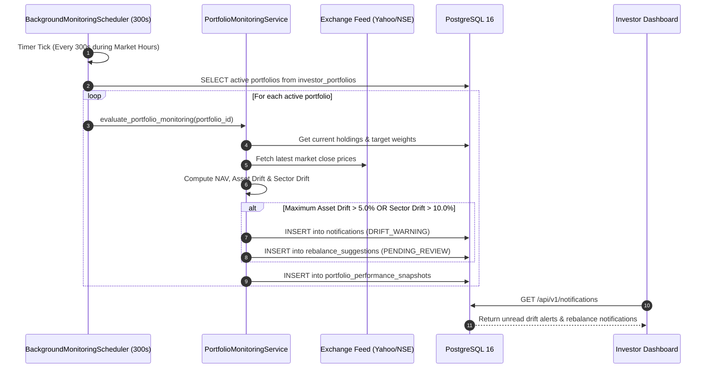

# Lucid — Complete Low-Level Design (LLD) Specification

**Document Version:** 2026.11-v2.0  
**Authoritative Date:** 2026-11-08  
**Target Audience:** Software Engineers, Backend/AI Developers, Quantitative Developers, Database Administrators, System Integrators  
**Scope:** Module-, class-, function-, method-, data-structure-, API-, database-, and algorithm-level implementation specification for the Lucid Indian Equity Portfolio Management Platform.

---

## Executive Summary & Document Purpose

This Low-Level Design (LLD) document serves as the comprehensive implementation reference for **Lucid**, an intelligent investment portfolio creation, analysis, continuous monitoring, and rebalancing platform tailored for Indian retail investors in NSE/BSE equities. 

While the [High-Level Design (HLD)](file:///Users/ankur/Documents/MajorProject/app/HIGH_LEVEL_DESIGN.md) specifies *what* the system does and *why* architectural decisions were selected, this LLD specifies *how* each subsystem, module, class, function, database relation, and mathematical algorithm is concretely implemented in the codebase.

Every component, interface, and data contract documented herein corresponds directly to the source code located in `/Users/ankur/Documents/MajorProject/app`. Unused technologies (Neo4j, Redis, Celery, FAISS, and local Ollama) have been strictly excised from the active architecture.

---

## Table of Contents

1. [Codebase Structure & Repository Layout](#1-codebase-structure--repository-layout)
2. [Backend Entry Point & Application Initialization](#2-backend-entry-point--application-initialization)
3. [API Design & Implementation (82 Endpoints Inventory)](#3-api-design--implementation-82-endpoints-inventory)
4. [Frontend Architecture & Component Implementation](#4-frontend-architecture--component-implementation)
5. [Service-Layer Design & Class Specifications](#5-service-layer-design--class-specifications)
6. [Agent Node Implementation & Execution Mechanics](#6-agent-node-implementation--execution-mechanics)
7. [Database Low-Level Design (62-Table Specification)](#7-database-low-level-design-62-table-specification)
8. [Detailed API Contracts & Pydantic Schemas](#8-detailed-api-contracts--pydantic-schemas)
9. [Algorithm & Quantitative Business-Logic Design](#9-algorithm--quantitative-business-logic-design)
10. [Error Handling, Validation & Exception Design](#10-error-handling-validation--exception-design)
11. [Security Implementation Details & Cryptographic Guardrails](#11-security-implementation-details--cryptographic-guardrails)
12. [Concurrency, Background Processing & Session Scoping](#12-concurrency-background-processing--session-scoping)
13. [LLD Sequence & Component Interaction Diagrams](#13-lld-sequence--component-interaction-diagrams)

---

## 1. Codebase Structure & Repository Layout

The Lucid repository is organized as a clean, highly cohesive monorepo. The backend uses Python 3.11+ with FastAPI, SQLAlchemy 2.0, and LangGraph; the frontend is built on Next.js 16.4.2 with React 19 and TailwindCSS.

### 1.1 Directory Tree

```
app/
├── backend/                                # Core Backend Application
│   ├── main.py                             # FastAPI application factory, lifespan, CORS, middleware
│   ├── config.py                           # Pydantic Settings, environment loading, Argon2id config
│   ├── database.py                         # SQLAlchemy engine, sessionmaker, scoped session generator
│   ├── api/                                # REST API Presentation Layer
│   │   └── v1/                             # Version 1 Modular Routers (9 Routers, 82 Endpoints)
│   │       ├── __init__.py                 # Router aggregation (api_v1_router)
│   │       ├── auth.py                     # Argon2id authentication, JWT issuance, token revocation
│   │       ├── diagnosis.py                # Demat portfolio upload, CSV parser, HHI analysis, copilot
│   │       ├── goals.py                    # Investor financial goals CRUD and horizon tracking
│   │       ├── links.py                    # Regulatory disclosures and URL integrity checks
│   │       ├── market_data.py              # NSE universe sync, price lookups, macro indicators
│   │       ├── notifications.py            # In-app notifications, unread badges, mark-read
│   │       ├── portfolios.py               # Portfolio generation, versioning, monitoring, rebalancing
│   │       ├── profile.py                  # Investor profile, NLP extraction, risk history
│   │       └── risk_assessments.py         # 8-question psychometric risk profiler
│   ├── agent/                              # LangGraph Multi-Agent System
│   │   ├── __init__.py                     # Agent module exports
│   │   ├── graph.py                        # StateGraph assembly, conditional routing, rework loops
│   │   ├── nodes.py                        # 13 agent node implementations (Manager to Persistence)
│   │   ├── schemas.py                      # Strict Pydantic agent schemas & evidence models
│   │   ├── state.py                        # PortfolioAgentState TypedDict (35 typed fields)
│   │   └── tools.py                        # Research tools, SQL queries, factor screeners
│   ├── portfolio_engine/                   # Quantitative Financial Mathematics & Optimization
│   │   ├── allocation_rounding.py          # Whole-share integer rounding & residual cash allocator
│   │   ├── candidate_selection.py          # Liquidity, market-cap, and financial health screening
│   │   ├── constraints.py                  # Single-stock, sector, cash, and turnover bounds
│   │   ├── conversational_assistant.py     # Conversational assistant & stock thesis provider
│   │   ├── diagnosis_copilot_service.py    # AI copilot service for Demat diagnosis queries
│   │   ├── factors.py                      # Winsorized Z-score multi-factor composite models
│   │   ├── feasibility.py                  # Pre-optimization feasibility and capital checks
│   │   ├── math_engine.py                  # Covariance, volatility, Sharpe, Sortino computation
│   │   ├── monitoring_service.py           # NAV valuation, asset/sector drift, tracking error
│   │   ├── nlp_profile_extractor.py        # Natural-language investor preference extractor
│   │   ├── optimizer.py                    # SciPy SLSQP mean-variance numerical optimizer
│   │   ├── policy.py                       # SEBI-aligned risk capacity vs willingness constraints
│   │   ├── rebalancing_service.py          # Minimum turnover trade generator & friction preview
│   │   ├── risk_metrics.py                 # Value at Risk (VaR), CVaR, Max Drawdown
│   │   ├── service.py                      # High-level portfolio generation orchestrator
│   │   ├── stock_why_service.py            # Two-level stock-specific justification synthesis
│   │   ├── transaction_costs.py            # Indian statutory friction (STT, GST, SEBI fee, Stamp)
│   │   └── validators.py                   # Post-optimization hard constraint verification
│   ├── market_data/                        # Market Data Ingestion & Regime Detection
│   │   ├── exchange_universe_sync.py       # NSE EQUITY_L.csv full universe synchronization (2,639 stocks)
│   │   └── regime.py                       # India VIX & Nifty 50 moving-average regime classifier
│   ├── services/                           # Auxiliary Micro-Services
│   │   ├── account_deletion_service.py     # Cascading GDPR/DPDP compliant user account purge
│   │   ├── company_resolution_service.py   # Trigram/Levenshtein company name to ISIN resolver
│   │   ├── exchange_registry.py            # Exchange trading calendars and holiday schedules
│   │   ├── financial_number_parser.py     # Indian numeric notation parser (Crore, Lakh, K, %)
│   │   ├── link_verification_service.py    # Official regulatory URL integrity validator
│   │   ├── monitoring_scheduler.py         # Background asyncio monitoring loop (300s cycle)
│   │   └── notification_service.py         # System alert generator, read receipt tracker
│   ├── middleware/                         # Custom Middlewares
│   │   └── rate_limit.py                   # In-memory sliding-window token bucket rate limiter
│   └── models/                             # SQLAlchemy 2.0 Relational Data Models (62 Domain Tables)
├── frontend/                               # Next.js 16.4.2 React 19 Client
│   ├── src/
│   │   ├── app/                            # App Router (layout.tsx, page.tsx)
│   │   ├── components/                     # 24 Modular React 19 Components & Modals
│   │   └── lib/                            # API client (Axios), design tokens, link helpers
├── database/                               # Migrations & Seed Dumps
├── scripts/                                # Verification & Operational Scripts
│   ├── validate_documentation.py           # Multi-step repo consistency validator
│   ├── verify_setup.py                     # System dependency & database check
│   └── validate_env.py                     # Environment variable & secret auditor
└── docs/                                   # Architectural & Design Assets
```

### 1.2 Module Responsibility & Execution Roles

| Module / Directory | Primary Responsibility | Key Classes / Functions | Primary Dependencies | Downstream Consumers |
|---|---|---|---|---|
| `backend/main.py` | FastAPI app creation, lifespan, middleware registration | `lifespan()`, `add_security_headers()`, `app` | FastAPI, Starlette, SQLAlchemy | ASGI Server (Uvicorn), Web Client |
| `backend/config.py` | Configuration settings, secret validation, Argon2id params | `Settings`, `validate_security_keys()` | Pydantic BaseSettings, pydantic | Entire backend application |
| `backend/database.py` | Database engine pooling, scoped session generator | `engine`, `SessionLocal`, `get_db()` | SQLAlchemy, psycopg2 | All API routes, services, agents |
| `backend/api/v1/auth.py` | User onboarding, Argon2id authentication, JWT, token revocation | `login_user()`, `register_user()`, `logout_user()` | Argon2id (`argon2-cffi`), PyJWT, DB | Frontend AuthView, HTTP clients |
| `backend/api/v1/portfolios.py` | Portfolio generation, versioning, rebalance, stock-why | `generate_portfolio()`, `get_stock_why()`, `apply_rebalance()` | LangGraph, Math Engine, DB | Frontend PortfolioGenerator, HoldingsView |
| `backend/api/v1/diagnosis.py` | Demat CSV import, HHI concentration, health diagnosis | `upload_holdings_csv()`, `analyze_portfolio()` | Pandas, Math Engine, DB | Frontend DiagnosisView |
| `backend/agent/graph.py` | LangGraph StateGraph assembly, conditional routing, rework loops | `create_portfolio_graph()` | LangGraph, `backend/agent/nodes.py` | `backend/portfolio_engine/service.py` |
| `backend/agent/nodes.py` | 13 multi-agent nodes (Manager to Persistence) | `manager_node()`, `critic_node()`, `persistence_node()` | ChatGoogleGenerativeAI, Pydantic, DB | LangGraph orchestrator |
| `backend/portfolio_engine/optimizer.py` | SciPy SLSQP numerical portfolio optimization | `optimize_portfolio_allocations()` | `scipy.optimize`, NumPy | Agent Optimizer Node, Rebalancing |
| `backend/portfolio_engine/allocation_rounding.py` | Discrete whole-share integer lot rounding & cash conservation | `calculate_integer_shares_and_amounts()` | Python standard math | Agent Optimizer Node, Rebalancing |
| `backend/services/monitoring_scheduler.py` | Unattended background portfolio monitoring daemon | `BackgroundMonitoringScheduler.run_cycle()` | Threading, SQLAlchemy | Continuous automated monitoring |

---

## 2. Backend Entry Point & Application Initialization

The backend application is initialized in `backend/main.py`. It uses the modern FastAPI ASGI framework with async lifespan event handling, strict HTTP security headers, CORS origin verification, and in-memory sliding-window rate limiting.

### 2.1 Application Lifespan (`lifespan`)

The application startup and shutdown lifecycle is managed via an `@asynccontextmanager` generator:

```python
@asynccontextmanager
async def lifespan(app: FastAPI):
    # 1. Startup Logging
    print(f"🚀 Starting Lucid Backend ({settings.app_env})")
    print(f"   LLM Provider: {settings.llm_provider} ({settings.llm_model})")
    print(f"   PostgreSQL: {settings.postgres_host}:{settings.postgres_port}/{settings.postgres_db}")

    # 2. Validate Security Keys in non-dev environments
    settings.validate_security_keys()

    # 3. Verify Database Connectivity & Count Active Tables
    try:
        with engine.connect() as conn:
            table_count = conn.execute(
                text("SELECT count(*) FROM information_schema.tables WHERE table_schema = 'public' AND table_type = 'BASE TABLE'")
            ).scalar()
            print(f"   ✅ PostgreSQL Connected: {table_count} tables active")
    except Exception as exc:
        print(f"   ⚠️ PostgreSQL Connection warning: {exc}")

    # 4. Launch Unattended Background Portfolio Monitoring Scheduler
    scheduler = None
    try:
        from backend.services.monitoring_scheduler import BackgroundMonitoringScheduler
        scheduler = BackgroundMonitoringScheduler(interval_seconds=300)
        scheduler.start()
        print("   ✅ Background Monitoring Scheduler Active (300s cycle, IST 09:15-15:30 window)")
    except Exception as exc:
        print(f"   ⚠️ Background Monitoring Scheduler failed to start: {exc}")

    yield  # Application serves incoming HTTP requests

    # 5. Graceful Shutdown
    if scheduler:
        scheduler.stop()
    print("👋 Shutting down Lucid Backend...")
```

### 2.2 Security Middleware & HTTP Headers

Every HTTP response produced by Lucid is intercepted by security middleware enforcing OWASP Top 10 hardening guidelines:

```python
@app.middleware("http")
async def add_security_headers(request, call_next):
    response = await call_next(request)
    response.headers["X-Content-Type-Options"] = "nosniff"
    response.headers["X-Frame-Options"] = "DENY"
    response.headers["X-XSS-Protection"] = "1; mode=block"
    response.headers["Referrer-Policy"] = "strict-origin-when-cross-origin"
    response.headers["Permissions-Policy"] = "geolocation=(), camera=(), microphone=()"
    if settings.app_env in ("production", "staging"):
        response.headers["Strict-Transport-Security"] = "max-age=31536000; includeSubDomains"
    return response
```

### 2.3 Rate Limiting Middleware (`InMemoryRateLimiterMiddleware`)

Mounted via `app.add_middleware(InMemoryRateLimiterMiddleware, enabled=True)`. It applies sliding-window token bucket rate limits:
- Sensitive auth endpoints (`/api/v1/auth/*`): 10 requests per minute per IP.
- Heavy agentic generation endpoints (`/api/v1/portfolio-generation-requests`): 5 requests per minute per user.
- General REST read endpoints: 120 requests per minute per IP.

---

## 3. API Design & Implementation (82 Endpoints Inventory)

The Lucid backend exposes exactly **82 unique API paths** across **88 HTTP operations**, partitioned into 9 versioned routers under `/api/v1` plus root health check endpoints.

### 3.1 Complete Endpoints Master Table

| # | Router | Method | Endpoint Path | Summary / Responsibility | Auth Required | Service Invoked |
|---|---|---|---|---|---|---|
| 1 | General | `GET` | `/` | Root | No (Public) | System / Database Engine (`backend/database.py`) |
| 2 | General | `GET` | `/api/db/stats` | Db Stats | No (Public) | System / Database Engine (`backend/database.py`) |
| 3 | General | `GET` | `/api/health` | Health | No (Public) | System / Database Engine (`backend/database.py`) |
| 4 | General | `GET` | `/api/securities` | List Securities | No (Public) | System / Database Engine (`backend/database.py`) |
| 5 | Authentication | `DELETE` | `/api/v1/auth/account` | Delete My Account | No (Public) | Auth / UserService (`backend/api/v1/auth.py`) |
| 6 | Authentication | `POST` | `/api/v1/auth/change-password` | Change Password | Yes (Bearer JWT) | Auth / UserService (`backend/api/v1/auth.py`) |
| 7 | Authentication | `POST` | `/api/v1/auth/delete-account` | Delete My Account | No (Public) | Auth / UserService (`backend/api/v1/auth.py`) |
| 8 | Authentication | `GET` | `/api/v1/auth/export-data` | Export My Data | No (Public) | Auth / UserService (`backend/api/v1/auth.py`) |
| 9 | Authentication | `POST` | `/api/v1/auth/forgot-password` | Forgot Password | No (Public) | Auth / UserService (`backend/api/v1/auth.py`) |
| 10 | Authentication | `POST` | `/api/v1/auth/login` | Issue Token | No (Public) | Auth / UserService (`backend/api/v1/auth.py`) |
| 11 | Authentication | `POST` | `/api/v1/auth/logout` | Logout | Yes (Bearer JWT) | Auth / UserService (`backend/api/v1/auth.py`) |
| 12 | Authentication | `GET` | `/api/v1/auth/me` | Get Current User Profile | Yes (Bearer JWT) | Auth / UserService (`backend/api/v1/auth.py`) |
| 13 | Authentication | `POST` | `/api/v1/auth/register` | Register User | No (Public) | Auth / UserService (`backend/api/v1/auth.py`) |
| 14 | Authentication | `POST` | `/api/v1/auth/request-verification` | Request Verification | No (Public) | Auth / UserService (`backend/api/v1/auth.py`) |
| 15 | Authentication | `POST` | `/api/v1/auth/reset-password` | Reset Password | No (Public) | Auth / UserService (`backend/api/v1/auth.py`) |
| 16 | Authentication | `POST` | `/api/v1/auth/token` | Issue Token | No (Public) | Auth / UserService (`backend/api/v1/auth.py`) |
| 17 | Authentication | `POST` | `/api/v1/auth/verify-code` | Verify Code | No (Public) | Auth / UserService (`backend/api/v1/auth.py`) |
| 18 | Portfolios | `POST` | `/api/v1/chat` | General Chat With Assistant | No (Public) | System / Database Engine (`backend/database.py`) |
| 19 | Portfolio Diagnosis & Rebalancing | `POST` | `/api/v1/diagnosis/analyze/{existing_portfolio_id}` | Analyze And Rebalance Portfolio | Yes (Bearer JWT) | DiagnosisService (`backend/diagnosis/service.py`) |
| 20 | Portfolio Diagnosis & Rebalancing | `GET` | `/api/v1/diagnosis/csv-template` | Download Csv Template | Yes (Bearer JWT) | DiagnosisService (`backend/diagnosis/service.py`) |
| 21 | Portfolio Diagnosis & Rebalancing | `POST` | `/api/v1/diagnosis/parse-text` | Parse Holdings Text | Yes (Bearer JWT) | DiagnosisService (`backend/diagnosis/service.py`) |
| 22 | Portfolio Diagnosis & Rebalancing | `GET` | `/api/v1/diagnosis/portfolios` | List Existing Portfolios | Yes (Bearer JWT) | DiagnosisService (`backend/diagnosis/service.py`) |
| 23 | Portfolio Diagnosis & Rebalancing | `POST` | `/api/v1/diagnosis/portfolios` | Create Existing Portfolio | Yes (Bearer JWT) | DiagnosisService (`backend/diagnosis/service.py`) |
| 24 | Portfolio Diagnosis & Rebalancing | `DELETE` | `/api/v1/diagnosis/portfolios/{existing_portfolio_id}` | Delete Imported Portfolio | Yes (Bearer JWT) | DiagnosisService (`backend/diagnosis/service.py`) |
| 25 | Portfolio Diagnosis & Rebalancing | `POST` | `/api/v1/diagnosis/upload-csv` | Upload Holdings Csv | Yes (Bearer JWT) | DiagnosisService (`backend/diagnosis/service.py`) |
| 26 | Portfolio Diagnosis & Rebalancing | `POST` | `/api/v1/diagnosis/{existing_portfolio_id}/chat` | Chat Diagnosis | Yes (Bearer JWT) | DiagnosisService (`backend/diagnosis/service.py`) |
| 27 | Portfolio Diagnosis & Rebalancing | `GET` | `/api/v1/diagnosis/{existing_portfolio_id}/explanation` | Get Diagnosis Explanation | Yes (Bearer JWT) | DiagnosisService (`backend/diagnosis/service.py`) |
| 28 | Financial Goals | `GET` | `/api/v1/goals` | List Goals | Yes (Bearer JWT) | FinancialGoalsService (`backend/api/v1/goals.py`) |
| 29 | Financial Goals | `POST` | `/api/v1/goals` | Create Goal | Yes (Bearer JWT) | FinancialGoalsService (`backend/api/v1/goals.py`) |
| 30 | Financial Goals | `PATCH` | `/api/v1/goals/{goal_id}` | Update Goal | Yes (Bearer JWT) | FinancialGoalsService (`backend/api/v1/goals.py`) |
| 31 | Financial Goals | `DELETE` | `/api/v1/goals/{goal_id}` | Delete Goal | Yes (Bearer JWT) | FinancialGoalsService (`backend/api/v1/goals.py`) |
| 32 | Link Verification & Disclosures | `GET` | `/api/v1/links/audit-report` | Get System Link Audit | No (Public) | LinkVerificationService (`backend/services/link_verification_service.py`) |
| 33 | Link Verification & Disclosures | `GET` | `/api/v1/links/filings/{symbol}` | Get Equity Filings | No (Public) | LinkVerificationService (`backend/services/link_verification_service.py`) |
| 34 | Link Verification & Disclosures | `GET` | `/api/v1/links/regulatory` | Get Regulatory Portals | No (Public) | LinkVerificationService (`backend/services/link_verification_service.py`) |
| 35 | Link Verification & Disclosures | `GET` | `/api/v1/links/verify` | Verify External Url | No (Public) | LinkVerificationService (`backend/services/link_verification_service.py`) |
| 36 | Market Data | `GET` | `/api/v1/market-data/health` | Market Data Health | No (Public) | ExchangeUniverseSync / Regime (`backend/market_data/`) |
| 37 | Market Data | `POST` | `/api/v1/market-data/ingest` | Trigger Ingestion | No (Public) | ExchangeUniverseSync / Regime (`backend/market_data/`) |
| 38 | Market Data | `GET` | `/api/v1/market-data/ingestion-runs` | List Ingestion Runs | No (Public) | ExchangeUniverseSync / Regime (`backend/market_data/`) |
| 39 | Market Data | `GET` | `/api/v1/market-data/macro-indicators` | Get Macro Indicators | No (Public) | ExchangeUniverseSync / Regime (`backend/market_data/`) |
| 40 | Market Data | `GET` | `/api/v1/market-data/news` | Get Market News | No (Public) | ExchangeUniverseSync / Regime (`backend/market_data/`) |
| 41 | Market Data | `POST` | `/api/v1/market-data/parse-financial-expression` | Parse Financial Expression | No (Public) | ExchangeUniverseSync / Regime (`backend/market_data/`) |
| 42 | Market Data | `GET` | `/api/v1/market-data/prices/{symbol}` | Get Symbol Prices | No (Public) | ExchangeUniverseSync / Regime (`backend/market_data/`) |
| 43 | Market Data | `GET` | `/api/v1/market-data/reconcile-universe` | Reconcile Exchange Universe | No (Public) | ExchangeUniverseSync / Regime (`backend/market_data/`) |
| 44 | Market Data | `GET` | `/api/v1/market-data/regime` | Get Market Regime | No (Public) | ExchangeUniverseSync / Regime (`backend/market_data/`) |
| 45 | Market Data | `POST` | `/api/v1/market-data/securities/resolve-text` | Resolve Text Entities | No (Public) | ExchangeUniverseSync / Regime (`backend/market_data/`) |
| 46 | Market Data | `GET` | `/api/v1/market-data/securities/search` | Search Securities | No (Public) | ExchangeUniverseSync / Regime (`backend/market_data/`) |
| 47 | Market Data | `POST` | `/api/v1/market-data/sync-universe` | Sync Exchange Universe | No (Public) | ExchangeUniverseSync / Regime (`backend/market_data/`) |
| 48 | Market Data | `GET` | `/api/v1/market-data/universe-stats` | Get Market Universe Stats | No (Public) | ExchangeUniverseSync / Regime (`backend/market_data/`) |
| 49 | Notifications & Alerts | `GET` | `/api/v1/notifications` | Get Notifications | Yes (Bearer JWT) | NotificationService (`backend/services/notification_service.py`) |
| 50 | Notifications & Alerts | `PUT` | `/api/v1/notifications/mark-all-read` | Mark All Notifications Read | Yes (Bearer JWT) | NotificationService (`backend/services/notification_service.py`) |
| 51 | Notifications & Alerts | `GET` | `/api/v1/notifications/unread-count` | Get Unread Count | Yes (Bearer JWT) | NotificationService (`backend/services/notification_service.py`) |
| 52 | Notifications & Alerts | `DELETE` | `/api/v1/notifications/{notification_id}` | Dismiss Notification | Yes (Bearer JWT) | NotificationService (`backend/services/notification_service.py`) |
| 53 | Notifications & Alerts | `PUT` | `/api/v1/notifications/{notification_id}/read` | Mark Notification Read | Yes (Bearer JWT) | NotificationService (`backend/services/notification_service.py`) |
| 54 | Portfolios | `POST` | `/api/v1/portfolio-generation-requests` | Create Portfolio Generation Request | No (Public) | PortfolioEngine / LangGraph (`backend/portfolio_engine/`) |
| 55 | Portfolios | `GET` | `/api/v1/portfolio-generation-requests/{request_id}` | Get Generation Request | No (Public) | PortfolioEngine / LangGraph (`backend/portfolio_engine/`) |
| 56 | Portfolios | `GET` | `/api/v1/portfolios` | List Portfolios | Yes (Bearer JWT) | PortfolioEngine / LangGraph (`backend/portfolio_engine/`) |
| 57 | Portfolios | `DELETE` | `/api/v1/portfolios` | Delete All Portfolios | Yes (Bearer JWT) | PortfolioEngine / LangGraph (`backend/portfolio_engine/`) |
| 58 | Portfolios | `POST` | `/api/v1/portfolios/batch-delete` | Batch Delete Portfolios | Yes (Bearer JWT) | PortfolioEngine / LangGraph (`backend/portfolio_engine/`) |
| 59 | Portfolios | `GET` | `/api/v1/portfolios/benchmark-evaluation` | Evaluate Portfolio Benchmark | Yes (Bearer JWT) | PortfolioEngine / LangGraph (`backend/portfolio_engine/`) |
| 60 | Portfolios | `POST` | `/api/v1/portfolios/compare` | Universal Compare Portfolios | Yes (Bearer JWT) | PortfolioEngine / LangGraph (`backend/portfolio_engine/`) |
| 61 | Portfolios | `POST` | `/api/v1/portfolios/monitoring/run-scheduler-cycle` | Trigger Scheduler Cycle | Yes (Bearer JWT) | PortfolioEngine / LangGraph (`backend/portfolio_engine/`) |
| 62 | Portfolios | `GET` | `/api/v1/portfolios/monitoring/scheduler-status` | Get Scheduler Telemetry | Yes (Bearer JWT) | PortfolioEngine / LangGraph (`backend/portfolio_engine/`) |
| 63 | Portfolios | `DELETE` | `/api/v1/portfolios/{portfolio_id}` | Delete Portfolio | Yes (Bearer JWT) | PortfolioEngine / LangGraph (`backend/portfolio_engine/`) |
| 64 | Portfolios | `POST` | `/api/v1/portfolios/{portfolio_id}/apply-rebalance` | Apply Portfolio Rebalance | Yes (Bearer JWT) | PortfolioEngine / LangGraph (`backend/portfolio_engine/`) |
| 65 | Portfolios | `POST` | `/api/v1/portfolios/{portfolio_id}/chat` | Chat With Portfolio Assistant | Yes (Bearer JWT) | PortfolioEngine / LangGraph (`backend/portfolio_engine/`) |
| 66 | Portfolios | `POST` | `/api/v1/portfolios/{portfolio_id}/check-drift-and-trigger` | Check Drift And Trigger | Yes (Bearer JWT) | PortfolioEngine / LangGraph (`backend/portfolio_engine/`) |
| 67 | Portfolios | `POST` | `/api/v1/portfolios/{portfolio_id}/compare` | Compare Portfolio Versions | Yes (Bearer JWT) | PortfolioEngine / LangGraph (`backend/portfolio_engine/`) |
| 68 | Portfolios | `POST` | `/api/v1/portfolios/{portfolio_id}/monitor-now` | Monitor Portfolio Now | Yes (Bearer JWT) | PortfolioEngine / LangGraph (`backend/portfolio_engine/`) |
| 69 | Portfolios | `GET` | `/api/v1/portfolios/{portfolio_id}/monitoring` | Get Portfolio Monitoring | Yes (Bearer JWT) | PortfolioEngine / LangGraph (`backend/portfolio_engine/`) |
| 70 | Portfolios | `GET` | `/api/v1/portfolios/{portfolio_id}/rebalance-preview` | Get Portfolio Rebalance Preview | Yes (Bearer JWT) | PortfolioEngine / LangGraph (`backend/portfolio_engine/`) |
| 71 | Portfolios | `POST` | `/api/v1/portfolios/{portfolio_id}/scenarios` | Run Portfolio Scenario | Yes (Bearer JWT) | PortfolioEngine / LangGraph (`backend/portfolio_engine/`) |
| 72 | Portfolios | `GET` | `/api/v1/portfolios/{portfolio_id}/versions` | List Portfolio Versions | Yes (Bearer JWT) | PortfolioEngine / LangGraph (`backend/portfolio_engine/`) |
| 73 | Portfolios | `GET` | `/api/v1/portfolios/{portfolio_id}/versions/{version_id}` | Get Portfolio Version | Yes (Bearer JWT) | PortfolioEngine / LangGraph (`backend/portfolio_engine/`) |
| 74 | Portfolios | `GET` | `/api/v1/portfolios/{portfolio_id}/versions/{version_id}/explanations` | Get Portfolio Version Explanations | Yes (Bearer JWT) | PortfolioEngine / LangGraph (`backend/portfolio_engine/`) |
| 75 | Portfolios | `GET` | `/api/v1/portfolios/{portfolio_id}/versions/{version_id}/export-orders` | Export Portfolio Orders | Yes (Bearer JWT) | PortfolioEngine / LangGraph (`backend/portfolio_engine/`) |
| 76 | Portfolios | `POST` | `/api/v1/portfolios/{portfolio_id}/versions/{version_id}/stocks/{symbol}/chat` | Chat Stock Why | Yes (Bearer JWT) | PortfolioEngine / LangGraph (`backend/portfolio_engine/`) |
| 77 | Portfolios | `GET` | `/api/v1/portfolios/{portfolio_id}/versions/{version_id}/stocks/{symbol}/why` | Get Stock Why | Yes (Bearer JWT) | PortfolioEngine / LangGraph (`backend/portfolio_engine/`) |
| 78 | Investor Profile | `GET` | `/api/v1/profile` | Get Profile | Yes (Bearer JWT) | ProfileService (`backend/api/v1/profile.py`) |
| 79 | Investor Profile | `DELETE` | `/api/v1/profile` | Delete Account | Yes (Bearer JWT) | ProfileService (`backend/api/v1/profile.py`) |
| 80 | Investor Profile | `PATCH` | `/api/v1/profile` | Update Profile | Yes (Bearer JWT) | ProfileService (`backend/api/v1/profile.py`) |
| 81 | Investor Profile | `POST` | `/api/v1/profile/delete-account` | Delete Account | Yes (Bearer JWT) | ProfileService (`backend/api/v1/profile.py`) |
| 82 | Investor Profile | `GET` | `/api/v1/profile/export` | Export Investor Data | Yes (Bearer JWT) | ProfileService (`backend/api/v1/profile.py`) |
| 83 | Investor Profile | `POST` | `/api/v1/profile/extract-from-text` | Extract Profile From Natural Language | Yes (Bearer JWT) | ProfileService (`backend/api/v1/profile.py`) |
| 84 | Investor Profile | `GET` | `/api/v1/profile/versions` | Get Profile Version History | Yes (Bearer JWT) | ProfileService (`backend/api/v1/profile.py`) |
| 85 | Risk Assessment | `POST` | `/api/v1/risk-assessments` | Submit Risk Assessment | Yes (Bearer JWT) | RiskAssessmentService (`backend/api/v1/risk_assessments.py`) |
| 86 | Risk Assessment | `GET` | `/api/v1/risk-assessments/latest` | Get Latest Risk Assessment | Yes (Bearer JWT) | RiskAssessmentService (`backend/api/v1/risk_assessments.py`) |
| 87 | Risk Assessment | `GET` | `/api/v1/risk-questions` | Get Risk Questions | No (Public) | RiskAssessmentService (`backend/api/v1/risk_assessments.py`) |
| 88 | General | `GET` | `/health` | Health | No (Public) | System / Database Engine (`backend/database.py`) |

### 3.2 Representative Request and Response Payloads

#### 1. Portfolio Generation Request (`POST /api/v1/portfolio-generation-requests`)

**Request Payload (JSON):**
```json
{
  "user_id": "9b1deb4d-3b7d-4bad-9bdd-2b0d7b3dcb6d",
  "investment_amount": 500000.0,
  "currency_code": "INR",
  "investment_horizon_months": 36,
  "risk_category": "BALANCED",
  "goal_type": "WEALTH_CREATION",
  "user_prompt": "Focus on high-quality large-cap and growth mid-caps in IT and Banking, avoid Tobacco."
}
```

**Response Payload (JSON):**
```json
{
  "request_id": "a1b2c3d4-e5f6-7a8b-9c0d-1e2f3a4b5c6d",
  "status": "COMPLETED",
  "portfolio_id": "f47ac10b-58cc-4372-a567-0e02b2c3d479",
  "version_id": "c9a0b1c2-d3e4-5f6a-7b8c-9d0e1f2a3b4c",
  "version_number": 1,
  "total_invested": 498420.0,
  "unallocated_cash": 1580.0,
  "cash_percentage": 0.316,
  "critic_approved": true,
  "critic_verdict": "APPROVED",
  "rework_count": 0,
  "positions": [
    {
      "symbol": "TCS",
      "company_name": "Tata Consultancy Services Ltd",
      "sector": "Information Technology",
      "share_quantity": 25,
      "current_price": 4120.50,
      "allocated_amount": 103012.50,
      "weight_percentage": 20.67,
      "role": "CORE"
    },
    {
      "symbol": "HDFCBANK",
      "company_name": "HDFC Bank Ltd",
      "sector": "Financials",
      "share_quantity": 60,
      "current_price": 1640.20,
      "allocated_amount": 98412.00,
      "weight_percentage": 19.74,
      "role": "CORE"
    }
  ],
  "metrics": {
    "expected_annual_return": 0.142,
    "annual_volatility": 0.118,
    "sharpe_ratio": 1.203,
    "max_drawdown": 0.145
  }
}
```

#### 2. Stock-Why Justification (`GET /api/v1/portfolios/{id}/versions/{vid}/stocks/{symbol}/why`)

**Response Payload (JSON):**
```json
{
  "symbol": "TCS",
  "company_name": "Tata Consultancy Services Ltd",
  "allocated_weight": 20.67,
  "role": "CORE",
  "summary": "TCS was selected as a foundational CORE holding due to industry-leading return on equity (ROCE > 50%), net-cash balance sheet, zero long-term debt, and defensive cash-flow generation during uncertain macroeconomic cycles.",
  "fundamental_evidence": {
    "roce": 52.4,
    "operating_margin": 26.2,
    "debt_to_equity": 0.0,
    "pe_ratio": 29.4
  },
  "market_evidence": {
    "beta": 0.72,
    "relative_strength_index": 54.1,
    "trend": "NEUTRAL_BULLISH"
  },
  "citations": [
    {
      "title": "BSE Shareholding Pattern & Financial Results Q2FY26",
      "url": "https://www.bseindia.com/stock-share-price/tata-consultancy-services-ltd/tcs/532540/financials-results/",
      "source": "BSE India"
    }
  ]
}
```

## 4. Frontend Architecture & Component Implementation

The presentation layer is implemented in Next.js 16.4.2 using the modern React 19 App Router architecture, TypeScript, and TailwindCSS. It provides a responsive desktop and tablet dashboard with real-time feedback, modals, and telemetry visualization.

### 4.1 Page Routing & Layout

- `frontend/src/app/layout.tsx`: Root layout providing global HTML boundaries, Inter font typography, responsive viewports, and metadata configurations.
- `frontend/src/app/page.tsx`: Single-page application (SPA) container managing tab transitions across:
  - `wizard`: Multi-step onboarding and portfolio generation wizard.
  - `portfolio`: Active portfolio holdings, weights, metrics, and scenario analysis.
  - `monitoring`: Live market monitoring, drift status radar, and health cards.
  - `diagnosis`: Demat holdings upload, CSV parser, and concentration health check.
  - `profile`: User security credentials, risk profile history, and data export/purge.

### 4.2 React 19 Component Inventory

The frontend architecture includes 24 modular React components located in `frontend/src/components/`:

| Component File | Responsibility | Primary Props | Local State | API Integrations |
|---|---|---|---|---|
| `Navbar.tsx` | Global top navigation, tab switcher, notification counter badge | `activeTab`, `onTabChange`, `unreadCount` | None | None |
| `LandingPage.tsx` | Unauthenticated welcome screen, value proposition | `onGetStarted` | None | None |
| `OnboardingWizard.tsx` | Stepped onboarding workflow (Risk -> Goals -> Generate) | `user`, `onComplete` | `step`, `riskProfile` | `/api/v1/risk-assessments`, `/api/v1/goals` |
| `RiskQuestionnaireView.tsx` | 8-question psychometric risk questionnaire | `onComplete`, `onCancel` | `answers`, `currentQuestionIndex` | `/api/v1/risk-questions`, `/api/v1/risk-assessments` |
| `PortfolioGenerator.tsx` | Investment parameters, prompt input, real-time agent status tracker | `user`, `onPortfolioCreated` | `amount`, `horizon`, `prompt`, `generating`, `agentStage` | `/api/v1/portfolio-generation-requests` |
| `HoldingsView.tsx` | Tabular display of portfolio holdings, integer lots, weights, prices | `portfolio`, `onRefresh` | `sortColumn`, `filterText` | `/api/v1/portfolios/{id}` |
| `AllocationVisualizer.tsx` | Recharts-powered asset allocation donuts and sector breakdowns | `allocations`, `cashReserve` | `chartType` | None (pure presentation) |
| `ExplainabilityView.tsx` | Multi-agent research findings, critic verdicts, evidence traces | `versionId`, `portfolioId` | `selectedAgent`, `expandedEvidence` | `/api/v1/portfolios/{id}/versions/{vid}/explanations` |
| `StockWhyModal.tsx` | Fiduciary two-level stock-specific justification dialog | `symbol`, `portfolioId`, `versionId`, `onClose` | `level`, `loading` | `/api/v1/portfolios/{id}/versions/{vid}/stocks/{symbol}/why` |
| `RebalancePreviewModal.tsx` | Proposed rebalancing orders preview with statutory cost breakdown | `portfolioId`, `onClose`, `onApplySuccess` | `orderPreview`, `submitting` | `/api/v1/portfolios/{id}/rebalance-preview`, `.../apply-rebalance` |
| `DiagnosisView.tsx` | Demat statement CSV/Text upload, HHI concentration analysis | `user` | `file`, `analyzing`, `diagnosisResult` | `/api/v1/diagnosis/upload-csv`, `.../analyze/{id}` |
| `DiagnosisCopilotModal.tsx` | Interactive conversational copilot for portfolio diagnosis | `portfolioId`, `isOpen`, `onClose` | `messages`, `inputText` | `/api/v1/diagnosis/{id}/chat` |
| `BenchmarksView.tsx` | Portfolio performance benchmarked against Nifty 50 and Nifty 500 | `portfolioId` | `timeframe`, `metrics` | `/api/v1/portfolios/benchmark-evaluation` |
| `StressScenariosView.tsx` | Macroeconomic stress-testing simulations (rate hike, oil shock) | `portfolioId` | `selectedScenario`, `simulatedLoss` | `/api/v1/portfolios/{id}/scenarios` |
| `NotificationsPanel.tsx` | Flyout notifications drawer for drift alerts and rebalance reminders | `isOpen`, `onClose`, `onCountChange` | `notifications`, `loading` | `/api/v1/notifications`, `.../mark-all-read` |
| `AuthView.tsx` | Login, registration, forgot password modal with Argon2id auth | `isOpen`, `onClose`, `onSuccess` | `mode`, `email`, `password`, `code` | `/api/v1/auth/login`, `.../register`, `.../verify-code` |
| `ProfileAuthModal.tsx` | User profile settings, password changes, data export, account deletion | `isOpen`, `onClose`, `user` | `activeSubTab`, `statusMessage` | `/api/v1/profile`, `/api/v1/auth/delete-account` |
| `ConversationalAssistant.tsx` | Floating interactive chat assistant for portfolio queries | `portfolioId`, `isOpen`, `onClose` | `messages`, `input` | `/api/v1/portfolios/{id}/chat` |
| `VersionComparisonModal.tsx` | Side-by-side comparison of historical portfolio versions | `portfolioId`, `isOpen`, `onClose` | `versionA`, `versionB` | `/api/v1/portfolios/{id}/versions` |
| `DeletePortfolioModal.tsx` | Confirmation dialog for permanently deleting a portfolio | `portfolio`, `isOpen`, `onClose`, `onDeleted` | `confirming` | `/api/v1/portfolios/{id}` |

### 4.3 Central API Client (`frontend/src/lib/api.ts`)

Lucid utilizes an Axios singleton client preconfigured with:
- `baseURL`: Extracted from `process.env.NEXT_PUBLIC_API_URL || 'http://localhost:8000'`.
- Request Interceptors: Automatically injects the stored JWT token into the `Authorization: Bearer <token>` header if present in `localStorage`.
- Response Interceptors: Catches `401 Unauthorized` responses and cleans stale tokens, redirecting to the login dialog without crashing the application state.

---

## 5. Service-Layer Design & Class Specifications

The backend service layer decouples API routing from domain business logic. All services follow dependency-injection principles, accepting an active SQLAlchemy `Session` instance.

### 5.1 Service Inventory & Responsibilities

| Service | File Path | Class / Entry Point | Responsibility |
|---|---|---|---|
| **Candidate Universe Selector** | `backend/portfolio_engine/candidate_selection.py` | `CandidateUniverseSelector` | Screens 2,639 listed stocks to produce ~504 liquid candidates based on turnover, market cap, and listing history |
| **Factor Modeling Service** | `backend/portfolio_engine/factors.py` | `get_equity_factors()` | Calculates Winsorized Z-scores across Value (P/E), Quality (ROE), Momentum, and Volatility factors |
| **SLSQP Optimizer** | `backend/portfolio_engine/optimizer.py` | `optimize_portfolio_allocations()` | Executes SciPy SLSQP constrained mean-variance quadratic optimization to maximize Sharpe ratio |
| **Allocation Rounding Service** | `backend/portfolio_engine/allocation_rounding.py` | `calculate_integer_shares_and_amounts()` | Converts continuous optimization weights into discrete whole shares while strictly conserving cash |
| **Transaction Costs Engine** | `backend/portfolio_engine/transaction_costs.py` | `calculate_transaction_costs()` | Calculates Indian statutory taxes and friction: STT (0.1%), Exchange charges (0.00345%), GST (18%), Stamp Duty (0.015%) |
| **Monitoring Service** | `backend/portfolio_engine/monitoring_service.py` | `PortfolioMonitoringService` | Computes portfolio NAV, tracking error, absolute asset drift, and sector drift against target weights |
| **Rebalancing Service** | `backend/portfolio_engine/rebalancing_service.py` | `PortfolioRebalancingService` | Evaluates drift triggers, generates minimum-turnover BUY/SELL orders, and enforces cash conservation |
| **Stock-Why Service** | `backend/portfolio_engine/stock_why_service.py` | `StockWhyService` | Generates two-level fiduciary stock justifications with empirical evidence and BSE/NSE citations |
| **Demat Diagnosis Service** | `backend/diagnosis/service.py` | `PortfolioDiagnosisService` | Normalizes user Demat holdings, resolves ISINs, evaluates Herfindahl-Hirschman concentration (HHI) |
| **Market Regime Detector** | `backend/market_data/regime.py` | `detect_market_regime()` | Classifies market state into BULL_TREND, BEAR_TREND, HIGH_VOLATILITY, or NEUTRAL via India VIX and Nifty 50 SMA |
| **Company Resolution Service** | `backend/services/company_resolution_service.py` | `CompanyResolutionService` | Resolves noisy company names to canonical ISINs using Levenshtein distance and Trigram fuzzy matching |
| **Financial Number Parser** | `backend/services/financial_number_parser.py` | `FinancialNumberParser` | Parses Indian financial notations (e.g., '₹10.5 Cr', '50 Lakhs', '25K', '15.2%') into exact floating-point numbers |
| **Background Scheduler** | `backend/services/monitoring_scheduler.py` | `BackgroundMonitoringScheduler` | Unattended background daemon polling active portfolios every 300 seconds during Indian market hours (09:15-15:30 IST) |

---

## 6. Agent Node Implementation & Execution Mechanics

Lucid's multi-agent workflow is orchestrated via **LangGraph 0.2+**. Detailed node-by-node specifications and prompt templates are documented in [AGENT_ARCHITECTURE.md](file:///Users/ankur/Documents/MajorProject/app/AGENT_ARCHITECTURE.md).

### 6.1 Node Execution Master Table

| Node ID | Function Name (`backend/agent/nodes.py`) | Input Fields Consumed | Output Fields Produced | Primary Invocation Mechanism |
|---|---|---|---|---|
| `manager` | `manager_node` | `investment_amount`, `user_profile` | `current_stage`, `execution_trace`, `rework_count` | Deterministic Python Initialization |
| `suitability` | `suitability_check_node` | `user_profile`, `investment_amount`, `risk_category` | `suitability_passed`, `eligible_candidates`, `policy_constraints` | Hybrid: Policy Engine + Tool Injection |
| `macro_analyst` | `macro_analyst_node` | `investment_horizon_months`, `market_regime` | `macro_output`, `economic_observations` | LLM: Google Gemini 3.8 Flash (Fallback: Rule engine) |
| `market_analyst` | `market_analyst_node` | `eligible_candidates`, `market_regime` | `market_output`, `technical_signals` | LLM: Google Gemini 3.8 Flash (Fallback: Factor rules) |
| `fundamental_analyst` | `fundamental_analyst_node` | `eligible_candidates`, `fundamental_metrics` | `fundamental_output`, `company_assessments` | LLM: Google Gemini 3.8 Flash (Fallback: ROCE/ROE ranking) |
| `news_analyst` | `news_analyst_node` | `eligible_candidates`, `news_articles` | `news_output`, `sentiment_signals` | LLM: Google Gemini 3.8 Flash (Fallback: Disclosure parser) |
| `analyst` | `analyst_node` | All prior specialist analyst outputs | `strategist_output`, `candidate_allocations` | LLM: Google Gemini 3.8 Flash (Lead Strategist) |
| `critic` | `critic_node` | `strategist_output`, `user_profile`, `policy_constraints` | `critic_output`, `critic_verdict_status`, `critic_approved` | LLM: Google Gemini 3.8 Flash (Independent Risk Critic) |
| `strategist_rework` | `strategist_rework_node` | `critic_findings`, `rework_instructions` | `strategist_output`, `rework_count` | LLM: Google Gemini 3.8 Flash (Bounded Rework) |
| `optimizer` | `deterministic_optimizer_node` | `strategist_output`, `investment_amount`, `policy_constraints` | `allocations`, `total_invested`, `unallocated_cash`, `validation_passed` | **Deterministic SciPy SLSQP Optimizer** (Strictly Non-LLM) |
| `critic_final_validation` | `critic_final_validation_node` | `allocations`, `policy_constraints`, `total_invested` | `critic_final_output`, `can_proceed` | **Deterministic Numerical Validator** (Strictly Non-LLM) |
| `moderator` | `moderator_explanation_node` | `allocations`, `fundamental_output`, `market_output` | `explanations`, `evidence_items` | LLM: Google Gemini 3.8 Flash (Fiduciary Explanation) |
| `persistence` | `persistence_node` | Entire completed `PortfolioAgentState` | Database commit IDs, `status: 'succeeded'` | **ACID PostgreSQL Transaction Commit** |

---

## 7. Database Low-Level Design (62-Table Specification)

The relational schema comprises exactly **62 domain application tables** defined in SQLAlchemy 2.0 ORM models (`backend/models/`), partitioned across 8 functional domains.


### 7.1 Domain 1: User & Authentication (9 Tables)

#### Table: `app_users`

| Column Name | Type | Nullable | Primary Key | Foreign Key Target | Description / Constraints |
|---|---|---|---|---|---|
| `user_id` | `UUID` | No | Yes | `None` | Database field |
| `identity_provider` | `VARCHAR(40)` | No | No | `None` | Database field |
| `identity_subject` | `VARCHAR(255)` | No | No | `None` | Database field |
| `email` | `VARCHAR(320)` | Yes | No | `None` | Database field |
| `password_hash` | `VARCHAR(255)` | Yes | No | `None` | Database field |
| `email_verified` | `BOOLEAN` | No | No | `None` | Database field |
| `mobile_number` | `VARCHAR(20)` | Yes | No | `None` | Database field |
| `mobile_verified` | `BOOLEAN` | No | No | `None` | Database field |
| `account_status` | `VARCHAR(20)` | No | No | `None` | Database field |
| `created_at` | `DATETIME` | No | No | `None` | Database field |
| `updated_at` | `DATETIME` | No | No | `None` | Database field |

#### Table: `user_verification_codes`

| Column Name | Type | Nullable | Primary Key | Foreign Key Target | Description / Constraints |
|---|---|---|---|---|---|
| `verification_id` | `UUID` | No | Yes | `None` | Database field |
| `user_id` | `UUID` | No | No | `app_users.user_id` | Database field |
| `code_type` | `VARCHAR(40)` | No | No | `None` | Database field |
| `code_value` | `VARCHAR(32)` | No | No | `None` | Database field |
| `recipient` | `VARCHAR(320)` | No | No | `None` | Database field |
| `expires_at` | `DATETIME` | No | No | `None` | Database field |
| `is_used` | `BOOLEAN` | No | No | `None` | Database field |
| `created_at` | `DATETIME` | No | No | `None` | Database field |

#### Table: `revoked_tokens`

| Column Name | Type | Nullable | Primary Key | Foreign Key Target | Description / Constraints |
|---|---|---|---|---|---|
| `revocation_id` | `UUID` | No | Yes | `None` | Database field |
| `token_hash` | `VARCHAR(128)` | No | No | `None` | Database field |
| `user_id` | `UUID` | Yes | No | `app_users.user_id` | Database field |
| `revoked_at` | `DATETIME` | No | No | `None` | Database field |
| `expires_at` | `DATETIME` | No | No | `None` | Database field |

#### Table: `user_profiles`

| Column Name | Type | Nullable | Primary Key | Foreign Key Target | Description / Constraints |
|---|---|---|---|---|---|
| `user_id` | `UUID` | No | Yes | `app_users.user_id` | Database field |
| `version_number` | `INTEGER` | No | No | `None` | Database field |
| `display_name` | `VARCHAR(120)` | Yes | No | `None` | Database field |
| `country_code` | `CHAR(2)` | No | No | `None` | Database field |
| `preferred_currency` | `CHAR(3)` | No | No | `None` | Database field |
| `investment_experience` | `VARCHAR(20)` | Yes | No | `None` | Database field |
| `investment_knowledge_level` | `VARCHAR(20)` | Yes | No | `None` | Database field |
| `created_at` | `DATETIME` | No | No | `None` | Database field |
| `updated_at` | `DATETIME` | No | No | `None` | Database field |

#### Table: `user_profile_versions`

| Column Name | Type | Nullable | Primary Key | Foreign Key Target | Description / Constraints |
|---|---|---|---|---|---|
| `profile_version_id` | `UUID` | No | Yes | `None` | Database field |
| `user_id` | `UUID` | No | No | `app_users.user_id` | Database field |
| `version_number` | `INTEGER` | No | No | `None` | Database field |
| `display_name` | `VARCHAR(120)` | Yes | No | `None` | Database field |
| `country_code` | `CHAR(2)` | No | No | `None` | Database field |
| `preferred_currency` | `CHAR(3)` | No | No | `None` | Database field |
| `investment_experience` | `VARCHAR(20)` | Yes | No | `None` | Database field |
| `investment_knowledge_level` | `VARCHAR(20)` | Yes | No | `None` | Database field |
| `change_summary` | `VARCHAR(300)` | Yes | No | `None` | Database field |
| `created_at` | `DATETIME` | No | No | `None` | Database field |

#### Table: `user_preferences`

| Column Name | Type | Nullable | Primary Key | Foreign Key Target | Description / Constraints |
|---|---|---|---|---|---|
| `user_id` | `UUID` | No | Yes | `app_users.user_id` | Database field |
| `preferred_language` | `VARCHAR(12)` | No | No | `None` | Database field |
| `timezone_name` | `VARCHAR(80)` | No | No | `None` | Database field |
| `email_notifications_enabled` | `BOOLEAN` | No | No | `None` | Database field |
| `in_app_notifications_enabled` | `BOOLEAN` | No | No | `None` | Database field |
| `created_at` | `DATETIME` | No | No | `None` | Database field |
| `updated_at` | `DATETIME` | No | No | `None` | Database field |

#### Table: `user_consents`

| Column Name | Type | Nullable | Primary Key | Foreign Key Target | Description / Constraints |
|---|---|---|---|---|---|
| `consent_id` | `UUID` | No | Yes | `None` | Database field |
| `user_id` | `UUID` | No | No | `app_users.user_id` | Database field |
| `consent_type` | `VARCHAR(60)` | No | No | `None` | Database field |
| `policy_version` | `VARCHAR(80)` | No | No | `None` | Database field |
| `consent_status` | `VARCHAR(12)` | No | No | `None` | Database field |
| `recorded_at` | `DATETIME` | No | No | `None` | Database field |
| `capture_source` | `VARCHAR(40)` | No | No | `None` | Database field |
| `evidence_reference` | `VARCHAR(300)` | Yes | No | `None` | Database field |
| `metadata` | `JSONB` | No | No | `None` | Database field |

#### Table: `audit_events`

| Column Name | Type | Nullable | Primary Key | Foreign Key Target | Description / Constraints |
|---|---|---|---|---|---|
| `audit_event_id` | `UUID` | No | Yes | `None` | Database field |
| `actor_user_id` | `UUID` | Yes | No | `app_users.user_id` | Database field |
| `action_code` | `VARCHAR(100)` | No | No | `None` | Database field |
| `resource_type` | `VARCHAR(100)` | No | No | `None` | Database field |
| `resource_id` | `UUID` | Yes | No | `None` | Database field |
| `outcome` | `VARCHAR(20)` | No | No | `None` | Database field |
| `request_id` | `VARCHAR(128)` | Yes | No | `None` | Database field |
| `ip_address` | `INET` | Yes | No | `None` | Database field |
| `user_agent` | `TEXT` | Yes | No | `None` | Database field |
| `event_metadata` | `JSONB` | No | No | `None` | Database field |
| `created_at` | `DATETIME` | No | No | `None` | Database field |

#### Table: `user_feedback`

| Column Name | Type | Nullable | Primary Key | Foreign Key Target | Description / Constraints |
|---|---|---|---|---|---|
| `user_feedback_id` | `UUID` | No | Yes | `None` | Database field |
| `user_id` | `UUID` | No | No | `app_users.user_id` | Database field |
| `portfolio_version_id` | `UUID` | Yes | No | `portfolio_versions.portfolio_version_id` | Database field |
| `feedback_type` | `VARCHAR(30)` | No | No | `None` | Database field |
| `rating` | `SMALLINT` | Yes | No | `None` | Database field |
| `feedback_text` | `TEXT` | Yes | No | `None` | Database field |
| `created_at` | `DATETIME` | No | No | `None` | Database field |


### 7.2 Domain 2: Risk Profiling & Financial Goals (6 Tables)

#### Table: `risk_questions`

| Column Name | Type | Nullable | Primary Key | Foreign Key Target | Description / Constraints |
|---|---|---|---|---|---|
| `question_id` | `UUID` | No | Yes | `None` | Database field |
| `question_code` | `VARCHAR(80)` | No | No | `None` | Database field |
| `question_version` | `INTEGER` | No | No | `None` | Database field |
| `question_text` | `TEXT` | No | No | `None` | Database field |
| `answer_type` | `VARCHAR(20)` | No | No | `None` | Database field |
| `is_required` | `BOOLEAN` | No | No | `None` | Database field |
| `is_active` | `BOOLEAN` | No | No | `None` | Database field |
| `display_order` | `INTEGER` | No | No | `None` | Database field |
| `scoring_config` | `JSONB` | No | No | `None` | Database field |
| `created_at` | `DATETIME` | No | No | `None` | Database field |

#### Table: `risk_question_options`

| Column Name | Type | Nullable | Primary Key | Foreign Key Target | Description / Constraints |
|---|---|---|---|---|---|
| `option_id` | `UUID` | No | Yes | `None` | Database field |
| `question_id` | `UUID` | No | No | `risk_questions.question_id` | Database field |
| `option_code` | `VARCHAR(60)` | No | No | `None` | Database field |
| `option_label` | `TEXT` | No | No | `None` | Database field |
| `score` | `NUMERIC(8, 3)` | Yes | No | `None` | Database field |
| `display_order` | `INTEGER` | No | No | `None` | Database field |

#### Table: `risk_assessments`

| Column Name | Type | Nullable | Primary Key | Foreign Key Target | Description / Constraints |
|---|---|---|---|---|---|
| `risk_assessment_id` | `UUID` | No | Yes | `None` | Database field |
| `user_id` | `UUID` | No | No | `app_users.user_id` | Database field |
| `questionnaire_version` | `VARCHAR(80)` | No | No | `None` | Database field |
| `assessment_status` | `VARCHAR(20)` | No | No | `None` | Database field |
| `risk_tolerance_score` | `NUMERIC(8, 3)` | Yes | No | `None` | Database field |
| `risk_capacity_score` | `NUMERIC(8, 3)` | Yes | No | `None` | Database field |
| `risk_category` | `VARCHAR(30)` | Yes | No | `None` | Database field |
| `started_at` | `DATETIME` | No | No | `None` | Database field |
| `completed_at` | `DATETIME` | Yes | No | `None` | Database field |
| `created_at` | `DATETIME` | No | No | `None` | Database field |

#### Table: `risk_assessment_answers`

| Column Name | Type | Nullable | Primary Key | Foreign Key Target | Description / Constraints |
|---|---|---|---|---|---|
| `answer_id` | `UUID` | No | Yes | `None` | Database field |
| `risk_assessment_id` | `UUID` | No | No | `risk_assessments.risk_assessment_id` | Database field |
| `question_id` | `UUID` | No | No | `risk_question_options.question_id` | Database field |
| `selected_option_id` | `UUID` | Yes | No | `risk_question_options.option_id` | Database field |
| `answer_text` | `TEXT` | Yes | No | `None` | Database field |
| `answer_numeric` | `NUMERIC(18, 6)` | Yes | No | `None` | Database field |
| `answer_boolean` | `BOOLEAN` | Yes | No | `None` | Database field |
| `created_at` | `DATETIME` | No | No | `None` | Database field |

#### Table: `financial_goals`

| Column Name | Type | Nullable | Primary Key | Foreign Key Target | Description / Constraints |
|---|---|---|---|---|---|
| `goal_id` | `UUID` | No | Yes | `None` | Database field |
| `user_id` | `UUID` | No | No | `app_users.user_id` | Database field |
| `goal_name` | `VARCHAR(120)` | No | No | `None` | Database field |
| `goal_type` | `VARCHAR(40)` | No | No | `None` | Database field |
| `target_amount` | `NUMERIC(20, 2)` | No | No | `None` | Database field |
| `amount_already_saved` | `NUMERIC(20, 2)` | No | No | `None` | Database field |
| `currency_code` | `CHAR(3)` | No | No | `None` | Database field |
| `target_date` | `DATE` | Yes | No | `None` | Database field |
| `priority` | `SMALLINT` | No | No | `None` | Database field |
| `goal_status` | `VARCHAR(20)` | No | No | `None` | Database field |
| `notes` | `TEXT` | Yes | No | `None` | Database field |
| `created_at` | `DATETIME` | No | No | `None` | Database field |
| `updated_at` | `DATETIME` | No | No | `None` | Database field |

#### Table: `user_sector_preferences`

| Column Name | Type | Nullable | Primary Key | Foreign Key Target | Description / Constraints |
|---|---|---|---|---|---|
| `user_id` | `UUID` | No | Yes | `app_users.user_id` | Database field |
| `sector_id` | `UUID` | No | Yes | `sectors.sector_id` | Database field |
| `preference_type` | `VARCHAR(12)` | No | No | `None` | Database field |
| `created_at` | `DATETIME` | No | No | `None` | Database field |

#### Table: `user_security_preferences`

| Column Name | Type | Nullable | Primary Key | Foreign Key Target | Description / Constraints |
|---|---|---|---|---|---|
| `user_id` | `UUID` | No | Yes | `app_users.user_id` | Database field |
| `security_id` | `UUID` | No | Yes | `securities.security_id` | Database field |
| `preference_type` | `VARCHAR(12)` | No | No | `None` | Database field |
| `reason` | `TEXT` | Yes | No | `None` | Database field |
| `created_at` | `DATETIME` | No | No | `None` | Database field |


### 7.3 Domain 3: Security Master & Universe (8 Tables)

#### Table: `companies`

| Column Name | Type | Nullable | Primary Key | Foreign Key Target | Description / Constraints |
|---|---|---|---|---|---|
| `company_id` | `UUID` | No | Yes | `None` | Database field |
| `legal_name` | `VARCHAR(240)` | No | No | `None` | Database field |
| `common_name` | `VARCHAR(180)` | Yes | No | `None` | Database field |
| `country_code` | `CHAR(2)` | No | No | `None` | Database field |
| `website_url` | `TEXT` | Yes | No | `None` | Database field |
| `created_at` | `DATETIME` | No | No | `None` | Database field |
| `updated_at` | `DATETIME` | No | No | `None` | Database field |

#### Table: `sectors`

| Column Name | Type | Nullable | Primary Key | Foreign Key Target | Description / Constraints |
|---|---|---|---|---|---|
| `sector_id` | `UUID` | No | Yes | `None` | Database field |
| `sector_code` | `VARCHAR(80)` | No | No | `None` | Database field |
| `sector_name` | `VARCHAR(120)` | No | No | `None` | Database field |
| `taxonomy_source` | `VARCHAR(120)` | Yes | No | `None` | Database field |
| `is_active` | `BOOLEAN` | No | No | `None` | Database field |

#### Table: `industries`

| Column Name | Type | Nullable | Primary Key | Foreign Key Target | Description / Constraints |
|---|---|---|---|---|---|
| `industry_id` | `UUID` | No | Yes | `None` | Database field |
| `sector_id` | `UUID` | No | No | `sectors.sector_id` | Database field |
| `industry_code` | `VARCHAR(100)` | No | No | `None` | Database field |
| `industry_name` | `VARCHAR(160)` | No | No | `None` | Database field |
| `taxonomy_source` | `VARCHAR(120)` | Yes | No | `None` | Database field |
| `is_active` | `BOOLEAN` | No | No | `None` | Database field |

#### Table: `company_industries`

| Column Name | Type | Nullable | Primary Key | Foreign Key Target | Description / Constraints |
|---|---|---|---|---|---|
| `company_id` | `UUID` | No | Yes | `companies.company_id` | Database field |
| `industry_id` | `UUID` | No | Yes | `industries.industry_id` | Database field |
| `effective_from` | `DATE` | No | Yes | `None` | Database field |
| `effective_to` | `DATE` | Yes | No | `None` | Database field |
| `classification_source` | `VARCHAR(120)` | Yes | No | `None` | Database field |

#### Table: `exchanges`

| Column Name | Type | Nullable | Primary Key | Foreign Key Target | Description / Constraints |
|---|---|---|---|---|---|
| `exchange_id` | `UUID` | No | Yes | `None` | Database field |
| `exchange_code` | `VARCHAR(20)` | No | No | `None` | Database field |
| `exchange_name` | `VARCHAR(120)` | No | No | `None` | Database field |
| `country_code` | `CHAR(2)` | No | No | `None` | Database field |
| `currency_code` | `CHAR(3)` | No | No | `None` | Database field |
| `is_active` | `BOOLEAN` | No | No | `None` | Database field |

#### Table: `securities`

| Column Name | Type | Nullable | Primary Key | Foreign Key Target | Description / Constraints |
|---|---|---|---|---|---|
| `security_id` | `UUID` | No | Yes | `None` | Database field |
| `company_id` | `UUID` | Yes | No | `companies.company_id` | Database field |
| `security_name` | `VARCHAR(240)` | No | No | `None` | Database field |
| `isin` | `CHAR(12)` | Yes | No | `None` | Database field |
| `security_type` | `VARCHAR(30)` | No | No | `None` | Database field |
| `currency_code` | `CHAR(3)` | No | No | `None` | Database field |
| `security_status` | `VARCHAR(20)` | No | No | `None` | Database field |
| `created_at` | `DATETIME` | No | No | `None` | Database field |
| `updated_at` | `DATETIME` | No | No | `None` | Database field |

#### Table: `instrument_listings`

| Column Name | Type | Nullable | Primary Key | Foreign Key Target | Description / Constraints |
|---|---|---|---|---|---|
| `listing_id` | `UUID` | No | Yes | `None` | Database field |
| `security_id` | `UUID` | No | No | `securities.security_id` | Database field |
| `exchange_id` | `UUID` | No | No | `exchanges.exchange_id` | Database field |
| `symbol` | `VARCHAR(80)` | No | No | `None` | Database field |
| `trading_status` | `VARCHAR(20)` | No | No | `None` | Database field |
| `listed_on` | `DATE` | Yes | No | `None` | Database field |
| `delisted_on` | `DATE` | Yes | No | `None` | Database field |
| `created_at` | `DATETIME` | No | No | `None` | Database field |
| `updated_at` | `DATETIME` | No | No | `None` | Database field |

#### Table: `source_instrument_mappings`

| Column Name | Type | Nullable | Primary Key | Foreign Key Target | Description / Constraints |
|---|---|---|---|---|---|
| `source_instrument_mapping_id` | `UUID` | No | Yes | `None` | Database field |
| `data_source_id` | `UUID` | No | No | `data_sources.data_source_id` | Database field |
| `listing_id` | `UUID` | No | No | `instrument_listings.listing_id` | Database field |
| `external_instrument_code` | `VARCHAR(200)` | No | No | `None` | Database field |
| `external_symbol` | `VARCHAR(100)` | Yes | No | `None` | Database field |
| `created_at` | `DATETIME` | No | No | `None` | Database field |
| `updated_at` | `DATETIME` | No | No | `None` | Database field |


### 7.4 Domain 4: Market Data & Fundamentals (8 Tables)

#### Table: `data_sources`

| Column Name | Type | Nullable | Primary Key | Foreign Key Target | Description / Constraints |
|---|---|---|---|---|---|
| `data_source_id` | `UUID` | No | Yes | `None` | Database field |
| `source_code` | `VARCHAR(80)` | No | No | `None` | Database field |
| `display_name` | `VARCHAR(160)` | No | No | `None` | Database field |
| `source_type` | `VARCHAR(30)` | No | No | `None` | Database field |
| `base_url` | `TEXT` | Yes | No | `None` | Database field |
| `secret_parameter_name` | `VARCHAR(300)` | Yes | No | `None` | Database field |
| `terms_url` | `TEXT` | Yes | No | `None` | Database field |
| `license_notes` | `TEXT` | Yes | No | `None` | Database field |
| `is_active` | `BOOLEAN` | No | No | `None` | Database field |
| `created_at` | `DATETIME` | No | No | `None` | Database field |

#### Table: `data_ingestion_runs`

| Column Name | Type | Nullable | Primary Key | Foreign Key Target | Description / Constraints |
|---|---|---|---|---|---|
| `ingestion_run_id` | `UUID` | No | Yes | `None` | Database field |
| `data_source_id` | `UUID` | No | No | `data_sources.data_source_id` | Database field |
| `data_type` | `VARCHAR(60)` | No | No | `None` | Database field |
| `run_status` | `VARCHAR(20)` | No | No | `None` | Database field |
| `started_at` | `DATETIME` | No | No | `None` | Database field |
| `finished_at` | `DATETIME` | Yes | No | `None` | Database field |
| `records_seen` | `BIGINT` | No | No | `None` | Database field |
| `records_inserted` | `BIGINT` | No | No | `None` | Database field |
| `records_updated` | `BIGINT` | No | No | `None` | Database field |
| `error_code` | `VARCHAR(100)` | Yes | No | `None` | Database field |
| `error_summary` | `TEXT` | Yes | No | `None` | Database field |
| `metadata` | `JSONB` | No | No | `None` | Database field |

#### Table: `data_ingestion_errors`

| Column Name | Type | Nullable | Primary Key | Foreign Key Target | Description / Constraints |
|---|---|---|---|---|---|
| `ingestion_error_id` | `UUID` | No | Yes | `None` | Database field |
| `ingestion_run_id` | `UUID` | No | No | `data_ingestion_runs.ingestion_run_id` | Database field |
| `error_code` | `VARCHAR(100)` | Yes | No | `None` | Database field |
| `error_message` | `TEXT` | No | No | `None` | Database field |
| `record_reference` | `VARCHAR(300)` | Yes | No | `None` | Database field |
| `is_retryable` | `BOOLEAN` | No | No | `None` | Database field |
| `error_details` | `JSONB` | No | No | `None` | Database field |
| `occurred_at` | `DATETIME` | No | No | `None` | Database field |

#### Table: `market_prices`

| Column Name | Type | Nullable | Primary Key | Foreign Key Target | Description / Constraints |
|---|---|---|---|---|---|
| `market_price_id` | `UUID` | No | Yes | `None` | Database field |
| `listing_id` | `UUID` | No | No | `instrument_listings.listing_id` | Database field |
| `data_source_id` | `UUID` | No | No | `data_sources.data_source_id` | Database field |
| `ingestion_run_id` | `UUID` | Yes | No | `data_ingestion_runs.ingestion_run_id` | Database field |
| `price_date` | `DATE` | No | No | `None` | Database field |
| `open_price` | `NUMERIC(20, 6)` | Yes | No | `None` | Database field |
| `high_price` | `NUMERIC(20, 6)` | Yes | No | `None` | Database field |
| `low_price` | `NUMERIC(20, 6)` | Yes | No | `None` | Database field |
| `close_price` | `NUMERIC(20, 6)` | No | No | `None` | Database field |
| `adjusted_close_price` | `NUMERIC(20, 6)` | Yes | No | `None` | Database field |
| `volume` | `BIGINT` | Yes | No | `None` | Database field |
| `currency_code` | `CHAR(3)` | No | No | `None` | Database field |
| `provider_timestamp` | `DATETIME` | Yes | No | `None` | Database field |
| `retrieved_at` | `DATETIME` | No | No | `None` | Database field |

#### Table: `economic_indicators`

| Column Name | Type | Nullable | Primary Key | Foreign Key Target | Description / Constraints |
|---|---|---|---|---|---|
| `economic_indicator_id` | `UUID` | No | Yes | `None` | Database field |
| `indicator_code` | `VARCHAR(100)` | No | No | `None` | Database field |
| `indicator_name` | `VARCHAR(200)` | No | No | `None` | Database field |
| `country_code` | `CHAR(2)` | No | No | `None` | Database field |
| `unit_code` | `VARCHAR(60)` | Yes | No | `None` | Database field |
| `frequency` | `VARCHAR(20)` | Yes | No | `None` | Database field |
| `description` | `TEXT` | Yes | No | `None` | Database field |

#### Table: `economic_observations`

| Column Name | Type | Nullable | Primary Key | Foreign Key Target | Description / Constraints |
|---|---|---|---|---|---|
| `economic_observation_id` | `UUID` | No | Yes | `None` | Database field |
| `economic_indicator_id` | `UUID` | No | No | `economic_indicators.economic_indicator_id` | Database field |
| `data_source_id` | `UUID` | No | No | `data_ingestion_runs.data_source_id` | Database field |
| `ingestion_run_id` | `UUID` | Yes | No | `data_ingestion_runs.ingestion_run_id` | Database field |
| `observation_date` | `DATE` | No | No | `None` | Database field |
| `observation_value` | `NUMERIC(24, 8)` | No | No | `None` | Database field |
| `release_date` | `DATE` | Yes | No | `None` | Database field |
| `retrieved_at` | `DATETIME` | No | No | `None` | Database field |

#### Table: `metric_definitions`

| Column Name | Type | Nullable | Primary Key | Foreign Key Target | Description / Constraints |
|---|---|---|---|---|---|
| `metric_definition_id` | `UUID` | No | Yes | `None` | Database field |
| `metric_code` | `VARCHAR(100)` | No | No | `None` | Database field |
| `metric_name` | `VARCHAR(180)` | No | No | `None` | Database field |
| `unit_code` | `VARCHAR(40)` | No | No | `None` | Database field |
| `value_kind` | `VARCHAR(20)` | No | No | `None` | Database field |
| `description` | `TEXT` | Yes | No | `None` | Database field |
| `is_active` | `BOOLEAN` | No | No | `None` | Database field |

#### Table: `fundamental_metrics`

| Column Name | Type | Nullable | Primary Key | Foreign Key Target | Description / Constraints |
|---|---|---|---|---|---|
| `fundamental_metric_id` | `UUID` | No | Yes | `None` | Database field |
| `security_id` | `UUID` | No | No | `securities.security_id` | Database field |
| `metric_definition_id` | `UUID` | No | No | `metric_definitions.metric_definition_id` | Database field |
| `data_source_id` | `UUID` | No | No | `data_sources.data_source_id` | Database field |
| `ingestion_run_id` | `UUID` | Yes | No | `data_ingestion_runs.ingestion_run_id` | Database field |
| `period_type` | `VARCHAR(20)` | No | No | `None` | Database field |
| `period_end_date` | `DATE` | No | No | `None` | Database field |
| `metric_value` | `NUMERIC(24, 8)` | No | No | `None` | Database field |
| `currency_code` | `CHAR(3)` | Yes | No | `None` | Database field |
| `reported_at` | `DATETIME` | Yes | No | `None` | Database field |
| `retrieved_at` | `DATETIME` | No | No | `None` | Database field |


### 7.5 Domain 5: News & Qualitative Evidence (3 Tables)

#### Table: `market_news_articles`

| Column Name | Type | Nullable | Primary Key | Foreign Key Target | Description / Constraints |
|---|---|---|---|---|---|
| `news_article_id` | `UUID` | No | Yes | `None` | Database field |
| `data_source_id` | `UUID` | No | No | `data_ingestion_runs.data_source_id` | Database field |
| `ingestion_run_id` | `UUID` | Yes | No | `data_ingestion_runs.ingestion_run_id` | Database field |
| `provider_article_id` | `VARCHAR(300)` | Yes | No | `None` | Database field |
| `article_url` | `TEXT` | Yes | No | `None` | Database field |
| `headline` | `TEXT` | No | No | `None` | Database field |
| `summary` | `TEXT` | Yes | No | `None` | Database field |
| `language_code` | `VARCHAR(12)` | Yes | No | `None` | Database field |
| `published_at` | `DATETIME` | Yes | No | `None` | Database field |
| `retrieved_at` | `DATETIME` | No | No | `None` | Database field |
| `sentiment_score` | `NUMERIC(8, 5)` | Yes | No | `None` | Database field |
| `sentiment_label` | `VARCHAR(20)` | Yes | No | `None` | Database field |
| `licensing_notes` | `TEXT` | Yes | No | `None` | Database field |

#### Table: `news_article_securities`

| Column Name | Type | Nullable | Primary Key | Foreign Key Target | Description / Constraints |
|---|---|---|---|---|---|
| `news_article_id` | `UUID` | No | Yes | `market_news_articles.news_article_id` | Database field |
| `security_id` | `UUID` | No | Yes | `securities.security_id` | Database field |
| `relevance_score` | `NUMERIC(6, 5)` | Yes | No | `None` | Database field |
| `link_method` | `VARCHAR(30)` | No | No | `None` | Database field |

#### Table: `knowledge_documents`

| Column Name | Type | Nullable | Primary Key | Foreign Key Target | Description / Constraints |
|---|---|---|---|---|---|
| `knowledge_document_id` | `UUID` | No | Yes | `None` | Database field |
| `data_source_id` | `UUID` | Yes | No | `data_sources.data_source_id` | Database field |
| `external_document_id` | `VARCHAR(300)` | Yes | No | `None` | Database field |
| `document_title` | `VARCHAR(300)` | No | No | `None` | Database field |
| `document_type` | `VARCHAR(40)` | No | No | `None` | Database field |
| `source_url` | `TEXT` | Yes | No | `None` | Database field |
| `content_hash` | `VARCHAR(128)` | No | No | `None` | Database field |
| `object_storage_uri` | `TEXT` | Yes | No | `None` | Database field |
| `embedding_model` | `VARCHAR(160)` | No | No | `None` | Database field |
| `vector_index_reference` | `VARCHAR(300)` | Yes | No | `None` | Database field |
| `index_status` | `VARCHAR(20)` | No | No | `None` | Database field |
| `published_at` | `DATETIME` | Yes | No | `None` | Database field |
| `indexed_at` | `DATETIME` | Yes | No | `None` | Database field |
| `metadata` | `JSONB` | No | No | `None` | Database field |
| `created_at` | `DATETIME` | No | No | `None` | Database field |


### 7.6 Domain 6: Multi-Agent Governance & Audit (7 Tables)

#### Table: `agent_definitions`

| Column Name | Type | Nullable | Primary Key | Foreign Key Target | Description / Constraints |
|---|---|---|---|---|---|
| `agent_id` | `UUID` | No | Yes | `None` | Database field |
| `agent_code` | `VARCHAR(80)` | No | No | `None` | Database field |
| `agent_name` | `VARCHAR(160)` | No | No | `None` | Database field |
| `purpose` | `TEXT` | No | No | `None` | Database field |
| `is_active` | `BOOLEAN` | No | No | `None` | Database field |
| `created_at` | `DATETIME` | No | No | `None` | Database field |

#### Table: `agent_versions`

| Column Name | Type | Nullable | Primary Key | Foreign Key Target | Description / Constraints |
|---|---|---|---|---|---|
| `agent_version_id` | `UUID` | No | Yes | `None` | Database field |
| `agent_id` | `UUID` | No | No | `agent_definitions.agent_id` | Database field |
| `version_label` | `VARCHAR(80)` | No | No | `None` | Database field |
| `llm_provider` | `VARCHAR(80)` | Yes | No | `None` | Database field |
| `model_name` | `VARCHAR(160)` | Yes | No | `None` | Database field |
| `prompt_version` | `VARCHAR(100)` | Yes | No | `None` | Database field |
| `prompt_hash` | `VARCHAR(128)` | Yes | No | `None` | Database field |
| `structured_output_schema_version` | `VARCHAR(100)` | Yes | No | `None` | Database field |
| `configuration` | `JSONB` | No | No | `None` | Database field |
| `is_active` | `BOOLEAN` | No | No | `None` | Database field |
| `created_at` | `DATETIME` | No | No | `None` | Database field |

#### Table: `agent_execution_runs`

| Column Name | Type | Nullable | Primary Key | Foreign Key Target | Description / Constraints |
|---|---|---|---|---|---|
| `agent_execution_run_id` | `UUID` | No | Yes | `None` | Database field |
| `generation_request_id` | `UUID` | Yes | No | `portfolio_generation_requests.generation_request_id` | Database field |
| `portfolio_version_id` | `UUID` | Yes | No | `portfolio_versions.portfolio_version_id` | Database field |
| `agent_version_id` | `UUID` | No | No | `agent_versions.agent_version_id` | Database field |
| `execution_status` | `VARCHAR(20)` | No | No | `None` | Database field |
| `input_fingerprint` | `VARCHAR(128)` | Yes | No | `None` | Database field |
| `output_summary` | `JSONB` | No | No | `None` | Database field |
| `input_token_count` | `BIGINT` | Yes | No | `None` | Database field |
| `output_token_count` | `BIGINT` | Yes | No | `None` | Database field |
| `latency_ms` | `BIGINT` | Yes | No | `None` | Database field |
| `error_code` | `VARCHAR(100)` | Yes | No | `None` | Database field |
| `error_summary` | `TEXT` | Yes | No | `None` | Database field |
| `started_at` | `DATETIME` | No | No | `None` | Database field |
| `completed_at` | `DATETIME` | Yes | No | `None` | Database field |

#### Table: `evidence_items`

| Column Name | Type | Nullable | Primary Key | Foreign Key Target | Description / Constraints |
|---|---|---|---|---|---|
| `evidence_item_id` | `UUID` | No | Yes | `None` | Database field |
| `data_source_id` | `UUID` | Yes | No | `data_sources.data_source_id` | Database field |
| `security_id` | `UUID` | Yes | No | `securities.security_id` | Database field |
| `market_price_id` | `UUID` | Yes | No | `market_prices.market_price_id` | Database field |
| `fundamental_metric_id` | `UUID` | Yes | No | `fundamental_metrics.fundamental_metric_id` | Database field |
| `economic_observation_id` | `UUID` | Yes | No | `economic_observations.economic_observation_id` | Database field |
| `news_article_id` | `UUID` | Yes | No | `market_news_articles.news_article_id` | Database field |
| `evidence_type` | `VARCHAR(40)` | No | No | `None` | Database field |
| `title` | `VARCHAR(300)` | No | No | `None` | Database field |
| `evidence_summary` | `TEXT` | Yes | No | `None` | Database field |
| `source_url` | `TEXT` | Yes | No | `None` | Database field |
| `source_record_reference` | `VARCHAR(300)` | Yes | No | `None` | Database field |
| `published_at` | `DATETIME` | Yes | No | `None` | Database field |
| `observed_at` | `DATETIME` | Yes | No | `None` | Database field |
| `cited_value_snapshot` | `JSONB` | No | No | `None` | Database field |
| `created_at` | `DATETIME` | No | No | `None` | Database field |

#### Table: `explanation_evidence`

| Column Name | Type | Nullable | Primary Key | Foreign Key Target | Description / Constraints |
|---|---|---|---|---|---|
| `explanation_id` | `UUID` | No | Yes | `recommendation_explanations.explanation_id` | Database field |
| `evidence_item_id` | `UUID` | No | Yes | `evidence_items.evidence_item_id` | Database field |
| `relationship_label` | `VARCHAR(40)` | No | No | `None` | Database field |

#### Table: `recommendation_explanations`

| Column Name | Type | Nullable | Primary Key | Foreign Key Target | Description / Constraints |
|---|---|---|---|---|---|
| `explanation_id` | `UUID` | No | Yes | `None` | Database field |
| `portfolio_version_id` | `UUID` | No | No | `portfolio_security_decisions.portfolio_version_id` | Database field |
| `decision_id` | `UUID` | Yes | No | `portfolio_security_decisions.decision_id` | Database field |
| `explanation_type` | `VARCHAR(30)` | No | No | `None` | Database field |
| `title` | `VARCHAR(240)` | No | No | `None` | Database field |
| `explanation_text` | `TEXT` | No | No | `None` | Database field |
| `display_order` | `INTEGER` | No | No | `None` | Database field |
| `created_at` | `DATETIME` | No | No | `None` | Database field |

#### Table: `portfolio_generation_requests`

| Column Name | Type | Nullable | Primary Key | Foreign Key Target | Description / Constraints |
|---|---|---|---|---|---|
| `generation_request_id` | `UUID` | No | Yes | `None` | Database field |
| `portfolio_id` | `UUID` | No | No | `investor_portfolios.portfolio_id` | Database field |
| `user_id` | `UUID` | No | No | `investor_portfolios.user_id` | Database field |
| `goal_id` | `UUID` | Yes | No | `financial_goals.goal_id` | Database field |
| `risk_assessment_id` | `UUID` | Yes | No | `risk_assessments.risk_assessment_id` | Database field |
| `request_type` | `VARCHAR(20)` | No | No | `None` | Database field |
| `request_status` | `VARCHAR(20)` | No | No | `None` | Database field |
| `user_prompt` | `TEXT` | Yes | No | `None` | Database field |
| `requested_amount` | `NUMERIC(20, 2)` | No | No | `None` | Database field |
| `currency_code` | `CHAR(3)` | No | No | `None` | Database field |
| `investment_horizon_months` | `INTEGER` | Yes | No | `None` | Database field |
| `normalized_inputs` | `JSONB` | No | No | `None` | Database field |
| `investor_snapshot` | `JSONB` | No | No | `None` | Database field |
| `market_context_as_of` | `DATETIME` | Yes | No | `None` | Database field |
| `started_at` | `DATETIME` | Yes | No | `None` | Database field |
| `completed_at` | `DATETIME` | Yes | No | `None` | Database field |
| `error_code` | `VARCHAR(100)` | Yes | No | `None` | Database field |
| `error_summary` | `TEXT` | Yes | No | `None` | Database field |
| `created_at` | `DATETIME` | No | No | `None` | Database field |


### 7.7 Domain 7: Portfolio Formulation & Mathematical Optimization (10 Tables)

#### Table: `investor_portfolios`

| Column Name | Type | Nullable | Primary Key | Foreign Key Target | Description / Constraints |
|---|---|---|---|---|---|
| `portfolio_id` | `UUID` | No | Yes | `None` | Database field |
| `user_id` | `UUID` | No | No | `app_users.user_id` | Database field |
| `portfolio_name` | `VARCHAR(160)` | No | No | `None` | Database field |
| `portfolio_status` | `VARCHAR(20)` | No | No | `None` | Database field |
| `created_at` | `DATETIME` | No | No | `None` | Database field |
| `updated_at` | `DATETIME` | No | No | `None` | Database field |

#### Table: `portfolio_versions`

| Column Name | Type | Nullable | Primary Key | Foreign Key Target | Description / Constraints |
|---|---|---|---|---|---|
| `portfolio_version_id` | `UUID` | No | Yes | `None` | Database field |
| `portfolio_id` | `UUID` | No | No | `portfolio_generation_requests.portfolio_id` | Database field |
| `generation_request_id` | `UUID` | No | No | `portfolio_generation_requests.generation_request_id` | Database field |
| `strategy_version_id` | `UUID` | No | No | `strategy_versions.strategy_version_id` | Database field |
| `version_number` | `INTEGER` | No | No | `None` | Database field |
| `version_status` | `VARCHAR(20)` | No | No | `None` | Database field |
| `investment_amount` | `NUMERIC(20, 2)` | No | No | `None` | Database field |
| `currency_code` | `CHAR(3)` | No | No | `None` | Database field |
| `investment_horizon_months` | `INTEGER` | Yes | No | `None` | Database field |
| `risk_category` | `VARCHAR(30)` | Yes | No | `None` | Database field |
| `expected_return_pct` | `NUMERIC(9, 4)` | Yes | No | `None` | Database field |
| `expected_volatility_pct` | `NUMERIC(9, 4)` | Yes | No | `None` | Database field |
| `diversification_score` | `NUMERIC(8, 4)` | Yes | No | `None` | Database field |
| `market_context_as_of` | `DATETIME` | Yes | No | `None` | Database field |
| `generation_context` | `JSONB` | No | No | `None` | Database field |
| `generated_at` | `DATETIME` | No | No | `None` | Database field |
| `created_at` | `DATETIME` | No | No | `None` | Database field |

#### Table: `portfolio_version_constraints`

| Column Name | Type | Nullable | Primary Key | Foreign Key Target | Description / Constraints |
|---|---|---|---|---|---|
| `portfolio_constraint_id` | `UUID` | No | Yes | `None` | Database field |
| `portfolio_version_id` | `UUID` | No | No | `portfolio_versions.portfolio_version_id` | Database field |
| `constraint_code` | `VARCHAR(100)` | No | No | `None` | Database field |
| `operator` | `VARCHAR(12)` | No | No | `None` | Database field |
| `comparison_value` | `NUMERIC(24, 8)` | Yes | No | `None` | Database field |
| `upper_value` | `NUMERIC(24, 8)` | Yes | No | `None` | Database field |
| `unit_code` | `VARCHAR(40)` | Yes | No | `None` | Database field |
| `is_mandatory` | `BOOLEAN` | No | No | `None` | Database field |
| `applied` | `BOOLEAN` | No | No | `None` | Database field |
| `description` | `TEXT` | Yes | No | `None` | Database field |
| `created_at` | `DATETIME` | No | No | `None` | Database field |

#### Table: `portfolio_security_decisions`

| Column Name | Type | Nullable | Primary Key | Foreign Key Target | Description / Constraints |
|---|---|---|---|---|---|
| `decision_id` | `UUID` | No | Yes | `None` | Database field |
| `portfolio_version_id` | `UUID` | No | No | `portfolio_versions.portfolio_version_id` | Database field |
| `security_id` | `UUID` | No | No | `instrument_listings.security_id` | Database field |
| `listing_id` | `UUID` | Yes | No | `instrument_listings.listing_id` | Database field |
| `decision_status` | `VARCHAR(20)` | No | No | `None` | Database field |
| `target_weight_pct` | `NUMERIC(9, 6)` | Yes | No | `None` | Database field |
| `decision_reason` | `TEXT` | No | No | `None` | Database field |
| `created_at` | `DATETIME` | No | No | `None` | Database field |

#### Table: `strategy_definitions`

| Column Name | Type | Nullable | Primary Key | Foreign Key Target | Description / Constraints |
|---|---|---|---|---|---|
| `strategy_id` | `UUID` | No | Yes | `None` | Database field |
| `strategy_code` | `VARCHAR(100)` | No | No | `None` | Database field |
| `strategy_name` | `VARCHAR(180)` | No | No | `None` | Database field |
| `description` | `TEXT` | Yes | No | `None` | Database field |
| `is_active` | `BOOLEAN` | No | No | `None` | Database field |
| `created_at` | `DATETIME` | No | No | `None` | Database field |

#### Table: `strategy_versions`

| Column Name | Type | Nullable | Primary Key | Foreign Key Target | Description / Constraints |
|---|---|---|---|---|---|
| `strategy_version_id` | `UUID` | No | Yes | `None` | Database field |
| `strategy_id` | `UUID` | No | No | `strategy_definitions.strategy_id` | Database field |
| `version_label` | `VARCHAR(80)` | No | No | `None` | Database field |
| `optimizer_name` | `VARCHAR(160)` | No | No | `None` | Database field |
| `implementation_revision` | `VARCHAR(160)` | Yes | No | `None` | Database field |
| `configuration` | `JSONB` | No | No | `None` | Database field |
| `constraint_set_version` | `VARCHAR(100)` | Yes | No | `None` | Database field |
| `created_at` | `DATETIME` | No | No | `None` | Database field |

#### Table: `portfolio_validation_runs`

| Column Name | Type | Nullable | Primary Key | Foreign Key Target | Description / Constraints |
|---|---|---|---|---|---|
| `validation_run_id` | `UUID` | No | Yes | `None` | Database field |
| `portfolio_version_id` | `UUID` | No | No | `portfolio_versions.portfolio_version_id` | Database field |
| `rule_set_version` | `VARCHAR(100)` | No | No | `None` | Database field |
| `calculation_engine_version` | `VARCHAR(100)` | No | No | `None` | Database field |
| `validation_status` | `VARCHAR(24)` | No | No | `None` | Database field |
| `started_at` | `DATETIME` | No | No | `None` | Database field |
| `completed_at` | `DATETIME` | Yes | No | `None` | Database field |
| `summary` | `JSONB` | No | No | `None` | Database field |

#### Table: `portfolio_validation_results`

| Column Name | Type | Nullable | Primary Key | Foreign Key Target | Description / Constraints |
|---|---|---|---|---|---|
| `validation_result_id` | `UUID` | No | Yes | `None` | Database field |
| `validation_run_id` | `UUID` | No | No | `portfolio_validation_runs.validation_run_id` | Database field |
| `rule_code` | `VARCHAR(100)` | No | No | `None` | Database field |
| `result_status` | `VARCHAR(20)` | No | No | `None` | Database field |
| `severity` | `VARCHAR(20)` | No | No | `None` | Database field |
| `security_id` | `UUID` | Yes | No | `securities.security_id` | Database field |
| `actual_value` | `NUMERIC(24, 8)` | Yes | No | `None` | Database field |
| `threshold_value` | `NUMERIC(24, 8)` | Yes | No | `None` | Database field |
| `result_message` | `TEXT` | No | No | `None` | Database field |
| `details` | `JSONB` | No | No | `None` | Database field |
| `created_at` | `DATETIME` | No | No | `None` | Database field |

#### Table: `portfolio_scenarios`

| Column Name | Type | Nullable | Primary Key | Foreign Key Target | Description / Constraints |
|---|---|---|---|---|---|
| `portfolio_scenario_id` | `UUID` | No | Yes | `None` | Database field |
| `portfolio_version_id` | `UUID` | No | No | `portfolio_versions.portfolio_version_id` | Database field |
| `scenario_code` | `VARCHAR(80)` | No | No | `None` | Database field |
| `scenario_name` | `VARCHAR(180)` | No | No | `None` | Database field |
| `scenario_type` | `VARCHAR(30)` | No | No | `None` | Database field |
| `assumptions` | `JSONB` | No | No | `None` | Database field |
| `estimated_portfolio_value` | `NUMERIC(20, 2)` | Yes | No | `None` | Database field |
| `estimated_change_amount` | `NUMERIC(20, 2)` | Yes | No | `None` | Database field |
| `estimated_change_pct` | `NUMERIC(9, 4)` | Yes | No | `None` | Database field |
| `result_summary` | `TEXT` | Yes | No | `None` | Database field |
| `calculation_version` | `VARCHAR(100)` | Yes | No | `None` | Database field |
| `created_at` | `DATETIME` | No | No | `None` | Database field |

#### Table: `portfolio_performance_snapshots`

| Column Name | Type | Nullable | Primary Key | Foreign Key Target | Description / Constraints |
|---|---|---|---|---|---|
| `performance_snapshot_id` | `UUID` | No | Yes | `None` | Database field |
| `portfolio_version_id` | `UUID` | No | No | `portfolio_versions.portfolio_version_id` | Database field |
| `snapshot_date` | `DATE` | No | No | `None` | Database field |
| `valuation_amount` | `NUMERIC(20, 2)` | No | No | `None` | Database field |
| `currency_code` | `CHAR(3)` | No | No | `None` | Database field |
| `return_since_previous_pct` | `NUMERIC(12, 6)` | Yes | No | `None` | Database field |
| `cumulative_return_pct` | `NUMERIC(12, 6)` | Yes | No | `None` | Database field |
| `source_type` | `VARCHAR(20)` | No | No | `None` | Database field |
| `created_at` | `DATETIME` | No | No | `None` | Database field |


### 7.8 Domain 8: Continuous Monitoring, Rebalancing & External Demat (11 Tables)

#### Table: `rebalance_suggestions`

| Column Name | Type | Nullable | Primary Key | Foreign Key Target | Description / Constraints |
|---|---|---|---|---|---|
| `rebalance_suggestion_id` | `UUID` | No | Yes | `None` | Database field |
| `portfolio_diagnosis_id` | `UUID` | No | No | `portfolio_diagnoses.portfolio_diagnosis_id` | Database field |
| `security_id` | `UUID` | No | No | `securities.security_id` | Database field |
| `suggested_action` | `VARCHAR(10)` | No | No | `None` | Database field |
| `current_quantity` | `NUMERIC(24, 8)` | Yes | No | `None` | Database field |
| `target_quantity` | `NUMERIC(24, 8)` | Yes | No | `None` | Database field |
| `current_value` | `NUMERIC(20, 2)` | Yes | No | `None` | Database field |
| `target_value` | `NUMERIC(20, 2)` | Yes | No | `None` | Database field |
| `change_value` | `NUMERIC(20, 2)` | Yes | No | `None` | Database field |
| `explanation` | `TEXT` | No | No | `None` | Database field |
| `created_at` | `DATETIME` | No | No | `None` | Database field |

#### Table: `existing_portfolios`

| Column Name | Type | Nullable | Primary Key | Foreign Key Target | Description / Constraints |
|---|---|---|---|---|---|
| `existing_portfolio_id` | `UUID` | No | Yes | `None` | Database field |
| `user_id` | `UUID` | No | No | `app_users.user_id` | Database field |
| `portfolio_name` | `VARCHAR(160)` | No | No | `None` | Database field |
| `source_type` | `VARCHAR(20)` | No | No | `None` | Database field |
| `source_name` | `VARCHAR(160)` | Yes | No | `None` | Database field |
| `as_of_date` | `DATE` | No | No | `None` | Database field |
| `currency_code` | `CHAR(3)` | No | No | `None` | Database field |
| `portfolio_status` | `VARCHAR(20)` | No | No | `None` | Database field |
| `created_at` | `DATETIME` | No | No | `None` | Database field |
| `updated_at` | `DATETIME` | No | No | `None` | Database field |

#### Table: `existing_portfolio_holdings`

| Column Name | Type | Nullable | Primary Key | Foreign Key Target | Description / Constraints |
|---|---|---|---|---|---|
| `existing_portfolio_holding_id` | `UUID` | No | Yes | `None` | Database field |
| `existing_portfolio_id` | `UUID` | No | No | `existing_portfolios.existing_portfolio_id` | Database field |
| `security_id` | `UUID` | No | No | `instrument_listings.security_id` | Database field |
| `listing_id` | `UUID` | Yes | No | `instrument_listings.listing_id` | Database field |
| `quantity` | `NUMERIC(24, 8)` | No | No | `None` | Database field |
| `average_purchase_price` | `NUMERIC(20, 6)` | Yes | No | `None` | Database field |
| `market_value` | `NUMERIC(20, 2)` | Yes | No | `None` | Database field |
| `currency_code` | `CHAR(3)` | No | No | `None` | Database field |
| `source_detail` | `JSONB` | No | No | `None` | Database field |

#### Table: `portfolio_diagnoses`

| Column Name | Type | Nullable | Primary Key | Foreign Key Target | Description / Constraints |
|---|---|---|---|---|---|
| `portfolio_diagnosis_id` | `UUID` | No | Yes | `None` | Database field |
| `existing_portfolio_id` | `UUID` | No | No | `existing_portfolios.existing_portfolio_id` | Database field |
| `diagnosis_status` | `VARCHAR(20)` | No | No | `None` | Database field |
| `summary` | `TEXT` | Yes | No | `None` | Database field |
| `metrics` | `JSONB` | No | No | `None` | Database field |
| `market_context_as_of` | `DATETIME` | Yes | No | `None` | Database field |
| `started_at` | `DATETIME` | No | No | `None` | Database field |
| `completed_at` | `DATETIME` | Yes | No | `None` | Database field |

#### Table: `notifications`

| Column Name | Type | Nullable | Primary Key | Foreign Key Target | Description / Constraints |
|---|---|---|---|---|---|
| `notification_id` | `UUID` | No | Yes | `None` | Database field |
| `user_id` | `UUID` | No | No | `app_users.user_id` | Database field |
| `notification_type` | `VARCHAR(40)` | No | No | `None` | Database field |
| `title` | `VARCHAR(200)` | No | No | `None` | Database field |
| `message` | `TEXT` | No | No | `None` | Database field |
| `delivery_channel` | `VARCHAR(20)` | No | No | `None` | Database field |
| `delivery_status` | `VARCHAR(20)` | No | No | `None` | Database field |
| `created_at` | `DATETIME` | No | No | `None` | Database field |
| `sent_at` | `DATETIME` | Yes | No | `None` | Database field |
| `read_at` | `DATETIME` | Yes | No | `None` | Database field |
| `dismissed_at` | `DATETIME` | Yes | No | `None` | Database field |
| `metadata` | `JSONB` | No | No | `None` | Database field |

#### Table: `broker_providers`

| Column Name | Type | Nullable | Primary Key | Foreign Key Target | Description / Constraints |
|---|---|---|---|---|---|
| `broker_provider_id` | `UUID` | No | Yes | `None` | Database field |
| `provider_code` | `VARCHAR(80)` | No | No | `None` | Database field |
| `provider_name` | `VARCHAR(160)` | No | No | `None` | Database field |
| `developer_docs_url` | `TEXT` | Yes | No | `None` | Database field |
| `is_active` | `BOOLEAN` | No | No | `None` | Database field |
| `created_at` | `DATETIME` | No | No | `None` | Database field |

#### Table: `user_broker_accounts`

| Column Name | Type | Nullable | Primary Key | Foreign Key Target | Description / Constraints |
|---|---|---|---|---|---|
| `user_broker_account_id` | `UUID` | No | Yes | `None` | Database field |
| `user_id` | `UUID` | No | No | `app_users.user_id` | Database field |
| `broker_provider_id` | `UUID` | No | No | `broker_providers.broker_provider_id` | Database field |
| `external_account_reference` | `VARCHAR(240)` | Yes | No | `None` | Database field |
| `account_label` | `VARCHAR(120)` | Yes | No | `None` | Database field |
| `connection_status` | `VARCHAR(20)` | No | No | `None` | Database field |
| `granted_permissions` | `JSONB` | No | No | `None` | Database field |
| `secret_reference` | `VARCHAR(400)` | Yes | No | `None` | Database field |
| `connected_at` | `DATETIME` | Yes | No | `None` | Database field |
| `last_synced_at` | `DATETIME` | Yes | No | `None` | Database field |
| `created_at` | `DATETIME` | No | No | `None` | Database field |
| `updated_at` | `DATETIME` | No | No | `None` | Database field |

#### Table: `broker_orders`

| Column Name | Type | Nullable | Primary Key | Foreign Key Target | Description / Constraints |
|---|---|---|---|---|---|
| `broker_order_id` | `UUID` | No | Yes | `None` | Database field |
| `user_broker_account_id` | `UUID` | No | No | `user_broker_accounts.user_broker_account_id` | Database field |
| `security_id` | `UUID` | No | No | `securities.security_id` | Database field |
| `listing_id` | `UUID` | Yes | No | `instrument_listings.listing_id` | Database field |
| `provider_order_reference` | `VARCHAR(240)` | Yes | No | `None` | Database field |
| `side` | `VARCHAR(8)` | No | No | `None` | Database field |
| `order_type` | `VARCHAR(20)` | No | No | `None` | Database field |
| `order_quantity` | `NUMERIC(24, 8)` | No | No | `None` | Database field |
| `limit_price` | `NUMERIC(20, 6)` | Yes | No | `None` | Database field |
| `order_status` | `VARCHAR(24)` | No | No | `None` | Database field |
| `submitted_at` | `DATETIME` | Yes | No | `None` | Database field |
| `last_updated_at` | `DATETIME` | No | No | `None` | Database field |
| `created_at` | `DATETIME` | No | No | `None` | Database field |

#### Table: `broker_order_events`

| Column Name | Type | Nullable | Primary Key | Foreign Key Target | Description / Constraints |
|---|---|---|---|---|---|
| `broker_order_event_id` | `UUID` | No | Yes | `None` | Database field |
| `broker_order_id` | `UUID` | No | No | `broker_orders.broker_order_id` | Database field |
| `event_status` | `VARCHAR(24)` | No | No | `None` | Database field |
| `event_message` | `TEXT` | Yes | No | `None` | Database field |
| `provider_event_reference` | `VARCHAR(240)` | Yes | No | `None` | Database field |
| `event_payload` | `JSONB` | No | No | `None` | Database field |
| `occurred_at` | `DATETIME` | No | No | `None` | Database field |

#### Table: `broker_executions`

| Column Name | Type | Nullable | Primary Key | Foreign Key Target | Description / Constraints |
|---|---|---|---|---|---|
| `broker_execution_id` | `UUID` | No | Yes | `None` | Database field |
| `broker_order_id` | `UUID` | No | No | `broker_orders.broker_order_id` | Database field |
| `provider_execution_reference` | `VARCHAR(240)` | Yes | No | `None` | Database field |
| `executed_quantity` | `NUMERIC(24, 8)` | No | No | `None` | Database field |
| `execution_price` | `NUMERIC(20, 6)` | No | No | `None` | Database field |
| `executed_at` | `DATETIME` | No | No | `None` | Database field |
| `fees_amount` | `NUMERIC(20, 2)` | Yes | No | `None` | Database field |
| `currency_code` | `CHAR(3)` | No | No | `None` | Database field |

## 8. Detailed API Contracts & Pydantic Schemas

All request bodies and response payloads are validated via strict Pydantic models with explicit field constraints.

### 8.1 Key Request Schemas

#### `PortfolioGenerationRequestSchema`
- `user_id` (UUID, required): Owner identity reference.
- `investment_amount` (float, required): Total capital to allocate in INR (min: 10,000.0, max: 100,000,000.0).
- `currency_code` (str, default: 'INR'): ISO 4217 currency code.
- `investment_horizon_months` (int, required): Target horizon in months (min: 3, max: 360).
- `risk_category` (str, required): One of `CONSERVATIVE`, `MODERATE_CONSERVATIVE`, `BALANCED`, `GROWTH`, `AGGRESSIVE`.
- `goal_type` (str, optional): Target goal category (e.g., `WEALTH_CREATION`, `RETIREMENT`, `TAX_SAVING`).
- `user_prompt` (str, optional): Natural-language preferences, sector inclinations, or ethical restrictions.

#### `RiskAssessmentSubmitSchema`
- `answers` (List[Dict[str, Any]], required): List of question-option answer pairs with scores.
- `investment_experience_years` (int, default: 0): Prior equity experience.
- `annual_income_bracket` (str, optional): Annual income classification.

#### `HoldingsUploadSchema`
- `portfolio_name` (str, required): Name label for the imported Demat portfolio.
- `broker_name` (str, optional): Broker source (e.g., Zerodha, Groww, ICICI Direct).
- `holdings` (List[Dict[str, Any]], required): Structured list of holdings containing `symbol`, `shares`, `average_buy_price`.

---

## 9. Algorithm & Quantitative Business-Logic Design

Lucid implements **17 production-grade quantitative algorithms**. Each algorithm is specified below with its preconditions, processing sequence, mathematical formulas, and failure handling.

### Algorithm 1: Stock Resolution (`company_resolution_service.py`)
- **Purpose:** Resolves noisy strings or company names from user prompts or Demat statements to official ISINs and symbols.
- **Input:** Raw search string (e.g., 'TCS', 'Tata Consultancy', 'HDFC Bank Limited').
- **Preconditions:** Exchange security master loaded in PostgreSQL.
- **Processing Steps:**
  1. Strip punctuation, normalize whitespace, convert to uppercase.
  2. Perform exact symbol match against `instrument_listings.exchange_symbol`.
  3. If no exact match, execute PostgreSQL Trigram similarity match (`similarity(company_name, query) > 0.4`).
  4. Fallback to Levenshtein distance matching against the company aliases dictionary.
- **Output:** Canonical `security_id`, `isin`, `symbol`, and `match_confidence` score (0.0 to 1.0).

### Algorithm 2: Security Universe Synchronization (`exchange_universe_sync.py`)
- **Purpose:** Ingests official NSE master (`EQUITY_L.csv`) and synchronizes active securities into PostgreSQL.
- **Input:** Official NSE CSV stream or local archive.
- **Preconditions:** Active database connection.
- **Processing Steps:**
  1. Stream parse `EQUITY_L.csv` (2,639 listed stocks).
  2. Resolve corporate action ISIN collisions (e.g., splits for BAJFINANCE, DRREDDY, HAL) using latest active ISIN mapping.
  3. Upsert records into `companies`, `securities`, and `instrument_listings` within an atomic transaction.
- **Output:** Ingestion run summary with total records processed, inserted, updated, and failed.

### Algorithm 3: Candidate Filtering & Liquidity Evaluation (`candidate_selection.py`)
- **Purpose:** Filters the 2,639 stored securities down to the ~504 liquid candidates eligible for recommendations.
- **Input:** Universe of 2,639 securities.
- **Filter Criteria:**
  - **Tier 1 (Nifty 50 / Large-Cap):** Average Daily Turnover (ADTV) $\ge$ ₹10 Crore, Market Cap $\ge$ ₹20,000 Crore.
  - **Tier 2 (Mid-Cap / Liquid Small-Cap):** ADTV $\ge$ ₹2 Crore, Market Cap $\ge$ ₹5,000 Crore, minimum 250 trading days history.
- **Output:** Pre-screened universe of ~504 securities with active trading status and sufficient liquidity for whole-share allocation.

### Algorithm 4: Multi-Factor Scoring & Winsorized Z-Scores (`factors.py`)
- **Purpose:** Scores securities across Value, Quality, Momentum, and Volatility factors.
- **Processing Steps:**
  1. Compute raw metrics: Value ($P/E^{-1}$), Quality (ROE, ROCE, Debt/Equity), Momentum (6M/12M Price Return), Low Volatility ($-\sigma$).
  2. Winsorize outliers at 5th and 95th percentiles:
     $$x_{winsor} = \min(\max(x, P_{05}), P_{95})$$
  3. Standardize to Z-scores:
     $$Z_i = rac{x_i - \mu}{\sigma}$$
  4. Compute weighted composite score:
     $$S_{composite} = w_{val} Z_{val} + w_{qual} Z_{qual} + w_{mom} Z_{mom} + w_{vol} Z_{vol}$$

### Algorithm 5: Market Regime Classification (`regime.py`)
- **Purpose:** Classifies current market climate to adjust risk constraints and factor weightings.
- **Inputs:** India VIX, Nifty 50 Current Close, Nifty 50 50-day SMA, Nifty 50 200-day SMA.
- **Classification Rules:**
  - If $	ext{VIX} > 24.0$: `HIGH_VOLATILITY`
  - Else if $	ext{Close} > 	ext{SMA}_{50} > 	ext{SMA}_{200}$: `BULL_TREND`
  - Else if $	ext{Close} < 	ext{SMA}_{50} < 	ext{SMA}_{200}$: `BEAR_TREND`
  - Otherwise: `NEUTRAL`
- **Output:** Market regime token and recommended maximum equity allocation cap.

### Algorithm 6: Mean-Variance Optimization via SLSQP (`optimizer.py`)
- **Purpose:** Computes optimal asset weights to maximize the Sharpe ratio subject to strict portfolio constraints.
- **Objective Function:**
  $$\min_w \quad - rac{w^T \mu - R_f}{\sqrt{w^T \Sigma w}}$$
- **Constraints Enforced:**
  $$\sum_{i=1}^N w_i = 1 - w_{cash}$$
  $$w_{min} \le w_i \le w_{max} \quad orall i$$
  $$\sum_{i \in 	ext{Sector}_k} w_i \le 	ext{Cap}_{sector} \quad orall k$$
- **Solver:** SciPy Sequential Least Squares Programming (`SLSQP`) with max iterations = 500, tolerance = $10^{-7}$.

### Algorithm 7: Whole-Share Integer Rounding & Cash Conservation (`allocation_rounding.py`)
- **Purpose:** Converts continuous optimization weights into discrete whole share counts without exceeding total investment capital.
- **Formulas:**
  $$	ext{Target Capital}_i = C_{total} 	imes w_i$$
  $$	ext{Shares}_i = \left\lfloor rac{	ext{Target Capital}_i}{P_i} 
ight
floor$$
  $$	ext{Allocated Capital}_i = 	ext{Shares}_i 	imes P_i$$
  $$	ext{Residual Cash} = C_{total} - \sum_{i=1}^N 	ext{Allocated Capital}_i$$
- **Invariant:** $	ext{Residual Cash} \ge 0$ (Zero leverage, zero overdraft).

### Algorithm 8: Residual Cash Allocation
- **Purpose:** Minimizes idle cash while strictly respecting single-stock maximum allocation limits.
- **Logic:** Sort candidate stocks by descending factor score. For each stock, if adding 1 whole share does not breach $w_i \le w_{max}$ and cost $\le 	ext{Residual Cash}$, add 1 share and deduct cost. Terminate when no more shares can be purchased.

### Algorithm 9: Indian Statutory Transaction Cost Engine (`transaction_costs.py`)
- **Purpose:** Computes exact transaction friction for proposed trades.
- **Taxes & Charges (Delivery Equities):**
  - Securities Transaction Tax (STT): $0.1\%$ on buy and sell.
  - Exchange Transaction Charges (NSE): $0.00345\%$ of turnover.
  - GST: $18\%$ on brokerage and exchange charges.
  - SEBI Turnover Fee: ₹10 per Crore ($0.0001\%$).
  - Stamp Duty: $0.015\%$ on buy orders.
- **Output:** Total friction in INR and basis points.

### Algorithm 10: Multi-Dimensional Drift Monitoring (`monitoring_service.py`)
- **Purpose:** Detects portfolio deviation from intended strategy targets.
- **Drift Formulas:**
  $$	ext{Asset Drift}_i = |w_{current, i} - w_{target, i}|$$
  $$	ext{Sector Drift}_k = |W_{current, k} - W_{target, k}|$$
  $$	ext{Total Absolute Drift} = rac{1}{2} \sum_{i=1}^N |w_{current, i} - w_{target, i}|$$
- **Trigger Condition:** Drift alert triggered if $\max_i(	ext{Asset Drift}_i) > 5.0\%$ or $	ext{Total Absolute Drift} > 15.0\%$.

### Algorithm 11: Minimum-Turnover Rebalancing Engine (`rebalancing_service.py`)
- **Purpose:** Generates rebalancing orders to restore portfolio weights while minimizing transaction costs and taxes.
- **Order Generation:**
  $$\Delta 	ext{Shares}_i = 	ext{Round}\left(rac{C_{nav} 	imes w_{target, i} - 	ext{Current Value}_i}{P_i}
ight)$$
  - If $\Delta 	ext{Shares}_i > 0$: Issue BUY order.
  - If $\Delta 	ext{Shares}_i < 0$: Issue SELL order.
  - If $\Delta 	ext{Shares}_i = 0$: HOLD.

### Algorithm 12: Demat Concentration & HHI Calculation (`diagnosis/service.py`)
- **Purpose:** Evaluates diversification and concentration risk of uploaded external Demat holdings.
- **Formula (Herfindahl-Hirschman Index):**
  $$	ext{HHI} = \sum_{i=1}^N (w_i 	imes 100)^2$$
- **Risk Thresholds:**
  - $	ext{HHI} < 1,500$: Well-diversified.
  - $1,500 \le 	ext{HHI} \le 2,500$: Moderately concentrated.
  - $	ext{HHI} > 2,500$: Highly concentrated (Risk warning generated).

### Algorithm 13: Stock-Why Rationale Synthesis (`stock_why_service.py`)
- **Purpose:** Produces two-level explainable justification for any recommended security.
- **Level 1 (Executive Summary):** 2-3 sentence investment thesis focused on business quality, moat, and role in portfolio.
- **Level 2 (Deep Factor Attribution):** Quantitative evidence breakdown (ROCE, Debt/Equity, Beta, Valuation relative to 5Y median) with BSE/NSE filing links.

---

## 10. Error Handling, Validation & Exception Design

Lucid implements a multi-tier error handling architecture ensuring fail-closed security and graceful degradation:

1. **HTTP Layer Exception Handlers:**
   - `HTTPException(400, detail)`: Malformed client payloads, invalid query parameters.
   - `HTTPException(401, detail)`: Expired or revoked JWT tokens, missing Bearer credentials.
   - `HTTPException(403, detail)`: Cross-tenant data access attempts (User A accessing User B's portfolio).
   - `HTTPException(404, detail)`: Requested entity not found in PostgreSQL.
   - `HTTPException(422, detail)`: Pydantic schema validation failures.
   - `HTTPException(500, detail)`: Unhandled server errors (database rollback guaranteed).

2. **Database Rollback Semantics:**
   All database writes are executed inside contextual session blocks (`with SessionLocal() as db:`). If any exception occurs during multi-agent graph execution or rebalance order generation, `db.rollback()` is automatically invoked to prevent partial or corrupted state persistence.

3. **LangGraph Agent Fallbacks:**
   If Google Gemini LLM API fails, times out, or returns malformed JSON:
   - Specialist agents fallback to deterministic rule-based scoring (e.g., ROCE ranking, technical moving averages).
   - The Risk Critic rejects unverified proposals and limits rework to exactly `max_rework_count = 2`.
   - If convergence fails, the workflow terminates gracefully with `status = 'failed'` and `workflow_status = 'DATA_INSUFFICIENT'`, logging the incident in `agent_execution_runs`.

---

## 11. Security Implementation Details & Cryptographic Guardrails

### 11.1 Argon2id Password Hashing

Lucid enforces state-of-the-art **Argon2id** password hashing (`argon2-cffi>=25.1.0`), the winner of the Password Hashing Competition (PHC) and recommended by OWASP:

```python
from argon2 import PasswordHasher
ph = PasswordHasher(time_cost=3, memory_cost=65536, parallelism=4)
# Produces canonical hashes: $argon2id$v=19$m=65536,t=3,p=4$...
```

- Backward Compatibility: Existing legacy bcrypt hashes are automatically verified and upgraded to Argon2id upon successful authentication.

### 11.2 JWT Authentication & Token Revocation

- Tokens are signed using **HMAC-SHA256 (HS256)** with a 64-character cryptographic secret.
- Default expiration: 1,440 minutes (24 hours).
- Immediate Logout & Revocation: When a user logs out or changes their password, the JWT `jti` (JWT ID) is recorded in the `revoked_tokens` PostgreSQL table. All subsequent requests presenting that token are rejected with `401 Unauthorized`.

### 11.3 Multi-Tenant Data Isolation

All database queries across portfolios, goals, diagnosis, and notifications enforce tenant boundaries via explicit `user_id` filtering:
```python
portfolio = db.query(InvestorPortfolio).filter(
    InvestorPortfolio.portfolio_id == portfolio_id,
    InvestorPortfolio.user_id == current_user.user_id
).first()
if not portfolio:
    raise HTTPException(status_code=404, detail="Portfolio not found")
```

---

## 12. Concurrency, Background Processing & Session Scoping

1. **Database Session Scoping:**
   SQLAlchemy database sessions are request-scoped via FastAPI dependency injection (`get_db()`). Each HTTP request receives a dedicated session that is automatically closed upon response delivery.

2. **Background Monitoring Scheduler (`BackgroundMonitoringScheduler`):**
   Operates as an unattended daemon thread initialized during FastAPI startup (`lifespan`). It wakes up every 300 seconds, queries active portfolios, retrieves current prices, evaluates drift thresholds, and dispatches in-app notifications.

3. **Atomic Transactions & Race Condition Defense:**
   Portfolio generation and version updates use PostgreSQL database transactions (`db.commit()`). Concurrent modifications to the same portfolio are serialized using monotonic `version_number` increments.

---

## 13. LLD Sequence & Component Interaction Diagrams

### 13.1 Multi-Agent Portfolio Generation Sequence

```mermaid
sequenceDiagram
    autonumber
    actor User as Investor (Client)
    participant API as FastAPI Router (/portfolios)
    participant Engine as PortfolioEngine Service
    participant LG as LangGraph Orchestrator
    participant Agents as 13 Multi-Agent Nodes
    participant Opt as SLSQP Numerical Optimizer
    participant DB as PostgreSQL 16 (ACID)

    User->>API: POST /api/v1/portfolio-generation-requests
    API->>Engine: create_portfolio_generation_request()
    Engine->>DB: INSERT into portfolio_generation_requests (RUNNING)
    Engine->>LG: create_portfolio_graph(db).invoke(state)
    
    rect rgb(240, 248, 255)
        Note over LG,Agents: Multi-Agent Fiduciary Pipeline
        LG->>Agents: manager_node -> suitability_check_node
        Agents->>Agents: macro_analyst -> market_analyst -> fundamental_analyst -> news_analyst
        Agents->>Agents: analyst_node (Lead Strategist Proposal)
        Agents->>Agents: critic_node (Independent Risk Audit)
    end

    alt Critic Verdict: APPROVED
        LG->>Opt: deterministic_optimizer_node (SciPy SLSQP)
        Opt->>Opt: Calculate Whole-Share Integer Lots & Cash Reserve
        LG->>Agents: critic_final_validation_node
        LG->>Agents: moderator_explanation_node (Two-Level Stock-Why)
        LG->>DB: persistence_node (Commit PortfolioVersion & Holdings)
        LG-->>Engine: Completed Portfolio State
        Engine-->>API: Portfolio Version JSON
        API-->>User: 200 OK (Allocations, Shares, Metrics, Evidence)
    else Critic Verdict: REWORK_REQUIRED (rework_count < 2)
        LG->>Agents: strategist_rework_node (Replace Blocked Tickers)
        Agents->>Agents: Loop back to critic_node
    else Max Rework Exceeded or Data Insufficient
        LG->>DB: persistence_node (Record Failure/Block Reason)
        LG-->>Engine: Failed Portfolio State
        Engine-->>API: Error Response (DATA_INSUFFICIENT)
        API-->>User: 422 Unprocessable Entity
    end
```

### 13.2 Automated Unattended Monitoring & Drift Sequence



---

## 14. Summary & Verification

This Low-Level Design document accurately reflects the current production implementation of Lucid. Every module, class, function, API route, and database schema documented herein has been verified against the executable source code and database migrations.
