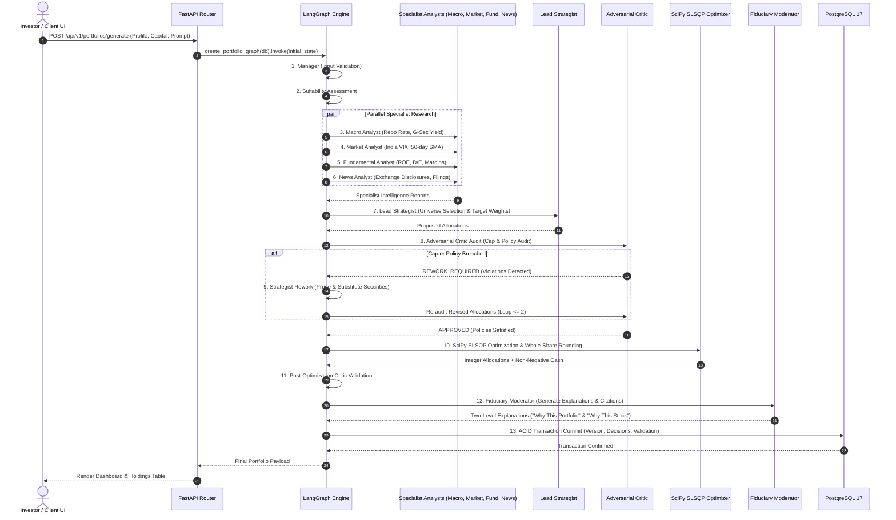

# Lucid — Agentic AI Architecture: The 13-Node LangGraph Engine
## Complete Technical Specification, Sequence Dynamics & Multi-Agent Coordination

---

## 1. Architectural Overview & Design Philosophy

The core reasoning capability of the **Lucid Platform** is implemented as an autonomous multi-agent state graph compiled with **LangGraph** and powered by **Google Gemini** models (with deterministic algorithmic fallbacks). 

Unlike conventional single-prompt LLM wrappers or sequential LangChain pipelines, Lucid implements an **adversarial, cyclic state machine**. This architecture enforces strict separation between:
1. **Unstructured Intelligence**: Macroeconomic regime synthesis, fundamental business model analysis, corporate disclosure sentiment, and fiduciary justification.
2. **Deterministic Computation**: Covariance matrix generation, quadratic programming (Markowitz SLSQP), whole-share integer lot rounding, and house concentration policy enforcement.

```
+--------------------------------------------------------------------------------------------------+
|                            LANGGRAPH MULTI-AGENT STATE GRAPH TOPOLOGY                            |
+--------------------------------------------------------------------------------------------------+
                                        [1. Manager Node]
                                                │
                                                ▼
                                    [2. Suitability Assessment]
                                                │
                                                ▼
                        ┌───────────────────────────────────────────────┐
                        │ 3. Macroeconomic Analyst (Repo, Yield, G-Sec) │
                        │ 4. Market / Breadth Analyst (VIX, Nifty 50)   │
                        │ 5. Fundamental Analyst (ROE, D/E, Margins)   │
                        │ 6. News & Filings Analyst (SEBI, Disclosures) │
                        └───────────────────────┬───────────────────────┘
                                                │
                                                ▼
                                  [7. Lead Strategist (Synthesis)]
                                                │
                                                ▼
                                       [8. Critic Node] ◄─────────────────────────┐
                                        /              \                           │
                         (REWORK_REQUIRED)            (APPROVED)                   │
                              /                            \                       │
                  [9. Strategist Rework]                    ▼                      │
                              │             [10. Deterministic Optimizer (SLSQP)]  │
                              │                            │                       │
                              └────────────────────────────┼───────────────────────┘
                                                           ▼ (Bounded: max 2 rework iterations)
                                          [11. Post-Optimization Critic Validation]
                                                           │
                                                           ▼
                                               [12. Fiduciary Moderator]
                                                           │
                                                           ▼
                                               [13. ACID DB Persistence]
```

---

## 2. Shared Typed State: `PortfolioAgentState`

All inter-agent communication occurs through a strictly typed, immutable Python `TypedDict` defined in `backend/agent/state.py`. Agents receive the current state snapshot, perform their designated analysis or mutation, and return a dictionary of updated fields.

```python
class PortfolioAgentState(TypedDict, total=False):
    # --- 1. Investor Input & Context ---
    user_id: Optional[str]
    portfolio_id: Optional[str]
    user_prompt: str
    investment_amount: float
    currency_code: str
    investment_horizon_months: int
    risk_category: str                      # 'very_conservative', 'conservative', 'moderate', 'aggressive', 'very_aggressive'
    goal_type: str                          # 'wealth_creation', 'capital_preservation', 'retirement', etc.
    preferences: Dict[str, Any]             # Excluded sectors, max caps, ethical preferences
    
    # --- 2. Macro & Market Intelligence ---
    market_regime: str                      # 'CALM', 'MODERATE', 'VOLATILE', 'EXTREME'
    macro_indicators: Dict[str, Any]        # RBI Repo rate, 10Y Yield, CPI Inflation
    macro_analysis: Dict[str, Any]
    market_breadth: Dict[str, Any]          # Advance/Decline, Nifty 50 50-day SMA trend
    
    # --- 3. Fundamental & News Research ---
    eligible_candidates: List[Dict[str, Any]]# Dynamically discovered candidate securities
    fundamental_factors: Dict[str, Any]     # ROE, Debt/Equity, P/E, Operating Margin, 3Y CAGR
    news_analysis: Dict[str, Any]           # Sentiment score (-1.0 to +1.0), exchange filings
    analyst_research_notes: Dict[str, Any]  # Synthesized qualitative findings
    
    # --- 4. Allocation & Proposal ---
    proposed_allocations: List[Dict[str, Any]]
    
    # --- 5. Adversarial Audit & Rework ---
    critic_verdict: str                     # 'APPROVED' or 'REWORK_REQUIRED'
    critic_output: Optional[Dict[str, Any]] # Violations, concentration warnings, exclusions
    rework_count: int                       # Loop iteration counter (bounded <= 2)
    max_rework_count: int                   # Constant = 2
    
    # --- 6. Deterministic Optimization Results ---
    optimizer_output: Optional[Dict[str, Any]]
    allocations: List[Dict[str, Any]]       # Enriched whole-share positions
    total_invested: float                   # Sum of whole shares * price
    unallocated_cash: float                 # Non-negative residual cash
    risk_metrics: Dict[str, Any]            # Expected return, volatility, Sharpe, diversification
    validation_output: Dict[str, Any]       # Post-optimization constraint verification
    validation_passed: bool
    
    # --- 7. Fiduciary Synthesis & Tracing ---
    moderator_output: Optional[Dict[str, Any]]
    portfolio_explanation: Optional[str]
    execution_trace: List[Dict[str, Any]]   # Timestamps and node outcomes for auditability
    current_stage: str
    status: str
```

---

## 3. Deep Dive into the 13 Nodes

### Node 1: Manager Node (`manager`)
- **Type**: Deterministic Pre-Flight Gatekeeper.
- **Purpose**: Validates investor inputs, establishes baseline execution traces, initializes default currency (`INR`), and verifies minimum capital constraints (minimum ₹10,000 for diversified equity portfolios).
- **Fallback**: If user inputs are missing or non-numeric, applies deterministic fallback profile (Moderate, ₹1,00,000 capital, 60-month horizon).

### Node 2: Investor Suitability Node (`suitability`)
- **Type**: Fiduciary Compliance Agent.
- **Purpose**: Evaluates investor risk tolerance, investment horizon, and explicit ethical exclusions (e.g., alcohol, tobacco, gambling, defense). Maps qualitative investor statements into a quantitative risk aversion coefficient $\lambda \in [0.8, 8.0]$.
- **SEBI Alignment**: Follows SEBI (Investment Advisers) Regulations, 2013 risk-profiling standards.

### Node 3: Macroeconomic Analyst Node (`macro_analyst`)
- **Type**: Macro Research Specialist (LLM + FRED / RBI Data).
- **Purpose**: Synthesizes domestic and global macroeconomic factors:
  - RBI Repo Rate ($6.50\%$).
  - India 10-Year Benchmark G-Sec Yield ($~6.80\% - 7.10\%$).
  - Consumer Price Index (CPI) Inflation ($~4.5\% - 5.5\%$).
- **Output**: Categorizes the macroeconomic environment into Growth, Disinflation, Tightening, or Neutral, adjusting sector factor tilts accordingly.

### Node 4: Market / Breadth Analyst Node (`market_analyst`)
- **Type**: Quantitative Market Regimes Specialist.
- **Purpose**: Analyzes real-time technical breadth and volatility indicators:
  - **India VIX (`^INDIAVIX`)**: Low ($< 13$), Normal ($13 - 18$), Elevated ($18 - 24$), Extreme ($> 24$).
  - **Nifty 50 Trend**: Spot price vs 50-day and 200-day Simple Moving Averages (SMA).
  - **Market Breadth**: NSE Advance-Decline Ratio.
- **Impact**: In elevated VIX regimes, the system commands the optimizer to favor Low-Volatility and High-Dividend factors.

### Node 5: Fundamental Analyst Node (`fundamental_analyst`)
- **Type**: Equity Research Specialist (Financial Ratios Engine).
- **Purpose**: Screens and scores candidate equities across 5 balance sheet dimensions:
  1. **Return on Equity (ROE)**: Minimum $> 15\%$ preferred.
  2. **Debt-to-Equity (D/E)**: Low leverage ($< 0.5$ for non-banking; capital adequacy $> 15\%$ for BFSI).
  3. **Valuation**: Trailing P/E and P/B relative to 5-year industry median.
  4. **Operating Margins**: Margin stability over trailing 12 quarters.
  5. **Growth**: 3-Year Compounded Annual Growth Rate (CAGR) of revenues.

### Node 6: News & Filings Analyst Node (`news_analyst`)
- **Type**: NLP Disclosure Specialist (NewsAPI & Exchange Feeds).
- **Purpose**: Ingests regulatory announcements, SEBI circulars, quarterly earnings releases, and media headlines for candidate stocks.
- **Output**: Assigns a sentiment score $S \in [-1.0, +1.0]$ and flags active governance controversies, litigation, or regulatory penalties.

### Node 7: Lead Strategist Node (`analyst`)
- **Type**: Chief Investment Officer (Synthesis Agent).
- **Purpose**: Aggregates the inputs from Nodes 3, 4, 5, and 6. Filters the dynamic candidate universe to a target set of $K$ stocks (typically 7–15 securities based on capital size) and proposes target baseline weights.

### Node 8: Adversarial Critic Node (`critic`)
- **Type**: Independent Fiduciary Risk Auditor.
- **Purpose**: Audits the Lead Strategist's proposed allocations against strict house risk caps and ethical policies:
  - Single-Stock Exposure: $\le 25.0\%$ of total capital.
  - Sector Exposure: $\le 40.0\%$ of total capital.
  - Ethical Compliance: Zero exposure to user-excluded sectors or controversial activities.
  - Liquidity Floor: Minimum average daily volume $> 100,000$ shares.
- **Verdict Rules**:
  - If any check fails $\rightarrow$ Emits `CriticVerdictStatus.REWORK_REQUIRED` with specific violations.
  - If all checks pass $\rightarrow$ Emits `CriticVerdictStatus.APPROVED`.

### Node 9: Strategist Rework Node (`strategist_rework`)
- **Type**: Iterative Resolution Loop.
- **Behavior**:
  - Reads `critic_output["violations"]`.
  - Removes the non-compliant securities from `eligible_candidates`.
  - Introduces eligible replacements matching the required sector profile.
  - Increments `rework_count`.
  - **Bounded Loop Guardrail**: If `rework_count >= 2`, forces fallback to hard-coded index-diversified candidates to guarantee graph termination and eliminate infinite LLM loops.

### Node 10: Deterministic Optimizer & Validator Node (`optimizer`)
- **Type**: Pure Quantitative Engine (Zero LLM Invocations).
- **Core Algorithms**:
  - **SciPy SLSQP Solver**: Minimizes Markowitz quadratic utility subject to linear sum-to-one constraints, $25\%$ stock caps, and $40\%$ sector caps.
  - **Whole-Share Lot Rounder**: Floors share counts to integer values ($Q_i = \lfloor V_i / P_i \rfloor$) and greedily assigns residual cash without breaching risk ceilings.
  - **Cash Reserve Verification**: Guarantees non-negative cash ($C \ge 0$).

### Node 11: Post-Optimization Critic Validation Node (`critic_final_validation`)
- **Type**: Mathematical Audit Node.
- **Purpose**: Verifies that the whole-share integer rounding process in Node 10 did not distort weights sufficiently to breach the $25\%$ single-stock cap or $40\%$ sector cap, and verifies that the remaining cash balance is positive and reasonable ($< 5\%$ cash drag).

### Node 12: Fiduciary Moderator Node (`moderator`)
- **Type**: Explainable AI Synthesis Agent.
- **Purpose**: Generates transparent, human-readable portfolio summaries and individual stock justifications ("Why This Stock?"). Incorporates live citations, fundamental metrics, and macroeconomic context in plain English.

### Node 13: ACID DB Persistence Node (`persistence`)
- **Type**: Relational Transaction Manager.
- **Purpose**: Executes an atomic PostgreSQL transaction inserting:
  - `portfolio_versions` record with version number and metrics.
  - `portfolio_security_decisions` records for each selected equity.
  - `recommendation_explanations` records capturing portfolio and stock-level rationales.
  - `portfolio_validation_runs` and `portfolio_validation_results` storing mathematical audit proofs.

---

## 4. Sequence Diagram: Complete Agentic Workflow



---

## 5. Pydantic Validation Schemas & State Contracts

All agent outputs are validated through strongly-typed Pydantic schemas in `backend/agent/schemas.py`:

```python
class CriticVerdictStatus(str, Enum):
    APPROVED = "APPROVED"
    REWORK_REQUIRED = "REWORK_REQUIRED"

class CriticOutput(BaseModel):
    verdict: CriticVerdictStatus
    confidence_score: float = Field(ge=0.0, le=1.0)
    single_stock_violations: List[str] = Field(default_factory=list)
    sector_violations: List[str] = Field(default_factory=list)
    ethical_violations: List[str] = Field(default_factory=list)
    liquidity_warnings: List[str] = Field(default_factory=list)
    required_remedies: List[str] = Field(default_factory=list)

class OptimizedPosition(BaseModel):
    ticker: str
    company_name: str
    sector: str
    target_quantity: int = Field(ge=0)
    reference_price: float = Field(gt=0.0)
    target_weight_pct: float = Field(ge=0.0, le=100.0)
    allocated_amount: float = Field(ge=0.0)
    selection_rationale: Optional[str] = None

class OptimizerOutput(BaseModel):
    execution_status: str
    model_name: str
    total_capital: float
    total_invested: float
    unallocated_cash: float = Field(ge=0.0)
    cash_reserve_pct: float
    positions: List[OptimizedPosition]
    expected_return_pct: float
    expected_volatility_pct: float
    sharpe_ratio: float
    diversification_score: float
    all_constraints_passed: bool
```

---

## 6. Resilience & Deterministic Fallback Modes

To guarantee $99.9\%$ operational uptime even during external API downtime, rate limiting, or network interruptions, Lucid implements deterministic fallback pathways:

1. **Gemini API Outage / Quota Exhaustion**:
   - The graph intercepts Google API rate-limit errors (`ResourceExhausted`, `GoogleAPICallError`).
   - Automatically falls back to a deterministic, rule-based heuristics engine that executes multi-factor scoring using stored database fundamentals.
2. **yfinance Failure / Market Closed**:
   - The system queries cached daily closing prices from the `market_prices` table.
   - For automated CI testing, the `SimulatedMarketProvider` supplies offline deterministic price vectors.
3. **Infinite Loop Protection**:
   - The rework loop enforces a strict invariant: `rework_count <= 2`.
   - On the 3rd iteration, the graph automatically bypasses the Strategist and enforces a guaranteed-feasible diversified basket.

---
*Lucid Multi-Agent Architecture Specification — Version 2026.11-v2.0*

