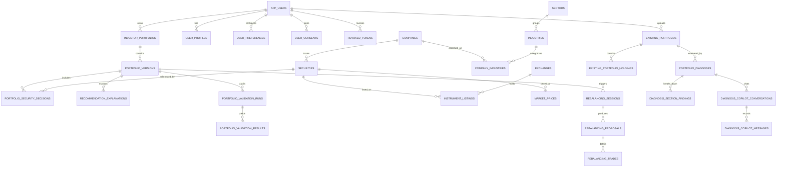

# Lucid — Database and System Architecture
## Complete Relational Schema Design, Entity Relationship Diagram & Multi-Tenant Isolation

---

## 1. System Architecture Overview

Lucid employs a multi-tiered decoupled architecture designed for institutional reliability, horizontal scalability, and strict security isolation:

```
[Presentation Layer]
  Next.js 16 (App Router) + React 19 + TypeScript + Tailwind CSS
         │
         ▼  (Stateless HTTP / JSON REST + Authorization: Bearer <JWT>)
[API Gateway & Application Server]
  FastAPI (ASGI) + Starlette + Pydantic v2 + Argon2id Security Middleware
         │
         ├──────────────────────────────────────────────────────┐
         ▼                                                      ▼
[Agentic Core (LangGraph)]                       [Quantitative Engine (SciPy)]
  13-Node Graph + Gemini 2.5 Flash                 SLSQP Markowitz Solver + Integer Rounder
         │                                                      │
         └──────────────────────────┬───────────────────────────┘
                                    │  (SQLAlchemy 2.0 ORM / Connection Pooling)
                                    ▼
[Relational Persistence Layer]
  PostgreSQL 17 (62 Normalized Relational Tables across 8 Domains)
```

---

## 2. Multi-Tenant Isolation & Composite Key Security

To ensure complete isolation between investors and prevent unauthorized cross-tenant data access, Lucid enforces composite foreign key patterns and tenant filtering at every critical query layer:

$$\text{Isolation Invariant: } \forall Q \in \text{PortfolioOperations}, \quad Q \iff \left( \texttt{portfolio\_id} = P \land \texttt{user\_id} = U_{\text{auth}} \right)$$

1. **Table Constraints**:
   - `investor_portfolios`: Unique constraint on `(portfolio_id, user_id)`.
   - `portfolio_versions`: Bound to parent `portfolio_id`.
   - `portfolio_security_decisions`: Foreign keyed to `portfolio_version_id`.
2. **Cascading Deletions**:
   - Deleting an `AppUser` cascades and completely purges all profiles, preferences, portfolios, versions, decisions, explanations, and broker records in compliance with Indian DPDP Act (2023) and GDPR standards.

---

## 3. The Complete 62 Database Tables Grouped by Domain

### Domain 1: User Identity, Security & Profiles (`IDENTITY` — 7 Tables)
1. `app_users`: Core user account table storing email, Argon2id password hash, and active/inactive status.
2. `revoked_tokens`: JTI blacklist ledger for invalidated stateless JWT tokens.
3. `user_consents`: Append-only consent ledger recording terms of service, SEBI risk disclosures, and DPDP consents.
4. `user_preferences`: UI configuration, preferred currency, and notification channels.
5. `user_profiles`: Investor demographic profile, investment knowledge level, and residency.
6. `user_profile_versions`: Historical audit versions tracking changes to investor profile details.
7. `user_verification_codes`: Time-limited OTP codes for password reset and email confirmation.

### Domain 2: Investor Suitability & Goals (`INVESTOR` — 5 Tables)
8. `financial_goals`: Investor financial objectives with target amounts, dates, and priorities.
9. `risk_assessments`: SEBI suitability assessment sessions with calculated risk score and category.
10. `risk_assessment_answers`: Recorded investor responses to specific risk assessment questions.
11. `risk_questions`: Standardized questionnaire items evaluating risk capacity, horizon, and loss tolerance.
12. `risk_question_options`: Selectable multiple-choice responses with associated score weights.

### Domain 3: Security Master & Taxonomies (`SECURITY` — 9 Tables)
13. `companies`: Legal entity master with CIN, legal name, corporate website, and registration.
14. `company_industries`: Many-to-many junction mapping companies to industries and primary sector tags.
15. `exchanges`: Exchange directory (NSE, BSE) with MIC codes, trading currencies, and holiday schedules.
16. `industries`: Granular industry classification linked to parent sector.
17. `instrument_listings`: Exchange-specific equity listings with NSE/BSE symbols, scrip codes, and lot sizes.
18. `sectors`: Broad industry sector taxonomy (Information Technology, Healthcare, Power & Utilities, etc.).
19. `securities`: Tradeable equity instruments with ISIN, currency code, security type, and listing status.
20. `user_sector_preferences`: Explicit investor sector tilts, positive preferences, and negative sector exclusions.
21. `user_security_preferences`: Security-level negative exclusion lists (e.g., custom stock exclusions).

### Domain 4: Market Data, Prices & News (`MARKET` — 11 Tables)
22. `data_ingestion_errors`: Error log for market data fetching exceptions and API failures.
23. `data_ingestion_runs`: Audit log for batch and scheduled market data sync executions.
24. `data_sources`: Registered market data API providers (Yahoo Finance, FRED, NewsAPI, NSE/BSE registries).
25. `economic_indicators`: Macroeconomic indicator series metadata (RBI Repo rate, CPI, 10Y G-Sec Yield).
26. `economic_observations`: Time-series observations and historical values for macroeconomic indicators.
27. `fundamental_metrics`: Quarterly balance sheet ratios: ROE, Debt/Equity, P/E, Operating Margin, 3Y CAGR.
28. `market_news_articles`: Aggregated corporate filings, SEBI circulars, and financial news items.
29. `market_prices`: Historical and real-time OHLCV price records for listed equity instruments.
30. `metric_definitions`: Formal definitions and formulas for financial fundamental and quantitative metrics.
31. `news_article_securities`: Association table linking news articles and regulatory filings to specific securities.
32. `source_instrument_mappings`: Cross-reference mapping third-party data provider IDs to canonical internal securities.

### Domain 5: Core Portfolios, Decisions & Scenarios (`PORTFOLIO` — 13 Tables)
33. `evidence_items`: Verifiable factual evidence items (filing excerpts, financial ratios) supporting recommendations.
34. `explanation_evidence`: Junction linking recommendation explanations to supporting evidence items.
35. `investor_portfolios`: Top-level portfolio container with user FK, portfolio name, and status.
36. `portfolio_generation_requests`: Inbound portfolio generation requests detailing investor prompt, capital, and risk tier.
37. `portfolio_scenarios`: Simulated stress-test scenarios (e.g., 2008 GFC, 2020 COVID crash, Rate Hike).
38. `portfolio_security_decisions`: Granular equity holdings per portfolio version with target weights and selection rationales.
39. `portfolio_validation_results`: Itemized constraint validation results (25% single-stock cap, 40% sector cap, whole shares).
40. `portfolio_validation_runs`: Audit record of quantitative validation passes executed on portfolio versions.
41. `portfolio_version_constraints`: Specific portfolio constraints applied during optimization.
42. `portfolio_versions`: Immutable portfolio version snapshots with investment capital, expected return, and generation context JSON.
43. `recommendation_explanations`: Fiduciary plain-English narrative rationales generated by the Moderator agent.
44. `strategy_definitions`: Formal investment strategy blueprints (e.g., Conservative Wealth Preserver, High-Growth Equity).
45. `strategy_versions`: Versioned parameter specifications for investment strategy models.

### Domain 6: Broker Accounts & Demat Holdings (`BROKER` — 6 Tables)
46. `broker_executions`: Realized execution fill records for placed broker orders with trade timestamps.
47. `broker_order_events`: State transition lifecycle events for broker orders (placed, rejected, filled).
48. `broker_orders`: Broker-ready execution order slips generated from whole-share rebalance proposals.
49. `broker_providers`: Supported broker gateways (Zerodha Kite, Groww, AngelOne, Upstox).
50. `portfolio_performance_snapshots`: Periodic portfolio NAV, valuation, and total return performance snapshots.
51. `user_broker_accounts`: Connected broker accounts with encrypted authentication credentials and sync status.

### Domain 7: Demat Diagnosis & Rebalancing (`DIAGNOSIS` — 4 Tables)
52. `existing_portfolios`: Uploaded external Demat portfolio statements for comprehensive health diagnosis.
53. `existing_portfolio_holdings`: Granular stock holdings extracted from uploaded brokerage statements.
54. `portfolio_diagnoses`: Comprehensive 7-dimension diagnostic audit records with overall health score (0–100).
55. `rebalance_suggestions`: Diagnostic rebalance recommendations to fix over-concentration or low-quality holdings.

### Domain 8: Multi-Agent Execution & Operations (`OPERATIONS` — 7 Tables)
56. `agent_definitions`: Registry of specialized agent roles (Manager, Suitability, Macro, Market, Fundamental, News, Critic, Moderator).
57. `agent_execution_runs`: Runtime execution logs recording agent start/end times, model parameters, and token usage.
58. `agent_versions`: Versioned agent implementations with prompt versions and model configurations.
59. `audit_events`: Immutable system security and data access audit trail for compliance verification.
60. `knowledge_documents`: Vector and text knowledge base documents for agent contextual retrieval.
61. `notifications`: In-app investor notifications for drift alerts, rebalance triggers, and market updates.
62. `user_feedback`: Investor feedback and ratings on portfolio recommendations and conversational copilot responses.

---

## 4. Entity-Relationship Diagram (Core Domains)



---
*Lucid Database Architecture Specification — Version 2026.11-v2.0*

