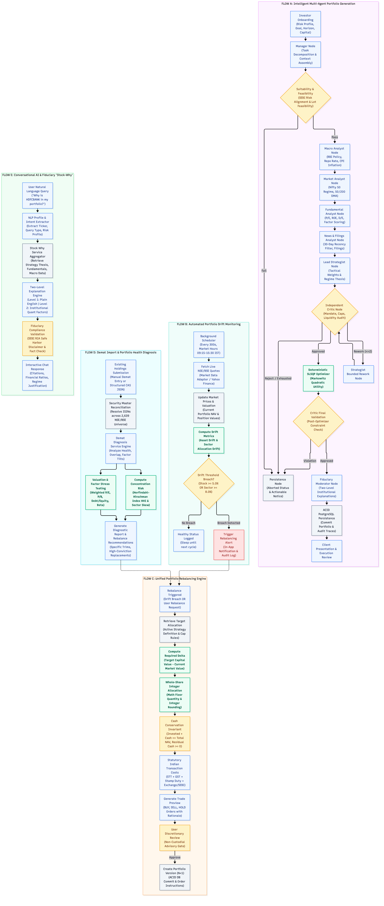

# Lucid — End-to-End Operational Methodology

This document details the complete mathematical, algorithmic, and agentic methodology governing Lucid's 5 core operational flows.

---

## Operational Workflow Overview



---

## FLOW A: Intelligent Multi-Agent Portfolio Generation Flow

Flow A translates an investor's subjective financial goals and risk tolerance into an optimized, mathematically verified equity portfolio.

```text
User Onboarding Request
         │
         ▼
┌──────────────────┐
│  Manager Node    │ ── Assemble Context & Initialize State
└────────┬─────────┘
         │
         ▼
┌──────────────────┐
│ Suitability Gate │ ── Check SEBI Risk Bounds & Capital Feasibility (Min ₹10,000)
└────────┬─────────┘
         │ Pass
         ▼
┌──────────────────┐
│ Macro Analyst    │ ── RBI Repo Rate (6.50%), CPI Inflation (5.1%), Yield Spread
└────────┬─────────┘
         │
         ▼
┌──────────────────┐
│ Market Analyst   │ ── Nifty 50 Trend, 50/200 DMA, Volatility Regime
└────────┬─────────┘
         │
         ▼
┌──────────────────┐
│ Fundamental Node │ ── ROE (>15%), P/E, Debt/Equity, Winsorized Factor Z-Scores
└────────┬─────────┘
         │
         ▼
┌──────────────────┐
│ News Analyst     │ ── Corporate Filings, Earnings Announcements, Sentiment
└────────┬─────────┘
         │
         ▼
┌──────────────────┐
│ Lead Strategist  │ ── Tactical Allocation & Candidate Selection
└────────┬─────────┘
         │
         ▼
┌──────────────────┐      Rework Required (<= 2)
│  Risk Critic     │ ───────────────────────────────► ┌──────────────────┐
└────────┬─────────┘                                   │ Strategist Rework│
         │ Approved                                    └────────┬─────────┘
         ▼                                                      │
┌──────────────────┐ ◄──────────────────────────────────────────┘
│ SLSQP Optimizer  │ ── Markowitz Quadratic Utility & Simplex Projection
└────────┬─────────┘
         │
         ▼
┌──────────────────┐
│ Critic Final Val │ ── Post-Optimizer Integer Share Sizing & Cap Audit
└────────┬─────────┘
         │ Approved
         ▼
┌──────────────────┐
│ Fiduciary Mod    │ ── Generate Level 1 (Retail) & Level 2 (Quant) Explanations
└────────┬─────────┘
         │
         ▼
┌──────────────────┐
│ ACID Persistence │ ── Commit Portfolio Version, Decisions, & Audit Logs
└──────────────────┘
```

### 1. Inputs
- **User Parameters**: Initial capital (e.g. ₹1,00,000), investment horizon (e.g. 5 years), risk tolerance profile (`conservative`, `moderate`, or `aggressive`), and goal type (`wealth_creation`, `retirement`, `capital_preservation`, `dividend_income`).
- **Database Universe**: 2,639 listed equities, filtered down to the 504 recommendation candidates passing liquidity criteria (daily turnover > ₹25,00,000).

### 2. Processing Steps
1. **Context Initialization**: `manager_node` parses goal parameters and establishes the typed `PortfolioAgentState`.
2. **Suitability & Feasibility**: `suitability_check_node` verifies that the requested capital can support integer shares without exceeding concentration caps (minimum viable capital is ₹10,000).
3. **Macroeconomic Analysis**: `macro_analyst_node` inspects RBI monetary policy data (repo rate, inflation) and sets broad equity asset allocation boundaries.
4. **Market Regime Classification**: `market_analyst_node` compares NIFTY 50 spot price against its 50-day and 200-day moving averages to determine market regime (Bullish, Neutral, Volatile).
5. **Fundamental Multi-Factor Ranking**: `fundamental_analyst_node` scores candidates across Quality, Value, Momentum, and Low-Volatility factors using sector-relative Winsorized Z-scores.
6. **Sentiment & Event Analysis**: `news_analyst_node` evaluates recent corporate announcements and flags material governance or earnings risks.
7. **Tactical Strategy Formulation**: `analyst_node` selects 10–18 target candidates and assigns preliminary baseline weights.
8. **Independent Fiduciary Audit**: `critic_node` enforces regulatory and policy limits:
   - Single stock weight $\le 10.0\%$ (or $15.0\%$ for aggressive).
   - Sector weight $\le 30.0\%$ (or $35.0\%$ for aggressive).
   - If violated, routes to `strategist_rework_node` (max 2 iterations).
9. **Deterministic Optimization**: `deterministic_optimizer_node` executes SciPy SLSQP to find mathematically optimal weights, followed by integer-share conversion via floor division.
10. **Post-Optimizer Final Validation**: `critic_final_validation_node` verifies that post-rounding integer weights remain strictly within policy bounds.
11. **Fiduciary Explanations**: `moderator_explanation_node` synthesizes dual-level rationales.
12. **ACID Persistence**: `persistence_node` commits the portfolio, version, decisions, and telemetry within a single database transaction.

### 3. Failure & Fallback Paths
- **Unsuitable/Infeasible Request**: If capital is below ₹10,000 or risk capacity is zero, the graph terminates early at `persistence_node` with status `ABORTED_INFEASIBLE` and returns an actionable explanation.
- **Critic Rejection Exhaustion**: If the strategist fails to satisfy constraints after 2 rework cycles, the workflow aborts safely without generating an invalid portfolio.
- **SLSQP Non-Convergence**: If the numerical solver fails, the system executes an iterative sector-constrained water-filling fallback algorithm.

---

## FLOW B: Automated Unattended Portfolio Monitoring Flow

Flow B operates continuously in the background to ensure that active investor portfolios remain aligned with target allocations.

```text
Background Monitoring Scheduler (Every 300s, 09:15-15:30 IST)
         │
         ▼
┌────────────────────────┐
│ Fetch Live Quotes      │ ── Yahoo Finance (yfinance) for all portfolio holdings
└────────┬───────────────┘
         │
         ▼
┌────────────────────────┐
│ Revalue Portfolio      │ ── Update current price, position value, and total NAV
└────────┬───────────────┘
         │
         ▼
┌────────────────────────┐
│ Calculate Drift        │ ── Holding drift = |Current Weight - Target Weight|
│                        │ ── Sector drift = |Current Sector % - Target Sector %|
└────────┬───────────────┘
         │
         ▼
┌────────────────────────┐      Drift Breached (Stock >= 5% or Sector >= 8%)
│ Evaluate Thresholds    │ ───────────────────────────────────────────────────► In-App Notification
└────────┬───────────────┘                                                      & Audit Log Entry
         │ No Drift Breach
         ▼
Log Status "HEALTHY" & Sleep
```

### 1. Inputs
- Active portfolio version ID and associated `portfolio_security_decisions`.
- Live NSE/BSE equity quotes retrieved from Yahoo Finance.

### 2. Processing Steps
1. **Cron Trigger**: The `BackgroundMonitoringScheduler` wakes up every 300 seconds during active market hours (Monday–Friday, 09:15 – 15:30 IST).
2. **Batch Price Fetching**: Retrieves latest trading prices for all unique holdings across active portfolios.
3. **Valuation Update**: Computes:
   $$	ext{Current Position Value}_i = 	ext{Shares Quantity}_i 	imes 	ext{Latest Price}_i$$
   $$	ext{Total Portfolio Value} = \sum_{i=1}^n 	ext{Current Position Value}_i + 	ext{Unallocated Cash}$$
   $$	ext{Current Weight}_i (\%) = \left(rac{	ext{Current Position Value}_i}{	ext{Total Portfolio Value}}
ight) 	imes 100$$
4. **Drift Computation**:
   $$	ext{Holding Drift}_i = 	ext{Current Weight}_i - 	ext{Target Weight}_i$$
   $$	ext{Sector Drift}_k = \sum_{i \in 	ext{Sector}_k} 	ext{Current Weight}_i - \sum_{i \in 	ext{Sector}_k} 	ext{Target Weight}_i$$
5. **Breach Detection**: Flags a drift event if any holding $|	ext{Holding Drift}_i| \ge 5.0\%$ or any sector $|	ext{Sector Drift}_k| \ge 8.0\%$.

### 3. Outputs
- Health status (`HEALTHY` or `DRIFT_ALERT`).
- Dispatches transactional in-app notifications and creates audit events.

---

## FLOW C: Unified Portfolio Rebalancing Engine

Flow C calculates the precise, whole-share buy and sell transactions needed to restore a drifted portfolio back to its target mandate.

```text
Rebalance Trigger (Drift Breach or User On-Demand)
         │
         ▼
┌────────────────────────┐
│ Target Capital Sizing  │ ── Target Capital = Total NAV * (Target Weight % / 100)
└────────┬───────────────┘
         │
         ▼
┌────────────────────────┐
│ Integer Share Rounding │ ── Target Quantity = floor(Target Capital / Current Price)
└────────┬───────────────┘
         │
         ▼
┌────────────────────────┐
│ Cash Invariant Audit   │ ── Verify Post-Trade Cash >= 0; trim 1 share from largest BUY if needed
└────────┬───────────────┘
         │
         ▼
┌────────────────────────┐
│ Statutory Costs Engine │ ── Calculate STT, Exchange Fees, SEBI Fees, GST (18%), Stamp Duty
└────────┬───────────────┘
         │
         ▼
┌────────────────────────┐
│ Generate Trade Preview │ ── BUY, SELL, HOLD orders with rationales & estimated net proceeds
└────────┬───────────────┘
         │
         ▼
User Discretionary Approval ──► Commit New Portfolio Version (N+1) & Broker Sync
```

### 1. Mathematical Invariants
- **Whole-Share Sizing**: No fractional shares; all trade quantities are discrete integers.
- **Cash Conservation**: Total invested capital plus residual cash must equal total portfolio NAV. Post-trade cash can never be negative. If integer rounding produces a minor deficit, the algorithm trims exactly 1 share from the largest BUY trade.
- **Statutory Indian Costs**: Automatically factors in:
  - STT: 0.10% on delivery buy and sell.
  - Exchange Transaction Fee: 0.00297% (NSE).
  - SEBI Turnover Fee: 0.0001%.
  - GST: 18% on (brokerage + exchange charges + SEBI charges).
  - Stamp Duty: 0.015% on delivery buy orders.

---

## FLOW D: Demat Import & Health Diagnosis Flow

Flow D allows investors to input their existing equity portfolio holdings (either via structured manual entry or CAS statement data import) and receive an immediate institutional health and concentration audit.

```text
Existing Demat Holdings (Manual Entry / CAS JSON)
         │
         ▼
┌────────────────────────┐
│ Security Reconciliation│ ── Match ISIN against Lucid 2,639 Universe Equities & Sectors
└────────┬───────────────┘
         │
         ▼
┌────────────────────────┐
│ Health & Concentration │ ── Calculate Herfindahl-Hirschman Index (HHI) & Sector Skew
└────────┬───────────────┘
         │
         ▼
┌────────────────────────┐
│ Factor Stress Testing  │ ── Weighted P/E, P/B, Debt/Equity, Beta & Earnings Yield
└────────┬───────────────┘
         │
         ▼
Diagnostic Report & Rebalancing Suggestions (Trims, Replacements, Risk Warnings)
```

### 1. Key Metrics Evaluated
- **Herfindahl-Hirschman Index (HHI)**:
  $$\text{HHI} = \sum_{i=1}^n (\text{Weight}_i\%)^2$$
  - $\text{HHI} < 1500$: Diversified.
  - $1500 \le \text{HHI} \le 2500$: Moderately Concentrated.
  - $\text{HHI} > 2500$: Highly Concentrated (High Risk).
- **Sector Concentration**: Detects sectors with exposure exceeding 35%.
- **Penny Stock / Illiquidity Flags**: Highlights holdings outside the verified liquid universe.

---

## FLOW E: Conversational AI & Fiduciary 'Stock-Why' Flow

Flow E provides plain-English, verifiable answers to investor questions regarding their portfolio allocations without hallucinating financial metrics.

```text
User Question: "Why is Infosys in my portfolio?"
         │
         ▼
┌────────────────────────┐
│ NLP Intent & Symbol    │ ── Extract Ticker ('INFY') and Query Intent ('stock_why')
└────────┬───────────────┘
         │
         ▼
┌────────────────────────┐
│ Stock-Why Service      │ ── Retrieve Decision Record, Factor Scores, Sector Rationale, Macro Link
└────────┬───────────────┘
         │
         ▼
┌────────────────────────┐
│ Two-Level Engine       │ ── Synthesize Level 1 (Retail Summary) & Level 2 (Quant Fact Sheet)
└────────┬───────────────┘
         │
         ▼
┌────────────────────────┐
│ Safe Harbor Compliance │ ── Append SEBI Non-Advisory Safe Harbor Disclaimer
└────────┬───────────────┘
         │
         ▼
Interactive Dialogue Response Delivered to Frontend Chat
```

### 1. Dual-Level Explanation Model
- **Level 1 (Executive Summary)**: Plain English explanation suitable for everyday retail investors (e.g. *"Infosys was included to provide defensive IT export exposure with consistent 28% return on equity and zero long-term debt"*).
- **Level 2 (Institutional Quantitative Fact Sheet)**: Verifiable metrics including exact factor Z-scores, historical beta, P/E ratio, 3-year CAGR, and macroeconomic regime alignment.
