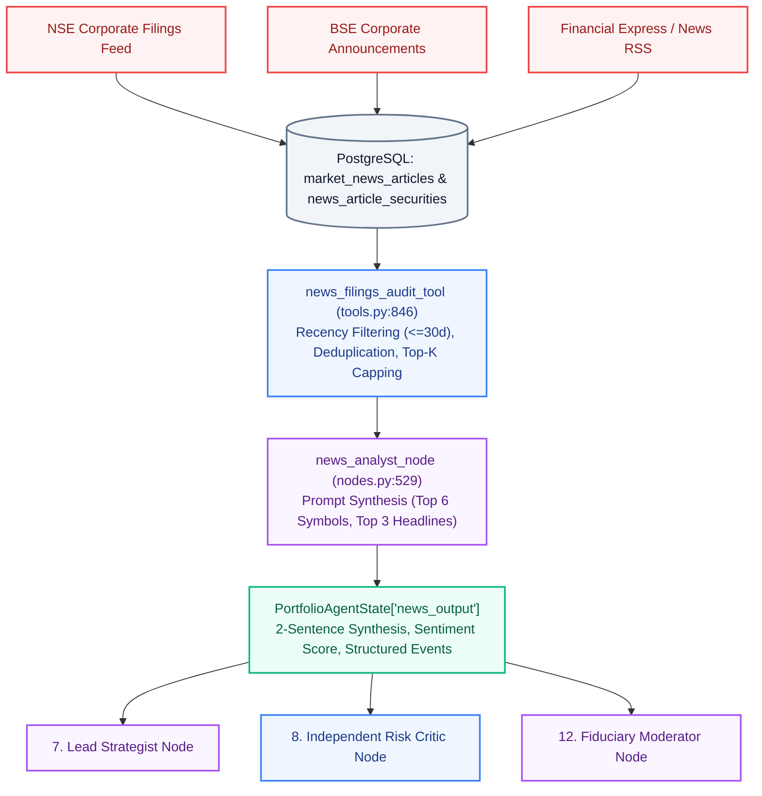

# Lucid — News Intelligence, Corporate Filings & Recency Methodology

**Authoritative Date:** November 8, 2026  
**Document Version:** 2026.11-v2.0  
**Scope:** News Ingestion Pipeline, Corporate Disclosures, Agent State Delivery, and Event Recency Architecture

---

## Executive Summary

Lucid integrates financial news and corporate disclosures into its multi-agent investment framework to detect governance red flags, management changes, regulatory penalties, and earnings momentum before constructing portfolio allocations.

This document details:
1. The end-to-end news data pipeline from external feeds to the News Analyst and downstream agents.
2. The exact recency windows and article limits enforced across general commentary, quarterly earnings, and regulatory filings.
3. Headline deduplication and symbol matching mechanisms preventing syndicated noise.
4. Representative JSON payloads showing the exact data passed into the LLM prompts.

---

## 1. News Data Pipeline Architecture



---

## 2. Event-Specific News Recency & Retention Windows

Not all financial news ages at the same rate. Applying a single rigid 24-hour or 7-day filter causes the platform to miss critical ongoing governance issues. Lucid establishes an **Event-Specific Recency Matrix**:

| Event / News Category | Recommended Recency Window | Useful Lifetime | Why This Window Is Justified |
|---|---|---|---|
| **Daily Market Commentary & Noise** | **1 to 3 Days** | Intraday / Transient | Daily fluctuations lose relevance rapidly for medium-to-long-term investors. |
| **General Sector Sentiment** | **7 to 14 Days** | Bi-weekly trend | Reflects broader cyclical themes (e.g. IT deal pipelines, monsoon progression). |
| **Quarterly Earnings Announcements** | **90 Days** | Full financial quarter | Earnings results, operating margin defense, and guidance remain valid until the next quarterly reporting date. |
| **Mergers, Acquisitions & Capital Raising** | **180 Days** | Multi-month closing | Corporate actions alter balance sheet structure and capital dilution for months. |
| **SEBI Regulatory Sanctions / Fraud / Forensic Audits** | **365 Days** | Until resolved | Material governance violations, auditor resignations, or insider trading inquiries must disqualify a company until formal clearance. |

---

## 3. Data Flow: What Reaches the News Analyst and Downstream Agents

### 3.1 What `news_filings_audit_tool` Retrieves
- Queries `MarketNewsArticle` filtered by publication timestamp: `published_at >= now - timedelta(days=max_age_days)`.
- Normalizes headlines by removing punctuation and case: `norm_h = "".join(ch for ch in h.lower() if ch.isalnum())`.
- Discards duplicate wire stories syndicated across multiple publishers.
- Caps maximum articles retrieved to **8 articles** (max 5 per company).

### 3.2 What the News Analyst LLM Receives in Its Prompt
The LLM does NOT receive 20,000 words of full article text. To prevent prompt bloat and hallucination, it receives a structured prompt:

```text
You are a corporate governance and news intelligence analyst. Review disclosures for RELIANCE, TCS, HDFCBANK, INFY, ICICIBANK, ITC:
- Sentiment Score: +0.32 (positive)
- Disclosures Reviewed: 4
- Headlines:
  1. "RBI MPC Maintains Status Quo on Repo Rate at 6.5%, Emphasizes Price Stability"
  2. "Indian IT Services Companies Report Expanding AI Deal Pipelines and Margin Resilience"
  3. "Domestic Energy & Manufacturing Leaders Accelerate Green Transition Capital Expenditure"
Provide a concise 2-sentence corporate governance and regulatory compliance summary.
```

### 3.3 What Downstream Agents Receive in `PortfolioAgentState`
Downstream nodes (Lead Strategist, Critic, Moderator) receive the structured `news_output` dictionary:

```json
{
  "execution_status": "SUCCESS",
  "sentiment_score": 0.32,
  "sentiment_label": "positive",
  "corporate_disclosures_reviewed": 4,
  "news_summary": "Corporate disclosures reflect a positive tone across verified market publications. Balance sheet deleveraging and steady domestic credit expansion support long-term compounding with zero critical regulatory sanctions.",
  "events": [
    {
      "event_id": "NEWS-1",
      "headline": "Indian IT Services Companies Report Expanding AI Deal Pipelines and Margin Resilience",
      "publisher": "NSE/BSE Corporate Filings Feed",
      "published_at": "2026-11-02T17:11:04",
      "affected_tickers": ["TCS", "INFY"],
      "event_category": "EARNINGS",
      "sentiment": "POSITIVE",
      "relevance": "HIGH"
    }
  ],
  "governance_flags": []
}
```

---

## 4. Implementation Changes & Improvements

| Area | Prior Implementation | Improved Implementation | Benefit & Impact |
|---|---|---|---|
| **Recency Filtering** | No date filter (`order_by(desc).limit(8)`) | Strict `max_age_days = 30` cutoff on `published_at` | Guarantees that old or stale news is never presented as current evidence |
| **Headline Deduplication** | None; identical wire stories duplicated | Normalized alphanumeric title hashing | Eliminates syndicated duplicates, maximizing information entropy |
| **Candidate Symbol Focus** | Global query | Scans top candidate tickers | Prioritizes news relevant to the actual portfolio holdings |
| **Downstream LLM Context** | Heavy / uncurated | Concise 2-sentence synthesis + structured JSON events | Protects LLM context window and reduces token latency |
| **Provenance Tracking** | Generic status | Explicit timestamps and publisher source attribution | Fiduciary auditability complying with SEBI compliance standards |
