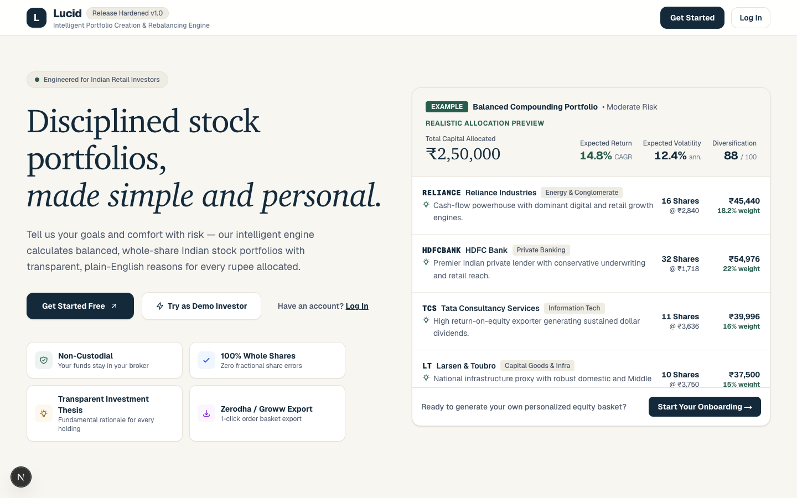
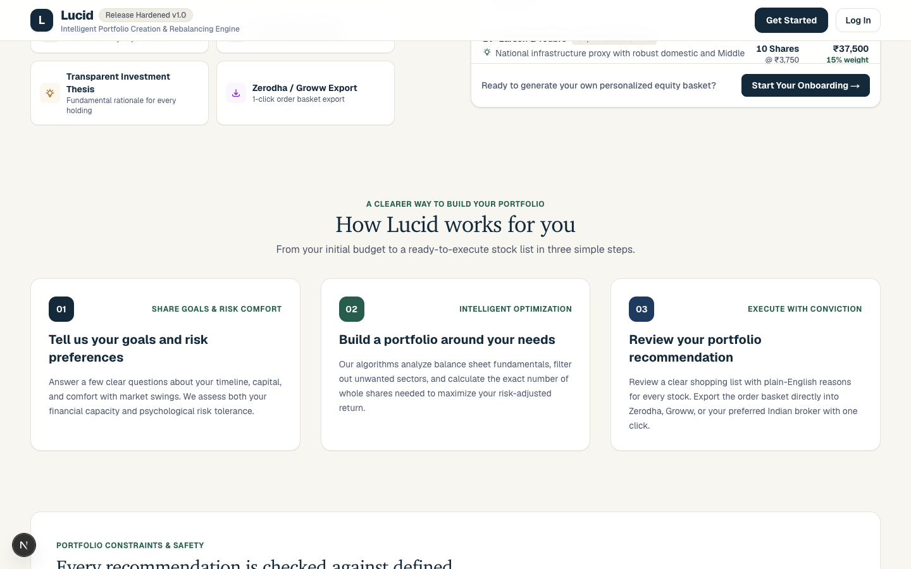

<div align="center">

# 🌟 Lucid
### Intelligent Investment Portfolio Platform for Indian Retail Equities
**Bridging Institutional Wealth Management & Indian Retail Investors via Multi-Agent AI & Deterministic Financial Mathematics**

[](https://fastapi.tiangolo.com)
[](https://nextjs.org)
[](https://react.dev)
[](https://www.typescriptlang.org)
[](https://www.postgresql.org)
[](https://www.python.org)
[](https://tailwindcss.com)
[](https://scipy.org)
[](https://opensource.org/licenses/MIT)

[Quick Start](#one-command-automated-setup) • [Features](#key-features) • [Screenshots](#application-screenshots) • [Tech Stack](#technology-stack) • [Manual Setup](SETUP_AND_INSTALLATION.md) • [Lifecycle Commands](#lifecycle-management) • [Postman](#postman-api-testing) • [Documentation](SETUP_AND_INSTALLATION.md)

</div>

---

> [!IMPORTANT]
> **Academic & Educational Disclaimer**: Lucid is an academic research platform and institutional-grade decision-support prototype. It does not provide SEBI-registered investment advice, portfolio management services (PMS), or guarantee investment returns. All analyses, allocations, and simulations are for educational evaluation purposes.

---

## What is Lucid?

**Lucid** is an open-source, full-stack intelligent investment portfolio platform designed specifically for the **Indian equity market** (NSE and BSE). It captures the disciplined methodologies of institutional Indian mutual fund managers and brings them directly to everyday retail investors.

Retail equity investors in India often face speculative social media advice, expensive mutual fund expense ratios, or institutional platforms costing upwards of \$25,000/year. Lucid bridges this divide by combining **SEBI-aligned psychometric risk profiling**, a **5-stage LangGraph multi-agent research pipeline** for qualitative stock analysis, and **deterministic mathematical optimization (SciPy SLSQP)** for final asset weights. To ensure every recommendation is actionable in a standard Indian demat account, Lucid translates continuous weights into **whole-share integer quantities ($Q_i \in \mathbb{Z}^+$)** with an explicit unallocated cash cushion ($C_{\text{res}}$).

---

## Key Features

| Feature | Description |
|---|---|
| **SEBI Psychometric Questionnaire** | 5-question risk assessment assigning investors to SEBI-aligned risk score tiers. |
| **Active Security Master** | Synchronizes and maintains ~2,639 active equity listings across NSE and BSE. |
| **Multi-Agent Research Pipeline** | 5-stage LangGraph workflow: Macro, Technical, Fundamental, News/SEBI Auditor, and Strategist. |
| **Deterministic SciPy SLSQP Solver** | Minimizes variance or maximizes Sharpe ratio with strict stock ($\le 25\%$) and sector ($\le 40\%$) caps. |
| **Whole-Share Integer Allocator** | Converts continuous percentage weights into whole-share lot sizes with zero cash overspend. |
| **Transparent Fiduciary Explainability** | Dual-level qualitative rationales (macro fit, P/E, ROE, Altman Z-score, regulatory filings). |
| **Demat Portfolio Diagnosis** | Uploads or enters existing stock holdings to diagnose sector drift and concentration risk. |
| **Real-Time Portfolio Monitoring** | Continuous tracking against target weights with rebalancing alerts when drift exceeds $\pm 5\%$. |
| **Tax-Aware Rebalancing Preview** | Previews rebalancing trades accounting for Indian STT and short/long-term capital gains rules. |
| **Multi-Portfolio Versioning** | Maintains complete immutable historical versions ($v_1, v_2, \dots$) with visual comparisons. |

---

## Application Screenshots

### Investor Dashboard & Macroeconomic Overview
The landing dashboard tracks macroeconomic indicators (India 10Y G-Sec, Repo Rate, CPI, India VIX), active portfolio performance, and quick launchers.

<div align="center">
  
</div>

### Portfolio Allocation & Integer Holdings Breakdown
Visualizes sector distribution, Sharpe ratio, Value-at-Risk (95%), whole-share quantities ($Q_i$), share prices ($P_i$), and cash reserve ($C_{\text{res}}$).

<div align="center">
  
</div>

---

## Technology Stack

| Layer | Component | Technology | Version | Purpose |
|---|---|---|---|---|
| **Frontend** | Framework & UI | Next.js, React, Tailwind CSS | `16.4.2` / `19.3.0` / `4.1` | Responsive investor web application |
| **Frontend** | Language | TypeScript | `5.8.0` | End-to-end type safety |
| **Backend** | API Engine | FastAPI, Uvicorn | `0.115.8` / `0.34.0` | 82 REST endpoints (ASGI) |
| **Backend** | Language | Python | `3.11+` | Business logic, optimizer & agents |
| **Database** | Core Store | PostgreSQL | `16+` | 60 database tables (59 application tables + 1 alembic table) |
| **Database** | ORM & Migrations | SQLAlchemy, Alembic | `2.0` / `1.14` | Relational mapping & schema revisions |
| **Optimization**| Mathematical Solver | SciPy (SLSQP), NumPy | `1.15.2` | Convex portfolio weight optimization |
| **AI Agents** | Agent Pipeline | LangGraph, Google Gemini | `gemini-3.8-flash` | Qualitative stock research (has rule fallback) |
| **Market Data**| Market Ingestion | Yahoo Finance (`yfinance`) | Free public API | Historical OHLCV prices & ratios (no key) |

---

## System Requirements

| Tool | Minimum Version | Required For | Verification Command |
|---|---|---|---|
| **Python** | `3.11+` | Backend API, optimizer, agents | `python3 --version` |
| **Node.js** | `18+` | Next.js frontend web app | `node --version` |
| **npm** | `9+` (11.6+ tested) | Frontend package management | `npm --version` |
| **PostgreSQL**| `16+` | Operational relational store | `psql --version` |
| **Git** | `2.30+` | Cloning and version control | `git --version` |

> [!NOTE]
> Lucid does **NOT** require Redis, Celery, Docker, Neo4j, or FAISS. All services run directly via Python, Node.js, and PostgreSQL.

---

## One-Command Automated Setup

The fastest way to get Lucid running. Choose the command matching your situation:

### Option 1: Fresh Computer Setup (Zero Prerequisites — No Git Needed!)
Run this single command in your terminal. It automatically downloads the repository (even without Git), installs any missing prerequisites (Git, Python 3.11+, Node.js 18+, PostgreSQL 16, VS Code), provisions the database, and launches Lucid in your browser.

**Windows 10 / 11 (PowerShell):**
```powershell
irm https://raw.githubusercontent.com/imankur0011/Lucid/main/bootstrap_lucid.ps1 | iex
```
*(If PowerShell execution policy is restricted, run: `powershell -ExecutionPolicy Bypass -Command "irm https://raw.githubusercontent.com/imankur0011/Lucid/main/bootstrap_lucid.ps1 | iex"`)*

**macOS & Linux (Terminal):**
```bash
curl -fsSL https://raw.githubusercontent.com/imankur0011/Lucid/main/bootstrap_lucid.sh | bash
```

---

### Option 2: Standard Setup (If Repository Is Already Cloned)
If you have already cloned the repository on your machine:

**Windows 10 / 11 (PowerShell):**
```powershell
powershell -ExecutionPolicy Bypass -File .\start_lucid.ps1
```

**macOS & Linux:**
```bash
chmod +x start_lucid.sh
./start_lucid.sh
```

### What the Automated Script Does (10 Stages)
1. **Detects OS & Architecture**: Identifies Darwin (`arm64`/`x86_64`), Linux, or Windows.
2. **Validates Toolchain & VS Code**: Checks Git, Python 3.11+, Node.js, npm, PostgreSQL; configures VS Code extensions.
3. **Creates Python Virtual Environment**: Sets up `.venv/` and installs dependencies from `backend/requirements.txt`.
4. **Prepares Frontend**: Runs `npm install` inside `frontend/` for Next.js 16 and React 19.
5. **Configures `.env`**: Generates secure 32-character random keys for `APP_SECRET_KEY` and `JWT_SECRET_KEY`; prompts for optional Gemini API key (30-second timeout, can skip).
6. **Verifies PostgreSQL**: Tests connection; auto-starts service via Homebrew on macOS if stopped.
7. **Provisions Database & Seeds Data**: Runs `scripts/init_database.py`, creates `portfolio_dev`, adds `pgcrypto`/`uuid-ossp`, runs Alembic migrations, and seeds ~2,639 equities.
8. **Resolves Port Conflicts**: Reclaims ports `8000` and `3000` from lingering processes.
9. **Starts FastAPI Backend**: Launches Uvicorn on port `8000` and polls `http://localhost:8000/api/health`.
10. **Starts Next.js Frontend & Opens Browser**: Launches web app on port `3000` and opens `http://localhost:3000` and VS Code.

> [!TIP]
> **Prefer automated setup?** You can launch everything in one command with `./start_lucid.sh` (macOS/Linux) or `powershell -ExecutionPolicy Bypass -File .\start_lucid.ps1` (Windows).

---

## Option B: Manual Setup from Scratch (For Developers)

If you prefer building and configuring the entire environment manually step by step without the automated launcher scripts:

### Step 1: Install System Prerequisites
Ensure the following tools are installed on your machine:
- **Python 3.11+** ([python.org](https://www.python.org/downloads/)) — Verify: `python3 --version`
- **Node.js 18+ & npm** ([nodejs.org](https://nodejs.org/)) — Verify: `node --version` and `npm --version`
- **PostgreSQL 16+** ([postgresql.org](https://www.postgresql.org/download/)) — Verify: `psql --version`
- **Git** ([git-scm.com](https://git-scm.com/)) — Verify: `git --version`

### Step 2: Clone Repository & Create Virtual Environment
```bash
# 1. Clone repository and enter directory
git clone https://github.com/imankur0011/Lucid.git
cd Lucid

# 2. Create isolated Python virtual environment
python3 -m venv .venv             # On Windows: python -m venv .venv

# 3. Activate the virtual environment
source .venv/bin/activate          # macOS / Linux
# On Windows PowerShell: .\.venv\Scripts\Activate.ps1
# On Windows CMD:        .venv\Scripts\activate.bat

# 4. Install backend dependencies
pip install --upgrade pip
pip install -r backend/requirements.txt
```

### Step 3: Configure Environment Variables (`.env`)
```bash
# 1. Copy the configuration template
cp .env.example .env               # On Windows: Copy-Item .env.example .env

# 2. Generate secure 32-character cryptographic keys (run twice)
python -c "import secrets; print(secrets.token_urlsafe(32))"
```
Open `.env` in any text editor and update:
- `APP_SECRET_KEY`: Paste first generated 32-char key.
- `JWT_SECRET_KEY`: Paste second generated 32-char key.
- `POSTGRES_USER`: Your local PostgreSQL username (e.g. `postgres` or macOS username).
- `POSTGRES_PASSWORD`: Your local PostgreSQL password (leave empty if none).
- `GEMINI_API_KEY`: *(Optional)* Your free key from [Google AI Studio](https://aistudio.google.com/).

### Step 4: Provision PostgreSQL Database & Seed Equities
Ensure PostgreSQL service is running (`brew services start postgresql@16` on macOS, or Windows Service):
```bash
# Run database initializer (creates portfolio_dev, extensions, 60 tables & seeds universe)
python scripts/init_database.py
```
*Expected: Creates `portfolio_dev`, applies Alembic migration `429fa263363c`, seeds 5 SEBI questions, and syncs ~2,639 NSE/BSE equities.*

### Step 5: Install Frontend Dependencies
```bash
cd frontend
npm install
cd ..
```

### Step 6: Start Applications (Two Terminals)
- **Terminal 1 — Backend API (FastAPI)**:
  ```bash
  # Inside Lucid root directory with (.venv) active:
  # macOS / Linux:
  python3 -m uvicorn backend.main:app --reload --host 0.0.0.0 --port 8000

  # Windows PowerShell:
  $env:PYTHONUTF8 = "1"
  python -m uvicorn backend.main:app --reload --host 0.0.0.0 --port 8000
  ```
  *Verify backend health: `curl http://localhost:8000/api/health` or `curl http://127.0.0.1:8000/api/health` (PowerShell: `Invoke-RestMethod http://127.0.0.1:8000/api/health`), or open [http://localhost:8000/docs](http://localhost:8000/docs)*

- **Terminal 2 — Frontend UI (Next.js)**:
  ```bash
  cd frontend
  npm run dev
  ```
  *Open [http://localhost:3000](http://localhost:3000) in your browser.*

> 📖 **Comprehensive Manual Guide**: For full database architectural diagrams, SQL commands, table schemas, Alembic rollbacks, VS Code debugging, and test suites, see **[SETUP_AND_INSTALLATION.md](SETUP_AND_INSTALLATION.md)**.

---

## Application URLs & Credentials

Once services are running, access Lucid via:

| Service | URL | Purpose |
|---|---|---|
| **Investor Web UI** | [http://localhost:3000](http://localhost:3000) | Main interface for risk assessment, portfolios, and diagnosis |
| **Backend REST API** | [http://localhost:8000](http://localhost:8000) | Core FastAPI server (82 endpoints) |
| **API Health Check** | [http://localhost:8000/api/health](http://localhost:8000/api/health) | Real-time JSON status of API and database |
| **Swagger UI Docs** | [http://localhost:8000/docs](http://localhost:8000/docs) | Interactive API exploration and testing |
| **OpenAPI Schema** | [http://localhost:8000/openapi.json](http://localhost:8000/openapi.json) | Complete OpenAPI JSON specification |

**Pre-seeded Developer Account:**
- **Email**: `developer@lucid.local`
- **Password**: `LucidDevPass123!`

---

## Lifecycle Management

Lucid includes root-level lifecycle scripts for controlling services:

| Action | macOS / Linux | Windows PowerShell | Purpose |
|---|---|---|---|
| **Start Application** | `./start_lucid.sh` | `powershell -File .\start_lucid.ps1` | Full automated launch |
| **Check System Status**| `./status_lucid.sh` | `powershell -File .\status_lucid.ps1` | Inspect service health and DB counts |
| **Stream Live Logs** | `./logs_lucid.sh all` | `powershell -File .\logs_lucid.ps1` | Tail backend and frontend logs |
| **Stop Services** | `./stop_lucid.sh` | `powershell -File .\stop_lucid.ps1` | Graceful shutdown (DB preserved) |

---

## Environment Variables Reference

A `.env` file in the root directory manages runtime settings (template in `.env.example`):

| Variable | Required? | Default | Purpose |
|---|---|---|---|
| `POSTGRES_HOST` | **Yes** | `localhost` | PostgreSQL server hostname |
| `POSTGRES_PORT` | **Yes** | `5432` | PostgreSQL listening port (`5432` standard) |
| `POSTGRES_DB` | **Yes** | `portfolio_dev` | Application database name |
| `POSTGRES_USER` | **Yes** | `postgres` | Database username |
| `POSTGRES_PASSWORD` | Optional | `""` / your password | Database password (empty for Homebrew peer auth) |
| `APP_ENV` | **Yes** | `development` | Runtime mode (`development`, `staging`, `production`) |
| `APP_PORT` | **Yes** | `8000` | FastAPI server listening port |
| `APP_SECRET_KEY` | **Yes** | *Auto-generated* | Cryptographic application secret key |
| `JWT_SECRET_KEY` | **Yes** | *Auto-generated* | HMAC-SHA256 key for signing auth tokens (min 32 chars) |
| `CORS_ORIGINS` | **Yes** | `http://localhost:3000` | Whitelisted frontend origin |
| `LLM_PROVIDER` | Optional | `gemini` | AI provider (`gemini` or `ollama`) |
| `LLM_MODEL` | Optional | `gemini-3.8-flash` | Model identifier |
| `GEMINI_API_KEY` | Optional | *Empty* | Google AI Studio key (Lucid falls back to rule-based engine if omitted) |
| `FRED_API_KEY` | Optional | *Empty* | Federal Reserve Economic Data API key (macro cross-ref) |
| `NEWS_API_KEY` | Optional | *Empty* | NewsAPI key (secondary news sentiment feed) |

*For complete variable details and setup instructions, see [SETUP_AND_INSTALLATION.md](SETUP_AND_INSTALLATION.md).*

---

## Project Structure

```text
Lucid/
├── backend/                  # FastAPI REST API & Financial Python Engines
│   ├── agent/                # LangGraph Multi-Agent Researcher Nodes & State
│   ├── alembic/              # Database Migrations (script_location = backend/alembic)
│   ├── api/v1/               # 82 REST API Endpoints (Auth, Portfolio, Market, etc.)
│   ├── database/             # SQLAlchemy Engine, Session, & Base Models
│   ├── market_data/          # NSE/BSE Universe Sync, Ingestion & Financial Ratios
│   ├── models/               # 59 Relational Domain Table Definitions
│   ├── portfolio_engine/     # SciPy SLSQP Solver & Whole-Share Allocator
│   ├── requirements.txt      # Python Dependencies (FastAPI, SciPy, LangGraph, etc.)
│   └── tests/                # Pytest Test Suites (Auth, Math, DB, Integrations)
├── frontend/                 # Next.js 16 Web Application (React 19, TypeScript)
│   ├── src/app/              # Next.js App Router Pages & API Proxies
│   ├── src/components/       # UI Components (Dashboard, Allocations, Drawer)
│   └── src/lib/              # TypeScript API Client & State Store
├── postman/                  # Postman API Collection (16 Folders, 96 Requests)
├── scripts/                  # Management & Validation Utilities
│   ├── init_database.py      # Automated Database Provisioning & Seeding
│   ├── validate_env.py       # Developer Environment Validator (5/5 checks)
│   └── verify_setup.py       # End-to-End System Health Audit
├── alembic.ini               # Alembic Migration Configuration (project root)
├── start_lucid.sh            # Automated Setup & Launcher (macOS/Linux)
├── start_lucid.ps1           # Automated Setup & Launcher (Windows)
├── stop_lucid.sh             # Graceful Service Stop Script (macOS/Linux)
├── stop_lucid.ps1            # Graceful Service Stop Script (Windows)
├── status_lucid.sh           # System Health Inspector (macOS/Linux)
├── status_lucid.ps1          # System Health Inspector (Windows)
├── logs_lucid.sh             # Log Inspection & Streaming Utility (macOS/Linux)
└── logs_lucid.ps1            # Log Inspection & Streaming Utility (Windows)
```

---

## Postman API Testing

Lucid includes a comprehensive Postman test suite covering all 82 REST endpoints:
- **Collection**: `postman/Lucid_API_Collection.json` (96 requests across 16 folders)
- **Environment**: `postman/Lucid_Development_Environment.json`
- **Automated Auth**: Login in folder `02` automatically saves the Bearer JWT token into `{{jwt_token}}` for subsequent requests.

---

## Troubleshooting

| Symptom | Cause | Solution |
|---|---|---|
| `ModuleNotFoundError: No module named 'backend'` | `PYTHONPATH` not set | Always run commands from project root: `PYTHONPATH=. python ...` |
| `psycopg2.OperationalError: could not connect` | PostgreSQL is stopped | Run `brew services start postgresql@16` (macOS) or `sudo systemctl start postgresql` (Linux). |
| `Connection refused on port 5432` | Mismatched DB port | Verify PostgreSQL port (`pg_isready -p 5432`). Update `POSTGRES_PORT` in `.env`. |
| `relation "alembic_version" does not exist` | Migrations unapplied | Run `PYTHONPATH=. alembic upgrade head` from project root with venv active. |
| `no such table: securities` | Reference data unseeded | Run `PYTHONPATH=. python scripts/init_database.py` from project root. |
| Port `8000` or `3000` already in use | Lingering process | Run `./stop_lucid.sh` (or `powershell .\stop_lucid.ps1`) to terminate stale instances. |
| Frontend shows "Failed to fetch" | Backend not running | Start backend service on port 8000; verify `http://localhost:8000/api/health`. |
| Gemini API 429 Quota Exceeded | Free-tier limit reached | Lucid automatically switches to its deterministic rule engine. No action needed. |

*For complete troubleshooting details, see [SETUP_AND_INSTALLATION.md](SETUP_AND_INSTALLATION.md#12-troubleshooting).*

---

## Security & Limitations

### Security Architecture
- **Stateless Bearer JWT**: Authenticates requests using HMAC-SHA256 signed tokens (RFC 7518).
- **Bcrypt Hashing**: Passwords stored salted and hashed via Passlib; never stored plaintext.
- **Fail-Closed Secrets**: Startup rejects default secret keys in staging/production modes.
- **Local Data Privacy**: Investor data, holdings, and risk profiles reside entirely in your local PostgreSQL database.

### Current Limitations
- **Academic Research Scope**: Prototype for decision support; does not execute live trades with brokers.
- **Single Currency**: Exclusively supports Indian Rupee ($\text{INR } ₹$) denominated equities on the NSE and BSE.
- **External Data Rates**: Yahoo Finance may throttle during peak market hours; Lucid uses caching and deterministic fallbacks to maintain availability.

---

<div align="center">

**Built with ❤️ for Indian Retail Investors**  
*Disciplined Financial Mathematics Meets Agentic AI*

</div>
