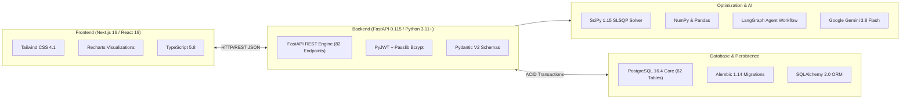
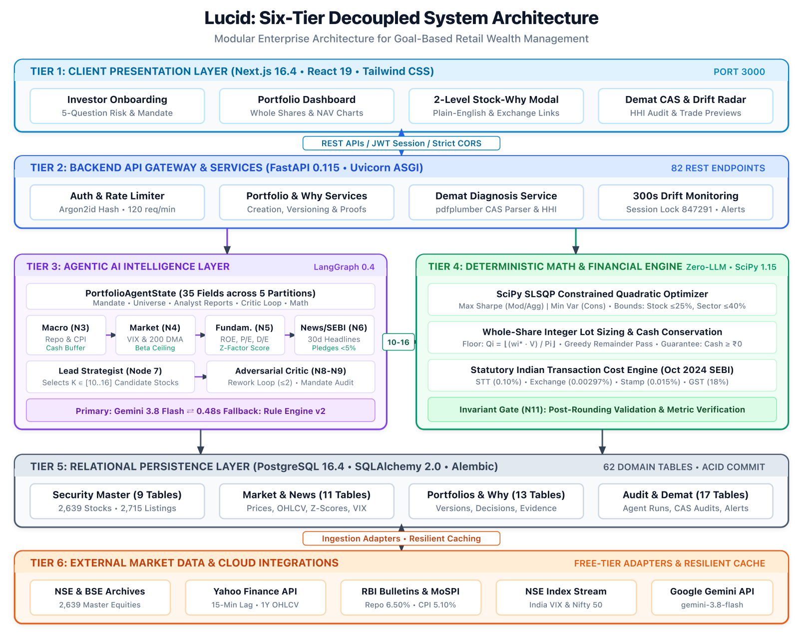
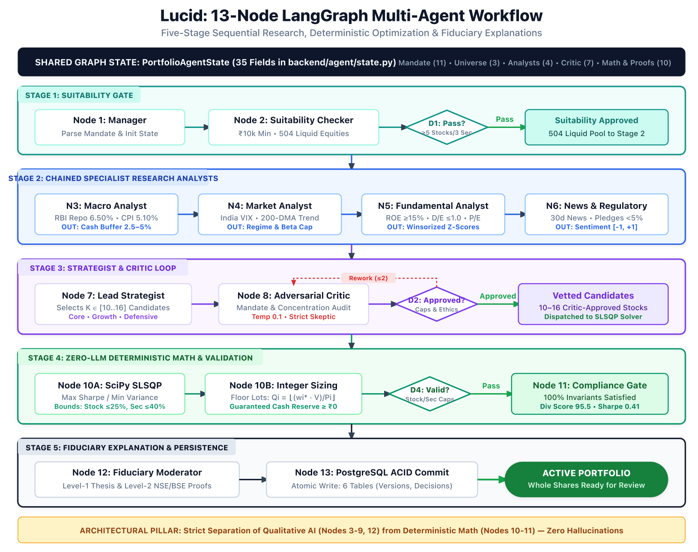
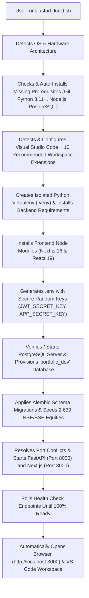
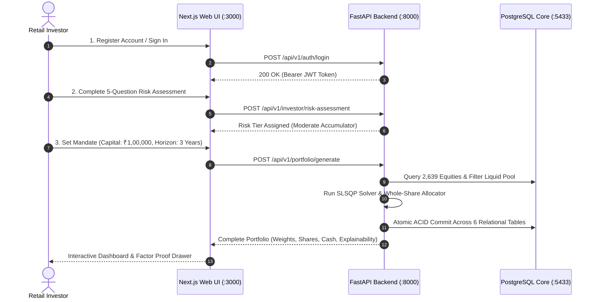
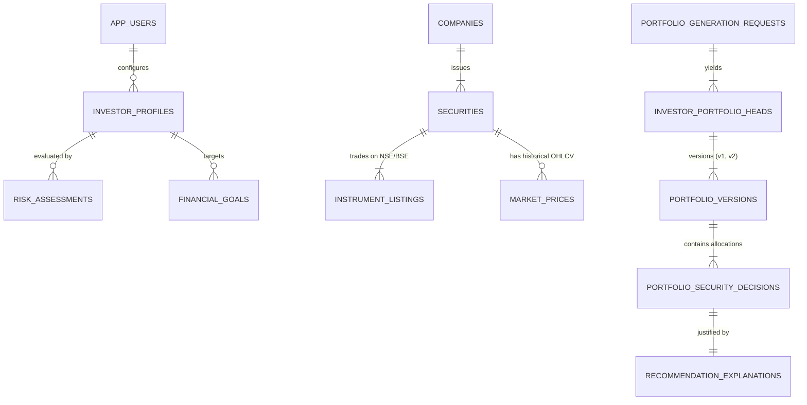

<div align="center">

# 🌟 Lucid
### Intelligent Investment Portfolio Platform for Indian Retail Equities
**Bridging Institutional Wealth Management & Indian Retail Investors via Multi-Agent AI & Deterministic Financial Mathematics**

[](https://fastapi.tiangolo.com)
[](https://nextjs.org)
[](https://react.dev)
[](https://www.typescriptlang.org)
[](https://www.postgresql.org)
[](https://www.python.org)
[](https://tailwindcss.com)
[](https://scipy.org)
[](https://opensource.org/licenses/MIT)

[Quick Start](#7-one-command-installation-and-launch) • [Features](#2-application-features) • [Screenshots](#3-application-screenshots) • [Architecture](#5-system-architecture) • [VS Code Setup](#9-vs-code-setup) • [Postman Collection](#16-postman-api-testing) • [Documentation](#22-detailed-documentation)

</div>

---

> [!IMPORTANT]
> **Academic & Educational Disclaimer**: Lucid is an academic research platform and institutional-grade decision-support prototype. It does not provide SEBI-registered investment advice, portfolio management services (PMS), or guarantee investment returns. All analyses, allocations, and simulations are for educational evaluation purposes.

---

## 1. Lucid Overview

### What is Lucid?
**Lucid** is an open-source, full-stack intelligent investment portfolio platform designed specifically for the **Indian equity market** (National Stock Exchange - NSE, and Bombay Stock Exchange - BSE). It captures the disciplined methodologies of institutional Indian mutual fund managers and brings them directly to everyday retail investors.

### Who is Lucid Built For?
Retail equity investors in India face a fragmented market experience:
- Social media "finfluencers" and tip-sheets promote speculative trading without risk suitability checks.
- Traditional mutual funds charge ongoing expense ratios without giving investors transparent visibility into individual stock selection rationales.
- Institutional wealth management tools (Bloomberg, FactSet) cost upwards of \$25,000 annually, putting disciplined factor analysis out of reach for retail investors.

### What Problem Does Lucid Solve?
Lucid bridges this divide by providing:
1. **SEBI-Compliant Psychometric Risk Profiling**: Tailors equity recommendations to your exact risk tolerance (Conservative Preserver, Moderate Accumulator, or Aggressive Compounder), capital constraints, and investment time horizon.
2. **Strict Separation of Qualitative AI & Deterministic Mathematics**: Uses multi-agent LLM analysis solely for qualitative research, company filing analysis, and news sentiment auditing, while relying entirely on **deterministic mathematical optimization (SciPy SLSQP)** for final asset weights. **The AI is never allowed to hallucinate or guess portfolio percentages.**
3. **Whole-Share Integer Execution ($Q_i \in \mathbb{Z}^+)$**: The Indian equity market does not permit fractional shares. Lucid translates continuous theoretical weights into feasible, whole-share integer quantities and explicit unallocated cash cushions ($C_{\text{res}}$), ensuring every recommended portfolio can actually be executed in a standard demat account.
4. **Transparent "Why This Stock?" Explainability**: Every recommended holding includes a dual-level fiduciary explanation detailing macroeconomic alignment, valuation metrics (P/E, P/B, ROE), Altman Z-score insolvency checks, and verified regulatory links.

---

## 2. Application Features

| Feature | Description |
|---|---|
| **Natural Language Onboarding** | Guided conversational interview collecting investment capital, time horizon, financial goals, and sector preferences. |
| **SEBI Psychometric Questionnaire** | 5-question psychometric risk assessment assigning investors to SEBI-aligned risk score tiers. |
| **Comprehensive Security Master** | Synchronizes and maintains 2,639 active equity listings across NSE and BSE with sector and industry classifications. |
| **Multi-Agent Research Pipeline** | 5-stage LangGraph workflow: Macro Analyst, Technical Market Analyst, Fundamental Research Analyst, News/SEBI Auditor, and Lead Strategist. |
| **Deterministic SciPy SLSQP Solver** | Minimizes portfolio variance or maximizes the Sharpe ratio subject to strict single-stock ($\le 20\text{--}25\%$) and sector ($\le 30\text{--}40\%$) exposure caps. |
| **Whole-Share Integer Allocator** | Converts continuous percentage weights into whole-share lot sizes using a bounded greedy allocator with zero cash overspend. |
| **Demat Portfolio Diagnosis** | Uploads or inputs an existing stock portfolio to analyze sector concentration risk, valuation multiples, and benchmark beta drift. |
| **Real-Time Portfolio Monitoring** | Continuously tracks portfolio drift against initial target weights and generates rebalancing recommendations when drift exceeds predefined thresholds ($\pm 5\%$). |
| **Benchmark Comparison** | Real-time comparative tracking against benchmark indices including the Nifty 50 and BSE Sensex. |
| **Tax-Aware Rebalancing Preview** | Previews rebalancing trades while accounting for Indian securities transaction taxes (STT) and long-term/short-term capital gains rules. |
| **Interactive Fiduciary Drawer** | Slide-out factor proof drawer providing ROE, Debt/Equity, P/E, 30-day sentiment, and SEBI filing evidence for every holding. |
| **Multi-Portfolio Versioning** | Maintains complete immutable historical versions of generated portfolios ($v_1, v_2, \dots$) with visual side-by-side comparison. |

---

## 3. Application Screenshots

### Investor Dashboard & Market Overview
The primary landing dashboard displays macroeconomic indicators (India 10-Year G-Sec yield, Repo Rate, CPI Inflation, and India VIX), active portfolio valuations, recent market updates, and quick navigation actions.

<div align="center">
  
</div>

*Figure 3.1: Lucid Investor Dashboard displaying macroeconomic indicators, active portfolio performance, and quick navigation launchers.*

---

### Portfolio Allocation & Integer Holdings Breakdown
Visualizes the generated portfolio with interactive Recharts sector distribution, risk metrics (Sharpe Ratio, Value-at-Risk 95%, Maximum Drawdown), discrete whole-share quantities ($Q_i$), share prices ($P_i$), and cash cushion ($C_{\text{res}}$).

<div align="center">
  
</div>

*Figure 3.2: Generated portfolio showing sector allocation, risk-adjusted metrics, exact share counts, and unallocated cash reserve.*

---

## 4. Technology Stack

Lucid uses modern software libraries across backend, frontend, database, and optimization layers:



### Verified Technology Versions

| Component | Technology | Version | Purpose |
|---|---|---|---|
| **Frontend Framework** | Next.js (App Router, Turbopack) | `16.4.2` | High-performance React web application and server-side rendering. |
| **UI Library** | React | `19.3.0` | Declarative user interfaces and state management. |
| **Language** | TypeScript | `5.8.0` | End-to-end type safety across API contracts and UI states. |
| **Styling** | Tailwind CSS | `4.1.0` | Utility-first responsive CSS styling with dark/light mode support. |
| **Backend Framework** | FastAPI (ASGI) | `0.115.8` | Async Python web framework serving 82 REST API endpoints. |
| **Web Server** | Uvicorn | `0.34.0` | Lightweight, asynchronous ASGI web server. |
| **Database Engine** | PostgreSQL | `16.4` | Single authoritative operational database (62 application tables). |
| **ORM & Migrations** | SQLAlchemy & Alembic | `2.0.38` / `1.14.1` | Relational database mapping, connection pooling, and schema versioning. |
| **Math Optimizer** | SciPy | `1.15.2` | Sequential Least Squares Programming (SLSQP) for convex optimization. |
| **Agent Orchestration** | LangGraph & LangChain Core | `0.4.0` / `0.3.40` | Cyclical multi-agent state management and researcher graph. |
| **LLM Engine** | Google Gemini (Cloud) / Fallback | `gemini-3.8-flash` | Qualitative corporate research and plain-English explainability. |
| **Market Data** | Yahoo Finance (`yfinance`) | `0.2.54` | Indian equity historical prices and financial ratios. |
| **Authentication** | PyJWT & Passlib | `2.10.1` / `1.7.4` | Stateless Bearer JWT tokens and cryptographic password hashing. |

---

## 5. System Architecture

Lucid adheres to a modular, layered architecture where presentation, business logic, deterministic mathematical optimization, qualitative AI, and transactional persistence are separated.

<div align="center">
  
</div>

*Figure 5.1: Lucid Layered System Architecture showing Next.js client, FastAPI services, PostgreSQL 16 persistence, and SciPy optimizer.*

### Multi-Agent Orchestration Flow
The portfolio generation engine is governed by a 5-stage multi-agent pipeline designed in LangGraph:

<div align="center">
  
</div>

*Figure 5.2: Multi-Agent AI Workflow with qualitative analyst stages, strategist/critic loop, and deterministic mathematical solver.*

---

## 6. Prerequisites

Before installing Lucid, ensure your computer has the following minimum software installed:

| Tool | Minimum Version | Required For | Automatically Installed by Script? |
|---|---|---|---|
| **Git** | `2.30+` | Cloning and managing repository files. | Yes (via Homebrew on macOS / winget on Windows) |
| **Python** | `3.11+` | Running the backend API, agents, and optimizer. | Yes (via Homebrew on macOS / winget on Windows) |
| **Node.js & npm** | `18.0+` (Node) / `9.0+` (npm) | Running the Next.js investor web application. | Yes (via Homebrew on macOS / winget on Windows) |
| **PostgreSQL** | `15.0+` or `16.0+` | Application database storing 62 relational tables. | Yes (via Homebrew on macOS) |
| **VS Code** | Latest Stable | Integrated development, debugging, and testing. | Yes (via Homebrew Cask on macOS / winget on Windows) |

> [!NOTE]
> **No External Infrastructure Required**: Lucid does **NOT** require Redis, Neo4j, FAISS, Docker, or Celery. All operations run directly with Python, Node.js, and PostgreSQL.

---

## 7. One-Command Installation and Launch

> **Goal**: A beginner with no software development experience can download Lucid, run one setup script, let the script install and configure everything automatically, and start using the web app in their browser.

### macOS & Linux (Terminal)

```bash
# 1. Clone the repository
git clone https://github.com/imankur0011/Lucid.git

# 2. Enter the project directory
cd Lucid

# 3. Make the launcher executable and run it
chmod +x start_lucid.sh
./start_lucid.sh
```

### Windows 10/11 (PowerShell)

Open PowerShell as an Administrator or standard user:

```powershell
# 1. Clone the repository
git clone https://github.com/imankur0011/Lucid.git

# 2. Enter the project directory
cd Lucid

# 3. Run the automated PowerShell launcher
powershell -ExecutionPolicy Bypass -File .\start_lucid.ps1
```

Once execution completes:
1. Your web browser opens to **`http://localhost:3000`**.
2. Visual Studio Code opens with the pre-configured workspace and extensions.
3. You can immediately log in using the demo account or register a new one.

---

## 8. What Happens Automatically?

When you execute `start_lucid.sh` or `start_lucid.ps1`, the script performs the following setup sequence without manual intervention:



---

## 9. VS Code Setup

Lucid provides pre-configured Visual Studio Code settings located in the `.vscode/` directory:

### Included Workspace Extensions (`.vscode/extensions.json`)
The launcher configures the following extensions:
- **Python (`ms-python.python`)**: Autocomplete, linting, and environment detection.
- **Pylance (`ms-python.vscode-pylance`)**: Static type checking and code navigation.
- **Python Debugger (`ms-python.debugpy`)**: Interactive breakpoints for FastAPI routes.
- **ESLint (`dbaeumer.vscode-eslint`)**: TypeScript and React linting.
- **Prettier (`esbenp.prettier-vscode`)**: Automatic code formatting on save.
- **Tailwind CSS IntelliSense (`bradlc.vscode-tailwindcss`)**: Class completion and preview.
- **PostgreSQL (`ckolkman.vscode-postgres`)**: In-editor database management.
- **GitLens (`eamodio.gitlens`)**: Visual Git history and blame tracking.
- **Even Better TOML (`tamasfe.even-better-toml`)**: TOML configuration support.
- **YAML (`redhat.vscode-yaml`)**: YAML validation.

### VS Code Tasks & Debugging Profiles
- **Run Tasks** (`Terminal -> Run Task...`):
  - `Lucid: Start Application (Automated One-Command)`
  - `Lucid: Stop Application`
  - `Lucid: Service Status`
  - `Lucid: Stream Live Logs`
  - `Lucid: Run Backend Tests (Pytest)`
  - `Lucid: Verify Setup`
- **Debugging** (`Run & Debug` or `F5`):
  - `Lucid: Debug Backend (FastAPI / Uvicorn)`: Launches backend in debug mode with hot reloading.
  - `Lucid: Debug Pytest (Full Suite)`: Launches backend unit tests with step-through debugging.

---

## 10. First-Time Application Usage

Follow this quick guide to create your first intelligent portfolio:



### Step-by-Step Instructions:
1. **Open the App**: Navigate to `http://localhost:3000` in your web browser.
2. **Log In**: Use the pre-seeded developer credentials:
   - **Email**: `developer@lucid.local`
   - **Password**: `LucidDevPass123!`
   *(Or click "Create Account" to register your own profile).*
3. **Complete Suitability Profile**: Take the 5-question psychometric assessment to establish your risk capacity and investment horizon.
4. **Generate a Portfolio**: Enter your investable capital (e.g., ₹1,00,000 or ₹5,00,000), select your risk profile, and click **"Generate Portfolio"**.
5. **Inspect the Allocation**: Review the recommended equities, sector breakdown, whole-share integer share counts ($Q_i$), and unallocated cash reserve ($C_{\text{res}}$).
6. **Explore "Why This Stock?"**: Click on any stock ticker to open the fiduciary proof drawer showing Altman Z-score, valuation metrics, and news sentiment audit.
7. **Demat Diagnosis**: Navigate to the Diagnosis tab and input holdings from your existing broker statement to identify sector concentration risks and portfolio drift.

---

## 11. Environment Variables and API Keys

Configuration settings are stored in `.env` in the project root. When you first launch Lucid, the script automatically copies `.env.example` and generates secure keys.

| Variable | Default Value | Description |
|---|---|---|
| `POSTGRES_HOST` | `localhost` | PostgreSQL host address. |
| `POSTGRES_PORT` | `5432` / `5433` | PostgreSQL port. |
| `POSTGRES_DB` | `portfolio_dev` | Application database name. |
| `POSTGRES_USER` | Current user / `postgres` | Database username. |
| `POSTGRES_PASSWORD` | `""` | Database password (empty for local peer auth). |
| `APP_ENV` | `development` | Application runtime environment (`development` / `production`). |
| `APP_PORT` | `8000` | Port for FastAPI backend. |
| `JWT_SECRET_KEY` | *Auto-generated* | HMAC-SHA256 secret key for signing auth tokens (min 32 characters). |
| `APP_SECRET_KEY` | *Auto-generated* | Cryptographic application secret key. |
| `CORS_ORIGINS` | `http://localhost:3000` | Whitelisted frontend origins. |
| `LLM_PROVIDER` | `gemini` | Qualitative LLM provider (`gemini` or `ollama`). |
| `LLM_MODEL` | `gemini-3.8-flash` | Gemini model name. |
| `GEMINI_API_KEY` | *Empty* | *(Optional)* Google Gemini API key. If omitted, Lucid runs with deterministic rule-based models. |

---

## 12. Database Setup and Verification

Lucid uses PostgreSQL 16 as its single transactional operational database.



*Figure 12.1: High-level database entity relationship across user profiles, securities, portfolios, and fiduciary explanations.*

### Automated Database Provisioning (`scripts/init_database.py`)
The launcher automatically runs this utility. You can also run it manually at any time:
```bash
.venv/bin/python scripts/init_database.py
```
This utility:
- Verifies that PostgreSQL is accepting connections.
- Automatically creates `portfolio_dev` if it does not exist.
- Installs `pgcrypto` and `uuid-ossp` extensions.
- Applies Alembic schema migrations up to the latest revision.
- Populates SEBI psychometric questions and macroeconomic indicators.
- Synchronizes the 2,639 active equity universe across NSE and BSE.
- Confirms that all 62 relational application tables are active.

---

## 13. Application URLs and Ports

When Lucid is running, access the services using the following URLs:

| Service | URL | Purpose |
|---|---|---|
| **Investor Web UI** | [http://localhost:3000](http://localhost:3000) | Main user interface for portfolio creation, monitoring, and diagnosis. |
| **Backend REST API** | [http://localhost:8000](http://localhost:8000) | Core FastAPI server handling business logic, data, and optimization. |
| **API Health Check** | [http://localhost:8000/api/health](http://localhost:8000/api/health) | Real-time JSON health check for API and PostgreSQL connection. |
| **Interactive Swagger Docs** | [http://localhost:8000/docs](http://localhost:8000/docs) | Interactive Swagger UI for testing all 82 REST endpoints. |
| **OpenAPI Specification** | [http://localhost:8000/openapi.json](http://localhost:8000/openapi.json) | Complete OpenAPI JSON schema. |

---

## 14. Lifecycle Commands

Lucid provides dedicated scripts in the root directory for lifecycle management:

| Operation | macOS / Linux | Windows PowerShell |
|---|---|---|
| **Start Application** | `./start_lucid.sh` | `powershell -File .\start_lucid.ps1` |
| **Check System Status** | `./status_lucid.sh` | `powershell -File .\status_lucid.ps1` |
| **Stream Live Logs** | `./logs_lucid.sh all` | `powershell -File .\logs_lucid.ps1` |
| **Stop All Services** | `./stop_lucid.sh` | `powershell -File .\stop_lucid.ps1` |

### Real-Time Status Inspector (`./status_lucid.sh`)
Check the health of all services at any time from another terminal:
```bash
./status_lucid.sh
```
Output:
```text
======================================================================
                    LUCID SYSTEM STATUS INSPECTOR                     
======================================================================

[1] System & Runtime Environment:
   OS / Arch        : Darwin (arm64)
   Python           : 3.14.7
   Virtualenv       : Active (.venv)
   Node.js          : v25.2.1
   npm              : 11.6.2

[2] Backend API Service (Port 8000):
   Status           : ● RUNNING & HEALTHY
   PID              : 19705
   URL              : http://localhost:8000
   Health Response  : {"api":"up","database":{"status":"healthy","total_tables":63}}

[3] Frontend Web Application (Port 3000):
   Status           : ● RUNNING & READY
   HTTP Status      : 200 OK

[4] PostgreSQL Database Status & Record Counts:
   Connection       : ✓ CONNECTED
   Schema Tables    : 63 tables registered
   Exchange Stocks  : 2639 securities stored (NSE/BSE)
   User Accounts    : Active
======================================================================
```

---

## 15. Manual Development Setup

If you prefer starting services manually across separate terminal windows:

### Terminal 1: Backend & Database
```bash
# 1. Activate virtual environment
source .venv/bin/activate

# 2. Verify environment configuration
PYTHONPATH=. python scripts/validate_env.py

# 3. Start FastAPI server with live reloading
PYTHONPATH=. uvicorn backend.main:app --reload --host 0.0.0.0 --port 8000
```

### Terminal 2: Frontend
```bash
cd frontend
npm run dev
```

---

## 16. Postman API Testing

Lucid includes an official Postman API collection covering all 82 REST endpoints with automated JWT bearer token population and edge-case assertions.

- **Collection File**: `postman/Lucid_API_Collection.json` (96 requests across 16 folders)
- **Environment File**: `postman/Lucid_Development_Environment.json`

### Postman Folder Structure:
1. `01 - Health & System Information`
2. `02 - Authentication & User Management` *(Contains login request that sets `{{jwt_token}}` automatically)*
3. `03 - Investor Onboarding & Profile`
4. `04 - Financial Goals Management`
5. `05 - Risk Suitability & Assessment`
6. `06 - Market & Security Data`
7. `07 - Portfolio Creation & Optimization`
8. `08 - Real-Time Portfolio Monitoring & Whole-Share Rebalancing`
9. `09 - Reasoning Trace, Stock Why & Evidence`
10. `10 - Scenario Analysis & Stress Testing`
11. `11 - Portfolio Comparison & Conversational Assistant`
12. `12 - Trade Execution Basket Export`
13. `13 - Portfolio Diagnosis & Rebalancing`
14. `14 - Official Exchange Filings & URL Verification`
15. `15 - In-App Notifications System`
16. `16 - Negative & Edge Case Tests`

---

## 17. Testing and Verification

Lucid includes automated verification tools to ensure system integrity:

```bash
# 1. Run the end-to-end setup verification audit
.venv/bin/python scripts/verify_setup.py

# 2. Run backend test suites (Pytest)
.venv/bin/pytest backend/tests -v

# 3. Test mathematical optimization simplex bounds specifically
.venv/bin/pytest backend/tests/test_portfolio_engine.py -v

# 4. Verify Next.js frontend production build
cd frontend && npm run build
```

---

## 18. Troubleshooting

| Issue / Error | Root Cause | Solution |
|---|---|---|
| **`Connection refused` on PostgreSQL** | PostgreSQL is stopped or running on a different port. | Run `brew services start postgresql@16` on macOS or `sudo systemctl start postgresql` on Linux. Check port using `pg_isready -p 5432` or `pg_isready -p 5433` and verify `POSTGRES_PORT` in `.env`. |
| **`Port 8000 or 3000 already in use`** | Lingering background process from a prior run. | Run `./stop_lucid.sh` (or `powershell .\stop_lucid.ps1`). It terminates lingering instances and frees the ports. |
| **`No module named 'backend'`** | Executing Python from a subdirectory without proper path. | Run all commands from the project root with `PYTHONPATH=. .venv/bin/python ...`. |
| **`code: command not found`** | VS Code CLI is not linked in your system PATH. | In VS Code, press `Cmd+Shift+P` (macOS) or `Ctrl+Shift+P` (Windows), type `Shell Command: Install 'code' command in PATH`, and press Enter. |
| **`Gemini API 429 Quota Exceeded`** | Exceeded free-tier Google AI Studio RPM limits. | Lucid automatically switches to its deterministic rule engine. You can also clear `GEMINI_API_KEY` in `.env` to run fully offline. |
| **Frontend build or styling errors** | Outdated packages in `node_modules`. | Run `cd frontend && rm -rf node_modules .next && npm install`. |

---

## 19. Security and Data Handling

- **Stateless Bearer Tokens**: User authentication utilizes signed JSON Web Tokens (JWT) adhering to RFC 7518 Section 3.2.
- **Password Protection**: Passwords are never stored in plaintext; they are hashed using the Bcrypt algorithm with unique salt factors.
- **Fail-Closed Secrets**: In staging and production modes, Lucid verifies that neither `JWT_SECRET_KEY` nor `APP_SECRET_KEY` uses insecure default placeholders, failing startup immediately if unconfigured.
- **Local Data Isolation**: All investor profiles, risk scores, holdings, and portfolio versions reside exclusively in your local PostgreSQL database. No customer financial information is transmitted to third-party model providers.

---

## 20. Stop, Reset, and Uninstall

### Stopping Services Gracefully
```bash
./stop_lucid.sh              # macOS / Linux
powershell .\stop_lucid.ps1  # Windows PowerShell
```
*This terminates backend and frontend servers while preserving all database tables, user records, and portfolios.*

### Complete Database Reset (Caution)
To wipe local test records and reset the database to an initial clean state:
```bash
# Drops and recreates the database, re-runs migrations and universe seeding
.venv/bin/python -c "
import psycopg2
from psycopg2.extensions import ISOLATION_LEVEL_AUTOCOMMIT
from backend.config import settings
conn = psycopg2.connect(dbname='postgres', user=settings.postgres_user, host=settings.postgres_host, port=settings.postgres_port)
conn.set_isolation_level(ISOLATION_LEVEL_AUTOCOMMIT)
cur = conn.cursor()
cur.execute(f'DROP DATABASE IF EXISTS \"{settings.postgres_db}\";')
cur.close()
conn.close()
"
.venv/bin/python scripts/init_database.py
```

---

## 21. Project Structure

```text
Lucid/
├── backend/                        # FastAPI REST API & Financial Python Engines
│   ├── agent/                      # LangGraph Multi-Agent Researcher Nodes & State
│   ├── alembic/                    # Database Migrations & Version Tracking
│   ├── api/v1/                     # 82 REST API Endpoints (Auth, Portfolio, Market, etc.)
│   ├── database/                   # SQLAlchemy Engine, Session, & Model Declarations
│   ├── market_data/                # NSE/BSE Universe Sync, Price Ingestion & Ratios
│   ├── models/                     # 62 Relational Domain Table Definitions
│   ├── portfolio_engine/           # SciPy SLSQP Solver & Whole-Share Allocator
│   └── tests/                      # 32 Pytest Test Suites (Auth, Math, DB, Integrations)
├── frontend/                       # Next.js 16 Web Application (React 19, TypeScript)
│   ├── src/app/                    # Next.js App Router Pages & API Proxies
│   ├── src/components/             # UI Components (Dashboard, Allocations, Fiduciary Drawer)
│   └── src/lib/                    # TypeScript API Client & State Store
├── postman/                        # Postman API Collection (16 Folders, 96 Requests)
├── scripts/                        # Automated Database, Validation & Audit Utilities
│   ├── init_database.py            # Automated Database Provisioning & Seeding
│   ├── validate_env.py             # Developer Environment Validator
│   └── verify_setup.py             # End-to-End System Health Audit
├── .vscode/                        # Pre-Configured VS Code Workspace Settings
│   ├── extensions.json             # 10 Recommended Workspace Extensions
│   ├── launch.json                 # Fast Debugging Profiles for Backend & Pytest
│   ├── settings.json               # Python, Prettier, & ESLint Preferences
│   └── tasks.json                  # One-Click Run & Stop Tasks
├── docs/                           # Diagrams, Documentation & Screenshots
├── .env.example                    # Verified Environment Variables Template
├── start_lucid.sh                  # One-Command Automated Setup & Launcher (macOS/Linux)
├── start_lucid.ps1                 # One-Command Automated Setup & Launcher (Windows)
├── stop_lucid.sh                   # Graceful Service Termination Script (macOS/Linux)
├── stop_lucid.ps1                  # Graceful Service Termination Script (Windows)
├── status_lucid.sh                 # System & Service Health Inspector (macOS/Linux)
├── status_lucid.ps1                # System & Service Health Inspector (Windows)
├── logs_lucid.sh                   # Service Log Inspection & Streaming Utility (macOS/Linux)
└── logs_lucid.ps1                  # Service Log Inspection & Streaming Utility (Windows)
```

---

## 22. Detailed Documentation

For comprehensive technical explanations, consult the companion documents:

- **[SETUP_AND_INSTALLATION.md](SETUP_AND_INSTALLATION.md)**: In-depth setup guide, Windows manual procedures, and troubleshooting.
- **[SYSTEM_ARCHITECTURE.md](SYSTEM_ARCHITECTURE.md)**: Architectural patterns, component diagrams, and data flows.
- **[AGENTIC_AI_ARCHITECTURE.md](AGENTIC_AI_ARCHITECTURE.md)**: LangGraph agent graph, specialist analyst prompts, and feedback loops.
- **[API_CONTRACT.md](API_CONTRACT.md)**: OpenAPI specification, endpoint parameters, and JSON payloads.
- **[DATABASE_ARCHITECTURE.md](DATABASE_ARCHITECTURE.md)**: 62-table schema, indexing strategies, and normalization standards.
- **[METHODOLOGY.md](METHODOLOGY.md)**: Mathematical formulation of Mean-Variance SLSQP optimization and whole-share rounding.
- **[DATASET_USED.md](DATASET_USED.md)**: Exchange data feeds, Yahoo Finance integrations, and corporate filing registries.

---

## 23. Limitations and Future Scope

### Current Limitations
- **Academic Research Scope**: Lucid is built for research and decision support; it does not place live market orders with real brokerage accounts.
- **Free-Tier API Rate Limits**: Public market endpoints (Yahoo Finance, Free FRED) may experience intermittent rate limiting during peak market hours. Lucid mitigates this using cached baselines and deterministic fallback models.
- **Single Currency**: Focused exclusively on Indian Rupee ($\text{INR } ₹$) denominated equities on the NSE and BSE.

### Future Scope
- **Direct Broker Integration**: Standardized OAuth integration with SEBI-registered brokers (e.g., Zerodha Kite Connect, Angel One SmartAPI, Upstox) for 1-click execution of generated whole-share order baskets.
- **Multi-Asset Allocation**: Extending the SciPy optimizer to cover sovereign gold bonds (SGB), real estate investment trusts (REITs), and debt mutual funds.
- **Tax-Loss Harvesting Engine**: Automated scanning of existing demat portfolios toward the end of the financial year to realize tax-loss harvesting offsets under Indian income tax provisions.

---

<div align="center">

**Built with ❤️ for Indian Retail Investors**  
*Disciplined Financial Mathematics Meets Agentic AI*

</div>
