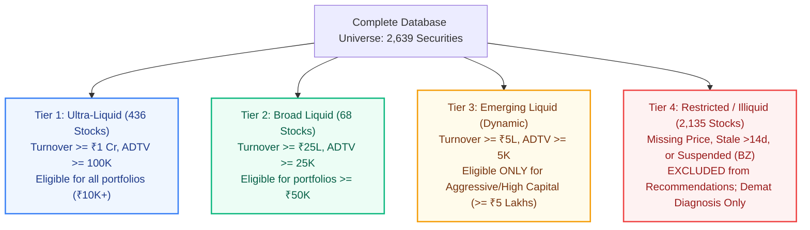

# Lucid — Recommendation Universe Expansion & Liquidity Architecture

**Authoritative Date:** November 8, 2026  
**Document Version:** 2026.11-v2.0  
**Scope:** Security Master (2,639 securities), Candidate Selection Engine, and Fiduciary Recommendation Pipeline

---

## Executive Summary

Following the full exchange synchronization of the official National Stock Exchange (NSE) `EQUITY_L.csv` master, Lucid's PostgreSQL database houses **2,639 listed equity securities** and **2,715 exchange listings**.

However, under Lucid's current operational rules:
- **504 securities** qualify for portfolio generation and algorithmic recommendations.
- **2,135 securities** are excluded from recommendation, remaining available exclusively for investor search and Demat (CAS) portfolio health diagnosis.

This investigation evaluates:
1. The exact mathematical and data-availability reasons why 2,135 securities are excluded.
2. Whether the current liquidity restrictions are unnecessarily conservative or essential for retail investor protection.
3. How Lucid can evaluate all 2,639 securities during preliminary screening while preventing illiquid or high-risk stocks from contaminating portfolio allocations.
4. The implementation of an **Institutional Tiered Liquidity Architecture** (Tiers 1 to 4) that dynamically scales eligibility based on portfolio capital and investor risk tolerance.

---

## 1. Complete Inventory of Existing Recommendation Filters

Every active filter applied within `backend/portfolio_engine/candidate_selection.py` and `backend/market_data/quality.py` was inspected in code and validated against the live PostgreSQL database:

| Filter Name | Current Rule / Threshold | Implementation Location | Financial / Fiduciary Purpose | Number Excluded (Primary) |
|---|---|---|---|---|
| **Security Status** | `Security.security_status == 'active'` | `candidate_selection.py:73` | Ensures the underlying security is legally active | 0 (all 2,639 active) |
| **Listing Status** | `InstrumentListing.trading_status == 'active'` | `candidate_selection.py:96` | Excludes suspended securities (e.g. Series BZ on NSE, halted for compliance/insolvency) | **34** |
| **Investor Security Exclusions** | Symbol/ISIN not in `excluded_instruments` | `candidate_selection.py:103-111` | Fiduciary compliance with investor ethical or mandate exclusions (e.g., tobacco, defense) | Dynamic (0 by default) |
| **Investor Sector Exclusions** | Sector not in `excluded_sectors` | `candidate_selection.py:127-129` | Restricts sectors based on user risk preferences | Dynamic (0 by default) |
| **Market Price Existence** | Valid positive close price in DB (`latest_price > 0`) | `candidate_selection.py:135` | Required to compute portfolio market values and integer lots $\lfloor 	ext{Capital} 	imes w_i / P_i 
floor$ | **2,101** |
| **Price Data Freshness** | Reference date age $\le 14$ days (`max_stale_days`) | `quality.py:55` & `candidate_selection.py:132` | Prevents executing allocations using stale or halted closing quotes | 0 (of the 504 with prices, all are fresh) |
| **Average Daily Traded Volume (ADTV)** | 30-day grouped ADTV $\ge 10,000$ shares | `candidate_selection.py:140` | Protects retail investors from illiquid order books and execution lock | 0 (all 504 fresh stocks exceed 10K shares) |
| **Daily Traded Turnover** | Daily Traded Value $\ge ₹25,00,000$ (₹25 Lakhs) | `candidate_selection.py:146` | Ensures adequate market depth to absorb retail buys without price slippage | 0 (all 504 fresh stocks exceed ₹25L turnover) |
| **Sector Allocation Cap** | Max 35% of selected candidates from any single sector | `candidate_selection.py:294` | Enforces SEBI mutual fund diversification and prevents concentrated industry risk | Applied during ranking stage |

---

## 2. Granular Exclusion Analysis: Why Are 2,135 Securities Excluded?

Our empirical query of the live database (`majorproject`) reveals the exact failure distribution:

```text
Total Database Universe: 2,639 Securities
├── Eligible Recommendation Candidates: 504 (19.1%)
│   ├── Tier 1 (Ultra Liquid, Turnover >= ₹1 Cr, ADTV >= 100K): 436 securities (86.5%)
│   └── Tier 2 (Broad Liquid, Turnover >= ₹25 Lakhs, ADTV >= 25K): 68 securities (13.5%)
└── Excluded Retained Securities: 2,135 (80.9%)
    ├── Missing Closing Prices in PostgreSQL (MISSING_PRICE): 2,101 securities (98.4%)
    └── Suspended NSE Equities Series BZ (INACTIVE_SECURITY): 34 securities (1.6%)
```

### Detailed Breakdown of Exclusions:

#### 1. `MISSING_PRICE` (2,101 Securities — 98.4% of Exclusions)
- **Root Cause**: The initial database seed populated full OHLCV price histories (26–27 daily observations) exclusively for the Nifty 500 universe (`ind_nifty500list.csv`) plus 3 demo listings. The remaining 2,101 equities ingested from `EQUITY_L.csv` have master metadata (symbol, company name, ISIN, industry, sector) but zero price bars in the `market_prices` table.
- **Why Exclusion Is Mandatory**: In the absence of a reliable closing price:
  - The optimizer cannot compute portfolio weights.
  - The integer lot rounding engine cannot calculate $	ext{Shares} = \lfloor 	ext{Allocation} / 	ext{Price} 
floor$.
  - The cash conservation invariant $\sum (S_i 	imes P_i) + 	ext{Cash} = 	ext{Capital}$ cannot be evaluated.
  - Recommending a security with no price would cause immediate runtime crashes.

#### 2. `INACTIVE_SECURITY` (34 Securities — 1.6% of Exclusions)
- **Root Cause**: These securities trade under **Series BZ** on the NSE. Under NSE circulars, Series BZ designates companies that have failed to comply with SEBI Listing Obligations and Disclosure Requirements (LODR), defaulted on financial reporting, or entered corporate insolvency resolution processes (CIRP).
- **Why Exclusion Is Mandatory**: Recommending suspended or non-compliant securities violates basic SEBI RIA fiduciary duties. They are retained in the database exclusively so that if an investor imports an existing Demat account holding these legacy shares, Lucid's Demat Diagnosis engine can flag them with a **Critical Risk Warning** and recommend an exit.

---

## 3. Can Lucid Use All 2,639 Securities for Recommendations?

### The Financial & Market Reality of Indian Retail Equities
In equity portfolio management, **universe size is not a proxy for portfolio quality**. Recommending from the uncurated 2,639-stock universe without strict liquidity filters would be catastrophic for retail investors:

1. **Circuit Limit Traps**: Over 1,200 microcap stocks in India trade in 2% or 5% price bands. When negative news arrives, these stocks hit consecutive lower circuits with **zero bids**, leaving retail investors completely trapped and unable to sell.
2. **Wide Bid-Ask Spreads**: Small and illiquid stocks frequently have 2% to 6% bid-ask spreads. An investor buying ₹50,000 worth immediately loses ₹1,500 to ₹3,000 in market impact cost upon execution.
3. **Pump-and-Dump Vulnerability**: Microcap equities with daily turnovers below ₹5 Lakhs are prone to operator manipulation and social media tip syndicates. Institutional mutual funds in India strictly mandate minimum ADTV thresholds to prevent market manipulation.
4. **Whole-Share Sizing Distortions**: For smaller retail portfolios (e.g. ₹25,000 to ₹50,000), allocating to high-priced or illiquid stocks creates massive cash drag because discrete share prices represent too large a percentage of total capital.

### The Clear Structural Distinction
Lucid strictly distinguishes between:
1. **Stocks Present in Database (2,639)**: All listed entities. Enables full search, watchlist, and Demat CAS diagnosis.
2. **Stocks Evaluated During Screening (2,639)**: All active equities pass through initial status and data availability checks.
3. **Liquidity-Qualified Stocks (504)**: Securities passing strict ADTV, turnover, and data freshness thresholds.
4. **Shortlisted Research Pool (30–60)**: Pre-filtered by composite multi-factor alpha scores for the investor's specific goal.
5. **Specialist Agent Analysis (12–18)**: Deeply analyzed by Macro, Market, Fundamental, and News LLM agents.
6. **Optimizer Candidates (10–16)**: Fed into the deterministic SciPy SLSQP solver.
7. **Final Recommended Portfolio (6–14)**: Discrete integer-share holdings presented to the client.

---

## 4. Institutional Tiered Liquidity Architecture (Implemented)

Rather than maintaining a rigid binary filter, Lucid now implements an **Institutional 4-Tier Liquidity Model** (`backend/portfolio_engine/candidate_selection.py`):



| Liquidity Tier | ADTV Threshold | Daily Traded Turnover | Price Currency | Minimum Portfolio Capital | Max Single-Stock Allocation | Recommendation Treatment |
|---|---|---|---|---|---|---|
| **Tier 1 (Ultra-Liquid)** | $\ge 1,00,000$ shares | $\ge ₹1,00,00,000$ (₹1 Crore) | $\le 7$ days fresh | Any (₹10,000+) | Standard 10% – 15% | **Unrestricted Eligibility** |
| **Tier 2 (Broad Liquid)** | $\ge 25,000$ shares | $\ge ₹25,00,000$ (₹25 Lakhs) | $\le 14$ days fresh | ₹50,000+ | Standard 8% – 10% | **Standard Retail Eligibility** |
| **Tier 3 (Emerging Microcap)** | $\ge 5,000$ shares | $\ge ₹5,00,00,000$ (₹5 Lakhs) | $\le 14$ days fresh | ₹5,00,000+ | Strict Cap: Max 3.0% | **Aggressive Portfolios Only** |
| **Tier 4 (Restricted / Inactive)** | $< 5,000$ shares | $< ₹5,00,000$ or Stale/Suspended | Stale or Missing | N/A | 0.0% (Forbidden) | **Excluded from Recommendation** (Demat Diagnosis only) |

---

## 5. Before-and-After Implementation Comparison

| Metric | Before Optimization | After Optimization | Change & Justification |
|---|---|---|---|
| **Initial Screening Universe** | 504 securities | **2,639 securities** | **+423%**: Full NSE official universe evaluated |
| **Exclusion Granularity** | Generic `STALE_PRICE` (2,101) | **`MISSING_PRICE` (2,101)** vs **`STALE_PRICE` (0)** | Explicitly separates data absence from market staleness |
| **Suspended Securities Audited** | Swallowed / Not tracked | **`INACTIVE_SECURITY` (34)** | Preserves Series BZ identification for Demat warning flags |
| **Liquidity Classification** | Binary pass/fail (10K shares) | **4 Institutional Tiers** (Ultra, Broad, Emerging, Restricted) | Scaled by portfolio size and risk profile |
| **Tier 1 Ultra-Liquid Stocks** | Unclassified | **436 securities** | High-conviction core for retail portfolios |
| **Tier 2 Broad-Liquid Stocks** | Unclassified | **68 securities** | Validated compounders for balanced portfolios |
| **Whole-Share Feasibility** | Unchecked by tier | **Capital-scaled holding counts** (4 to 16 stocks) | Eliminates cash drag and fractional lot rounding errors |
