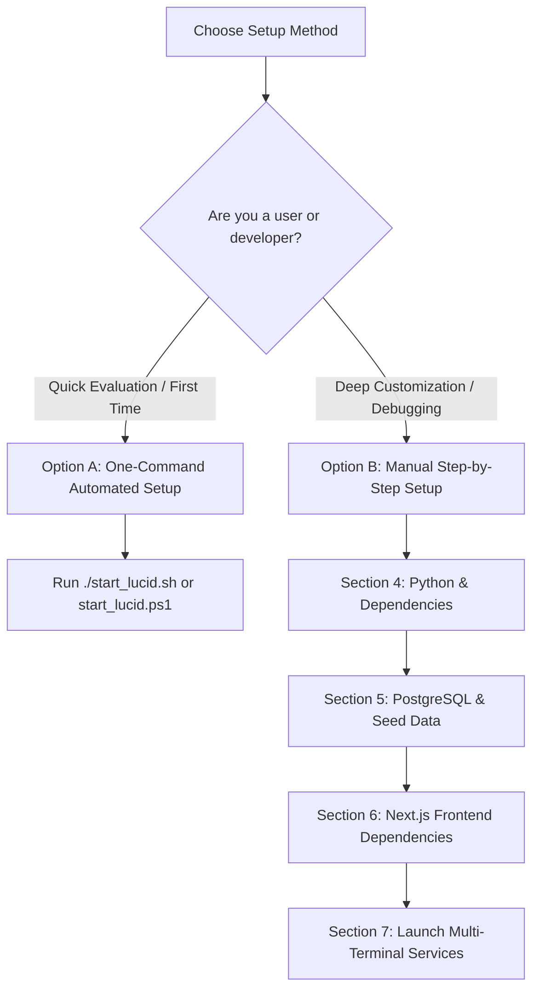

# Lucid — Complete Setup & Installation Guide

This document is the authoritative setup manual for **Lucid — Intelligent Investment Portfolio Platform for Indian Retail Equities**. It provides step-by-step instructions for both automated one-command installation and manual developer setup from scratch on macOS, Linux, and Windows.

---

## Table of Contents

- [Section 1: Overview — Two Setup Paths](#section-1-overview--two-setup-paths)
- [Section 2: Prerequisites](#section-2-prerequisites)
- [Section 3: Option A — One-Command Automated Setup](#section-3-option-a--one-command-automated-setup)
- [Section 4: Python Environment & Backend Dependencies](#section-4-python-environment--backend-dependencies)
  - [4.1 Install Python 3.11+](#41-install-python-311)
  - [4.2 Clone Repository](#42-clone-repository)
  - [4.3 Create Virtual Environment](#43-create-virtual-environment)
  - [4.4 Activate Virtual Environment](#44-activate-virtual-environment)
  - [4.5 Install Python Dependencies](#45-install-python-dependencies)
  - [4.6 Create `.env` Configuration](#46-create-env-configuration)
- [Section 5: PostgreSQL Database Setup & Data Seeding](#section-5-postgresql-database-setup--data-seeding)
  - [5.1 What is PostgreSQL & Why Lucid Uses It](#51-what-is-postgresql--why-lucid-uses-it)
  - [5.2 Install PostgreSQL 16+](#52-install-postgresql-16)
  - [5.3 Connect as PostgreSQL Administrator](#53-connect-as-postgresql-administrator)
  - [5.4 Create Database and Extensions](#54-create-database-and-extensions)
  - [5.5 Configure `.env` for PostgreSQL](#55-configure-env-for-postgresql)
  - [5.6 Run Alembic Migrations](#56-run-alembic-migrations)
  - [5.7 Seed Reference Data and NSE/BSE Universe](#57-seed-reference-data-and-nsebse-universe)
  - [5.8 Verify Database Readiness](#58-verify-database-readiness)
- [Section 6: Manual Frontend Setup & Dependencies](#section-6-manual-frontend-setup--dependencies)
  - [6.1 Install Node.js 18+ and npm](#61-install-nodejs-18-and-npm)
  - [6.2 Navigate to Frontend Directory](#62-navigate-to-frontend-directory)
  - [6.3 Install Frontend Dependencies](#63-install-frontend-dependencies)
- [Section 7: Running the Applications Manually (Multi-Terminal)](#section-7-running-the-applications-manually-multi-terminal)
  - [7.1 Terminal 1: PostgreSQL Service](#71-terminal-1-postgresql-service-if-not-running-as-a-background-daemon)
  - [7.2 Terminal 2: Start FastAPI Backend Server](#72-terminal-2-start-fastapi-backend-server)
  - [7.3 Verify Backend Health](#verify-that-the-backend-is-healthy)
  - [7.4 Terminal 3: Start Next.js Frontend Server](#73-terminal-3-start-nextjs-frontend-server)
  - [7.5 Verify Full Application in Browser](#verify-full-application-in-browser)
  - [7.6 Run End-to-End System Verification](#run-end-to-end-system-verification-suite)
- [Section 8: External API Configuration (Optional)](#section-8-external-api-configuration-optional)
  - [8.1 Google Gemini (LLM — Optional but Recommended)](#81-google-gemini-llm--optional-but-recommended)
  - [8.2 Yahoo Finance (`yfinance` — No Key Required)](#82-yahoo-finance-yfinance--no-key-required)
  - [8.3 FRED — Federal Reserve Economic Data (Optional)](#83-fred--federal-reserve-economic-data-optional)
  - [8.4 NewsAPI (Optional)](#84-newsapi-optional)
  - [8.5 Auto-Generated Secrets (Local Security)](#85-auto-generated-secrets-local-security)
- [Section 9: VS Code Setup & Debugging](#section-9-vs-code-setup--debugging)
  - [9.1 Install Visual Studio Code](#91-install-visual-studio-code)
  - [9.2 Open Repository](#92-open-repository)
  - [9.3 Select Python Interpreter](#93-select-python-interpreter)
  - [9.4 Recommended Workspace Extensions](#94-recommended-workspace-extensions)
  - [9.5 Command-Line Extension Installation](#95-command-line-extension-installation)
  - [9.6 VS Code Tasks](#96-vs-code-tasks)
  - [9.7 Interactive Debugging](#97-interactive-debugging)
- [Section 10: Running Tests](#section-10-running-tests)
- [Section 11: Developer Lifecycle Guide](#section-11-developer-lifecycle-guide)
  - [11.1 Adding Python Dependencies](#111-adding-python-dependencies)
  - [11.2 Adding Frontend Dependencies](#112-adding-frontend-dependencies)
  - [11.3 Database Schema Changes (Migrations)](#113-database-schema-changes-migrations)
  - [11.4 Updating Environment Variables](#114-updating-environment-variables)
  - [11.5 Resetting the Database (Development Only)](#115-resetting-the-database-development-only)
- [Section 12: Troubleshooting](#section-12-troubleshooting)
- [Section 13: Documentation Coverage Matrix](#section-13-documentation-coverage-matrix)

---

## Section 1: Overview — Two Setup Paths

Lucid supports two setup workflows depending on your objective:



### Option A: One-Command Automated Setup (Recommended for Everyone)
- **Who it is for**: First-time users, evaluators, students, and developers wanting an instant, working local environment.
- **What it does**: A single script detects your operating system, validates tools, creates virtual environments, installs Python and Node dependencies, configures `.env`, provisions PostgreSQL, applies Alembic migrations, seeds 2,639 NSE/BSE equities, starts both servers, and opens the application in your browser.
- **When to use**: Whenever you want the system up and running with zero configuration friction.

### Option B: Manual Setup from Scratch (For Developers)
- **Who it is for**: Core contributors, systems engineers, and developers troubleshooting specific components or deploying to custom environments.
- **What it does**: Walks through each command line by line: installing Python 3.11+, initializing `.venv`, managing PostgreSQL databases and extensions, executing Alembic migrations, running `init_database.py`, installing npm packages, and starting servers in isolated terminals.
- **When to use**: When you need granular control over environment variables, custom PostgreSQL installations, debugging database connection issues, or executing isolated component tests.

---

## Section 2: Prerequisites

Before setting up Lucid, verify that your machine satisfies the minimum software versions:

| Tool | Minimum Version | Dev Machine Tested | Why Needed | How to Verify |
|---|---|---|---|---|
| **Python** | `3.11+` | `3.14.7` | Backend REST API, LangGraph agents, SciPy SLSQP optimizer | `python3 --version` |
| **Node.js** | `18+` | `v25.2.1` | Next.js 16 web application and server-side rendering | `node --version` |
| **npm** | `9+` | `11.6.2` | Frontend package installation and build scripts | `npm --version` |
| **PostgreSQL** | `16+` | `18.1` | Authoritative operational store (60 relational tables: 59 domain application tables + 1 alembic migration table) | `psql --version` |
| **Git** | `2.30+` | `2.39+` | Source code version control and repository cloning | `git --version` |

> [!NOTE]
> **No External Middleware Needed**: Lucid requires **no** Redis, Celery, Docker, Neo4j, or FAISS. All computational workloads and agent workflows run directly within the Python and PostgreSQL runtimes.

---

## Section 3: Option A — One-Command Setup

Lucid provides two automated launch pathways depending on whether you already have the repository on your machine:

### 3.1 Pathway 1: Fresh Machine Bootstrap (Zero Prerequisites — No Git Needed!)
Use this command if you are on a fresh computer where Git, Python, Node.js, or PostgreSQL have not yet been installed.

#### Windows 10 / 11 (PowerShell)
Open PowerShell (press Windows Key, type `PowerShell`, press Enter) and run:
```powershell
irm https://raw.githubusercontent.com/imankur0011/Lucid/main/bootstrap_lucid.ps1 | iex
```
*(If PowerShell execution policy is restricted, run: `powershell -ExecutionPolicy Bypass -Command "irm https://raw.githubusercontent.com/imankur0011/Lucid/main/bootstrap_lucid.ps1 | iex"`)*

**How the Windows Bootstrap works under the hood:**
1. Tests internet connectivity to GitHub.
2. Checks for Git. If Git is missing, installs it via `winget`, OR natively downloads the repository ZIP archive from `https://github.com/imankur0011/Lucid/archive/refs/heads/main.zip` using PowerShell's built-in `Invoke-WebRequest` and extracts it via `Expand-Archive`.
3. Checks Python 3.11+. If missing, installs Python quietly via `winget` or downloads the official `python-3.11.9-amd64.exe` installer.
4. Checks Node.js 18+. If missing, installs Node.js LTS quietly via `winget` or MSI installer.
5. Dynamically refreshes the session `$env:Path` so newly installed binaries are immediately usable without restarting PowerShell.
6. Transfers control to `start_lucid.ps1` inside the installed directory (`$HOME\Lucid`).

#### macOS & Linux (Terminal)
Open Terminal and run:
```bash
curl -fsSL https://raw.githubusercontent.com/imankur0011/Lucid/main/bootstrap_lucid.sh | bash
```

**How the Unix Bootstrap works under the hood:**
1. Detects OS and CPU architecture (Apple Silicon `arm64`, Intel `x86_64`, or Linux distribution).
2. Verifies or installs Homebrew (macOS) or updates `apt`/`dnf` package indices (Linux).
3. Installs missing prerequisites: Git, Python 3.11+, Node.js 18+, and PostgreSQL 16.
4. Clones the repository to `$HOME/Lucid` (or extracts archive if Git is absent).
5. Transfers control to `./start_lucid.sh` for full environment setup.

---

### 3.2 Pathway 2: Cloned Repository Launcher (If Repo Already Present)
If you have already cloned the repository on your machine:

#### Windows 10 / 11 (PowerShell)
```powershell
powershell -ExecutionPolicy Bypass -File .\start_lucid.ps1
```

#### macOS & Linux
```bash
chmod +x start_lucid.sh
./start_lucid.sh
```

### What Each of the 10 Stages Does

1. **System & Architecture Detection**: Detects Darwin (`arm64`/`x86_64`), Linux, or Windows to apply the appropriate process and environment semantics.
2. **Prerequisites & Toolchain Validation**: Checks for `git`, `python3`, `node`, `npm`, and `psql`. On macOS with Homebrew, missing prerequisites and VS Code are auto-installed.
3. **Python Virtual Environment (`.venv`)**: Creates `.venv` in the project root, upgrades `pip`, and installs packages from `backend/requirements.txt` using MD5 hash caching to avoid slow reinstalls.
4. **Frontend Dependency Preparation**: Enters `frontend/` and runs `npm install` for Next.js 16 and React 19 packages.
5. **Environment Configuration (`.env`)**: If `.env` is absent, copies `.env.example` and generates 32-character cryptographically secure keys for `APP_SECRET_KEY` and `JWT_SECRET_KEY` using Python's `secrets` module.
6. **PostgreSQL Verification**: Tests connection on configured host and port (`5432` default); automatically starts the service via Homebrew on macOS if stopped.
7. **Database Provisioning, Migrations & Seeding**: Executes `PYTHONPATH=. python scripts/init_database.py`. Creates `portfolio_dev`, installs `pgcrypto` and `uuid-ossp`, applies Alembic migration `429fa263363c`, and seeds ~2,639 NSE/BSE equities.
8. **Port Conflict Resolution**: Checks ports `8000` (FastAPI) and `3000` (Next.js) and terminates stale Lucid PID processes from prior sessions.
9. **FastAPI Backend Launch**: Starts Uvicorn in the background on port 8000, logs to `logs/backend.log`, and polls `http://localhost:8000/api/health` until healthy.
10. **Next.js Frontend Launch & Browser Open**: Starts Next.js on port 3000, logs to `logs/frontend.log`, polls for HTTP 200, opens `http://localhost:3000` in your default browser, and launches VS Code.

### External API Limitations
The launcher script automatically configures all local dependencies, but it cannot register for external third-party API accounts on your behalf.
- **Google Gemini API**: During Stage 5, the launcher prompts you in the terminal for a `GEMINI_API_KEY` with a **30-second timeout**. If you press Enter or wait 30 seconds without typing, Lucid defaults to its deterministic rule-based engine.
- **FRED & NewsAPI**: Optional keys that can be added to `.env` later if global macro or secondary news feeds are desired.

### After Setup: URLs & Verification
Once the script displays `🎉 LUCID IS RUNNING & READY!`:
- **Web Application**: [http://localhost:3000](http://localhost:3000)
- **FastAPI Documentation**: [http://localhost:8000/docs](http://localhost:8000/docs)
- **Health Endpoint**: [http://localhost:8000/api/health](http://localhost:8000/api/health)
- **Pre-seeded Developer Login**:
  - Email: `developer@lucid.local`
  - Password: `LucidDevPass123!`

To verify status at any time from a second terminal:
```bash
./status_lucid.sh        # macOS / Linux
powershell .\status_lucid.ps1 # Windows
```

---

## Section 4: Python Environment & Backend Dependencies

Follow this section to set up the Python 3.11+ runtime, initialize the virtual environment, install backend packages, and create the `.env` configuration file.

### 4.1 Install Python 3.11+
Lucid requires Python 3.11 or higher.

- **macOS (via Homebrew)**:
  ```bash
  brew install python@3.11
  ```
- **Windows**:
  Download Python 3.11+ installer from [https://www.python.org/downloads/](https://www.python.org/downloads/). During installation, **ensure you check the box "Add python.exe to PATH"**.
- **Linux (Ubuntu / Debian)**:
  ```bash
  sudo apt update
  sudo apt install -y python3.11 python3.11-venv python3.11-pip
  ```
- **Verify Installation**:
  ```bash
  python3 --version
  ```
  *(Expected: `Python 3.11.x` or higher).*

### 4.2 Clone Repository
Clone the repository and enter the project directory:
```bash
git clone https://github.com/imankur0011/Lucid.git
cd Lucid
```

### 4.3 Create Virtual Environment
**What is this step?**  
A Python virtual environment is an isolated folder on your computer that contains its own private copy of Python and installed libraries. This prevents Lucid's packages (like FastAPI or SciPy) from interfering with other software on your computer.

**Where should I run it?**  
Run from the root of the `Lucid` folder.

- **macOS & Linux**:
  ```bash
  python3 -m venv .venv
  ```
- **Windows (PowerShell or Command Prompt)**:
  ```powershell
  python -m venv .venv
  ```

**Expected Output:**  
A new directory named `.venv` is created inside your Lucid folder containing Python executables and package directories.

### 4.4 Activate the Virtual Environment
**What is this step?**  
Activating the environment tells your terminal to use the Python interpreter and tools located inside `.venv` rather than your system-wide Python.

**Where should I run it?**  
Run from the root of the `Lucid` folder.

- **macOS & Linux**:
  ```bash
  source .venv/bin/activate
  ```
- **Windows (PowerShell)**:
  ```powershell
  .\.venv\Scripts\Activate.ps1
  ```
  *(If PowerShell displays an execution policy error, run: `Set-ExecutionPolicy -Scope Process -ExecutionPolicy Bypass` and try again).*
- **Windows (Command Prompt)**:
  ```cmd
  .venv\Scripts\activate.bat
  ```

**Expected Output:**  
Your terminal prompt will now show the prefix `(.venv)`, for example:
```text
(.venv) user@macbook Lucid %
# or on Windows:
(.venv) PS C:\Users\Name\Lucid>
```

*(To exit the virtual environment later, simply type `deactivate`).*

### 4.5 Install Python Dependencies
**What is this step?**  
Lucid relies on open-source Python libraries for its web server (FastAPI), quantitative optimizer (SciPy), database ORM (SQLAlchemy), market data ingestion (`yfinance`), and multi-agent coordination (LangGraph). The `backend/requirements.txt` file lists all these packages with tested versions.

**Where should I run it?**  
Run from the root of the `Lucid` folder **with your virtual environment active (`(.venv)`)**.

- **macOS, Linux & Windows (Universal)**:
  ```bash
  pip install --upgrade pip
  pip install -r backend/requirements.txt
  ```

**Expected Output:**  
`pip` downloads and installs the required packages. At the end, you will see:
```text
Successfully installed fastapi-0.115.8 scipy-1.15.2 sqlalchemy-2.0.38 yfinance-0.2.54 ...
```

**Verify Installation:**
```bash
pip show fastapi scipy langgraph
```
*(Expected: displays the version, author, and location metadata for each package).*

### 4.6 Create the `.env` Configuration File
**What is this step?**  
An environment configuration file (`.env`) stores private settings, database passwords, and security keys outside of source code so that secrets are never accidentally uploaded to GitHub. Lucid provides a template named `.env.example`.

**Where should I run it?**  
Run from the root of the `Lucid` folder.

**Step A: Copy the template**
- **macOS & Linux**:
  ```bash
  cp .env.example .env
  ```
- **Windows (PowerShell)**:
  ```powershell
  Copy-Item .env.example .env
  ```
- **Windows (Command Prompt)**:
  ```cmd
  copy .env.example .env
  ```

**Step B: Generate Cryptographic Secret Keys**  
Lucid requires two secure random keys: `APP_SECRET_KEY` (for application security) and `JWT_SECRET_KEY` (for signing user authentication tokens). Generate them using Python's built-in `secrets` module:

```bash
# Run this command TWICE: once for APP_SECRET_KEY, once for JWT_SECRET_KEY
python -c "import secrets; print(secrets.token_urlsafe(32))"
```

Open `.env` in any text editor (VS Code, Notepad, nano) and replace the placeholder keys with your newly generated strings.

Edit `.env` using your preferred editor (VS Code, nano, or vim) and update the following settings:

| Variable | Required | Default | Purpose | How to Obtain |
|---|---|---|---|---|
| `POSTGRES_HOST` | **Yes** | `localhost` | PostgreSQL host | Local machine host (`localhost`) |
| `POSTGRES_PORT` | **Yes** | `5432` | PostgreSQL port | Standard port `5432` |
| `POSTGRES_DB` | **Yes** | `portfolio_dev` | Database name | Standard app database name |
| `POSTGRES_USER` | **Yes** | `postgres` | Database user | Your OS user (Homebrew) or `postgres` |
| `POSTGRES_PASSWORD` | Optional | `""` | Database password | Password set during PostgreSQL setup |
| `APP_ENV` | **Yes** | `development` | Application mode | `development` |
| `APP_PORT` | **Yes** | `8000` | FastAPI listening port | `8000` |
| `APP_SECRET_KEY` | **Yes** | *Placeholder* | Cryptographic app key | Generated via `secrets.token_urlsafe(32)` |
| `JWT_SECRET_KEY` | **Yes** | *Placeholder* | JWT signing key | Generated via `secrets.token_urlsafe(32)` |
| `CORS_ORIGINS` | **Yes** | `http://localhost:3000` | Frontend CORS whitelist | `http://localhost:3000` |
| `LLM_PROVIDER` | Optional | `gemini` | LLM provider | `gemini` or `ollama` |
| `LLM_MODEL` | Optional | `gemini-3.8-flash` | Model identifier | `gemini-3.8-flash` |
| `GEMINI_API_KEY` | Optional | *Empty* | AI Studio key | [https://aistudio.google.com/](https://aistudio.google.com/) |
| `RISK_FREE_RATE_PCT`| Optional | `7.0` | Risk-free rate benchmark | RBI 10-Yr G-Sec baseline (`7.0`) |
| `FRED_API_KEY` | Optional | *Empty* | FRED API key | [https://fred.stlouisfed.org/](https://fred.stlouisfed.org/) |
| `NEWS_API_KEY` | Optional | *Empty* | NewsAPI key | [https://newsapi.org/](https://newsapi.org/) |

> [!IMPORTANT]
> **Database Prerequisite**: Do not attempt to start the backend server yet. FastAPI requires the PostgreSQL database (`portfolio_dev`), schema tables, extensions, and seed data to be active first. Proceed directly to **[Section 5: PostgreSQL Database Setup & Data Seeding](#section-5-postgresql-database-setup--data-seeding)**. Both the backend and frontend servers are launched together in **[Section 7: Running the Applications Manually (Multi-Terminal)](#section-7-running-the-applications-manually-multi-terminal)** once the database is fully initialized.

---

## Section 5: PostgreSQL Database Setup & Data Seeding

### 5.1 What is PostgreSQL & Why Lucid Uses It
PostgreSQL is an enterprise-grade open-source relational database known for ACID compliance, strong data integrity, and support for advanced indexing and cryptographic primitives. Lucid uses PostgreSQL 16+ as its **single operational source of truth**, persisting all 59 domain application tables without relying on separate NoSQL or vector stores (60 total tables including the Alembic migration history table).

### 5.2 Install PostgreSQL 16+

- **macOS (via Homebrew)**:
  ```bash
  brew install postgresql@16
  brew services start postgresql@16
  ```
- **Windows**:
  Download the PostgreSQL 16 installer from [https://www.postgresql.org/download/windows/](https://www.postgresql.org/download/windows/). Follow the setup wizard, note the password you assign to the `postgres` superuser, and leave the default port as `5432`.
- **Ubuntu / Debian**:
  ```bash
  sudo apt update
  sudo apt install -y postgresql postgresql-contrib
  sudo systemctl start postgresql
  sudo systemctl enable postgresql
  ```
- **Verify Installation**:
  ```bash
  psql --version
  ```

### 5.3 Connect as PostgreSQL Administrator

- **macOS (Homebrew Peer Auth)**:
  ```bash
  psql -d postgres
  ```
- **Linux (Peer Auth)**:
  ```bash
  sudo -u postgres psql
  ```
- **Windows (Password Auth)**:
  ```bash
  psql -U postgres -h localhost
  ```
  *(Or open pgAdmin 4 included with the Windows installer).*

### 5.4 Create Database and Extensions
In your `psql` interactive prompt, create the database and register the cryptographic and UUID extensions:

```sql
-- Create application database
CREATE DATABASE portfolio_dev;

-- Connect to the newly created database
\c portfolio_dev

-- Install required extensions
CREATE EXTENSION IF NOT EXISTS "pgcrypto";
CREATE EXTENSION IF NOT EXISTS "uuid-ossp";

-- Verify that extensions are installed
\dx

-- Exit psql
\q
```

> [!NOTE]
> **Optional Dedicated Database User**:  
> If you prefer not to use the default superuser, create a dedicated application user:
> ```sql
> CREATE USER lucid_user WITH PASSWORD 'choose_a_strong_password';
> GRANT ALL PRIVILEGES ON DATABASE portfolio_dev TO lucid_user;
> ```
> Then set `POSTGRES_USER=lucid_user` and `POSTGRES_PASSWORD=choose_a_strong_password` in `.env`.

### 5.5 Configure `.env` for PostgreSQL
Ensure the values in `.env` match your local PostgreSQL configuration:
```ini
POSTGRES_HOST=localhost
POSTGRES_PORT=5432
POSTGRES_DB=portfolio_dev
POSTGRES_USER=postgres
POSTGRES_PASSWORD=your_postgres_password_here
```
*(On macOS Homebrew with peer authentication, `POSTGRES_USER` is typically your macOS username and `POSTGRES_PASSWORD` is left empty).*

### 5.6 Run Alembic Database Migrations
**What is this step?**  
A database migration is a version-controlled Python script that builds your database tables automatically according to the application schema. Lucid uses **Alembic**. Running migrations applies the schema revision `429fa263363c` to create all 59 domain application tables.

**Where should I run it?**  
Run from the root of the `Lucid` folder **with your virtual environment active (`(.venv)`)**.

- **macOS & Linux**:
  ```bash
  PYTHONPATH=. alembic upgrade head
  ```
- **Windows (PowerShell)**:
  ```powershell
  $env:PYTHONPATH = "."
  alembic upgrade head
  ```
  *(Or: `python -m alembic upgrade head`)*

**Expected Output:**
```text
INFO  [alembic.runtime.migration] Context impl PostgresqlImpl.
INFO  [alembic.runtime.migration] Will assume transactional DDL.
INFO  [alembic.runtime.migration] Running upgrade  -> 429fa263363c, initial_portfolio_schema
```

**Verify the Migration Revision:**
- **macOS & Linux**: `PYTHONPATH=. alembic current`
- **Windows**: `python -m alembic current`  
*(Expected: `429fa263363c (head)`).*

### 5.7 Seed Reference Data and NSE/BSE Stock Universe
**What is this step?**  
Database tables start out empty. "Seeding" fills the tables with essential initial records: the 5 SEBI psychometric risk questionnaire questions, RBI macroeconomic benchmarks, developer login accounts, and the master universe of ~2,639 actively traded Indian stocks on the NSE and BSE.

The script `scripts/init_database.py` is **idempotent**, meaning it checks what already exists and safely inserts only what is missing. It will never create duplicate records if run more than once.

**Where should I run it?**  
Run from the root of the `Lucid` folder **with your virtual environment active (`(.venv)`)**.

- **macOS & Linux**:
  ```bash
  python3 scripts/init_database.py
  ```
- **Windows (PowerShell or Command Prompt)**:
  ```powershell
  python scripts\init_database.py
  ```

**Expected Output:**
```text
======================================================================
  LUCID — DATABASE PROVISIONING & MIGRATION
======================================================================
   Checking database 'portfolio_dev'...
   ✅ Database 'portfolio_dev' exists and is accessible.
   ✅ PostgreSQL extensions (pgcrypto, uuid-ossp) verified.
   Applying database migrations via Alembic...
   ✅ Alembic migrations applied successfully.
   ✅ Risk questionnaire seeded (5 questions).
   ✅ Macro indicators baseline verified.
   ✅ Security universe synchronized: 2639 equities active.
   ✅ Created development user: developer@lucid.local

[SUCCESS] Database is ready! Total public tables: 60 (Expected: 60: 59 application tables + 1 alembic_version)
======================================================================
```

**What this script does:**
1. Confirms connection and verifies `portfolio_dev` exists.
2. Ensures `pgcrypto` and `uuid-ossp` extensions are active.
3. Applies Alembic migrations up to `head`.
4. Seeds the SEBI psychometric risk questionnaire (5 structured questions).
5. Populates macroeconomic baseline indicators (G-Sec 10Y yield, Repo rate, Inflation).
6. Seeds the default developer credentials (`developer@lucid.local`).
7. Synchronizes the active exchange universe (~2,639 equities across NSE and BSE). *Requires internet access and may take 2–5 minutes on first run.*

Verify database contents via SQL:
```bash
psql -d portfolio_dev -c "SELECT count(*) FROM securities;"
psql -d portfolio_dev -c "SELECT count(*) FROM risk_questions;"
```

### 5.8 Verify Database Readiness
Run the environment validation utility from the project root:
```bash
PYTHONPATH=. python scripts/validate_env.py
```
*(Expected: All 5/5 validation checks report `✅ PASS`).*

#### Database Verification Summary Table

| Verification Query | Expected Result | Meaning |
|---|---|---|
| `SELECT count(*) FROM securities;` | $\ge 2,600$ | Active NSE/BSE equity universe synchronized |
| `SELECT count(*) FROM risk_questions;` | `5` | SEBI psychometric questionnaire seeded |
| `SELECT count(*) FROM economic_indicators;` | $> 0$ | Macroeconomic regime indicators present |
| `SELECT version_num FROM alembic_version;` | `429fa263363c` | Migration schema at latest head |
| `SELECT count(*) FROM information_schema.tables WHERE table_schema='public';` | `60` | 59 app domain tables + 1 alembic version table |

---

## Section 6: Manual Frontend Setup & Dependencies

The frontend is built with Next.js 16 (App Router), React 19, TypeScript 5.8, and Tailwind CSS 4.1.

### 6.1 Install Node.js 18+ and npm
Lucid requires Node.js version 18.0.0 or higher (Node 20+ LTS recommended).

- **macOS (via Homebrew)**:
  ```bash
  brew install node
  ```
- **Windows**:
  Download and run the official Windows Node.js LTS installer from [https://nodejs.org/](https://nodejs.org/).
- **Ubuntu / Debian**:
  ```bash
  curl -fsSL https://deb.nodesource.com/setup_18.x | sudo -E bash -
  sudo apt install -y nodejs
  ```
- **Verify Versions**:
  ```bash
  node --version   # Must be >= v18.0.0
  npm --version    # Must be >= 9.0.0
  ```

### 6.2 Navigate to Frontend Directory
From the project root:
```bash
cd frontend
```

### 6.3 Install Frontend Dependencies
Install dependencies using `npm ci` (for strict adherence to `package-lock.json`) or `npm install`:
```bash
npm ci
```
*(Expected: downloads packages into `frontend/node_modules/`).*

### 6.4 Available Frontend npm Scripts:
- `npm run dev`: Starts local development server on port 3000 with hot reloading.
- `npm run build`: Compiles TypeScript and builds the optimized production bundle.
- `npm run start`: Serves the production build.
- `npm run lint`: Runs ESLint checks across frontend code. *(Note: 76 pre-existing style warnings are non-blocking; `npm run build` succeeds cleanly).*
- `npm run test:e2e`: Runs Playwright end-to-end integration tests.

---

## Section 7: Running the Applications Manually (Multi-Terminal)

Now that your Python virtual environment is active, the PostgreSQL database is provisioned and seeded, and frontend dependencies are installed, you are ready to launch the full-stack system.

Run the services across dedicated terminal windows:

### 7.1 Terminal 1: PostgreSQL Service (Verify Daemon)
Ensure your PostgreSQL database service is active:

- **macOS (Homebrew)**:
  ```bash
  brew services start postgresql@16
  ```
- **Linux (systemd)**:
  ```bash
  sudo systemctl start postgresql
  ```
- **Windows (PowerShell)**:
  ```powershell
  # PostgreSQL starts automatically as a Windows Service upon installation
  Get-Service postgresql*
  ```

### 7.2 Terminal 2: Start FastAPI Backend Server
Open a terminal, activate your virtual environment, and launch FastAPI:

- **macOS & Linux**:
  ```bash
  cd /path/to/Lucid
  source .venv/bin/activate
  python3 -m uvicorn backend.main:app --reload --host 0.0.0.0 --port 8000
  ```
- **Windows (PowerShell)**:
  ```powershell
  cd C:\path\to\Lucid
  .\.venv\Scripts\Activate.ps1
  $env:PYTHONUTF8 = "1"
  python -m uvicorn backend.main:app --reload --host 0.0.0.0 --port 8000
  ```

> [!TIP]
> Setting `$env:PYTHONUTF8 = "1"` in PowerShell ensures UTF-8 standard stream encoding on Windows. Using `python -m uvicorn` automatically includes the project root in Python's module search path (`sys.path`).

### 7.3 Verify That the Backend is Healthy
Open a separate terminal window and test the health route:
- **macOS & Linux**:
  ```bash
  curl http://localhost:8000/api/health
  ```
- **Windows (PowerShell)**:
  ```powershell
  Invoke-RestMethod http://127.0.0.1:8000/api/health
  ```
*(Expected response: `{"api":"up","environment":"development","database":{"status":"healthy","total_tables":60}}`)*

**Interactive API Documentation:**  
Open **[http://localhost:8000/docs](http://localhost:8000/docs)** in your browser to view the interactive Swagger UI and test any of the 82 endpoints.

### 7.4 Terminal 3: Start Next.js Frontend Server
Open another terminal and run from the `frontend/` directory:
```bash
cd /path/to/Lucid/frontend
npm run dev
```

- **Expected Output**:
  ```text
     ▲ Next.js 16.4.2
     - Local:        http://localhost:3000
     - Network:      http://192.168.1.x:3000

  ✓ Ready in 1200ms
  ```

### 7.5 Verify Full Application in Browser
Open **[http://localhost:3000](http://localhost:3000)** in your web browser to interact with the Lucid Investor Platform.
- **Default Developer Credentials**:
  - **Email**: `developer@lucid.local`
  - **Password**: `LucidDevPass123!`

### 7.6 Run End-to-End System Verification Suite
In a terminal with `.venv` active, run the full 14-dimension verification audit:
- **macOS & Linux**:
  ```bash
  python3 scripts/verify_e2e.py
  ```
- **Windows (PowerShell)**:
  ```powershell
  python scripts\verify_e2e.py
  ```
*(Expected output: `[SUCCESS] 100% END-TO-END VERIFICATION PASSED: Lucid is fully operational.`)*

### 7.7 Stopping the Servers
To stop the services, press `Ctrl+C` in each terminal window, or run `powershell .\stop_lucid.ps1` (Windows) / `./stop_lucid.sh` (macOS/Linux) from the repository root.

---

## Section 8: External API Configuration (Optional)
### 8.1 Google Gemini (LLM — Optional but Recommended)
- **Role in Lucid**: Powers the LangGraph multi-agent pipeline (Macro Analyst, Fundamental Analyst, News Auditor, and Strategist) to conduct qualitative stock research and draft explainability theses.
- **Is it Required?**: **No**. Lucid includes a deterministic rule-based fallback engine. If no Gemini API key is provided, or if the API exceeds rate limits, Lucid generates portfolio allocations and rule-based explanations seamlessly.
- **How to Obtain a Free Key**:
  1. Visit Google AI Studio: [https://aistudio.google.com/](https://aistudio.google.com/).
  2. Sign in with your Google Account.
  3. Click **Get API key** in the left sidebar, then click **Create API key**.
  4. Copy your API key (starts with `AIza...`).
- **Cost**: The Gemini Free Tier provides generous rate limits for `gemini-3.8-flash` with no credit card required.
- **Configuration in `.env`**:
  ```ini
  LLM_PROVIDER=gemini
  LLM_MODEL=gemini-3.8-flash
  GEMINI_API_KEY=AIzaSyYourActualKeyHere
  ```
- **How to Verify**: Start the backend and generate a portfolio via the UI or API. If Gemini is connected, backend logs will display `Gemini response received`.
- **Without Key**: Portfolio generation completes with deterministic qualitative descriptions and mathematical SLSQP weights.

### 8.2 Yahoo Finance (`yfinance` — No Key Required)
- **Role in Lucid**: Ingests 1-year daily historical OHLCV price histories, market capitalization, sector mappings, and financial ratios (P/E, ROE, Debt-to-Equity).
- **Is it Required?**: Yes, used automatically for real-time and historical market data.
- **Key Requirement**: **No API key or user account is required**. The `yfinance` library downloads public quote data directly.
- **Rate Limits & Caching**: Yahoo Finance enforces rate limits during live trading hours. Lucid caches fetched price series in PostgreSQL to minimize outgoing requests and prevent HTTP 429 throttling.

### 8.3 FRED — Federal Reserve Economic Data (Optional)
- **Role in Lucid**: Provides US macroeconomic indicators (US 10Y Treasury, Fed Funds Rate, US CPI) for global macro cross-referencing.
- **Is it Required?**: **No**. Lucid's primary macroeconomic engine uses domestic Indian data (RBI Repo Rate, India 10Y G-Sec yield) seeded locally.
- **How to Obtain**: Register for a free API key at [https://fred.stlouisfed.org/docs/api/api_key.html](https://fred.stlouisfed.org/docs/api/api_key.html).
- **Configuration in `.env`**:
  ```ini
  FRED_API_KEY=your_fred_api_key_here
  ```

### 8.4 NewsAPI (Optional)
- **Role in Lucid**: Acts as a secondary news feed for market sentiment auditing and corporate announcement scraping.
- **Is it Required?**: **No**. Lucid uses direct RSS feeds from Indian financial publications as its primary news ingestion source.
- **How to Obtain**: Free developer tier (100 requests/day) available at [https://newsapi.org/](https://newsapi.org/).
- **Configuration in `.env`**:
  ```ini
  NEWS_API_KEY=your_newsapi_key_here
  ```

### 8.5 Auto-Generated Secrets (Local Security)
`APP_SECRET_KEY` and `JWT_SECRET_KEY` are purely local cryptographic signing keys and do **not** require any third-party external service.

Generate both keys using Python's built-in `secrets` module:
```bash
python3 -c "import secrets; print(secrets.token_urlsafe(32))"
```
Execute this command twice and paste the results into `.env`:
```ini
APP_SECRET_KEY=s8j2K...32_characters_minimum
JWT_SECRET_KEY=w9LmP...32_characters_minimum
```
> [!CAUTION]
> Never commit your `.env` file to version control. The repository's `.gitignore` file automatically excludes `.env`.

---

---

## Section 9: VS Code Setup & Debugging
Lucid provides pre-configured workspace settings, task automation, and debugging profiles for Visual Studio Code.

### 9.1 Install Visual Studio Code
Download and install VS Code from [https://code.visualstudio.com/](https://code.visualstudio.com/).

### 9.2 Open Repository
Launch VS Code and open the Lucid root directory:
```bash
code /path/to/Lucid
```
*(Or in VS Code: **File → Open Folder...** and select the `Lucid` folder).*

### 9.3 Select Python Interpreter
To enable autocomplete, linting, and type checking:
1. Press `Cmd+Shift+P` (macOS) or `Ctrl+Shift+P` (Windows/Linux) to open the Command Palette.
2. Type and select `Python: Select Interpreter`.
3. Choose the virtual environment:
   - macOS / Linux: `./.venv/bin/python`
   - Windows: `.\.venv\Scripts\python.exe`

### 9.4 Recommended Workspace Extensions
The repository includes `.vscode/extensions.json` containing the recommended extension bundle:

| Extension | Extension ID | Required? | Purpose in Lucid |
|---|---|---|---|
| **Python** | `ms-python.python` | ✅ Required | Python language server, formatting, and test discovery |
| **Pylance** | `ms-python.vscode-pylance` | ✅ Required | Static type checking and IntelliSense |
| **Ruff** | `charliermarsh.ruff` | ✅ Required | Fast Python linter and code formatter |
| **ESLint** | `dbaeumer.vscode-eslint` | ✅ Required | TypeScript and Next.js React linting |
| **Prettier** | `esbenp.prettier-vscode` | Recommended | Code formatting for `.ts`, `.tsx`, `.json`, `.md` |
| **Tailwind CSS** | `bradlc.vscode-tailwindcss` | Recommended | Autocomplete and preview for Tailwind 4 utility classes |
| **PostgreSQL** | `ckolkman.vscode-postgres` | Recommended | In-editor database explorer and query runner |
| **GitLens** | `eamodio.gitlens` | Optional | Visual Git history, blame annotations, and branch comparisons |
| **Even Better TOML** | `tamasfe.even-better-toml` | Optional | TOML syntax support for configuration files |
| **YAML** | `redhat.vscode-yaml` | Optional | YAML validation for GitHub Actions and workflows |

### 9.5 Command-Line Extension Installation
You can install all recommended extensions via the terminal:
```bash
code --install-extension ms-python.python
code --install-extension ms-python.vscode-pylance
code --install-extension charliermarsh.ruff
code --install-extension dbaeumer.vscode-eslint
code --install-extension esbenp.prettier-vscode
code --install-extension bradlc.vscode-tailwindcss
code --install-extension ckolkman.vscode-postgres
```

### 9.6 VS Code Tasks
Lucid defines tasks in `.vscode/tasks.json`. Access them via **Terminal → Run Task...**:
- `Lucid: Start Application (Automated One-Command)`
- `Lucid: Stop Application`
- `Lucid: Service Status`
- `Lucid: Stream Live Logs`
- `Lucid: Run Backend Tests (Pytest)`
- `Lucid: Verify Setup`

### 9.7 Interactive Debugging
Pre-configured debug targets are defined in `.vscode/launch.json`:
1. Open the **Run & Debug** panel (`Cmd+Shift+D` on macOS, `Ctrl+Shift+D` on Windows) or press `F5`.
2. Select **`Lucid: Debug Backend (FastAPI / Uvicorn)`**.
3. Set breakpoints in any Python file (e.g., `backend/api/v1/portfolio.py`).
4. Breakpoints will hit whenever the corresponding API route is called from the UI or cURL.

---

## Section 10: Running Tests

Lucid includes 216 unit and integration test suites covering authentication, mathematical SLSQP optimization invariants, multi-agent workflows, and database transaction rollbacks.

Run from the project root **with your virtual environment active (`(.venv)`)**:

- **macOS & Linux**:
  ```bash
  source .venv/bin/activate
  
  # 1. Run full backend test suite (216 tests)
  PYTHONPATH=. pytest backend/tests -v
  
  # 2. Run specific test modules
  PYTHONPATH=. pytest backend/tests/test_portfolio_engine.py -v
  PYTHONPATH=. pytest backend/tests/test_auth_and_security.py -v
  
  # 3. Run automated 12-point end-to-end system verification
  python3 scripts/verify_e2e.py
  ```

- **Windows (PowerShell)**:
  ```powershell
  .\.venv\Scripts\Activate.ps1
  
  # 1. Run full backend test suite (216 tests)
  python -m pytest backend/tests -v
  
  # 2. Run specific test modules
  python -m pytest backend/tests/test_portfolio_engine.py -v
  python -m pytest backend/tests/test_auth_and_security.py -v
  
  # 3. Run automated 12-point end-to-end system verification
  python scripts\verify_e2e.py
  ```

> [!NOTE]
> Backend integration tests connect to the PostgreSQL database to verify transactions and foreign-key constraints. Ensure PostgreSQL is running and migrated before running `pytest`.

---

## Section 11: Developer Lifecycle Guide

### 11.1 Adding Python Dependencies
When introducing a new Python library:

Run from project root with `.venv` active:
```bash
# 1. Install the package in your virtual environment
pip install package-name

# 2. Add the dependency to backend/requirements.txt with version constraint
echo "package-name>=1.0.0" >> backend/requirements.txt

# 3. Verify installation
pip show package-name
```

### 11.2 Adding Frontend Dependencies
When adding npm packages to the Next.js frontend:

Run from `frontend/` directory:
```bash
cd frontend

# Install package and update package.json + package-lock.json
npm install package-name

# Always commit both package.json and package-lock.json
cd ..
git add frontend/package.json frontend/package-lock.json
```

### 11.3 Database Schema Changes (Migrations)
When modifying SQLAlchemy domain models in `backend/models/`:

Run from project root with `.venv` active:
```bash
# 1. Modify or add models in backend/models/
# 2. Generate an autogenerated Alembic revision script
PYTHONPATH=. alembic revision --autogenerate -m "describe your schema change"

# 3. Review the generated file in backend/alembic/versions/
# 4. Apply the migration to your database
PYTHONPATH=. alembic upgrade head

# 5. Validate that all schema tables pass verification
PYTHONPATH=. python scripts/validate_env.py
```

### 11.4 Updating Environment Variables
- When adding a new configuration setting, always document it in `.env.example` with clear comments.
- **Never commit real API keys, passwords, or production secrets** to `.env.example` or any git-tracked file.
- Keep `.env` strictly untracked (it is included in `.gitignore`).

### 11.5 Resetting the Database (Development Only)
If you want to clear test portfolios, reset user sessions, and restore the database to an initial clean baseline:

> [!CAUTION]
> This operation drops and recreates the `portfolio_dev` database schema. All test data will be permanently wiped.

Run from project root with `.venv` active:
```bash
# 1. Downgrade Alembic schema to base
PYTHONPATH=. alembic downgrade base

# 2. Re-apply all migrations to head
PYTHONPATH=. alembic upgrade head

# 3. Re-seed questionnaire, macroeconomic baseline, and exchange universe
PYTHONPATH=. python scripts/init_database.py
```

---

## Section 12: Troubleshooting

| Symptom / Error | Root Cause | Exact Solution |
|---|---|---|
| `ModuleNotFoundError: No module named 'backend'` | `PYTHONPATH` not set when invoking Python | Always prefix commands with `PYTHONPATH=.` and run from project root: `PYTHONPATH=. python scripts/...` |
| `psycopg2.OperationalError: could not connect` | PostgreSQL service is stopped | macOS: `brew services start postgresql@16`<br>Linux: `sudo systemctl start postgresql`<br>Windows: Verify `postgresql` service in `services.msc` |
| `connection refused on port 5432` | PostgreSQL is listening on an alternate port | Check active port: `pg_isready -p 5432` and `pg_isready -p 5433`. Update `POSTGRES_PORT` in `.env` to match. |
| `relation "alembic_version" does not exist` | Database migrations have not been applied | Run `PYTHONPATH=. alembic upgrade head` from project root with `.venv` active. |
| `no such table: securities` | Database exists but has not been seeded | Run `PYTHONPATH=. python scripts/init_database.py` from project root with `.venv` active. |
| `GEMINI_API_KEY not set` | Missing Gemini key in `.env` | **No action needed**. This is expected behavior. Lucid automatically runs using its deterministic rule-based engine. |
| `npm: command not found` | Node.js is not installed or not in system `PATH` | Install Node.js 18+ from [https://nodejs.org/](https://nodejs.org/) or via `brew install node`. |
| Frontend displays "Failed to fetch" | Backend server is not running on port 8000 | Start backend server in a separate terminal: `PYTHONPATH=. uvicorn backend.main:app --reload --port 8000`. |
| `alembic: command not found` | Virtual environment is not activated | Activate virtual environment: `source .venv/bin/activate` (macOS/Linux) or `.\.venv\Scripts\Activate.ps1` (Windows). |
| `Exchange sync timeout` | Intermittent network latency or NSE rate limits | Re-run `PYTHONPATH=. python scripts/init_database.py`. The script is idempotent and safely skips already-synced securities. |

---

## Section 13: Documentation Coverage Matrix

| Setup Step | Automated Script | Manual Docs | Tested | Location in this Guide |
|---|---|---|---|---|
| Bootstrap without Git | ✅ Windows (`.ps1`) & Unix (`.sh`) | ✅ ZIP download & Git | ✅ | Section 3.1 |
| Git installation | ✅ Windows (winget) & Unix (brew/apt) | ✅ All OSes | ✅ | Section 3.1, 4.2 |
| Python 3.11+ installation | ✅ Windows (winget/EXE) & Unix (brew/apt) | ✅ All OSes | ✅ | Section 3.1, 4.1 |
| Repository acquisition | ✅ Git clone or direct ZIP extraction | ✅ Git clone | ✅ | Section 3.1, 4.2 |
| Virtual environment creation | ✅ Auto-created at `.venv` | ✅ All OSes | ✅ | Section 4.3 |
| Virtual environment activation | ✅ Used internally by launcher | ✅ All OSes | ✅ | Section 4.4 |
| Python requirements install | ✅ With MD5 hash caching | ✅ All OSes | ✅ | Section 4.5 |
| `.env` configuration | ✅ Auto-generates random 32-char keys | ✅ Manual reference table | ✅ | Section 4.6, 5.5 |
| PostgreSQL 16+ installation | ✅ Windows (winget) & Unix (brew/apt) | ✅ All OSes | ✅ | Section 5.2 |
| PostgreSQL service start | ✅ Auto-started if stopped | ✅ Service commands | ✅ | Section 5.2 |
| Database creation | ✅ Auto-created via `init_database.py` | ✅ SQL `CREATE DATABASE` | ✅ | Section 5.4 |
| PostgreSQL extensions | ✅ `pgcrypto` & `uuid-ossp` auto-added | ✅ SQL `CREATE EXTENSION` | ✅ | Section 5.4 |
| Alembic migrations | ✅ Auto-applied to head revision | ✅ `alembic upgrade head` | ✅ | Section 5.6 |
| Reference data seeding | ✅ Risk questionnaire & macro indicators | ✅ `init_database.py` | ✅ | Section 5.7 |
| NSE/BSE universe sync | ✅ ~2,639 active equities synced | ✅ `init_database.py` | ✅ | Section 5.7 |
| Gemini API key setup | ⚠️ Prompts with 30s timeout (fallback active) | ✅ Step-by-step guide | ✅ | Section 8.1 |
| Yahoo Finance | ✅ Built-in keyless ingestion | ✅ No key needed | ✅ | Section 8.2 |
| FRED API key | ⚠️ Optional | ✅ Step-by-step guide | ✅ | Section 8.3 |
| NewsAPI key | ⚠️ Optional | ✅ Step-by-step guide | ✅ | Section 8.4 |
| Node.js 18+ installation | ✅ Windows (winget/MSI) & Unix (brew/apt) | ✅ All OSes | ✅ | Section 6.1 |
| Frontend dependencies | ✅ `npm install` with cache check | ✅ `npm ci` reproducible | ✅ | Section 6.3 |
| VS Code installation | ✅ Windows (winget) & macOS (cask) | ✅ Manual installer | ✅ | Section 9.1 |
| VS Code extensions | ✅ 10 recommended extensions auto-installed | ✅ Full IDs table | ✅ | Section 9.4 |
| Backend startup | ✅ Uvicorn on 8000 with health polling | ✅ Manual uvicorn | ✅ | Section 7.2 |
| Frontend startup | ✅ Next.js on 3000 with HTTP 200 polling | ✅ Manual npm run dev | ✅ | Section 7.4 |
| Automated E2E verification | ✅ 12-point health audit (`verify_e2e.py`) | ✅ Manual script run | ✅ | Section 7.6, 10 |
| DB schema changes | ❌ (Manual developer action) | ✅ Full Alembic guide | ✅ | Section 11.3 |

---

<div align="center">

**Lucid Documentation Suite**  
*Comprehensive Engineering Reference for Indian Equity Wealth Management*

</div>
