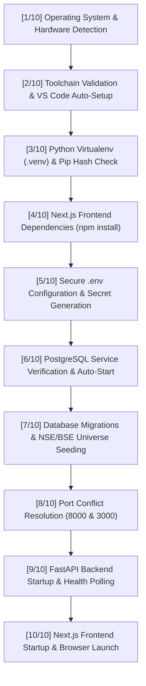

# Lucid — Complete Setup, Installation & Application Launcher Guide

This document provides complete instructions for installing, configuring, running, and managing **Lucid — Intelligent Investment Portfolio Platform for Indian Retail Equities** on macOS, Windows 10/11, and Linux.

---

## Table of Contents

1. [Quick Start: One-Command Automated Setup](#1-quick-start-one-command-automated-setup)
2. [Supported Operating Systems & Requirements](#2-supported-operating-systems--requirements)
3. [The 10-Step Automated Setup Pipeline](#3-the-10-step-automated-setup-pipeline)
4. [Visual Studio Code Automatic Setup & Extensions](#4-visual-studio-code-automatic-setup--extensions)
5. [Operational Lifecycle Scripts](#5-operational-lifecycle-scripts)
6. [Environment Variables & Configuration (`.env`)](#6-environment-variables--configuration-env)
7. [PostgreSQL Database Architecture & Initialization](#7-postgresql-database-architecture--initialization)
8. [Manual Step-by-Step Developer Setup](#8-manual-step-by-step-developer-setup)
9. [Postman API Collection Verification](#9-postman-api-collection-verification)
10. [Automated Test Suites & Health Audits](#10-automated-test-suites--health-audits)
11. [Troubleshooting & Common Questions](#11-troubleshooting--common-questions)
12. [Safe Service Stop, Reset & Data Hygiene](#12-safe-service-stop-reset--data-hygiene)

---

## 1. Quick Start: One-Command Automated Setup

Lucid is designed so that a user with no software development experience can download the repository, run a single script, let the script configure the system automatically (including Visual Studio Code and required extensions), and begin using the web application in their browser.

### Step 1: Clone the Repository

Open your terminal (Terminal on macOS/Linux or PowerShell on Windows) and clone the repository:

```bash
git clone https://github.com/imankur0011/Lucid.git
cd Lucid
```

### Step 2: Run the Setup Script

#### macOS & Linux
```bash
chmod +x start_lucid.sh
./start_lucid.sh
```

#### Windows 10/11 (PowerShell)
```powershell
powershell -ExecutionPolicy Bypass -File .\start_lucid.ps1
```

Once the launcher completes its automated tasks, your default browser opens immediately:
- **Investor Web UI**: [http://localhost:3000](http://localhost:3000)
- **FastAPI Interactive Docs**: [http://localhost:8000/docs](http://localhost:8000/docs)
- **OpenAPI Schema**: [http://localhost:8000/openapi.json](http://localhost:8000/openapi.json)

Default local demo credentials:
- **Email**: `developer@lucid.local`
- **Password**: `LucidDevPass123!`

---

## 2. Supported Operating Systems & Requirements

### Tested Operating Systems
- **macOS Sonoma / Sequoia**: Tested on Apple Silicon (`arm64`) and Intel (`x86_64`).
- **Windows 10 / 11**: Tested via PowerShell 5.1+ and PowerShell 7.
- **Ubuntu 22.04 / 24.04 LTS & Debian 12**: Tested via standard bash shell.

### Minimum System Requirements
- **RAM**: 8 GB minimum (16 GB recommended).
- **Disk Space**: ~2.5 GB free disk space (for Python packages, Node modules, and PostgreSQL exchange data).
- **Internet Connection**: Required during initial setup to download packages and exchange universe data.

---

## 3. The 10-Step Automated Setup Pipeline

When `./start_lucid.sh` (or `.\start_lucid.ps1`) runs, it executes the following 10-stage automated pipeline:



### What Happens in Each Stage:

1. **System & Architecture Detection**: Identifies whether the machine is running Darwin (`arm64`/`x86_64`), Linux, or Windows to apply the appropriate process and environment semantics.
2. **Prerequisite & VS Code Setup**: Validates `git`, `python3` ($\ge 3.11$), `node` ($\ge 18$), `npm`, `psql`, and Visual Studio Code (`code` CLI). On macOS with Homebrew, missing core tools and VS Code are installed automatically. Recommended workspace extensions are configured in the background.
3. **Python Virtual Environment (`.venv`)**: Creates an isolated virtual environment at `.venv`, upgrades `pip`, and installs backend dependencies from `backend/requirements.txt` with MD5 hash caching to avoid slow reinstalls on future runs.
4. **Frontend Dependencies**: Navigates to `frontend/` and executes `npm install` for Next.js 16 and React 19 dependencies.
5. **Environment Configuration (`.env`)**: If `.env` is missing, copies `.env.example` and automatically generates cryptographically secure 32-character random keys for `JWT_SECRET_KEY` and `APP_SECRET_KEY` using Python's `secrets` module. Existing `.env` files are preserved.
6. **PostgreSQL Verification**: Tests connection to PostgreSQL. On macOS, attempts automatic service start via Homebrew (`brew services start postgresql@16`).
7. **Database Provisioning, Migrations & Universe Seeding**: Runs `scripts/init_database.py`. Creates the database (`portfolio_dev`), enables PostgreSQL extensions (`pgcrypto`, `uuid-ossp`), executes Alembic migrations to head (`429fa263363c`), and seeds reference data (5 psychometric risk questions, macroeconomic indicators, default developer user, and 2,639 NSE/BSE equities).
8. **Port Availability Check**: Checks ports `8000` (backend) and `3000` (frontend), terminates lingering Lucid PID processes from prior sessions, and ensures ports are clean.
9. **Backend Server Launch**: Starts Uvicorn ASGI server with FastAPI on port `8000` in the background, logging to `logs/backend.log`, and polls `http://localhost:8000/api/health` until healthy.
10. **Frontend Server Launch & Browser Open**: Starts Next.js development server on port `3000` in the background, logging to `logs/frontend.log`, polls for HTTP 200, opens `http://localhost:3000` in your default browser, and opens the project in VS Code.

---

## 4. Visual Studio Code Automatic Setup & Extensions

Lucid integrates directly with Visual Studio Code to provide a ready-to-code workspace out of the box.

### Automatic Discovery & Installation
- The launcher automatically searches for the `code` CLI in your system `PATH`.
- On macOS, if `code` is not in your shell path, the launcher checks `/Applications/Visual Studio Code.app` and automatically configures the CLI path. If VS Code is not installed and Homebrew is present, it installs VS Code automatically.
- On Windows, the PowerShell script detects VS Code in `Local AppData` or uses `winget install Microsoft.VisualStudioCode`.

### Recommended Workspace Extensions (`.vscode/extensions.json`)
The setup automatically installs or prompts for the following extensions:

| Extension | Extension ID | Purpose in Lucid |
|---|---|---|
| **Python** | `ms-python.python` | Core Python language support, linting, and autocomplete. |
| **Pylance** | `ms-python.vscode-pylance` | High-performance Python static type analysis and IntelliSense. |
| **Python Debugger** | `ms-python.debugpy` | Interactive debugging for FastAPI endpoints and pytest suites. |
| **ESLint** | `dbaeumer.vscode-eslint` | Next.js and TypeScript linting directly in the editor. |
| **Prettier** | `esbenp.prettier-vscode` | Opinionated code formatter for `.ts`, `.tsx`, `.json`, `.md`. |
| **Tailwind CSS IntelliSense** | `bradlc.vscode-tailwindcss` | Autocomplete, syntax highlighting, and hover preview for utility classes. |
| **PostgreSQL** | `ckolkman.vscode-postgres` | Native PostgreSQL connection management and SQL table explorer. |
| **GitLens** | `eamodio.gitlens` | Git blame annotations, commit history, and revision navigation. |
| **Even Better TOML** | `tamasfe.even-better-toml` | TOML schema validation and syntax highlighting. |
| **YAML** | `redhat.vscode-yaml` | YAML validation for GitHub Actions and configuration files. |

### VS Code Tasks & Debugging Configurations
The `.vscode/` directory includes:
- **`.vscode/settings.json`**: Pre-configures Python interpreter path (`.venv/bin/python`), Pytest test discovery (`backend/tests`), format-on-save, and Tailwind class mappings.
- **`.vscode/launch.json`**: Pre-built debug profiles:
  - `Lucid: Debug Backend (FastAPI / Uvicorn)`: Debug API endpoints with breakpoints.
  - `Lucid: Debug Pytest (Full Suite)`: Run and debug unit/integration tests.
  - `Lucid: Verify Setup Script`: Run setup verification in the debugger.
  - `Lucid: Debug Frontend`: Attach Chrome debugger to Next.js client code.
- **`.vscode/tasks.json`**: One-click VS Code tasks for starting, stopping, checking status, viewing logs, running migrations, and running test suites.

---

## 5. Operational Lifecycle Scripts

Lucid includes operational scripts in the repository root for managing running services.

### Cross-Platform Command Matrix

| Action | macOS / Linux | Windows PowerShell | Description |
|---|---|---|---|
| **Start / Launch** | `./start_lucid.sh` | `powershell -File .\start_lucid.ps1` | Runs full setup pipeline, starts services, opens browser & VS Code. |
| **Check Status** | `./status_lucid.sh` | `powershell -File .\status_lucid.ps1` | Inspects system runtime, backend health, frontend HTTP, and PostgreSQL table/record counts. |
| **Stream Logs** | `./logs_lucid.sh all` | `powershell -File .\logs_lucid.ps1` | Tails real-time logs from backend and frontend. |
| **Stop Services** | `./stop_lucid.sh` | `powershell -File .\stop_lucid.ps1` | Gracefully terminates backend and frontend, releases ports, leaves DB intact. |

### Log Streamer Usage
```bash
./logs_lucid.sh backend    # Stream FastAPI logs only (logs/backend.log)
./logs_lucid.sh frontend   # Stream Next.js logs only (logs/frontend.log)
./logs_lucid.sh all 100    # Stream both services concurrently (last 100 lines)
./logs_lucid.sh clear      # Truncate all log files to reclaim disk space
```

---

## 6. Environment Variables & Configuration (`.env`)

Configuration settings are stored in `.env` in the repository root. When running for the first time, the launcher generates `.env` from `.env.example` with random cryptographic secrets.

### Complete Configuration Reference

| Environment Variable | Required? | Default Value | Description |
|---|---|---|---|
| `POSTGRES_HOST` | **Yes** | `localhost` | PostgreSQL server hostname or IP. |
| `POSTGRES_PORT` | **Yes** | `5432` / `5433` | PostgreSQL listening port. |
| `POSTGRES_DB` | **Yes** | `portfolio_dev` | Application database name. |
| `POSTGRES_USER` | **Yes** | `postgres` / current user | PostgreSQL username. |
| `POSTGRES_PASSWORD` | Optional | `""` (local peer auth) | PostgreSQL password (leave empty if peer auth). |
| `DATABASE_URL` | Optional | `None` | Direct SQLAlchemy connection URL (overrides separate parameters). |
| `APP_ENV` | **Yes** | `development` | Application mode: `development`, `staging`, or `production`. |
| `APP_PORT` | **Yes** | `8000` | Port for the FastAPI backend server. |
| `APP_SECRET_KEY` | **Yes** | *Auto-generated* | Cryptographic application secret key. |
| `JWT_SECRET_KEY` | **Yes** | *Auto-generated* | HMAC-SHA256 secret key for signing user auth tokens (min 32 chars). |
| `CORS_ORIGINS` | **Yes** | `http://localhost:3000` | Whitelisted frontend origins. |
| `LLM_PROVIDER` | Optional | `gemini` | Qualitative LLM provider: `gemini` or `ollama`. |
| `LLM_MODEL` | Optional | `gemini-3.8-flash` | Gemini model name. |
| `GEMINI_API_KEY` | Optional | *Empty* | Google AI Studio Gemini API key. If omitted, Lucid runs with rule-based models. |
| `RISK_FREE_RATE_PCT` | Optional | `7.0` | India 10-Year G-Sec benchmark yield percentage. |
| `FRED_API_KEY` | Optional | *Empty* | Federal Reserve Economic Data API key (for global macro data). |
| `NEWS_API_KEY` | Optional | *Empty* | NewsAPI key (for secondary market sentiment feeds). |

---

## 7. PostgreSQL Database Architecture & Initialization

Lucid uses PostgreSQL 16 as its single authoritative transactional store. All relational data resides across 62 domain application tables plus 1 Alembic version table.

### Schema Domain Breakdown
1. **Security Master & Corporate Registry** (13 tables): Companies, listings, share classes, corporate actions, filings, sector classifications.
2. **Market Data & Fundamentals** (9 tables): Historical OHLCV prices, volume, financial statements, balance sheets, corporate ratios, index compositions.
3. **Investor Profiles & Suitability** (8 tables): App users, KYC details, psychometric risk assessments, score tiers, financial goals.
4. **Portfolio Engine & Optimization** (14 tables): Generated portfolios, version trees, allocation weights, constraints, whole-share integer quantities, unallocated cash.
5. **Demat Diagnosis & Rebalancing** (8 tables): External portfolio holdings, asset allocation drift, tax harvesting recommendations, rebalance trade orders.
6. **Multi-Agent Telemetry & Audit Logs** (7 tables): Agent step execution runs, tool invocations, LLM token usage, qualitative research theses, evidence registries.
7. **Broker Order Integration** (3 tables): Mock order books, trade executions, transaction ledger.

### Database Initialization Script (`scripts/init_database.py`)
This script can be executed standalone at any time:
```bash
.venv/bin/python scripts/init_database.py
```
It performs:
1. `CREATE DATABASE "portfolio_dev"` if missing.
2. `CREATE EXTENSION IF NOT EXISTS "pgcrypto";` and `"uuid-ossp";`.
3. `alembic upgrade head` to apply all schema revisions.
4. Populates SEBI psychometric risk questionnaire (5 questions).
5. Populates macroeconomic baseline indicators.
6. Synchronizes exchange security master (2,639 active NSE/BSE equities).
7. Provisions default developer account (`developer@lucid.local`).
8. Verifies table count ($\ge 62$ tables).

---

## 8. Manual Step-by-Step Developer Setup

For developers who prefer starting backend and frontend processes in separate terminal windows:

### Terminal 1: PostgreSQL & Backend Setup
```bash
# 1. Start PostgreSQL
brew services start postgresql@16  # macOS
# or: sudo systemctl start postgresql # Linux

# 2. Create Python virtual environment
python3 -m venv .venv
source .venv/bin/activate

# 3. Install Python dependencies
pip install --upgrade pip
pip install -r backend/requirements.txt

# 4. Provision and seed the database
PYTHONPATH=. python scripts/init_database.py

# 5. Start the FastAPI backend server
PYTHONPATH=. uvicorn backend.main:app --reload --host 0.0.0.0 --port 8000
```

### Terminal 2: Frontend Setup
```bash
# 1. Enter the frontend directory
cd frontend

# 2. Install Node dependencies
npm install

# 3. Start Next.js development server
npm run dev
```

### Terminal 3: Setup Verification
```bash
# Run the automated end-to-end verification audit
.venv/bin/python scripts/verify_setup.py
```

---

## 9. Postman API Collection Verification

Lucid provides an official Postman API collection for testing all 82 REST endpoints.

- **Collection File**: `postman/Lucid_API_Collection.json`
- **Environment File**: `postman/Lucid_Development_Environment.json`
- **Total Requests**: 96 organized across 16 folders.

### How to Import & Run in Postman:
1. Open Postman.
2. Click **Import** in the top-left corner.
3. Select both files:
   - `postman/Lucid_API_Collection.json`
   - `postman/Lucid_Development_Environment.json`
4. In the top-right environment selector, choose **Lucid Development Environment**.
5. Run the first request in folder `02 - Authentication & User Management`: **Login with Email and Password**.
   - The test script extracts the bearer JWT token and populates the `{{jwt_token}}` variable automatically.
6. Execute requests across the remaining folders:
   - `01 - Health & System Information`
   - `03 - Investor Onboarding & Profile`
   - `04 - Financial Goals Management`
   - `05 - Risk Suitability & Assessment`
   - `06 - Market & Security Data`
   - `07 - Portfolio Creation & Optimization`
   - `08 - Real-Time Portfolio Monitoring & Whole-Share Rebalancing`
   - `09 - Reasoning Trace, Stock Why & Evidence`
   - `10 - Scenario Analysis & Stress Testing`
   - `11 - Portfolio Comparison & Conversational Assistant`
   - `12 - Trade Execution Basket Export`
   - `13 - Portfolio Diagnosis & Rebalancing`
   - `14 - Official Exchange Filings & URL Verification`
   - `15 - In-App Notifications System`
   - `16 - Negative & Edge Case Tests`

---

## 10. Automated Test Suites & Health Audits

Lucid includes test suites for backend models, mathematical optimization, agent execution, and frontend production builds.

### Run All Backend Tests (Pytest)
```bash
.venv/bin/pytest backend/tests -v
```
To run specific test modules:
```bash
# Optimization engine simplex invariants
.venv/bin/pytest backend/tests/test_portfolio_engine.py -v

# Authentication, JWT signatures, rate limiting
.venv/bin/pytest backend/tests/test_auth_and_security.py -v

# Database relationships, foreign key cascades, transaction rollbacks
.venv/bin/pytest backend/tests/test_database.py -v
```

### Validate Production Frontend Build
```bash
cd frontend
npm run build
```

### End-to-End System Verification
```bash
.venv/bin/python scripts/verify_setup.py
```

---

## 11. Troubleshooting & Common Questions

### 1. PostgreSQL is not accepting connections
- **Symptom**: `psycopg2.OperationalError: could not connect to server: Connection refused`.
- **Cause**: PostgreSQL service is stopped or listening on a different port.
- **Resolution**:
  - macOS: `brew services restart postgresql@16` or check `brew services list`.
  - Check your port: Check whether PostgreSQL is on port `5432` or `5433` using `pg_isready -p 5432` and `pg_isready -p 5433`. Update `POSTGRES_PORT` in `.env` to match.

### 2. Port 8000 or 3000 is occupied
- **Symptom**: `Address already in use` or backend/frontend fails to bind.
- **Cause**: A previous server instance was left running in the background.
- **Resolution**:
  - Run `./stop_lucid.sh` (or `powershell .\stop_lucid.ps1`). It terminates lingering processes and frees both ports.
  - Or manually inspect listeners: `lsof -i :8000 -t` and `lsof -i :3000 -t`.

### 3. Missing Python modules or `ModuleNotFoundError: No module named 'backend'`
- **Symptom**: `ModuleNotFoundError: No module named 'backend'`.
- **Cause**: Running Python scripts from inside a subdirectory without `PYTHONPATH` set to the project root.
- **Resolution**:
  - Always execute from the repository root: `PYTHONPATH=. .venv/bin/python scripts/...`.

### 4. VS Code command `code` not found in terminal
- **Symptom**: `./start_lucid.sh: line 105: code: command not found`.
- **Cause**: The VS Code shell command was not registered in your system PATH.
- **Resolution**:
  - Open Visual Studio Code.
  - Press `Cmd+Shift+P` (macOS) or `Ctrl+Shift+P` (Windows/Linux).
  - Type `Shell Command: Install 'code' command in PATH` and press Enter.

### 5. Gemini API Key rate limit or quota exceeded
- **Symptom**: `429 ResourceExhausted` during multi-agent research.
- **Cause**: Free cloud tier RPM limits on Google AI Studio.
- **Resolution**:
  - Lucid handles this gracefully via an automated deterministic fallback mechanism. You can clear `GEMINI_API_KEY` in `.env` or leave it empty, and Lucid will run the entire qualitative research and allocation pipeline using its deterministic rule engine.

---

## 12. Safe Service Stop, Reset & Data Hygiene

### Graceful Shutdown
To stop Lucid at any time:
```bash
# macOS / Linux:
./stop_lucid.sh

# Windows PowerShell:
powershell -ExecutionPolicy Bypass -File .\stop_lucid.ps1
```
This terminates the Next.js frontend and FastAPI backend, removes PID files, and frees network ports `8000` and `3000`. **Your PostgreSQL database records are preserved intact.**

### Complete Database Reset (Caution)
If you wish to wipe test portfolios and restore the database to a clean baseline state:
```bash
# 1. Connect to PostgreSQL
psql -h localhost -p 5433 -U postgres -d postgres -c "DROP DATABASE portfolio_dev;"

# 2. Re-run automated database provisioning
.venv/bin/python scripts/init_database.py
```
This re-applies Alembic migrations, re-seeds the risk questionnaire and 2,639 NSE/BSE securities, and creates a fresh developer user.
