# Lucid — System Architecture Documentation

**Document Version:** 2026.11-v2.0  
**Authoritative Date:** 2026-11-08  
**Scope:** Authoritative 8-Layer Architectural Blueprint of **Lucid**, an intelligent investment portfolio creation, monitoring, and rebalancing platform for Indian retail equities listed on the National Stock Exchange (NSE) and Bombay Stock Exchange (BSE).

---

## Architectural Blueprint (8 Layers)

```mermaid
graph TD
    classDef l1 fill:#F8FAFC,stroke:#0EA5E9,stroke-width:2px,color:#0F172A;
    classDef l2 fill:#EFF6FF,stroke:#3B82F6,stroke-width:2px,color:#1E3A8A;
    classDef l3 fill:#F5F3FF,stroke:#8B5CF6,stroke-width:2px,color:#4C1D95;
    classDef l4 fill:#FAF5FF,stroke:#A855F7,stroke-width:2px,color:#581C87;
    classDef l5 fill:#ECFDF5,stroke:#10B981,stroke-width:2px,color:#065F46;
    classDef l6 fill:#FFFBEB,stroke:#F59E0B,stroke-width:2px,color:#78350F;
    classDef l7 fill:#F1F5F9,stroke:#64748B,stroke-width:2px,color:#0F172A;
    classDef l8 fill:#FEF2F2,stroke:#EF4444,stroke-width:2px,color:#991B1B;

    subgraph L1 ["Layer 1: Client Presentation Layer (Next.js 16.4.2 React UI)"]
        UI_Dash["Investor Dashboard & NAV View"]:::l1
        UI_Gen["Portfolio Wizard & Risk Profiler"]:::l1
        UI_Mon["Continuous Monitoring & Drift Radar"]:::l1
        UI_Reb["Rebalance Execution & Order Preview"]:::l1
        UI_Diag["Demat Statement Diagnostics (HHI)"]:::l1
        UI_Chat["Copilot Chat & Fiduciary Stock-Why"]:::l1
    end

    subgraph L2 ["Layer 2: API Gateway & Middleware Layer (FastAPI 0.115)"]
        API_GW["FastAPI Core Application (backend/main.py)"]:::l2
        API_Auth["JWT Authentication & RBAC (backend/auth/)"]:::l2
        API_Rate["In-Memory Sliding-Window Rate Limiter"]:::l2
        API_Sec["Strict HTTP Security Headers (CSP, HSTS, XFO)"]:::l2
        API_Cors["CORS Policy Validation (localhost:3000)"]:::l2
        API_Routes["Modular REST Routers (9 Routers, 82 Endpoints)"]:::l2
    end

    subgraph L3 ["Layer 3: Orchestration & State Management Layer (LangGraph)"]
        LG_Graph["StateGraph Orchestrator (backend/agent/graph.py)"]:::l3
        LG_State["PortfolioAgentState TypedDict (backend/agent/state.py)"]:::l3
        LG_Edges["Conditional Routing & Fiduciary Gate Logic"]:::l3
        LG_Trace["Full Step-by-Step Telemetry & LLM Audit Logging"]:::l3
    end

    subgraph L4 ["Layer 4: Agentic AI & Intelligence Layer (13 Specialized Nodes)"]
        A_Mgr["Manager Node (Task Decomposition)"]:::l4
        A_Suit["Suitability & Feasibility Node (SEBI Gate)"]:::l4
        A_Macro["Macro Analyst Node (RBI & Inflation)"]:::l4
        A_Mkt["Market Analyst Node (NIFTY 50 50/200 DMA)"]:::l4
        A_Fund["Fundamental Analyst Node (P/E, ROE, Factors)"]:::l4
        A_News["News & Corporate Filings Analyst Node"]:::l4
        A_Strat["Lead Strategist Node (Tactical Candidate Weights)"]:::l4
        A_Critic["Independent Risk Critic Node (Mandate Audit)"]:::l4
        A_Rewk["Strategist Bounded Rework Node (Max 2 Loops)"]:::l4
        A_Opt["Deterministic SLSQP Optimizer Node"]:::l4
        A_CritFin["Critic Final Validation Node (Constraint Audit)"]:::l4
        A_Mod["Fiduciary Moderator Node (Two-Level Explanations)"]:::l4
        A_Pers["ACID PostgreSQL Persistence Node"]:::l4
    end

    subgraph L5 ["Layer 5: Quantitative & Mathematical Engine Layer (SciPy & NumPy)"]
        M_Opt["Deterministic SLSQP Optimizer (Markowitz Quadratic Utility)"]:::l5
        M_Int["Whole-Share Integer Allocation & Cash Conservation Engine"]:::l5
        M_Drift["Asset & Sector Allocation Drift Engine (Threshold: 5%/8%)"]:::l5
        M_Cost["Statutory Indian Equity Transaction Costs Engine (STT, GST)"]:::l5
        M_Fact["Multi-Factor Scoring & Winsorized Z-Score Normalizer"]:::l5
        M_Risk["Risk Engine (Sharpe, Sortino, Beta, Max Drawdown)"]:::l5
    end

    subgraph L6 ["Layer 6: Operational Services & Scheduler Layer"]
        S_Cron["Background Monitoring Scheduler (300s, 09:15-15:30 IST)"]:::l6
        S_Notif["Notification Service (In-App Unread Alerts)"]:::l6
        S_Diag["Demat Diagnosis Service (HHI Concentration & Overlap)"]:::l6
        S_Why["Stock-Why Service (Institutional Citations & Proofs)"]:::l6
        S_Reb["Rebalancing Service (Trade Preview & Invariant Checks)"]:::l6
        S_Sync["Security Universe Sync Service (NSE/BSE Ingestion)"]:::l6
    end

    subgraph L7 ["Layer 7: Data Access & Persistence Layer (PostgreSQL 16 Master)"]
        DB_Engine["SQLAlchemy 2.0 ORM & Connection Pooling"]:::l7
        DB_Master[("PostgreSQL 16 Database (majorproject)<br/>62 Domain Tables + alembic_version")]:::l7
        DB_Sec["Security Master (2,639 Securities, 2,715 Listings)"]:::l7
        DB_Port["Portfolio Store (Versions, Decisions, Trades)"]:::l7
        DB_Audit["Telemetry & System Audit Logs"]:::l7
    end

    subgraph L8 ["Layer 8: External Integrations & Market Data Layer"]
        EXT_NSE["NSE India Archives (Official EQUITY_L Master)"]:::l8
        EXT_BSE["BSE India Corporate Directory (ISIN Cross-Reference)"]:::l8
        EXT_YF["Yahoo Finance API (yfinance Live Quotes & History)"]:::l8
        EXT_RBI["Reserve Bank of India Bulletins (Policy Repo Rate)"]:::l8
        EXT_News["NewsAPI & RSS Financial News Feeds"]:::l8
        EXT_LLM["Google Gemini API (gemini-3.8-flash / Local Fallback)"]:::l8
    end

    L1 <--> L2
    L2 <--> L3
    L3 <--> L4
    L4 <--> L5
    L3 <--> L5
    L2 <--> L6
    L6 <--> L5
    L4 <--> L7
    L5 <--> L7
    L6 <--> L7
    L6 <--> L8
    L7 <--> L8
    L4 <--> L8
```

---

## Detailed Architectural Breakdown by Layer

### Layer 1: Client Presentation Layer
- **Framework**: Next.js 16.4.2 using React 19.3.0 and TypeScript 5.
- **Styling**: Tailwind CSS v4 with accessible, high-contrast financial palettes.
- **Key Modules**:
  - `Investor Dashboard`: High-level asset allocation, sector weights, and comparative benchmark performance against NIFTY 50.
  - `Portfolio Wizard`: Interactive SEBI-aligned risk questionnaire determining risk capacity, investment horizon, and capital feasibility.
  - `Drift Radar & Live Monitoring`: Visual asset drift (>5%) and sector drift (>8%) tracking.
  - `Rebalance Execution Preview`: Interactive breakdown of proposed whole-share BUY, SELL, and HOLD orders with statutory transaction fee estimates.
  - `Demat Statement Diagnostic View`: Portfolio overlap, Herfindahl-Hirschman Index (HHI) concentration metrics, and stock-specific health flags.
  - `Copilot Chat & Fiduciary Stock-Why`: Natural-language portfolio assistant and institutional-grade explanation modals.

---

### Layer 2: API Gateway & Middleware Layer
- **Gateway**: FastAPI 0.115+ running on Uvicorn ASGI server.
- **Routing**: 9 modular REST routers aggregating 82 unique API paths across 88 distinct HTTP operations under the `/api/v1` namespace.
- **Middleware Infrastructure**:
  - `In-Memory Sliding-Window Rate Limiter`: Implements client IP-scoped rate limiting via `collections.deque` timestamps, returning HTTP 429 upon threshold breach.
  - `JWT Bearer Authentication`: Cryptographically signed JSON Web Tokens (HS256) enforcing user data isolation and session tracking.
  - `Token Revocation Check`: Cross-references token SHA256 hashes against the `revoked_tokens` table on every protected request.
  - `Strict Security Headers`: Enforces `X-Content-Type-Options: nosniff`, `X-Frame-Options: DENY`, `Strict-Transport-Security`, and Content Security Policy (CSP).
  - `CORS Validation`: Restricts cross-origin requests to configured trusted frontend origins (`http://localhost:3000`).

---

### Layer 3: Orchestration & State Management Layer
- **Orchestrator**: LangGraph `StateGraph` compiled with request-scoped database session injection.
- **Central State**: `PortfolioAgentState` TypedDict maintaining 35 state fields including investor profile, candidate equities, factor scores, critic verdicts, optimizer weights, integer shares, and telemetry traces.
- **Fiduciary Invariants**:
  - Missing, malformed, or unverified outputs strictly abort workflow execution (fail-closed).
  - Bounded iteration caps: Maximum 2 rework cycles allowed between Lead Strategist and Independent Critic.
  - Execution traces, agent prompt timestamps, and LLM latencies are recorded to `agent_execution_runs`.

---

### Layer 4: Agentic AI & Intelligence Layer (13 Specialized Nodes)
1. **`manager_node`**: Decomposes user request, initializes state, and validates capital bounds.
2. **`suitability_check_node`**: Deterministic SEBI gate verifying investor risk capacity and capital adequacy ($\ge$ ₹10,000).
3. **`macro_analyst_node`**: Evaluates RBI repo rate, CPI inflation, and fiscal deficit.
4. **`market_analyst_node`**: Classifies NIFTY 50 regime (Bull/Bear/Sideways) using 50-day and 200-day moving averages.
5. **`fundamental_analyst_node`**: Audits candidate equity P/E, ROE, Earnings Yield, and factor Z-scores.
6. **`news_analyst_node`**: Analyzes corporate governance, regulatory filings, and recent sentiment (30-day cutoff).
7. **`analyst_node` (Lead Strategist)**: Synthesizes tactical candidate weights and alpha scores.
8. **`critic_node` (Independent Risk Critic)**: Evaluates strategy against mandate, concentration caps, and ESG/sector exclusions.
9. **`strategist_rework_node`**: Re-allocates candidate weights if Critic issues a bounded rework order (max 2 loops).
10. **`deterministic_optimizer_node`**: Executes SciPy SLSQP optimization and integer whole-share lot allocation.
11. **`critic_final_validation_node`**: Audits final integer-share weights against hard single-stock and sector caps.
12. **`moderator_explanation_node`**: Synthesizes two-level institutional rationales and stock-why explanations.
13. **`persistence_node`**: Commits all portfolio versions, allocations, and telemetry to PostgreSQL in an atomic ACID transaction.

---

### Layer 5: Quantitative & Mathematical Engine Layer
- **SLSQP Optimizer**: Solves $\min_{\mathbf{w}} 0.5 \lambda \mathbf{w}^T \boldsymbol{\Sigma} \mathbf{w} - \mathbf{w}^T \boldsymbol{\mu}$ subject to $\sum w_i = 1$ and individual/sector bounds.
- **Integer Allocation Engine**: Converts continuous weights $w_i$ to discrete share counts $N_i = \lfloor \frac{w_i C}{P_i} \rfloor$ and tracks residual cash balance.
- **Statutory Fee Engine**: Computes exact delivery charges on Indian exchanges:
  - STT: 0.1% on delivery turnover
  - Exchange Charges: 0.00297% (NSE)
  - SEBI Charges: ₹10 / Crore
  - GST: 18% on exchange and brokerage fees
  - Stamp Duty: 0.015% on BUY delivery turnover
- **Multi-Factor Normalizer**: Winsorizes raw ratios at the 5th and 95th percentiles and computes sector-relative Z-scores for Value, Quality, Momentum, and Low Volatility.
- **Risk Engine**: Computes annualized Sharpe ratio, Sortino ratio, systematic Beta, and Historical Value-at-Risk (VaR 95%).

---

### Layer 6: Operational Services & Background Schedulers
- **Monitoring Scheduler**: Async daemon polling active portfolios every 300 seconds during Indian market hours (09:15 to 15:30 IST), detecting asset drift (>5%) and sector drift (>8%).
- **Notification Service**: Manages in-app unread alert queues and persists audit notifications.
- **Demat Diagnosis Service**: Calculates portfolio diversification metrics (HHI concentration index) and generates integer rebalancing previews.
- **Fiduciary Stock-Why Service**: Produces grounded investment rationales with verified source citations.
- **Security Master Sync Service**: Synchronizes the 2,639 listed equity universe from official NSE and BSE repositories.

---

### Layer 7: Data Access & Persistence Layer (PostgreSQL 16)
- **Database Engine**: PostgreSQL 16+ via SQLAlchemy 2.0 ORM with connection pooling.
- **Schema Scale**: 62 relational application tables across 8 functional domains:
  1. User & Authentication (7 tables)
  2. Investor & Goals (5 tables)
  3. Security Master (9 tables)
  4. Market Data & Fundamentals (11 tables)
  5. Portfolio Generation & Constraints (13 tables)
  6. Diagnosis & Rebalancing (4 tables)
  7. Agent Telemetry & Notifications (7 tables)
  8. Broker & Performance Snapshots (6 tables)
- **Schema Migrations**: Managed declaratively through Alembic (`alembic.ini`).

---

### Layer 8: External Integrations & Market Data Layer
- **Official NSE India Archives**: Daily security master (`EQUITY_L.csv`) providing ISINs, listed symbols, and trading statuses.
- **BSE Corporate Directory**: ISIN resolution and corporate action split mappings.
- **Yahoo Finance API (`yfinance`)**: Adjusted close prices, volume, intraday quotes, and 3-year historical series.
- **Reserve Bank of India Bulletins**: Monetary policy repo rates, CPI inflation figures, and macro baselines.
- **Google Gemini API (`gemini-3.8-flash`)**: Cloud-based qualitative multi-agent reasoning, with automatic deterministic fallback to local dynamic reasoning when offline.
- **NewsAPI & RSS Feeds**: Corporate announcements, financial news sentiment, and filings.

---

## Architectural Exclusions

To eliminate legacy documentation drift, the following components are **explicitly excluded from the active runtime**:
- **Neo4j**: Lucid utilizes PostgreSQL 16 relational queries for entity relationships; no graph database is in the runtime path.
- **Redis**: Sliding-window rate limiting and market caching operate in memory and in PostgreSQL.
- **Celery**: Background monitoring tasks are scheduled using native Python asyncio and background threads.
- **FAISS**: Multi-agent reasoning queries structured relational models directly without external vector database dependencies.
- **Ollama**: Local LLM execution is replaced by Google Gemini with deterministic qualitative rule-based fallbacks.
- **Live Custodial Broker Routing**: Lucid is strictly non-custodial; orders are generated as advisory previews for investor execution.
