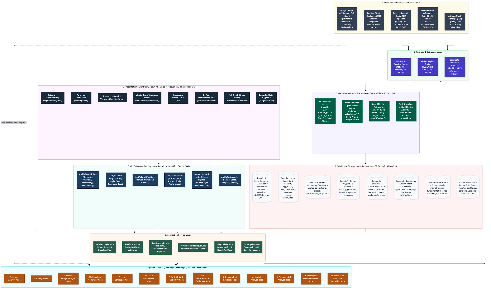

# Lucid — System Architecture Documentation

This document specifies the comprehensive 8-layer architecture of **Lucid**, an intelligent investment portfolio creation, monitoring, and rebalancing platform for Indian retail equities listed on the National Stock Exchange (NSE) and Bombay Stock Exchange (BSE).

---

## Architectural Blueprint (8 Layers)

```mermaid
graph TD
    classDef l1 fill:#F8FAFC,stroke:#0EA5E9,stroke-width:2px,color:#0F172A;
    classDef l2 fill:#EFF6FF,stroke:#3B82F6,stroke-width:2px,color:#1E3A8A;
    classDef l3 fill:#F5F3FF,stroke:#8B5CF6,stroke-width:2px,color:#4C1D95;
    classDef l4 fill:#FAF5FF,stroke:#A855F7,stroke-width:2px,color:#581C87;
    classDef l5 fill:#ECFDF5,stroke:#10B981,stroke-width:2px,color:#065F46;
    classDef l6 fill:#FFFBEB,stroke:#F59E0B,stroke-width:2px,color:#78350F;
    classDef l7 fill:#F1F5F9,stroke:#64748B,stroke-width:2px,color:#0F172A;
    classDef l8 fill:#FEF2F2,stroke:#EF4444,stroke-width:2px,color:#991B1B;

    subgraph L1 ["Layer 1: Client Presentation Layer (Next.js 16.4.2 React UI)"]
        UI_Dash["Investor Dashboard & NAV View"]:::l1
        UI_Gen["Portfolio Wizard & Risk Profiler"]:::l1
        UI_Mon["Continuous Monitoring & Drift Radar"]:::l1
        UI_Reb["Rebalance Execution & Order Preview"]:::l1
        UI_Diag["CAS Demat Statement Diagnostics"]:::l1
        UI_Chat["Copilot Chat & Fiduciary Stock-Why"]:::l1
    end

    subgraph L2 ["Layer 2: API Gateway & Middleware Layer (FastAPI 0.115)"]
        API_GW["FastAPI Core Application (backend/main.py)"]:::l2
        API_Auth["JWT Authentication & RBAC (backend/auth/)"]:::l2
        API_Rate["In-Memory Sliding-Window Rate Limiter"]:::l2
        API_Sec["Strict HTTP Security Headers (CSP, HSTS, XFO)"]:::l2
        API_Cors["CORS Policy Validation (localhost:3000)"]:::l2
        API_Routes["Modular REST Routers (v1: 9 Routers, 40+ Endpoints)"]:::l2
    end

    subgraph L3 ["Layer 3: Orchestration & State Management Layer (LangGraph)"]
        LG_Graph["StateGraph Orchestrator (backend/agent/graph.py)"]:::l3
        LG_State["PortfolioAgentState TypedDict (backend/agent/state.py)"]:::l3
        LG_Edges["Conditional Routing & Fiduciary Gate Logic"]:::l3
        LG_Trace["Full Step-by-Step Telemetry & LLM Audit Logging"]:::l3
    end

    subgraph L4 ["Layer 4: Agentic AI & Intelligence Layer (13 Specialized Nodes)"]
        A_Mgr["Manager Node (Task Decomposition)"]:::l4
        A_Suit["Suitability & Feasibility Node (SEBI Gate)"]:::l4
        A_Macro["Macro Analyst Node (RBI & Inflation)"]:::l4
        A_Mkt["Market Analyst Node (Nifty 50 Regime)"]:::l4
        A_Fund["Fundamental Analyst Node (P/E, ROE, Factors)"]:::l4
        A_News["News & Corporate Filings Analyst Node"]:::l4
        A_Strat["Lead Strategist Node (Tactical Weights)"]:::l4
        A_Critic["Independent Risk Critic Node (Mandate Audit)"]:::l4
        A_Rewk["Strategist Bounded Rework Node (Max 2 Loops)"]:::l4
        A_Mod["Fiduciary Moderator Node (Two-Level Explanations)"]:::l4
    end

    subgraph L5 ["Layer 5: Quantitative & Mathematical Engine Layer (SciPy & NumPy)"]
        M_Opt["Deterministic SLSQP Optimizer (Markowitz Quadratic Utility)"]:::l5
        M_Int["Whole-Share Integer Allocation & Cash Conservation Engine"]:::l5
        M_Drift["Asset & Sector Allocation Drift Engine (Threshold: 5%/8%)"]:::l5
        M_Cost["Statutory Indian Equity Transaction Costs Engine (STT, GST)"]:::l5
        M_Fact["Multi-Factor Scoring & Winsorized Z-Score Normalizer"]:::l5
        M_Risk["Risk Engine (Sharpe, Sortino, VaR, Max Drawdown)"]:::l5
    end

    subgraph L6 ["Layer 6: Operational Services & Scheduler Layer"]
        S_Cron["Background Monitoring Scheduler (300s, 09:15-15:30 IST)"]:::l6
        S_Notif["Notification Service (In-App & Push Alerts)"]:::l6
        S_Diag["Demat Diagnosis Service (pdfplumber CAS Parsing & HHI)"]:::l6
        S_Why["Stock-Why Service (Institutional Citations & Proofs)"]:::l6
        S_Reb["Rebalancing Service (Trade Preview & Invariant Checks)"]:::l6
    end

    subgraph L7 ["Layer 7: Data Access & Persistence Layer (PostgreSQL Master)"]
        DB_Engine["SQLAlchemy 2.0 ORM & Connection Pooling"]:::l7
        DB_Master[("PostgreSQL 16 Database (majorproject)<br/>62 Relational Tables across 8 Domains")]:::l7
        DB_Sec["Security Master (2,639 Securities, 2,715 Listings)"]:::l7
        DB_Port["Portfolio Store (Versions, Decisions, Trades)"]:::l7
        DB_Audit["Telemetry & System Audit Logs"]:::l7
    end

    subgraph L8 ["Layer 8: External Integrations & Market Data Layer"]
        EXT_NSE["NSE India Archives (Official EQUITY_L Master)"]:::l8
        EXT_BSE["BSE India Corporate Directory (ISIN Cross-Reference)"]:::l8
        EXT_YF["Yahoo Finance API (yfinance Live Quotes & History)"]:::l8
        EXT_RBI["Reserve Bank of India Bulletins (Policy Repo Rate)"]:::l8
        EXT_News["NewsAPI & RSS Financial News Feeds"]:::l8
        EXT_CAS["CDSL / NSDL Consolidated Account Statement (CAS PDF)"]:::l8
    end

    L1 <--> L2
    L2 <--> L3
    L3 <--> L4
    L4 <--> L5
    L3 <--> L5
    L2 <--> L6
    L6 <--> L5
    L4 <--> L7
    L5 <--> L7
    L6 <--> L7
    L6 <--> L8
    L7 <--> L8
```

---

## Detailed Architectural Breakdown by Layer

### Layer 1: Client Presentation Layer
- **Framework**: Next.js 16.4.2 using React 19.3.0 and TypeScript 5.
- **Styling**: Tailwind CSS v4 with responsive layouts and accessible color palettes.
- **Key Views**:
  - `Investor Dashboard`: High-level asset allocation breakdown, performance tracking against NIFTY 50, and portfolio health indicators.
  - `Portfolio Wizard`: Step-by-step psychometric questionnaire determining risk capacity, time horizon, financial goals, and initial investment capital.
  - `Drift Radar & Live Monitoring`: Real-time visualization of individual asset and sector drift against configured policy boundaries.
  - `Rebalance Execution Preview`: Interactive breakdown of proposed integer-lot BUY, SELL, and HOLD orders, complete with statutory transaction fee estimates.
  - `CAS Demat Diagnostic View`: Drag-and-drop PDF statement uploader showing portfolio overlap, Herfindahl-Hirschman Index (HHI) concentration metrics, and stock-specific health flags.
  - `Fiduciary Stock-Why Modal`: Interactive dialogue explaining why any given security was selected or trimmed, toggleable between Plain English and Institutional Quantitative evidence.

### Layer 2: API Gateway & Middleware Layer
- **Framework**: FastAPI 0.115 running on Python 3.14 with Uvicorn ASGI server.
- **Security Middleware**:
  - `InMemoryRateLimiterMiddleware`: Sliding-window rate limiter preventing brute-force authentication attacks and protecting expensive LangGraph agent invocations.
  - `Security Headers Middleware`: Enforces `X-Content-Type-Options: nosniff`, `X-Frame-Options: DENY`, `X-XSS-Protection: 1; mode=block`, and production `HSTS`.
  - `CORS Middleware`: Whitelists trusted frontend origins (`http://localhost:3000`).
- **REST Endpoints**: 9 domain-specific routers mounted under `/api/v1` (Authentication, Profile, Goals, Risk Assessments, Market Data, Portfolios, Diagnosis, Links, Notifications).

### Layer 3: Orchestration & State Management Layer
- **Orchestration Framework**: LangGraph StateGraph (`backend/agent/graph.py`).
- **State Definition**: Strongly typed `PortfolioAgentState` (`backend/agent/state.py`) capturing user profile data, research findings, agent reasoning, candidate selections, optimizer weights, critic verdicts, and audit logs.
- **Fiduciary Execution Invariants**:
  - Independent Risk Critic must strictly approve before optimization begins.
  - Critic Final Validation must verify that post-optimizer integer share sizing satisfies all mandate caps.
  - Malformed or incomplete agent outputs trigger explicit failsafe persistence (stop-and-report).

### Layer 4: Agentic AI & Intelligence Layer
- **Model Integration**: Google Gemini 1.5 Flash via `langchain-google-genai` (with Ollama fallback).
- **Specialized Roles**:
  - `Manager Node`: Decomposes investment goals, initializes graph state, and coordinates downstream specialists.
  - `Suitability & Feasibility Node`: Rule-based gatekeeper validating SEBI investor risk capacity and capital lot feasibility.
  - `Macro Analyst Node`: Assesses macro conditions (RBI repo rate 6.50%, CPI inflation 5.1%, yield curve).
  - `Market Analyst Node`: Evaluates Nifty 50 trend, 50-day and 200-day DMA breadth, and market volatility regime.
  - `Fundamental Analyst Node`: Analyzes balance sheets, P/E, P/B, ROE, ROCE, and debt-to-equity ratios.
  - `News Analyst Node`: Scans regulatory disclosures, earnings releases, and material news sentiment.
  - `Lead Strategist Node`: Synthesizes research into candidate weights and sector allocations.
  - `Independent Risk Critic Node`: Adversarially audits allocations against single-stock (10%) and sector (30%) concentration caps.
  - `Strategist Bounded Rework Node`: Enables up to 2 iterative reworks if the Critic identifies violations.
  - `Fiduciary Moderator Node`: Produces dual-level explanations (Executive Retail Summary + Institutional Factor Proofs).

### Layer 5: Quantitative & Mathematical Engine Layer
- **Computational Core**: SciPy 1.15 and NumPy 2.2 executing entirely in Python without LLM hallucination risk.
- **Deterministic Optimizer**: Solves Markowitz Mean-Variance Quadratic Utility using Sequential Least Squares Programming (SLSQP).
- **Integer Lot Rounding**: Translates decimal target weights into executable integer share quantities using floor division, enforcing the strict cash conservation invariant:
  $$\sum_{i=1}^n (	ext{Shares}_i 	imes 	ext{Price}_i) + 	ext{Unallocated Cash} = 	ext{Total Capital}$$
- **Factor Scoring**: Winsorizes outlier values at the 5th and 95th percentiles and calculates sector-relative Z-scores clamped to $[-3.0, +3.0]$.
- **Indian Statutory Costs Engine**: Accurately computes Securities Transaction Tax (STT), Exchange Turnover Fees, SEBI Turnover Fees, GST (18%), Stamp Duty, and brokerage charges.

### Layer 6: Operational Services & Scheduler Layer
- **Continuous Monitoring Scheduler**: Background thread executing every 300 seconds (5 minutes) during Indian market hours (09:15 – 15:30 IST) to fetch live market quotes, revalue portfolios, and detect drift breaches.
- **Notification Service**: Dispatches transactional alerts when drift thresholds (5% single-stock or 8% sector) are breached.
- **Demat Diagnosis Service**: Employs `pdfplumber` and regular expressions to parse CDSL and NSDL CAS statements, reconciling ISINs against the Security Master.
- **Rebalancing Service**: Calculates drift turnover, synthesizes whole-share BUY/SELL/HOLD orders, and generates executable trade previews.

### Layer 7: Data Access & Persistence Layer
- **Database**: PostgreSQL 16 (`majorproject`), the sole relational source of truth.
- **ORM**: SQLAlchemy 2.0 with connection pooling and request-scoped sessions.
- **Database Schema**: 62 relational tables organized into 8 functional domains:
  1. Identity & Security (7 tables)
  2. Investor Suitability & Goals (5 tables)
  3. Security Master & Companies (9 tables)
  4. Market Data, Prices & Fundamentals (11 tables)
  5. Portfolio Engine & Optimization (13 tables)
  6. Broker Integrations & Orders (6 tables)
  7. Demat Diagnosis & Rebalancing (4 tables)
  8. Multi-Agent Telemetry & Auditing (7 tables)
- **Database Scale**: Ingests 2,639 securities, 2,639 companies, and 2,715 exchange listings.

### Layer 8: External Integrations & Market Data Layer
- **NSE India Archives**: Official master list of listed equities (`EQUITY_L.csv`).
- **BSE India Corporate Directory**: Universal ISIN matching and cross-exchange mapping.
- **Yahoo Finance (`yfinance`)**: Live market quotes, historical OHLCV data, and benchmark indices.
- **Reserve Bank of India (RBI)**: Macroeconomic policy rates and monetary indicators.
- **CDSL / NSDL**: Consolidated Account Statement (CAS) PDF import for existing demat portfolios.
