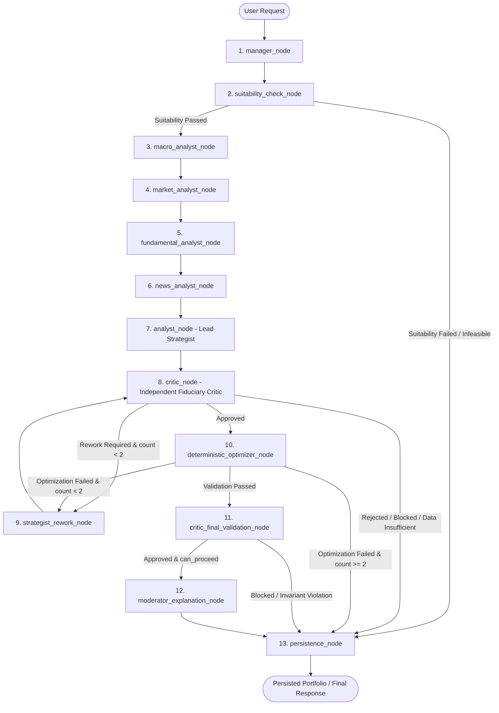

# Lucid — Canonical Current Implementation Reference

**Document Version:** 2026.11-v2.0  
**Authoritative Date:** 2026-11-08  
**Purpose:** Central authoritative index of verified implementation facts, source-file mappings, system parameters, architectural boundaries, and component execution status for Lucid.

---

## 1. Executive Summary & Architectural Scope

Lucid is an intelligent investment portfolio creation, analysis, continuous monitoring, and rebalancing platform engineered specifically for Indian retail investors in National Stock Exchange (NSE) and Bombay Stock Exchange (BSE) equities.

Lucid operates strictly under a **non-custodial, fiduciary decision-support architecture**:
- It evaluates investor risk tolerance using psychometric assessment aligned with SEBI risk profiling guidelines.
- It ingests and normalizes the full equity universe (2,639 listed securities).
- It applies institutional multi-factor scoring (Quality, Value, Momentum, Low Volatility) and Markowitz quadratic utility optimization using SciPy's Sequential Least Squares Programming (SLSQP).
- It allocates whole-share (integer) lots with explicit residual cash conservation.
- It provides step-by-step fiduciary explainability with institutional citations.
- It continuously monitors portfolios during Indian market hours (09:15 to 15:30 IST) for asset drift (>5%) and sector drift (>8%).
- It generates deterministic rebalancing previews without executing custodial broker orders.

---

## 2. Technology Stack & Operational Reality

| Layer / Subsystem | Canonical Technology | Version | Operational Status | Evidence in Codebase |
|---|---|---|---|---|
| **Programming Language** | Python | 3.11+ (verified 3.11-3.14) | **IMPLEMENTED** | `pyproject.toml`, `.venv/` |
| **Backend Web Framework** | FastAPI | >= 0.115.0 | **IMPLEMENTED** | `backend/main.py:app` |
| **ASGI Production Server** | Uvicorn | >= 0.34.0 | **IMPLEMENTED** | `backend/requirements.txt` |
| **Primary Relational Database** | PostgreSQL | 16+ | **IMPLEMENTED** | `backend/database/`, `backend/models/` |
| **Database ORM** | SQLAlchemy | >= 2.0.30 | **IMPLEMENTED** | `backend/models/__init__.py` |
| **Schema Migrations** | Alembic | >= 1.14.0 | **IMPLEMENTED** | `alembic.ini`, `backend/alembic/` |
| **Multi-Agent Orchestrator** | LangGraph | >= 0.3.0 | **IMPLEMENTED** | `backend/agent/graph.py` |
| **Mathematical Optimizer** | SciPy (SLSQP) | >= 1.15.0 | **IMPLEMENTED** | `backend/portfolio_engine/optimizer.py` |
| **Numerical Computation** | NumPy & Pandas | >= 2.2.0 | **IMPLEMENTED** | `backend/portfolio_engine/math_engine.py` |
| **Password Hashing** | Argon2id | `argon2-cffi>=25.1.0` | **IMPLEMENTED** | `backend/api/v1/auth.py` |
| **Legacy Password Fallback** | bcrypt | >= 4.0.0 | **IMPLEMENTED** | `backend/api/v1/auth.py` |
| **Token Authentication** | PyJWT (HS256) | >= 2.10.0 | **IMPLEMENTED** | `backend/auth/dependencies.py` |
| **Rate Limiting** | Sliding-Window In-Memory | Custom deque | **IMPLEMENTED** | `backend/middleware/rate_limit.py` |
| **LLM Provider** | Google Gemini | `gemini-3.8-flash` | **IMPLEMENTED / OPTIONAL** | `backend/agent/nodes.py`, `backend/config.py` |
| **LLM Fallback Engine** | Dynamic Rule-Based | Custom Python | **IMPLEMENTED** | `backend/agent/nodes.py` |
| **Client Frontend** | Next.js (Turbopack) | 16.4.2 | **IMPLEMENTED** | `frontend/package.json` |
| **UI Framework** | React | 19.3.0 | **IMPLEMENTED** | `frontend/package.json` |
| **Frontend Language** | TypeScript | 5.x | **IMPLEMENTED** | `frontend/tsconfig.json` |
| **Styling & Design System** | Tailwind CSS | 4.x | **IMPLEMENTED** | `frontend/src/app/globals.css` |
| **E2E Testing** | Playwright | 1.50+ | **IMPLEMENTED** | `frontend/playwright.config.ts` |
| **Graph Database (Neo4j)** | None (Config Stub Removed) | N/A | **UNUSED / EXCLUDED** | Excluded from runtime |
| **Cache Store (Redis)** | None (Config Stub Removed) | N/A | **UNUSED / EXCLUDED** | Excluded from runtime |
| **Task Queue (Celery)** | None (Asyncio Scheduler) | N/A | **UNUSED / EXCLUDED** | Excluded from runtime |
| **Vector Store (FAISS)** | None (Direct SQL / LLM) | N/A | **UNUSED / EXCLUDED** | Excluded from runtime |
| **Local LLM (Ollama)** | None (Config Stub Removed) | N/A | **UNUSED / EXCLUDED** | Excluded from runtime |

---

## 3. Database Architecture & Schema Truth

PostgreSQL 16 is the **single operational source of truth**. All persistent data resides in 62 domain application tables plus 1 Alembic tracking table.

### 3.1 Verified Domain Table Counts

```text
Domain 1: User & Authentication Domain (7 Tables)
  ├── app_users
  ├── user_profiles
  ├── user_preferences
  ├── user_consents
  ├── user_verification_codes
  ├── revoked_tokens
  └── user_profile_versions

Domain 2: Investor & Risk Assessment Domain (5 Tables)
  ├── financial_goals
  ├── risk_questions
  ├── risk_question_options
  ├── risk_assessments
  └── risk_assessment_answers

Domain 3: Security Master Domain (9 Tables)
  ├── companies
  ├── exchanges
  ├── sectors
  ├── industries
  ├── company_industries
  ├── securities
  ├── instrument_listings
  ├── user_sector_preferences
  └── user_security_preferences

Domain 4: Market, Fundamental & Economic Data Domain (11 Tables)
  ├── data_sources
  ├── data_ingestion_runs
  ├── data_ingestion_errors
  ├── source_instrument_mappings
  ├── market_prices
  ├── metric_definitions
  ├── fundamental_metrics
  ├── economic_indicators
  ├── economic_observations
  ├── market_news_articles
  └── news_article_securities

Domain 5: Portfolio Generation & Validation Domain (13 Tables)
  ├── investor_portfolios
  ├── portfolio_generation_requests
  ├── strategy_definitions
  ├── strategy_versions
  ├── portfolio_versions
  ├── portfolio_security_decisions
  ├── portfolio_version_constraints
  ├── evidence_items
  ├── recommendation_explanations
  ├── explanation_evidence
  ├── portfolio_validation_runs
  ├── portfolio_validation_results
  └── portfolio_scenarios

Domain 6: Demat Diagnosis & Rebalancing Domain (4 Tables)
  ├── existing_portfolios
  ├── existing_portfolio_holdings
  ├── portfolio_diagnoses
  └── rebalance_suggestions

Domain 7: Agentic AI, Telemetry & Audit Domain (7 Tables)
  ├── agent_definitions
  ├── agent_versions
  ├── agent_execution_runs
  ├── knowledge_documents
  ├── user_feedback
  ├── notifications
  └── audit_events

Domain 8: Broker & Historical Performance Domain (6 Tables)
  ├── broker_providers
  ├── user_broker_accounts
  ├── broker_orders
  ├── broker_order_events
  ├── broker_executions
  └── portfolio_performance_snapshots

Total Relational Application Tables: 62
Total Tables in Live PostgreSQL Schema (including alembic_version): 63
```

---

## 4. LangGraph Multi-Agent Architecture (13 Nodes)

The multi-agent workflow is defined in [backend/agent/graph.py](file:///Users/ankur/Documents/MajorProject/app/backend/agent/graph.py) and compiled into an acyclic state machine with bounded rework loops.



### 4.1 Node Inventory & Functional Truth

| # | Node Identifier | Python Function | Active Technology | Processing Nature | LLM Usage |
|---|---|---|---|---|---|
| 1 | `manager` | `manager_node` | Python | State initialization & task decomposition | None (Deterministic) |
| 2 | `suitability` | `suitability_check_node` | SQLAlchemy + Policy | Psychometric scoring & capital feasibility | None (Deterministic SEBI Gate) |
| 3 | `macro_analyst` | `macro_analyst_node` | RBI repo rates + CPI data | Macro stance classification | Gemini with heuristic fallback |
| 4 | `market_analyst` | `market_analyst_node` | NIFTY 50 50/200 DMA | Market regime detection (Bull/Bear/Sideways) | Gemini with rule-based fallback |
| 5 | `fundamental_analyst`| `fundamental_analyst_node`| Financial metrics | Multi-factor Z-scores (Value, Quality, Momentum)| Gemini with factor fallback |
| 6 | `news_analyst` | `news_analyst_node` | NewsAPI & RSS | Recency-filtered sentiment & governance audit | Gemini with news cache fallback |
| 7 | `analyst` | `analyst_node` | Lead Strategist logic | Synthesizes tactical candidate weights | Gemini with quantitative fallback |
| 8 | `critic` | `critic_node` | Independent Critic | Pre-optimizer mandate & concentration audit | Gemini with deterministic rules |
| 9 | `strategist_rework` | `strategist_rework_node` | Bounded iteration | Adjusts candidates based on Critic feedback | Quantitative adjustment (Max 2 loops) |
| 10 | `optimizer` | `deterministic_optimizer_node`| SciPy SLSQP | Quadratic utility maximization & integer shares | Pure Mathematics (Deterministic) |
| 11 | `critic_final_validation`| `critic_final_validation_node`| Validation Engine | Post-optimizer allocation & constraint audit | Pure Mathematics (Deterministic) |
| 12 | `moderator` | `moderator_explanation_node`| Explanations Engine | Two-level institutional rationale synthesis | Gemini with structured template fallback |
| 13 | `persistence` | `persistence_node` | SQLAlchemy Session | ACID atomic transaction persistence | Pure Database (Deterministic) |

---

## 5. Quantitative Methodology & Mathematical Formulas

All mathematical operations are implemented in [backend/portfolio_engine/math_engine.py](file:///Users/ankur/Documents/MajorProject/app/backend/portfolio_engine/math_engine.py) and [backend/portfolio_engine/optimizer.py](file:///Users/ankur/Documents/MajorProject/app/backend/portfolio_engine/optimizer.py).

### 5.1 Optimization Objective Function
Lucid minimizes the negative risk-adjusted quadratic utility:
$$\min_{\mathbf{w}} \quad f(\mathbf{w}) = \frac{1}{2} \lambda \, \mathbf{w}^T \boldsymbol{\Sigma} \mathbf{w} - \mathbf{w}^T \boldsymbol{\mu}$$
Subject to:
1. **Full Investment Budget Constraint**: $\sum_{i=1}^n w_i = 1.0$
2. **Single-Stock Upper Bound**: $0.0 \le w_i \le \min(w_{\text{single\_max}}, \max(w_{\text{policy\_max}}, \frac{1}{n}))$
3. **Sector Allocation Upper Bound**: $\sum_{i \in \text{Sector}_k} w_i \le \min(w_{\text{sector\_max}}, \max(w_{\text{policy\_sector}}, \frac{1}{S}))$

### 5.2 Canonical Historical Lookback Windows
- **Momentum Lookback**: $126$ trading days (~6 calendar months)
- **Market Regime Lookback**: $252$ trading days (~1 calendar year)
- **Volatility & Covariance Lookback**: $504$ trading days (~2 calendar years)
- **Systematic Beta & 3Y CAGR Lookback**: $756$ trading days (~3 calendar years)
- **Secular Macro Cycle Lookback**: $1260$ trading days (~5 calendar years)

### 5.3 Observation Thresholds
- Minimum observations for Momentum: $30$ days
- Minimum observations for Regime: $50$ days
- Minimum observations for Volatility: $60$ days
- Minimum observations for Audited 3Y CAGR: $700$ days

### 5.4 News Recency Window
- **Primary Publication Recency Cutoff**: $30$ calendar days
- **Maximum Articles per Security**: $5$ deduplicated articles
- **Fallback Historical Cache Window**: $90$ calendar days

### 5.5 Statutory Indian Equity Transaction Cost Model
Transaction costs are deterministically calculated for delivery equity trades on NSE/BSE:
- **Securities Transaction Tax (STT)**: 0.1% on delivery BUY and SELL turnover
- **Exchange Transaction Charges**: 0.00297% (NSE delivery)
- **SEBI Turnover Charges**: ₹10 per crore (0.0001%)
- **Integrated Goods & Services Tax (GST)**: 18% on (Brokerage + Exchange Charges + SEBI Charges)
- **State Stamp Duty**: 0.015% on BUY delivery turnover only

---

## 6. Security Master & Recommendation Universe

| Universe Tier | Securities Count | Criteria | Permitted Use in Lucid |
|---|---|---|---|
| **Exchange Ingested Universe** | **2,639** | Active NSE/BSE listed equities | Stock Search, Demat Statement Diagnosis, Overlap Analysis |
| **Tier 1 — Ultra Liquid** | ~250 | ADTV $\ge 100,000$ shares, Turnover $\ge$ ₹1 Crore | Portfolio Recommendations, Optimizer Candidates |
| **Tier 2 — Broad Liquid** | ~254 | ADTV $\ge 25,000$ shares, Turnover $\ge$ ₹25 Lakhs | Portfolio Recommendations, Optimizer Candidates |
| **Tier 3 — Emerging** | ~480 | ADTV $\ge 5,000$ shares, Turnover $\ge$ ₹5 Lakhs | Discovery Search, Demat Diagnosis |
| **Tier 4 — Restricted / Inactive** | ~1,655 | Sub-threshold volume, stale prices (>14 days), suspended | Excluded from recommendations |

---

## 7. Operational Services & Background Schedulers

1. **Portfolio Monitoring Scheduler** ([backend/services/monitoring_scheduler.py](file:///Users/ankur/Documents/MajorProject/app/backend/services/monitoring_scheduler.py)):
   - Runs an asynchronous monitoring loop every 300 seconds during active Indian market trading hours (09:15 to 15:30 IST).
   - Evaluates portfolio asset drift against a 5% threshold and sector drift against an 8% threshold.
   - Automatically writes unread alerts to the `notifications` table.

2. **Demat Diagnosis & Rebalancing Service** ([backend/diagnosis/service.py](file:///Users/ankur/Documents/MajorProject/app/backend/diagnosis/service.py)):
   - Evaluates existing investor portfolios for Herfindahl-Hirschman Index (HHI) concentration.
   - Identifies high-risk, volatile, or sub-scale holdings.
   - Generates whole-share rebalance proposals with explicit fee breakdowns.

3. **Fiduciary Stock-Why Service** ([backend/portfolio_engine/stock_why_service.py](file:///Users/ankur/Documents/MajorProject/app/backend/portfolio_engine/stock_why_service.py)):
   - Produces institutional-grade investment theses combining quantitative factor scores, corporate filings, valuation metrics, and risk factors.

4. **Account & Data Lifecycle Service** ([backend/services/account_deletion_service.py](file:///Users/ankur/Documents/MajorProject/app/backend/services/account_deletion_service.py)):
   - Implements full GDPR/DPDP-compliant data export and permanent account deletion (`/api/v1/auth/delete-account`).

---

## 8. Component Implementation Status Matrix

| Component | Responsible Source File | Execution Status | Operational Notes |
|---|---|---|---|
| **FastAPI Core Gateway** | `backend/main.py` | **IMPLEMENTED** | 82 unique paths, 88 operations |
| **JWT Authentication** | `backend/auth/dependencies.py` | **IMPLEMENTED** | HS256, 7-day expiry, token revocation |
| **Argon2id Password Security** | `backend/api/v1/auth.py` | **IMPLEMENTED** | Salted Argon2id with legacy bcrypt fallback |
| **Sliding-Window Rate Limiter** | `backend/middleware/rate_limit.py` | **IMPLEMENTED** | In-memory IP tracking, fail-safe |
| **Security Master Sync** | `backend/market_data/exchange_universe_sync.py` | **IMPLEMENTED** | Ingests 2,639 equities from official NSE CSV |
| **SEBI Risk Profiling** | `backend/api/v1/risk_assessments.py` | **IMPLEMENTED** | 5 psychometric questions, deterministic scoring |
| **LangGraph 13-Node Graph** | `backend/agent/graph.py` | **IMPLEMENTED** | Compiles with conditional routing and 2 rework cycles |
| **Google Gemini Reasoning** | `backend/agent/nodes.py` | **IMPLEMENTED** | Uses `gemini-3.8-flash` with local fallback |
| **SciPy SLSQP Optimizer** | `backend/portfolio_engine/optimizer.py` | **IMPLEMENTED** | Quadratic utility maximization with hard bounds |
| **Whole-Share Allocator** | `backend/portfolio_engine/math_engine.py` | **IMPLEMENTED** | Floor rounding with residual cash tracking |
| **Indian Fee Calculator** | `backend/portfolio_engine/transaction_costs.py` | **IMPLEMENTED** | STT, GST, Stamp Duty, Exchange & SEBI fees |
| **Demat Portfolio Diagnosis** | `backend/diagnosis/service.py` | **IMPLEMENTED** | Concentration (HHI) & sector imbalance analysis |
| **Market Hours Scheduler** | `backend/services/monitoring_scheduler.py` | **IMPLEMENTED** | 300s polling during 09:15-15:30 IST |
| **In-App Notifications** | `backend/api/v1/notifications.py` | **IMPLEMENTED** | Persisted to DB with unread tracking |
| **Next.js 16.4.2 Frontend** | `frontend/src/app/` | **IMPLEMENTED** | Responsive React 19 UI with Tailwind CSS v4 |
| **Automated Verification** | `scripts/validate_env.py` | **IMPLEMENTED** | 5-step pre-flight diagnostic utility |
| **End-to-End Self-Test** | `scripts/verify_setup.py` | **IMPLEMENTED** | Database, OpenAPI, and SLSQP optimizer verification |
| **Postman API Test Suite** | `postman/Lucid_API_Collection.json` | **IMPLEMENTED** | 96 requests across 16 categorized folders |
| **Automated Broker Order Execution** | `backend/models/broker.py` | **SIMULATED / DECISION SUPPORT** | Decision support only; non-custodial manual execution |
| **Direct Account Aggregator (AA)** | `backend/diagnosis/service.py` | **PLANNED / NOT IMPLEMENTED** | Holdings currently entered manually or via CAS JSON |
| **SMS/WhatsApp Gateways** | `backend/services/notification_service.py` | **MOCKED IN DEV / OPTIONAL** | Internal notifications stored in PostgreSQL |
| **Neo4j / Redis / Celery / FAISS** | N/A | **UNUSED / EXCLUDED** | Excluded from runtime |

