# Lucid — Chapter-Wise Evidence Inventory & Implementation Mapping
## Master Technical Evidence Matrix for the Final Major Project Report (IT898)
**Candidate**: Ankur Patel (Roll No. 252IT004)  
**Programme**: Master of Technology in Information Technology  
**Department**: Department of Information Technology, National Institute of Technology Karnataka (NITK), Surathkal  
**Research Guide**: Dr. Biju R Mohan  
**Course Code**: IT898 — Major Project  
**Submission Date**: Academic Year 2026–2027  

---

## 1. Executive Overview & Evidence Hierarchy

This document establishes the **authoritative evidence inventory** for the preparation of the Final Major Project Report for **Lucid** (an intelligent investment portfolio creation, analysis, continuous monitoring, and rebalancing platform for Indian retail equities across the NSE and BSE).

In accordance with strict academic rigor, this report establishes a transparent **Evidence Hierarchy**:
1. **Actual Running Implementation & Observed Runtime Behavior** (`http://localhost:3000`, `http://localhost:8000`, live PostgreSQL on port 5433).
2. **Current Source Code & Executable Logic** (`backend/`, `frontend/src/`, `scripts/`).
3. **Database Schema & Migrations** (`backend/models/`, `backend/alembic/versions/`, 62 domain application tables + 1 alembic tracking table = 63 total tables).
4. **Automated Test Suites & Execution Evidence** (26 test files in `backend/tests/` comprising 216 test cases).
5. **API Contracts, OpenAPI Specification & Postman Collection** (82 active endpoints, `backend/api/v1/`, `postman/Lucid_API_Collection.json`).
6. **Authoritative Design Documentation** (`HIGH_LEVEL_DESIGN.md`, `LOW_LEVEL_DESIGN.md`, `SYSTEM_ARCHITECTURE.md`, `AGENT_ARCHITECTURE.md`, `METHODOLOGY.md`, `DATASET_USED.md`, `API_CONTRACT.md`, `DATABASE_ARCHITECTURE.md`, `SETUP_AND_INSTALLATION.md`).
7. **Original Major Project Proposal** (`Market Survey/IT-898 Major Project Report.pdf` / `project_report_v2_rewritten.tex`).

---

## 2. Source-of-Truth Reconciliation (Proposal vs. Final Implementation)

The original proposal report (`IT-898 Major Project Report.pdf`) outlined an early exploratory architecture. During the full implementation and empirical validation phases, several architectural components evolved to ensure institutional numerical accuracy, real-time response speeds, and strict mathematical reliability. 

The following reconciliation table documents the exact discrepancies between what was proposed versus what is implemented in the running application:

| Architectural Dimension | Original Proposal (`IT-898 Major Project Report.pdf`) | Final Authoritative Implementation (Current Ground Truth) | Reason for Evolution / Implementation Reality |
|---|---|---|---|
| **Database Architecture** | Neo4j Graph Database (Mutual Fund Knowledge Graph - MFKG) alongside relational storage. | **PostgreSQL 16 (Relational Master Database)** housing **62 domain application tables** + 1 Alembic tracking table (63 total tables) across 8 functional domains. | Neo4j was replaced because relational constraints, foreign keys, ACID compliance, and SQL window functions are required for financial ledgers, transactional ledger consistency, and complex portfolio aggregations. |
| **Agent AI Architecture** | 3-Role LLM Debate mechanism (Strategist, Critic, Moderator) with M-SAEA hallucination audit. | **13-Node LangGraph StateGraph** orchestrated multi-agent pipeline (`backend/agents/graph.py` & `backend/agents/nodes/`) with distinct qualitative agents and dual-level retail/quantitative explanation generators. | Expanded into specialized institutional nodes: Macro Analyst, Market Regime, Fundamentals, Sentiment/News, Valuation, Portfolio Construction, Critic/Validation, and Explainability. |
| **LLM Provider & Model** | Proposed generic conversational LLMs (with local Ollama references). | **Google Gemini (`gemini-3.8-flash`)** via LangChain Google GenAI, backed by a **fully deterministic rule-based fallback engine**. | Provides institutional sub-second latency for complex financial JSON parsing, with guaranteed system uptime if external LLM quotas or network drops occur. |
| **Quantitative Optimization** | Conceptual Markowitz optimization combined with LLM prompting. | **Strict Decoupling**: Numerical calculations are **completely prohibited** inside the LLM. Optimization is executed by **SciPy 1.15's Sequential Least Squares Programming (SLSQP)** solver (`scipy.optimize.minimize`). | Eliminates financial hallucinations. Enforces hard mathematical bounds: $\sum w_i = 1$, single stock $w_i \le 25\%$, sector $\sum w_{s} \le 40\%$. |
| **Share Quantity Allocation** | Abstract percentage allocations. | **Deterministic Whole-Share Integer Lot Allocation & Cash Conservation** (`backend/portfolio_engine/integer_rounding.py`): $\text{Shares}_i = \lfloor (\text{Capital} \times w_i) / P_i \rfloor$. | Indian equity exchanges (NSE/BSE) legally prohibit fractional shares. Lucid computes exact share counts and preserves residual cash. |
| **Stock Universe Coverage** | Mentioned broad equity analysis without formal exchange catalog. | **2,639 listed exchange securities** ingested directly from official NSE archives (`EQUITY_L.csv`) and mapped to BSE scrips, with **504 liquid candidates** passing strict institutional liquidity criteria. | Categorized into 4 Liquidity Tiers (Ultra Liquid, Broad Liquid, Emerging, Restricted). Stocks outside the 504 set remain fully available for Demat diagnosis and search. |
| **Password Security** | Standard authentication mentioned. | **Argon2id password hashing** (`$argon2id$v=19$m=65536,t=3,p=4` via `argon2-cffi>=25.1.0`) with JWT bearer tokens (HS256). | Meets modern cryptographic standards against GPU/ASIC rainbow-table cracking. |
| **Caching & Messaging** | Proposed Redis and Celery. | **Lightweight In-Memory Sliding-Window Rate Limiter** (`backend/middleware/rate_limit.py`) and native Python background threading (`backend/services/monitoring_scheduler.py`). | Avoids external distributed infrastructure overhead for single-node deployments while guaranteeing 5-minute market-hour monitoring. |
| **Deployment Model** | Proposed AWS ECS/Fargate, RDS, Neo4j AuraDB. | **Unified One-Command Local / Cloud Launcher** (`start_lucid.sh` & `start_lucid.ps1`), Next.js 16.4.2 frontend, Uvicorn ASGI server, PostgreSQL 16. | Self-contained, reproducible, zero-friction developer setup runnable on macOS, Linux, or Windows with a single command. |

---

## 3. Academic Front-Matter Specification (NITK Surathkal Format)

The report reproduces the front-matter formatting, typography, and page layout of the uploaded proposal (`IT-898 Major Project Report.pdf`) and the departmental LaTeX template (`/Users/ankur/Documents/Major_Project_Report/main.tex` & `majorreport_14_9_26.tex`):

1. **Cover & Title Page**:
   - Institutional Header: *Major Project (IT898) Report on*
   - Project Title: **AGENTIC AI APPLICATION FOR INTELLIGENT PORTFOLIO CREATION** (with subtitle *Lucid: Intelligent Investment Portfolio Platform for Indian Retail Equities*)
   - Degree: *Master of Technology in Information Technology*
   - Author: **ANKUR PATEL** (Roll No. **252IT004**)
   - Research Guide: **Dr. Biju R Mohan**
   - Emblem: Official NITK Emblem (`NITKLogo.jpeg`)
   - Department: *Department of Information Technology, National Institute of Technology Karnataka, Surathkal, Mangalore - 575025*
   - Month & Year: *September–November 2026*
2. **Declaration Page**:
   - Encased in standard LaTeX `framed` environment.
   - Text affirming bonafide student submission for M.Tech Degree.
   - Signed: Ankur Patel (252IT004), Place: NITK Surathkal.
3. **Certificate Page**:
   - Encased in standard LaTeX `framed` environment.
   - Formal certification by Guide (**Dr. Biju R Mohan**) and **Chairman - DPGC**.
4. **Acknowledgement Page**:
   - Academic acknowledgement to Dr. Biju R Mohan, faculty of Department of IT, and NITK Surathkal.
5. **Abstract & Keywords**:
   - Newly written, comprehensive abstract reflecting the completed implementation, SciPy SLSQP optimization, LangGraph agents, 2,639-stock universe, 63 database tables, and continuous monitoring radar.
   - Keywords: *Agentic AI, LangGraph, Portfolio Optimization, SLSQP, Indian Equities (NSE/BSE), Demat CAS Diagnosis, Drift Radar, Explainable AI, Argon2id*.
6. **Table of Contents, List of Figures, List of Tables, Abbreviations**:
   - Automatically compiled via LaTeX `\tableofcontents`, `\listoffigures`, `\listoftables`.
   - Comprehensive abbreviations table (`AI`, `LLM`, `NSE`, `BSE`, `SEBI`, `RBI`, `VIX`, `SLSQP`, `HHI`, `STT`, `GST`, `CAS`, `ISIN`, `JWT`, `REST`, `ORM`).
7. **Intentional Blank Page**:
   - Placed immediately before Chapter 1 using LaTeX `\newpage \thispagestyle{empty} \null \clearpage`.
8. **Page Numbering**:
   - Front matter: Lowercase Roman numerals (`i`, `ii`, `iii`, ...).
   - Chapters: Arabic numerals (`1`, `2`, `3`, ...) starting at Chapter 1.

---

## 4. Chapter-by-Chapter Technical Evidence Mapping

```mermaid
graph TD
    subgraph "Report Chapters"
        C1["Ch 1: Introduction"]
        C2["Ch 2: Literature & Market Survey"]
        C3["Ch 3: High-Level Design (HLD)"]
        C4["Ch 4: Low-Level Design (LLD)"]
        C5["Ch 5: ER & Database Design"]
        C6["Ch 6: System Architecture"]
        C7["Ch 7: Methodology"]
        C8["Ch 8: Datasets & External APIs"]
        C9["Ch 9: API Contract"]
        C10["Ch 10: Work Done & Requirements"]
        C11["Ch 11: Testing & Results"]
        C12["Ch 12: Conclusion & Future Scope"]
    end
    subgraph "Implementation Evidence"
        E_Code["Source Code (FastAPI, Next.js, LangGraph)"]
        E_DB["PostgreSQL (63 Tables, 8 Domains)"]
        E_Diag["24 Visual Assets & 9 ER Diagrams"]
        E_Tests["216 Pytest Test Cases & Validator"]
        E_Docs["7 Design Documents (HLD, LLD, API, etc.)"]
    end
    C1 & C2 --> E_Docs
    C3 & C6 --> E_Diag & E_Code
    C4 & C7 --> E_Code & E_Tests
    C5 --> E_DB & E_Diag
    C8 & C9 --> E_Code & E_Docs
    C10 & C11 --> E_Tests & E_Code
    C12 --> E_Docs
```

---

### Chapter 1 — Introduction

- **Purpose & Scope**: Establishes the real-world problem of Indian retail investing, cognitive overload, financial illiteracy, market volatility, and the limitations of both black-box quantitative robo-advisors and hallucinatory LLM chatbots.
- **Source Code Mappings**:
  - `README.md` (Sections 1.1–1.3: Problem Statement, Solution Overview)
  - `HIGH_LEVEL_DESIGN.md` (Sections 1: Executive Summary, Section 2: Business Architecture)
  - `backend/config.py` (Core platform configuration parameters)
- **Database Mappings**:
  - Domain overview: `investor_portfolios`, `user_profiles`, `financial_goals`.
- **Diagrams & Visual Assets**:
  - Problem-Solution Conceptual Workflow diagram.
  - Figure 1.1: NITK Surathkal Departmental Crest (`NITKLogo.jpeg`).
- **Test Evidence**:
  - Platform initialization and dependency health tests.

---

### Chapter 2 — Market Survey & Competitive Analysis

- **Purpose & Scope**: In-depth academic and market benchmarking of 7 prominent investment platforms (6 Indian platforms + 1 international AI benchmark), analyzing their methodologies, personalization, explainability, portfolio tracking, and execution constraints.
- **Platforms Evaluated**:
  1. **smallcase**: Curated thematic baskets; lacks automated multi-factor optimization, dynamic single-stock drift monitoring, or whole-share cash conservation.
  2. **Univest**: Advisory alerts and stock ideas; lacks portfolio-level risk-adjusted SLSQP optimization and fiduciary reasoning traces.
  3. **Motilal Oswal IAP**: Institutional robo-advisory; requires high capital thresholds (>₹5,00,000), relies on opaque proprietary factor models with no investor explainability.
  4. **Savart**: Vantage quantitative engine; maps risk questionnaires but remains an unexplainable algorithmic black box.
  5. **Wright Research**: Quantitative factor models (momentum, value); lacks conversational onboarding, Demat health audits, and transparent multi-agent critique.
  6. **Jarvis Invest**: Proprietary AI risk management; black-box equity picks with zero verifiable factor-level explainability.
  7. **MarketSenseAI** (International Academic Benchmark): LLM-driven financial analysis; lacks Indian statutory cost models (STT, GST) and whole-share exchange constraints.
- **Comparative Evidence Matrix**: Comprehensive 15-dimension matrix comparing all 7 platforms against Lucid.
- **Outcome of Review**: Formulation of Lucid's foundational design pillars:
  - Pillar 1: Decoupling LLM qualitative synthesis from deterministic SciPy SLSQP optimization.
  - Pillar 2: Mandatory integer whole-share lot allocation.
  - Pillar 3: Continuous 5-minute drift radar during market hours.
  - Pillar 4: Fiduciary dual-level "Stock-Why" explainability.
  - Pillar 5: Full NSE/BSE security directory integration (2,639 stocks).

---

### Chapter 3 — High-Level Design (HLD)

- **Purpose & Scope**: Outlines the architectural blueprint, component responsibilities, inter-service communications, user-level journeys, and design trade-offs.
- **Source Code Mappings**:
  - `HIGH_LEVEL_DESIGN.md`, `docs/design/HIGH_LEVEL_DESIGN.md`
  - `SYSTEM_ARCHITECTURE.md` (Sections 1–3)
  - `backend/main.py` (FastAPI application gateway and router mounts)
  - `frontend/src/app/page.tsx` (Next.js central user journey coordinator)
- **Component Subsystems**:
  - Client Presentation Subsystem (Next.js 16.4.2 / React 19)
  - API Gateway & Security Subsystem (FastAPI 0.115+, JWT Bearer, Rate Limiting)
  - Business Service Subsystem (Onboarding, Screening, Optimization, Monitoring, Rebalancing, CAS Parser)
  - Multi-Agent AI Subsystem (LangGraph StateGraph)
  - Mathematical Quantitative Subsystem (SciPy SLSQP, Integer Lot Rounder)
  - Persistence Subsystem (PostgreSQL 16 Relational Master)
  - Market Feeds & External Subsystem (NSE Archives, Yahoo Finance, RBI)
- **Diagrams & Visual Assets**:
  - `SYSTEM_ARCHITECTURE.png` / `.svg` (High-level system topology)
  - `COMPLETE_DATA_FLOW.png` / `.svg` (End-to-end data processing flow)
- **Key User Workflows**:
  - Workflow 1: Registration, KYC & Risk Profiling
  - Workflow 2: Goal-Driven Portfolio Generation
  - Workflow 3: Dual-Level "Stock-Why" Explainability
  - Workflow 4: Demat Statement (CAS) Upload & Diagnosis
  - Workflow 5: Continuous 5-Minute Background Monitoring
  - Workflow 6: Friction-Aware Rebalancing Order Generation

---

### Chapter 4 — Low-Level Design (LLD)

- **Purpose & Scope**: Detailed class designs, schemas, component hierarchies, state machines, and sequence interactions.
- **Source Code Mappings**:
  - **Frontend Architecture**:
    - `frontend/src/components/OnboardingWizard.tsx` (Suitability profiling & risk survey)
    - `frontend/src/components/PortfolioGenerator.tsx` (Generation request dispatcher)
    - `frontend/src/components/HoldingsView.tsx` (Active portfolio & NAV viewer)
    - `frontend/src/components/AllocationVisualizer.tsx` (Interactive sector/asset charts)
    - `frontend/src/components/StockWhyModal.tsx` (Dual-level explanation viewer)
    - `frontend/src/components/DiagnosisView.tsx` (CAS Demat statement analysis)
    - `frontend/src/components/RebalancePreviewModal.tsx` (Order execution preview)
    - `frontend/src/lib/api.ts` (Type-safe backend API client)
  - **Backend Architecture**:
    - `backend/api/v1/` (`auth.py`, `portfolios.py`, `market_data.py`, `diagnosis.py`, `monitoring.py`, `rebalancing.py`)
    - `backend/schemas/` (Pydantic v2 validation models)
    - `backend/services/` (Application service layer)
  - **Agent Architecture**:
    - `backend/agents/graph.py` (LangGraph StateGraph definition)
    - `backend/agents/state.py` (TypedDict AgentState structure)
    - `backend/agents/nodes/` (13 individual node implementations)
  - **Optimization Engine**:
    - `backend/portfolio_engine/optimizer.py` (SciPy SLSQP formulation)
    - `backend/portfolio_engine/integer_rounding.py` (Whole-share allocation)
    - `backend/portfolio_engine/transaction_costs.py` (Statutory fee models)
  - **Monitoring & Scheduler**:
    - `backend/services/monitoring_scheduler.py` (Background scheduler loop)
    - `backend/portfolio_engine/monitoring_service.py` (Valuation & drift audits)
- **Diagrams & Visual Assets**:
  - `docs/diagrams/api/API_AUTH_FLOW.png` / `.svg`
  - `docs/diagrams/api/API_PORTFOLIO_GENERATION_FLOW.png` / `.svg`
  - `docs/diagrams/api/API_MONITORING_REBALANCE_FLOW.png` / `.svg`
  - `docs/diagrams/api/API_DIAGNOSIS_FLOW.png` / `.svg`

---

### Chapter 5 — ER Diagram and Complete Database Design

- **Purpose & Scope**: Complete, exhaustive database design chapter documenting **all 62 domain application tables** (+1 alembic tracking table = 63 tables) across 8 functional domains.
- **Source Code & Migration Mappings**:
  - `backend/models/` (`base.py`, `user.py`, `profile.py`, `goal.py`, `security.py`, `market_data.py`, `portfolio.py`, `broker.py`, `diagnosis.py`, `agent.py`, `audit.py`)
  - `backend/alembic/versions/` (Database migration scripts)
  - `scripts/init_database.py` (Automated provisioning script)
- **Domain Breakdown (Exact 63 Tables)**:
  1. **Domain 1: Identity, Authentication & Security Governance (5 Tables)**:
     - `app_users` (Primary user ledger, Argon2id password hash, UUID PK)
     - `revoked_tokens` (JWT blacklist for logout/invalidation)
     - `user_consents` (SEBI advisory & terms consent audit)
     - `user_verification_codes` (Mobile & email OTP verification)
     - `audit_events` (Security & administrative audit trail)
  2. **Domain 2: Investor Suitability, Profiling & Financial Goals (10 Tables)**:
     - `user_profiles`, `user_profile_versions`, `financial_goals`, `user_preferences`, `risk_questions`, `risk_question_options`, `risk_assessments`, `risk_assessment_answers`, `user_security_preferences`, `user_sector_preferences`.
  3. **Domain 3: Security Master & Corporate Registry (8 Tables)**:
     - `exchanges` (NSE, BSE exchange master)
     - `sectors`, `industries` (Macro & micro sector taxonomies)
     - `companies` (Listed corporate entities, CIN numbers)
     - `company_industries` (Junction table for multi-sector mapping)
     - `securities` (Canonical equity master, ISIN PK/Unique)
     - `instrument_listings` (Exchange scrip codes & ticker symbols, e.g. RELIANCE on NSE vs 500325 on BSE)
     - `source_instrument_mappings` (External API ticker mappings)
  4. **Domain 4: Market Data, Historical Quotes & Macro Regime (8 Tables)**:
     - `market_prices` (Daily OHLCV quotes, adjusted close, volume)
     - `fundamental_metrics` (Financial metrics: ROE, PE, PB, D/E, market cap)
     - `metric_definitions` (Metadata catalogue for financial ratios)
     - `economic_indicators`, `economic_observations` (RBI Repo Rate, CPI Inflation, GDP series)
     - `market_news_articles`, `news_article_securities` (Ingested news articles & ticker tags)
     - `knowledge_documents` (Regulatory circulars and knowledge base)
  5. **Domain 5: Portfolio Engine, Quantitative Optimization & Tracking (10 Tables)**:
     - `strategy_definitions`, `strategy_versions` (Conservative, Moderate, Aggressive strategy definitions)
     - `investor_portfolios` (Master portfolio ledger per investor)
     - `portfolio_versions` (Versioned snapshots of portfolio weights)
     - `portfolio_version_constraints` (Target constraints applied per version)
     - `portfolio_generation_requests` (Telemetry of user generation requests)
     - `portfolio_security_decisions` (Whole-share allocations, weights, buy prices)
     - `portfolio_performance_snapshots` (Daily NAV & historical returns)
     - `portfolio_scenarios` (Stress test evaluations: 2008 Crash, COVID-19, Rate Hike)
     - `rebalance_suggestions` (Proposed rebalancing actions)
  6. **Domain 6: Broker Integration, Execution & Order Lifecycle (5 Tables)**:
     - `broker_providers` (Zerodha, Upstox, Groww mock adapters)
     - `user_broker_accounts` (Linked demat credentials)
     - `broker_orders`, `broker_order_events`, `broker_executions` (Order lifecycle)
  7. **Domain 7: Demat CAS Diagnosis & Portfolio Analytics (3 Tables)**:
     - `existing_portfolios` (Imported Demat / CAS portfolios)
     - `existing_portfolio_holdings` (Stock holdings, buy quantities, average cost)
     - `portfolio_diagnoses` (Diagnosis outcomes: HHI score, concentration risks, duplicate overlaps)
  8. **Domain 8: Multi-Agent AI Telemetry, Reasoning Traces & Verification (13 Tables)**:
     - `agent_definitions`, `agent_versions`, `agent_execution_runs` (LangGraph execution telemetry)
     - `recommendation_explanations` (Dual-level Stock-Why explanation texts)
     - `evidence_items`, `explanation_evidence` (Verifiable factor scores supporting explanations)
     - `portfolio_validation_runs`, `portfolio_validation_results` (Deterministic constraint checks)
     - `data_sources`, `data_ingestion_runs`, `data_ingestion_errors` (Pipeline ingestion logs)
     - `notifications` (In-app drift & rebalancing alerts)
     - `user_feedback` (Investor explanation rating & feedback)
  - **Schema Tracking**: `alembic_version` (Alembic schema version tracker).
- **Diagrams & Visual Assets**:
  - Master Database ER Diagram (`/Users/ankur/Downloads/Lucid_Database_ER_Diagrams/00_master_er_diagram.png`)
  - 8 Domain ER Diagrams (`01_identity_and_security_domain.png` through `08_multi_agent_telemetry_and_auditing_domain.png`).

---

### Chapter 6 — System Architecture

- **Purpose & Scope**: Exhaustive description of the runtime topology, 8 architectural layers, technology stack with verified versions, inter-service communication, and security posture.
- **Source Code Mappings**:
  - `SYSTEM_ARCHITECTURE.md`, `docs/design/SYSTEM_ARCHITECTURE.md`
  - `backend/config.py` (Pydantic Settings management)
  - `backend/middleware/rate_limit.py` (In-Memory sliding-window rate limiter)
  - `backend/middleware/` (Security headers, CORS)
  - `start_lucid.sh` (Operational runtime orchestration)
- **Technology Stack Table (Verified Versions)**:
  - Frontend: Next.js 16.4.2, React 19.3.0, TypeScript 5.8, Tailwind CSS v4.1, Lucide React.
  - Backend API: FastAPI 0.115.8, Uvicorn 0.34.0, Pydantic v2.10.6, Starlette 0.45.3.
  - Database: PostgreSQL 16+, SQLAlchemy 2.0.38, Alembic 1.14.1, Psycopg2-binary 2.9.10.
  - Optimization & Science: SciPy 1.15.2, NumPy 2.2.3, Pandas 2.2.3.
  - Multi-Agent Orchestration: LangGraph 0.4.0, LangChain Google GenAI 2.0.10, Google Gemini 3.8 Flash.
  - Authentication & Security: Argon2-cffi 25.1.0, PyJWT 2.10.1, Python-multipart 0.0.20.
  - Market Feeds & Parsing: yfinance 0.2.54, pdfplumber 0.11.5, Requests 2.32.3.
- **Diagrams & Visual Assets**:
  - `SYSTEM_ARCHITECTURE.png` / `.svg`
  - `NSE_BSE_DATA_FLOW.png` / `.svg`

---

### Chapter 7 — Methodology

- **Purpose & Scope**: Detailed mathematical, financial, and procedural walkthrough of the 16-step investment engineering lifecycle.
- **Source Code Mappings**:
  - `METHODOLOGY.md`, `OPTIMIZATION_METHODOLOGY.md`
  - `backend/portfolio_engine/candidate_selection.py` (4-tier liquidity filtering)
  - `backend/portfolio_engine/optimizer.py` (SciPy SLSQP implementation)
  - `backend/portfolio_engine/integer_rounding.py` (Discrete lot sizing)
  - `backend/portfolio_engine/transaction_costs.py` (Statutory fee engine)
  - `backend/services/cas_parser.py` (PDF statement ingestion)
  - `backend/market_data/regime.py` (India VIX & 50/200 DMA trend classification)
- **Key Mathematical Formulations (Rendered in LaTeX)**:
  1. **Portfolio Expected Return**:
     $$R_p = \sum_{i=1}^{N} w_i \mathbb{E}[R_i]$$
  2. **Portfolio Variance & Covariance**:
     $$\sigma_p^2 = \mathbf{w}^T \mathbf{\Sigma} \mathbf{w} = \sum_{i=1}^{N} \sum_{j=1}^{N} w_i w_j \text{Cov}(R_i, R_j)$$
  3. **Sharpe Ratio Objective Function**:
     $$\text{Maximize } S_p = \frac{R_p - R_f}{\sigma_p}$$
  4. **Constrained Optimization Formulation (SLSQP)**:
     $$\min_{\mathbf{w}} \left( -\frac{\mathbf{w}^T \boldsymbol{\mu} - R_f}{\sqrt{\mathbf{w}^T \mathbf{\Sigma} \mathbf{w}}} \right) \quad \text{s.t.} \quad \sum_{i=1}^{N} w_i = 1, \quad 0 \le w_i \le 0.25, \quad \sum_{i \in \text{Sector}_k} w_i \le 0.40$$
  5. **Integer Whole-Share Lot Allocation & Residual Cash**:
     $$\text{Shares}_i = \left\lfloor \frac{\text{Capital} \times w_i}{P_i} \right\rfloor, \quad \text{Residual Cash} = \text{Capital} - \sum_{i=1}^{N} (\text{Shares}_i \times P_i)$$
  6. **Herfindahl-Hirschman Concentration Index (HHI)**:
     $$\text{HHI} = \sum_{i=1}^{N} (w_i \times 100)^2$$
  7. **Statutory Indian Transaction Costs**:
     $$\text{Total Friction} = \text{Brokerage} + \text{STT} + \text{Exchange Turnover} + \text{SEBI Fee} + \text{Stamp Duty} + \text{GST (18\%)}$$
  8. **Holding Drift Radar Trigger**:
     $$\text{Drift}_i = \left| \frac{\text{Shares}_i \times P_i(t)}{\text{Portfolio Value}(t)} - w_{i,\text{target}} \right| \ge 0.05$$
- **Diagrams & Visual Assets**:
  - `METHODOLOGY_FLOW.png` / `.svg` (Full 16-step methodology pipeline)

---

### Chapter 8 — Datasets Used and External Data Sources

- **Purpose & Scope**: Complete catalog of all external market feeds, regulatory sources, API schemas, refresh frequencies, and the **exact data payloads passed to each AI agent node**.
- **Source Code Mappings**:
  - `DATASET_USED.md`, `docs/design/DATASET_USED.md`
  - `backend/market_data/exchange_universe_sync.py` (NSE `EQUITY_L.csv` ingestion)
  - `backend/market_data/yfinance_client.py` (Quotes & historical prices)
  - `backend/market_data/regime.py` (RBI repo rates, VIX, Nifty)
- **External Data Inventory**:
  1. **National Stock Exchange (NSE)**: Official `EQUITY_L.csv` archive (2,639 equities, ISIN, face value, listing date).
  2. **Bombay Stock Exchange (BSE)**: Scrip Master (ticker-to-ISIN resolution for dual-listed equities).
  3. **Yahoo Finance (`yfinance`)**: Adjusted close prices, 1-year lookback, market cap, ROE, PE, PB, D/E ratios.
  4. **Reserve Bank of India (RBI DBIE)**: Monetary Policy Repo Rate (6.50% baseline), policy statements.
  5. **Exchange Volatility Index (India VIX)**: Real-time risk benchmark.
  6. **Google Gemini Generative AI**: Qualitative agent reasoning and explanation generation.
- **Exact Data Passed to AI Agents**:
  - Detailed field-by-field payload breakdown table for each of the LangGraph agent nodes.
  - Sanitized structured JSON context examples.
- **Diagrams & Visual Assets**:
  - `API_TO_AGENT_DATA_FLOW.png` / `.svg` (Data transformation and agent payload ingestion)

---

### Chapter 9 — API Contract and Integration Design

- **Purpose & Scope**: Exhaustive documentation of the complete backend API surface, comprising **82 active endpoints** across 11 functional domains, request/response schemas, error handling, and Postman test assets.
- **Source Code Mappings**:
  - `API_CONTRACT.md`, `API_INVENTORY.md`
  - `backend/api/v1/` (All router modules)
  - `postman/Lucid_API_Collection.json` (96 Postman requests across 16 folders)
  - `postman/Lucid_Development_Environment.json` (Environment variables)
- **Endpoint Domain Breakdown (82 Routes)**:
  1. Authentication & Session Management (8 endpoints: `/login`, `/register`, `/logout`, `/me`, etc.)
  2. User Profile & Suitability (6 endpoints: `/profile`, `/preferences`, etc.)
  3. Financial Goals (5 endpoints: `/goals`, CRUD, milestone tracking)
  4. Risk Questionnaire & Assessment (5 endpoints: `/risk-questions`, `/risk-assessments`)
  5. Security Master & Stock Search (10 endpoints: `/securities`, `/search`, `/stocks/{symbol}`)
  6. Market Data, Prices & Regime (8 endpoints: `/market-data/prices`, `/regime`, `/indicators`)
  7. Portfolio Generation & Management (12 endpoints: `/portfolio-generation-requests`, `/portfolios`)
  8. Demat Statement Diagnosis (6 endpoints: `/diagnosis/upload`, `/analyze`, `/chat`)
  9. Continuous Monitoring & Drift Radar (6 endpoints: `/monitoring`, `/drift`, `/scheduler`)
  10. Rebalancing & Execution Preview (8 endpoints: `/rebalancing/evaluate`, `/preview`, `/orders`)
  11. Notifications & Telemetry (8 endpoints: `/notifications`, `/audit`, `/health`)
- **Diagrams & Visual Assets**:
  - `docs/diagrams/api/API_AUTH_FLOW.png`
  - `docs/diagrams/api/API_PORTFOLIO_GENERATION_FLOW.png`
  - `docs/diagrams/api/API_MONITORING_REBALANCE_FLOW.png`
  - `docs/diagrams/api/API_DIAGNOSIS_FLOW.png`

---

### Chapter 10 — Work Done and Functional Requirements Implementation

- **Purpose & Scope**: Demonstration of all implemented core and differentiating functional requirements, architectural component mappings, and visual UI evidence.
- **Source Code Mappings**:
  - `FUNCTIONAL_REQUIREMENT_MAPPING.md`
  - Core Functional Requirements (FR-C01 through FR-C10)
  - Differentiating Functional Requirement (FR-D01: Fiduciary "Stock-Why" Explanation & Critic Trace)
- **Requirements Traceability Matrix**:
  - Mapping: `Req ID` $\to$ `Frontend Component` $\to$ `Backend Router` $\to$ `Database Tables` $\to$ `Test Suite` $\to$ `Status`.
- **Application UI Screenshots**:
  - Screen 1: Landing Page & Hero Section (`LandingPage.tsx`)
  - Screen 2: Investor Onboarding & Risk Survey (`OnboardingWizard.tsx`, `RiskQuestionnaireView.tsx`)
  - Screen 3: Generated Whole-Share Portfolio & Allocation (`HoldingsView.tsx`, `AllocationVisualizer.tsx`)
  - Screen 4: Fiduciary "Stock-Why" Explanation Modal (`StockWhyModal.tsx`)
  - Screen 5: Demat Statement (CAS) Health Diagnosis (`DiagnosisView.tsx`, `DiagnosisCopilotModal.tsx`)
  - Screen 6: 5-Minute Drift Radar & Monitoring (`HoldingsView.tsx`)
  - Screen 7: Friction-Aware Rebalance Order Preview (`RebalancePreviewModal.tsx`)
  - Screen 8: Multi-Scenario Stress Testing (`StressScenariosView.tsx`)

---

### Chapter 11 — Results, Testing, and Evaluation

- **Purpose & Scope**: Empirical evaluation, automated test execution evidence across 216 tests, quantitative backtest comparison against benchmarks, and system performance telemetry.
- **Source Code Mappings**:
  - `backend/tests/` (26 test files, 216 automated test cases)
  - `backend/portfolio_engine/backtest.py` (Quantitative benchmark comparison engine)
  - `scripts/validate_documentation.py` (8-step consistency validation suite)
- **Quantitative Benchmark Backtest Results (Verified Execution)**:
  - Evaluation Capital: ₹2,50,000 across 3 distinct strategies:
    1. **Lucid AI Disciplined Optimizer (Moderate)**:
       - Holdings: 13 stocks
       - Annualized Return: **10.72%**
       - Annualized Volatility: **9.00%**
       - Sharpe Ratio: **0.41**
       - Max Drawdown: **7.55%**
       - Diversification Score: **95.51 / 100**
       - Herfindahl Index (HHI): **0.1183**
    2. **Equal-Weight Benchmark (1/N)**:
       - Holdings: 25 stocks
       - Annualized Return: 10.45%
       - Annualized Volatility: 8.10%
       - Sharpe Ratio: 0.43
       - Max Drawdown: 6.70%
       - Diversification Score: 100.00 / 100
       - Herfindahl Index (HHI): 0.0400
    3. **Broad Market Index Benchmark (Nifty 50 Proxy)**:
       - Holdings: 25 stocks
       - Annualized Return: 9.13%
       - Annualized Volatility: 9.27%
       - Sharpe Ratio: 0.23
       - Max Drawdown: 8.04%
       - Diversification Score: 81.72 / 100
       - Herfindahl Index (HHI): 0.2155
- **Automated Test Results Summary**:
  - Total Tests Collected: **216 tests** across 26 test suites.
  - Test Categories: Auth & Security, Agent Execution, SLSQP Optimization, Integer Lot Sizing, CAS Parser, Drift Radar, Database Integrity.
  - Documentation Consistency Validator: **8 / 8 Checks Passed (100%)**.

---

### Chapter 12 — Conclusion and Future Scope

- **Purpose & Scope**: Summarizes project achievements, academic contributions to retail financial engineering, commercial viability, transparent disclosure of current limitations, and prioritized future enhancements.
- **Source Code Mappings**:
  - `README.md`, `HIGH_LEVEL_DESIGN.md` (Future Roadmap section)
- **Core Topics**:
  - Academic Contributions: Fiduciary AI explainability, strict LLM-solver decoupling, whole-share integer rounding.
  - Validated Limitations: Free-tier data delays, single-node in-memory rate limiting, mock broker execution.
  - Future Work: Direct SEBI-registered broker integration (Zerodha Kite Connect, Upstox API), algorithmic tax-loss harvesting, real-time tick-by-tick websocket feeds.

---

### References & Appendices

- **Academic References**: Formal citations for foundational literature:
  - Markowitz, H. (1952). *Portfolio Selection*. The Journal of Finance.
  - Sharpe, W. F. (1964). *Capital Asset Prices: A Theory of Market Equilibrium*.
  - Fama, E. F., & French, K. R. (1993). *Common Risk Factors in the Returns on Stocks and Bonds*.
  - LangChain & LangGraph Orchestration Architecture (2024).
  - Securities and Exchange Board of India (SEBI) Investment Advisers Regulations (2013/2024).
  - Reserve Bank of India (RBI) Monetary Policy Reports (2024–2026).
- **Appendices (A through I)**:
  - **Appendix A**: Complete Consolidated API Inventory (82 endpoints).
  - **Appendix B**: Complete Database Table Catalogue (63 tables with schemas).
  - **Appendix C**: Master and Domain Database ER Diagrams.
  - **Appendix D**: System Architecture & Workflow Diagrams.
  - **Appendix E**: Sample API Payloads (Request & Response JSON).
  - **Appendix F**: Sample Multi-Agent Context & Reasoning Trace Payloads.
  - **Appendix G**: Application UI Screenshots.
  - **Appendix H**: Comprehensive Test Case Execution Matrix.
  - **Appendix I**: Developer Installation, Environment Setup & Launcher Manual.

---

## 5. Artifact Directory & Verification Status

| Deliverable Asset | Repository Path | Brain Artifact Path | Status |
|---|---|---|---|
| **Evidence Inventory (This Document)** | [`docs/FINAL_REPORT_EVIDENCE_INVENTORY.md`](file:///Users/ankur/Documents/MajorProject/app/docs/FINAL_REPORT_EVIDENCE_INVENTORY.md) | `FINAL_REPORT_EVIDENCE_INVENTORY.md` | ✅ **Complete & Verified** |
| **Master LaTeX Document Tree** | `report/main.tex` & `report/chapters/` | `report/` | ⏳ Ready for Compilation |
| **All Diagrams (SVG, PNG, MMD)** | `docs/diagrams/`, `docs/diagrams/api/` | `docs/diagrams/` | ✅ **Verified (24 assets)** |
| **ER Diagrams (Master + 8 Domains)** | `docs/diagrams/er/` | `/Users/ankur/Downloads/Lucid_Database_ER_Diagrams/` | ✅ **Verified (9 ER diagrams)** |
| **NITK Surathkal Logo** | `report/images/NITKLogo.jpeg` | `/Users/ankur/Documents/Major_Project_Report/NITKLogo.jpeg` | ✅ **Verified** |

