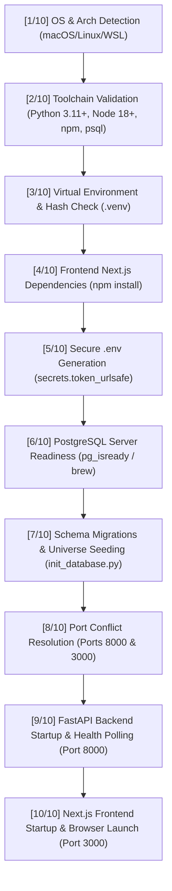

# Lucid — Complete Setup, Installation & Application Launcher Guide

This document provides complete instructions for installing, configuring, running, and managing **Lucid** on macOS, Linux, and Windows systems.

---

## 1. Quick Start: One-Command Automated Setup

Lucid provides an automated startup system. A single command handles prerequisite detection, Python virtual environment creation, backend dependencies, frontend Node dependencies, `.env` generation with cryptographically secure random secrets, PostgreSQL database verification, schema migrations, reference data seeding (including 2,639 NSE/BSE securities), service port conflict resolution, background service orchestration, and automatic browser launch.

### macOS & Linux

```bash
# Clone the repository
git clone https://github.com/imankur0011/Lucid.git
cd Lucid

# Grant execution permissions and run the automated launcher
chmod +x start_lucid.sh
./start_lucid.sh
```

### Windows (PowerShell)

```powershell
# Clone the repository
git clone https://github.com/imankur0011/Lucid.git
cd Lucid

# Run the PowerShell launcher
powershell -ExecutionPolicy Bypass -File .\start_lucid.ps1
```

Once execution completes, your default browser opens automatically to:
- **Investor Web UI**: [http://localhost:3000](http://localhost:3000)
- **FastAPI Interactive Docs**: [http://localhost:8000/docs](http://localhost:8000/docs)
- **OpenAPI Schema**: [http://localhost:8000/openapi.json](http://localhost:8000/openapi.json)

---

## 2. Companion Lifecycle Scripts

Lucid includes a dedicated suite of operational scripts in the repository root for managing running services:

| Script | Command | Purpose |
|---|---|---|
| **Launcher** | `./start_lucid.sh` | Starts PostgreSQL verification, migrations, backend, and frontend. |
| **Status Inspector** | `./status_lucid.sh` | Inspects system runtime, backend PID/health, frontend PID/HTTP status, and PostgreSQL table/record counts. |
| **Log Streamer** | `./logs_lucid.sh [backend\|frontend\|all\|clear]` | Streams live logs from `logs/backend.log` and `logs/frontend.log` with colorized formatting. |
| **Service Stopper** | `./stop_lucid.sh` | Safely terminates Lucid backend and frontend processes, freeing ports 8000 and 3000 while preserving PostgreSQL. |
| **Windows Launcher** | `powershell -File .\start_lucid.ps1` | Native Windows PowerShell equivalent for automated setup and launch. |

---

## 3. Automated 10-Step Setup Pipeline (`start_lucid.sh`)

When `./start_lucid.sh` is executed, it runs through 10 distinct phases:



### Detailed Pipeline Breakdown

1. **Operating System & Architecture Detection**:
   Detects Darwin (`arm64` Apple Silicon vs `x86_64` Intel), Linux, or Windows/WSL to select appropriate background process and service control semantics.

2. **Required Tools Validation**:
   Checks for `git`, `python3` (verifying version $\ge 3.11$), `node` (verifying version $\ge 18$), `npm`, and `psql`. On macOS with Homebrew installed, missing dependencies are offered for automatic installation.

3. **Python Virtual Environment (`.venv`)**:
   Creates `.venv` if absent. Calculates an MD5 hash of `backend/requirements.txt` stored in `.venv/.requirements.hash`. Dependency installation via `pip` is triggered **only** on first run or when `requirements.txt` changes, reducing subsequent startup time to under 3 seconds.

4. **Frontend Node Dependencies**:
   Validates `frontend/node_modules`. Runs `npm install` inside `frontend/` only when `node_modules` is missing or `package.json` has been updated.

5. **Cryptographically Secure `.env` Generation**:
   If `.env` does not exist, copies `.env.example` and automatically replaces placeholder JWT and application secret keys with cryptographically random 256-bit URL-safe tokens generated via Python `secrets.token_urlsafe(32)`. If already present, existing secrets are preserved. Prompts for optional `GEMINI_API_KEY` (runs in deterministic rule fallback mode if omitted).

6. **PostgreSQL Service Verification**:
   Reads host and port configurations from `.env`. Probes database availability using `pg_isready`. On macOS, attempts automatic service start via `brew services start postgresql@16` if the daemon is stopped.

7. **Database Provisioning, Migrations & Universe Seeding (`scripts/init_database.py`)**:
   - Connects to PostgreSQL server.
   - Creates the target database (`portfolio_dev` or configured name) if it does not exist.
   - Enables required PostgreSQL extensions: `pgcrypto` and `uuid-ossp`.
   - Executes programmatic Alembic database migrations (`backend/alembic`) up to `head`, generating 59 domain tables + 1 alembic version tracking table (60 total tables).
   - Idempotently seeds risk questionnaire questions, macroeconomic policy baselines (RBI Repo Rate 6.50%, India VIX), baseline market news, demo developer user account, and the complete NSE/BSE security universe (2,639 equities).

8. **Port Conflict Resolution**:
   Checks ports `8000` (FastAPI) and `3000` (Next.js) for stale process IDs or conflicting listeners. Gracefully terminates old processes and frees ports.

9. **Backend Server Startup**:
   Launches Uvicorn ASGI server in the background:
   ```bash
   PYTHONPATH=. .venv/bin/uvicorn backend.main:app --host 0.0.0.0 --port 8000 > logs/backend.log 2>&1 &
   ```
   Polls `http://localhost:8000/api/health` every second for up to 30 seconds until HTTP 200 is confirmed.

10. **Frontend Server Startup & Browser Launch**:
    Launches Next.js development server:
    ```bash
    npm run dev > logs/frontend.log 2>&1 &
    ```
    Polls `http://localhost:3000` until HTTP 200 is returned, records PID to `.lucid_frontend.pid`, and automatically triggers `open`, `xdg-open`, or `start` to open the web dashboard in the default browser.

---

## 4. Manual Setup Guide (Fallback / Step-by-Step)

If you prefer to configure services manually without `start_lucid.sh`, follow these exact steps:

### Step 4.1: Clone and Enter Repository

```bash
git clone https://github.com/imankur0011/Lucid.git
cd Lucid
```

### Step 4.2: Configure Python Virtual Environment

```bash
python3 -m venv .venv
source .venv/bin/activate
pip install --upgrade pip setuptools wheel
pip install -r backend/requirements.txt
```

### Step 4.3: Configure Environment Variables

```bash
cp .env.example .env
```

Edit `.env` to verify database connection settings:
```ini
POSTGRES_HOST=localhost
POSTGRES_PORT=5432
POSTGRES_DB=portfolio_dev
POSTGRES_USER=your_postgres_user
POSTGRES_PASSWORD=your_postgres_password
JWT_SECRET_KEY=generate_random_secret_here
APP_SECRET_KEY=generate_random_secret_here
GEMINI_API_KEY=your_gemini_api_key_or_leave_empty
```

### Step 4.4: Initialize Database & Run Migrations

Ensure your PostgreSQL service is running (`brew services start postgresql@16` on macOS, or Windows Service). Then run the automated database provisioning script:
```bash
PYTHONPATH=. .venv/bin/python scripts/init_database.py
```

*This creates the `portfolio_dev` database, verifies `pgcrypto`/`uuid-ossp` extensions, executes Alembic migrations up to head, seeds SEBI psychometric questions, macroeconomic indicators, developer user, and synchronizes the ~2,639 NSE/BSE stock universe.*

### Step 4.5: Configure Frontend Dependencies

```bash
cd frontend
npm install
cd ..
```

### Step 4.6: Start Services in Two Terminals

**Terminal 1 — Backend API:**
```bash
cd Lucid
source .venv/bin/activate
uvicorn backend.main:app --host 0.0.0.0 --port 8000 --reload
# On Windows PowerShell:
# $env:PYTHONUTF8 = "1"
# python -m uvicorn backend.main:app --host 0.0.0.0 --port 8000 --reload
```

**Terminal 2 — Frontend Application:**
```bash
cd Lucid/frontend
npm run dev
```

### Step 4.7: Verify System Readiness

```bash
# In your root terminal with (.venv) active:
python scripts/verify_e2e.py
```
```

---

## 5. Environment Variables Reference

| Variable | Default Value | Description |
|---|---|---|
| `POSTGRES_HOST` | `localhost` | Hostname of the PostgreSQL database instance. |
| `POSTGRES_PORT` | `5432` | TCP port for PostgreSQL (or `5433` if custom). |
| `POSTGRES_DB` | `portfolio_dev` | Name of the primary database. |
| `POSTGRES_USER` | `postgres` | Database superuser or application owner. |
| `POSTGRES_PASSWORD` | *(empty or password)* | Password for PostgreSQL user. |
| `JWT_SECRET_KEY` | *(auto-generated)* | 256-bit cryptographically secure key for JWT token signing. |
| `JWT_ALGORITHM` | `HS256` | Symmetric signature algorithm. |
| `ACCESS_TOKEN_EXPIRE_MINUTES` | `60` | Lifespan of access tokens before refresh. |
| `APP_SECRET_KEY` | *(auto-generated)* | Application session and cookie signing key. |
| `GEMINI_API_KEY` | *(optional)* | Google Gemini API key for qualitative agent research. Falls back to deterministic rule-based models if omitted. |
| `ENVIRONMENT` | `development` | Runtime environment (`development`, `staging`, `production`). |
| `LOG_LEVEL` | `INFO` | Logging threshold (`DEBUG`, `INFO`, `WARNING`, `ERROR`). |

---

## 6. Default Seed Credentials

Upon running database initialization, the development seeder provisions a ready-to-use investor account:

- **Email**: `developer@lucid.local`
- **Password**: `LucidDevPass123!`
- **Role**: `investor`
- **Account Status**: `active`
- **Verification**: Email and Mobile pre-verified

---

## 7. Status Inspection & Health Check

Run `./status_lucid.sh` at any time to inspect system health:

```text
======================================================================
                    LUCID SYSTEM STATUS INSPECTOR                     
======================================================================

[1] System & Runtime Environment:
   OS / Arch        : Darwin (arm64)
   Python           : 3.14.7 (/opt/homebrew/bin/python3)
   Virtualenv       : Active (.venv)
   Node.js          : v25.2.1 (/opt/homebrew/bin/node)
   npm              : 11.6.2

[2] Backend API Service (Port 8000):
   Status           : ● RUNNING & HEALTHY
   PID              : 91402 (Recorded PID: 91402)
   URL              : http://localhost:8000
   Health Response  : {"status":"healthy","database":"connected","version":"1.0.0"}

[3] Frontend Web Application (Port 3000):
   Status           : ● RUNNING & READY
   PID              : 91455 (Recorded PID: 91455)
   URL              : http://localhost:3000
   HTTP Status      : 200 OK

[4] PostgreSQL Database Status & Record Counts:
   Connection       : ✓ CONNECTED
   Schema Tables    : 60 tables registered
   Exchange Stocks  : 2639 securities stored (NSE/BSE)
   User Accounts    : 639 user account(s)
   Macro Indicators : 5 economic series registered

======================================================================
🟢 OVERALL STATUS: ALL SYSTEMS OPERATIONAL
   Lucid is fully running and accessible at http://localhost:3000
======================================================================
```

---

## 8. Log Inspection & Troubleshooting

### Streaming Logs
Use `./logs_lucid.sh` to stream application output:

```bash
# Stream all logs
./logs_lucid.sh

# Stream backend API logs only
./logs_lucid.sh backend

# Stream frontend Next.js logs only
./logs_lucid.sh frontend

# View the last 100 lines of backend logs
./logs_lucid.sh backend 100

# Clear/truncate log files
./logs_lucid.sh clear
```

### Common Troubleshooting Scenarios

#### 1. Port 8000 or 3000 Already in Use
Run `./stop_lucid.sh` to terminate lingering processes. Alternatively:
```bash
lsof -i :8000 -sTCP:LISTEN -t | xargs kill -9 2>/dev/null || true
lsof -i :3000 -sTCP:LISTEN -t | xargs kill -9 2>/dev/null || true
```

#### 2. PostgreSQL Connection Refused
- Ensure PostgreSQL is running:
  - macOS: `brew services start postgresql@16`
  - Linux: `sudo systemctl start postgresql`
- Check port in `.env` (`POSTGRES_PORT=5432` or `5433`).
- Test with `psql -h localhost -p 5432 -U postgres`.

#### 3. Python Version Compatibility
Lucid requires Python 3.11+. Check your Python version:
```bash
python3 --version
```
If using Homebrew on macOS:
```bash
brew install python@3.11
```

#### 4. Frontend Next.js Build Cache Issues
If frontend displays stale pages or module resolution errors:
```bash
rm -rf frontend/.next frontend/node_modules
cd frontend && npm install && cd ..
```
