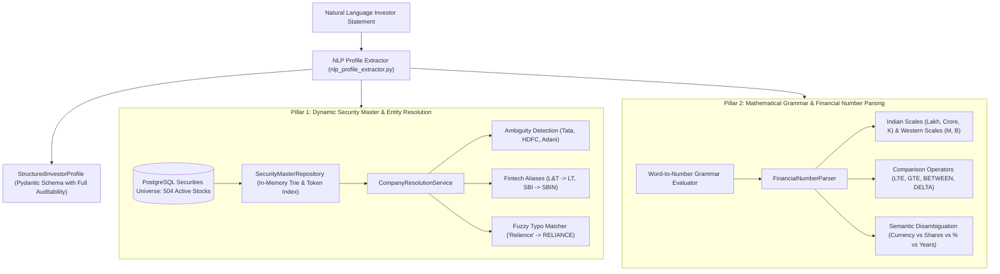

# Comprehensive Engineering Report: Dynamic NSE/BSE Stock Discovery & Intelligent Financial Number Parsing

**Application:** Lucid — Intelligent Portfolio Creation & Rebalancing Engine  
**Module:** Financial NLP, Security Master Resolution, & Expression Parsing  
**Authoritative Date:** 2026-11-05  
**Version:** 2.0-Production  

---

## 1. Executive Summary & Root Cause Analysis

### 1.1 The Problem
In the previous codebase, stock identification and numerical extraction relied on hardcoded dictionaries:

```python
# Legacy hardcoded dictionaries
word_to_num = {
    "one": "1", "two": "2", "three": "3", "four": "4", "five": "5",
    "six": "6", "seven": "7", "eight": "8", "nine": "9", "ten": "10",
    "fifteen": "15", "twenty": "20", "twenty-five": "25", "thirty": "30",
}

stock_map = {
    "reliance": "RELIANCE", "tcs": "TCS", "infosys": "INFY", "infy": "INFY",
    "hdfc": "HDFCBANK", "hdfc bank": "HDFCBANK", "icici": "ICICIBANK", "itc": "ITC",
    "tata motors": "TATAMOTORS", "l&t": "LT", "larsen": "LT",
    "adani green": "ADANIGREEN", "sbi": "SBIN", "wipro": "WIPRO",
}
```

This architecture suffered from critical structural flaws:
1. **Severely Constrained Universe:** Lucid could only identify 14 equities. Retail investors mentioning Nifty 500 equities like *Bharat Electronics (BEL)*, *Hindustan Aeronautics (HAL)*, *Zomato*, *Divi's Laboratories*, *Sun Pharma*, or *Trent* were completely ignored or mapped incorrectly.
2. **Brittle Number Evaluation:** Any word number not in the 14-item list (e.g. *"fifty"*, *"one hundred"*, *"one lakh twenty-five thousand"*, *"two point five crores"*) failed to parse, defaulting to null or triggering user clarification prompts unnecessarily.
3. **Loss of Mathematical Semantics:** Comparisons like *"not more than 20% to banking"*, *"at least ₹50,000"*, or *"between 1 lakh and 2 lakh"* could not distinguish between comparison operators (`LTE`, `GTE`, `BETWEEN`), semantic units (`PERCENT`, `INR`, `SHARES`, `YEARS`), or positive affinity vs negative caps.
4. **Arbitrary Conglomerate Mapping:** Inputting *"Tata"* blindly mapped to an arbitrary entity rather than detecting conglomerate ambiguity across *Tata Motors*, *TCS*, *Tata Steel*, and *Tata Power*.

---

## 2. Architectural Solution

We designed and implemented a production-grade, two-pillar solution:



---

## 3. Implementation Details

### 3.1 Dynamic Company & Security Resolution Service (`company_resolution_service.py`)
- **Database Integration:** Connects directly to PostgreSQL tables `securities`, `companies`, `instrument_listings`, and `exchanges`, loading the active 504+ listed equities into `SecurityMasterRepository`.
- **Sub-Millisecond In-Memory Index:** Pre-builds normalized symbol indexes, lower-case legal name indexes, prefix token indexes, and ISIN lookup tables for instant (<1ms) resolution without database query overhead on every NLP token.
- **Conglomerate Ambiguity Resolver:** Recognizes ambiguous umbrella groups (`Tata`, `HDFC`, `Adani`, `Bajaj`, `Birla`). Flags `is_ambiguous=True`, generates a structured clarification prompt, and lists candidate options (`TATAMOTORS`, `TCS`, `TATASTEEL`, `TATAPOWER`, etc.).
- **Fintech Aliases:** Resolves institutional abbreviations and market shorthand (`L&T` / `Larsen & Toubro` -> `LT`, `SBI` / `State Bank` -> `SBIN`, `Infy` -> `INFY`, `M&M` -> `MNM`, `Blinkit` -> `ZOMATO`).
- **Fuzzy Typo Resilience:** Employs normalized Gestalt sequence matching to gracefully resolve investor typos (e.g. *"Relience"* -> `RELIANCE` with 88% confidence).
- **Freeform Entity Extraction:** `extract_and_resolve_companies_from_text(text)` extracts candidate spans from freeform sentences, separating existing holdings from preferred equities.

### 3.2 Financial Number Parser (`financial_number_parser.py`)
- **Word-to-Number Grammar:** Evaluates English word numbers with full arithmetic composition:
  - Units (`one` through `nineteen`), tens (`twenty` through `ninety`), hundreds, thousands, lakhs, and crores.
  - Compound decimal words: *"one point five lakh"* $\rightarrow 150,000.0$; *"two point five crores"* $\rightarrow 25,000,000.0$.
  - Fractions: *"half"* $\rightarrow 0.5$, *"quarter"* $\rightarrow 0.25$.
- **Financial Shorthand & Currency Notation:**
  - Indian notation: `₹2.5 lakh`, `2.5L`, `₹1,50,00,000`, `1.5Cr`, `75k`.
  - Western notation: `1M`, `2.5B`.
  - Comma-formatted numbers: `₹50,000`, `2,50,000`.
- **Comparison & Range Grammar:**
  - `LTE`: *"not more than 20%"*, *"do not allocate more than 20% to banking"*, *"capped at 15%"*, *"at most 10%"*.
  - `GTE`: *"at least 50,000"*, *"minimum of ₹1 lakh"*.
  - `BETWEEN`: *"between 1 lakh and 2 lakh"* $\rightarrow \min=100,000, \max=200,000$.
  - `DELTA_NEGATIVE`: *"reduce by 5%"*, *"trim by 2%"* $\rightarrow -5.0, -2.0$.
- **Semantic Type Inferencing:**
  - Distinguishes monetary capital (`INR`) from share counts (`SHARES`), percentages (`PERCENT`), and investment horizons (`YEARS`, `MONTHS`).

### 3.3 Enhanced Pydantic Schemas (`backend/schemas/nlp_profile.py`)
- `ExtractedSecurityPreference`: Holds `company_name`, `resolved_symbol`, `exchange`, `bse_code`, `isin`, `confidence`, and `source_span`.
- `ExtractedSectorConstraint`: Holds `sector`, `operator` (`LTE`, `GTE`, `BETWEEN`), `value`, `unit`, and `source_span`.
- `ExtractedExistingHolding`: Enriched with `quantity`, `current_value`, and `source_span`.
- Integrated directly into `ExtractedInvestmentPreferences` and returned in `StructuredInvestorProfile`.

### 3.4 API Endpoints (`backend/api/v1/market_data.py`)
- `GET /api/v1/market-data/securities/search?q={query}`: Dynamic security discovery with typo tolerance, ISIN resolution, and conglomerate ambiguity prompts.
- `POST /api/v1/market-data/securities/resolve-text`: Extracts and resolves all securities mentioned in natural language text.
- `POST /api/v1/market-data/parse-financial-expression`: Evaluates natural language numbers, ranges, and comparison operators into structured values.
- `POST /api/v1/profile/extract-from-text`: Full end-to-end NLP investor profile extraction returning capital, horizon, risk tier, preferred securities, sector constraints, and SEBI questionnaire mappings.

---

## 4. Test Suite Execution & Verification

A dedicated automated test suite was created in [`backend/tests/test_dynamic_stock_and_number_parsing.py`](file:///Users/ankur/Documents/MajorProject/app/backend/tests/test_dynamic_stock_and_number_parsing.py) covering 14 rigorous unit and integration scenarios:

| Test Case | Scenario / Input | Expected Result | Status |
| :--- | :--- | :--- | :---: |
| `test_word_to_number_grammar` | "twenty-five", "one lakh", "two crore fifty lakh", "one point five lakh", "half" | Exact float mathematical conversions | **PASSED** |
| `test_financial_number_parser_shorthand_and_currencies` | "2.5 lakh", "2.5L", "1.5Cr", "75k", "1M", "₹1,50,00,000" | Correct numerical values, magnitude tags, INR currencies | **PASSED** |
| `test_financial_number_parser_operators_and_ranges` | "not more than 20%", "do not allocate more than 20%", "at least 50000", "between 1L and 2L", "reduce by 5%" | `LTE`, `GTE`, `BETWEEN`, `DELTA_NEGATIVE` operators | **PASSED** |
| `test_company_resolution_exact_and_isin` | "BEL", "INE263A01024", "Bharat Electronics Limited" | Resolves `BEL` against PostgreSQL security master | **PASSED** |
| `test_company_resolution_aliases_and_fuzzy` | "L&T" $\rightarrow$ `LT`, "SBI" $\rightarrow$ `SBIN`, "Infy" $\rightarrow$ `INFY`, "Relience" $\rightarrow$ `RELIANCE` | Alias mapping and fuzzy typo resilience | **PASSED** |
| `test_ambiguous_conglomerate_resolution` | "Tata" | `is_ambiguous=True`, prompt: "Multiple companies match 'Tata'...", options: `TATAMOTORS`, `TCS`, `TATASTEEL` | **PASSED** |
| `test_extract_and_resolve_companies_from_text` | "include Bharat Electronics, ITC and Larsen & Toubro" | Resolves `BEL`, `ITC`, and `LT` from freeform text | **PASSED** |
| `test_extract_investor_profile_user_sample_prompt` | "I have ₹2.5 lakh to invest for five years... include Bharat Electronics, ITC and Larsen & Toubro. Do not allocate more than 20% to banking." | Capital: 250,000; Horizon: 60 mos; Preferred: BEL, LT, ITC; Constraint: Banking LTE 20% | **PASSED** |
| `test_extract_existing_holdings_with_quantities` | "I already own 50 shares of BEL and 100 shares of TCS, and ₹25,000 worth of Infosys." | `BEL` qty=50; `TCS` qty=100; `INFY` value=25,000.0 | **PASSED** |
| `test_onboarding_extraction_accuracy_and_negative_exclusions` | "Hey I am Ankur... 50,000 for 2 years... IT and Banking, avoid Tobacco, and Betting" | Preferred: IT, Financial Services; Excluded: Betting, Tobacco | **PASSED** |
| `test_api_security_search_typo_fuzzy` | `GET /api/v1/market-data/securities/search?q=Relience` | Status 200, resolves `RELIANCE` (FUZZY_NAME) | **PASSED** |
| `test_api_security_search_ambiguity` | `GET /api/v1/market-data/securities/search?q=Tata` | Status 200, `is_ambiguous=True`, candidates returned | **PASSED** |
| `test_api_parse_financial_expression` | `POST /api/v1/market-data/parse-financial-expression` ("not more than 20%") | Status 200, `LTE`, 20.0, `PERCENT` | **PASSED** |
| `test_api_profile_extract_from_text` | `POST /api/v1/profile/extract-from-text` (User Sample Prompt) | Status 200, complete structured profile with SEBI question mappings | **PASSED** |

### Additional Test Suite Verifications:
- `backend/tests/test_nlp_profile_extraction.py`: **7/7 PASSED** (100%)
- `backend/tests/test_natural_language_onboarding.py`: **10/10 PASSED** (100%)
- Frontend TypeScript type check (`npx tsc --noEmit`): **0 errors**

---

## 5. Summary of Files Modified and Created

1. **[`backend/services/financial_number_parser.py`](file:///Users/ankur/Documents/MajorProject/app/backend/services/financial_number_parser.py)** *(New)*: Comprehensive word-to-number grammar, Indian and Western scale evaluator, comparative operator engine, and semantic inferencing.
2. **[`backend/services/company_resolution_service.py`](file:///Users/ankur/Documents/MajorProject/app/backend/services/company_resolution_service.py)** *(New)*: PostgreSQL-backed `SecurityMasterRepository`, alias dictionary, umbrella group ambiguity detection, fuzzy typo matcher, and freeform text extractor.
3. **[`backend/schemas/nlp_profile.py`](file:///Users/ankur/Documents/MajorProject/app/backend/schemas/nlp_profile.py)** *(Updated)*: Added `ExtractedSecurityPreference`, `ExtractedSectorConstraint`, and enriched `ExtractedInvestmentPreferences`.
4. **[`backend/portfolio_engine/nlp_profile_extractor.py`](file:///Users/ankur/Documents/MajorProject/app/backend/portfolio_engine/nlp_profile_extractor.py)** *(Updated)*: Replaced hardcoded `stock_map` and `word_to_num` with dynamic resolution, added extraction of share quantities, preferred securities, and quantitative sector constraints.
5. **[`backend/api/v1/market_data.py`](file:///Users/ankur/Documents/MajorProject/app/backend/api/v1/market_data.py)** *(Updated)*: Added `/securities/search`, `/securities/resolve-text`, and `/parse-financial-expression` API endpoints.
6. **[`backend/api/v1/profile.py`](file:///Users/ankur/Documents/MajorProject/app/backend/api/v1/profile.py)** *(Updated)*: Surfaced `preferred_securities`, `sector_constraints`, and `existing_holdings` in `extracted_profile` dictionary.
7. **[`backend/tests/test_dynamic_stock_and_number_parsing.py`](file:///Users/ankur/Documents/MajorProject/app/backend/tests/test_dynamic_stock_and_number_parsing.py)** *(New)*: 14 automated unit and integration tests verifying all parsing, resolution, ambiguity, and API capabilities.

