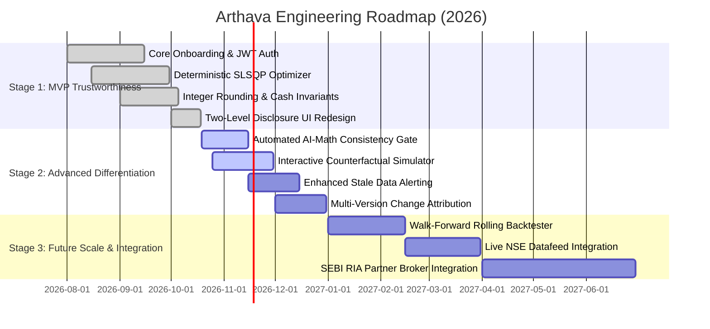

# Implementation Roadmap, Traceability Matrix, and Engineering Handoff
**Application:** Arthava (Intelligent Portfolio Creation & Rebalancing Engine)  
**Document:** `docs/implementation_roadmap.md`  
**Standard:** Phased Engineering Milestones, Evidence-to-Validation Matrix, and Fiduciary Handoff

---

## 1. Phased Implementation Roadmap

The development of Arthava is structured across three disciplined phases. Stage 1 represents the currently implemented and verified baseline.



### Stage 1: MVP and Core Trustworthiness (Currently Implemented & Verified)
- **Delivered Capabilities:**
  - Investor onboarding, risk profiling, and JWT session isolation.
  - Conversational strategy and ethical exclusion parsing.
  - Scipy SLSQP deterministic portfolio optimization.
  - Whole-share rounding ($q_i \in \mathbb{Z}_{\geq 0}$) with non-negative cash reserve invariant ($C_{rem} \geq 0$).
  - Two-level progressive disclosure (Level 1 Simple Explanation vs. Level 2 Financial Detail).
  - Suppression of all internal agent names (`Strategist`, `Critic`, `Moderator`) and execution traces from retail screens.
  - Portfolio diagnosis, integer rebalancing preview, and macro stress tests.
  - 100% test pass rate across 53 Pytest tests and 12 Playwright browser journeys.

### Stage 2: Advanced Differentiation (Near-Term Execution)
- **Target Deliverables:**
  - *Automated AI-Math Consistency Gate:* Automated validation blocking any LLM explanation where mentioned numbers differ from calculated metrics by $> 0.1\%$.
  - *Controlled Counterfactual Simulator:* Interactive sliders to preview how changing horizon or budget shifts the asset mix.
  - *Enhanced Stale Data Alerter:* Automated banner notifications if pricing feeds exceed 24 hours of latency.
  - *Multi-Version Attribution Matrix:* Automated diff explaining whether portfolio shifts between versions were caused by investor input changes or market price movements.

### Stage 3: Future Scale and Ecosystem Integration (Long-Term Horizons)
- **Target Deliverables:**
  - *Rolling Walk-Forward Backtester:* Multi-period cross-validation to assess strategy decay across differing market regimes.
  - *Commercial Exchange Data Feeds:* Direct WebSocket ingestion from NSE Data & Analytics Ltd. with verified exchange licenses.
  - *Broker API Partner Integration:* Optional order routing to SEBI-registered discount brokers (Zerodha Kite Connect, Groww) under formal RIA/broker regulatory partnerships.

---

## 2. Requirements-to-Evidence-to-Validation Matrix

This matrix connects every high-priority requirement to its underlying data inputs, deterministic calculations, evidence sources, validation methods, and acceptance tests:

| Req ID | Requirement Name | Required Inputs / Market Data | Output Artifact | Underlying Evidence | Validation Method | Acceptance Test Reference |
| :--- | :--- | :--- | :--- | :--- | :--- | :--- |
| **FR-C01** | Risk Capacity Profiling | Capital $B$, Horizon, Drawdown Reaction | Risk Tier ($[1, 5]$) | Investor demographic & behavioral survey | Score boundary clamping ($[1, 5]$) | `test_investor_api.py::test_create_and_get_investor_profile` |
| **FR-C02** | Exclusion Parsing | Natural language prompt | Boolean exclusion mask | User ethical preference string | Schema regex & keyword matching | `test_concurrency_and_failures.py` |
| **FR-C04** | SLSQP Optimization | Covariance $\Sigma$, Returns $\mu$, Caps $u_i, S_k$ | Continuous weights $w_i^*$ | 3-Year historical daily returns | Invariant check: $\sum w_i = 1.0 \pm 10^{-4}$ | `test_portfolio_engine.py::test_optimize_portfolio_slsqp` |
| **FR-C05** | Integer Share Rounding | Weights $w_i^*$, Budget $B$, Prices $p_i$ | Whole shares $q_i$, Cash $C_{rem}$ | Audited closing prices ($p_i > 0$) | Invariants: $C_{rem} \geq 0$, $\sum p_i q_i + C_{rem} = B$ | `test_portfolio_engine.py::test_integer_share_rounding` |
| **FR-C06** | Mathematical Caps | Weights $w_i^*$, Sector map | Validation flag `PASS/FAIL` | Fiduciary safety guardrails | Linear boundary check: $w_i \leq 0.25, S_k \leq 0.40$ | `test_portfolio_engine.py::test_constraint_validator` |
| **FR-C07** | Fiduciary Citations | Holdings $\{q_i\}$, Company fundamentals | Plain-English cards + Citations | Audited corporate filings (NSE) | Citation date & numeric cross-check | Playwright E2E Module 8 |
| **FR-C08** | Portfolio Diagnosis | Current shares, Target weights | Integer Buy/Sell actions | Market prices & drift metrics | Integer cash conservation | `test_diagnosis_and_rebalance.py` |
| **FR-C09** | Stress Simulation | Portfolio holdings, Shock matrix | Hypothetical loss % | Macro scenario models (-20% shock) | Linear asset shock propagation | Playwright E2E Module 9 |
| **FR-C10** | Benchmark Backtest | 3-Year prices, Benchmark series | CAGR, Sharpe, Drawdown | Nifty 50 daily index values | Gross return formula verification | `test_benchmark_and_comparison.py` |
| **FR-S01** | User Data Isolation | User credentials, Bearer JWT | Authenticated session | Cryptographic HS256 JWT claim | SQL `WHERE user_id = :current_user` | `test_auth_and_security.py` |
| **FR-S02** | Version History | Portfolio instance, Timestamp | Version Snapshot record | Monotonic integer per user | Database foreign key integrity | `test_database.py::test_portfolio_versioning` |

---

## 3. Open Questions, Strategic Decisions, and Reasoned Recommendations

| Topic / Decision Area | Open Question | Proposed Options | Reasoned Recommendation | Impact on Product & Investor |
| :--- | :--- | :--- | :--- | :--- |
| **1. Cash Reserve Handling** | How should unallocated cash resulting from whole-share rounding be communicated to beginners? | A) Hide cash and round up (borrowing).<br>B) Display cash as an explicit reserve with explanation.<br>C) Reinvest in an overnight liquid ETF. | **Option B (Display as Cash Reserve)** | Fosters transparency; educates investors on the reality of Indian share indivisibility without risk of budget overdrafts. |
| **2. AI Deliberation Presentation** | Should internal agent debate (Critic vs. Strategist) be exposed to retail investors? | A) Expose full agent debate transcript.<br>B) Expose agent names with summarized points.<br>C) Completely conceal agent names; present outcomes as "Mathematical & Fiduciary Safety Verification". | **Option C (Strict Concealment)** | Eliminates developer jargon; presents a unified, trustworthy fiduciary product without confusing investors with internal architecture. |
| **3. Market Data Freshness Policy** | At what latency threshold should a price feed trigger an investor warning? | A) Warn if $> 15$ minutes old.<br>B) Warn if $> 24$ hours old.<br>C) Warn only if market closed $> 3$ days. | **Option B (Warn if $> 24$ hours old)** | Appropriate for end-of-day equity portfolio construction. Avoids alarming investors during normal trading hours while flagging weekend or holiday staleness. |
| **4. Live Broker Execution** | Should live trade placement (e.g., Zerodha Kite API) be included in current scope? | A) Implement direct automated trading.<br>B) Defer live execution; provide exportable share order list. | **Option B (Exportable List / Defer Live)** | Avoids complex SEBI RIA compliance, custody audits, and broker licensing hurdles while giving investors actionable share quantities to place themselves. |

---

## 4. Engineering Implementation Handoff (Developer-Only Technical Reference)

> [!IMPORTANT]
> This section is strictly for software engineers, database administrators, and technical auditors. The internal details documented below must **never** be rendered in ordinary retail investor screens, tooltips, or public API responses.

### Affected Codebase Components & API Contracts

```
backend/
├── api/v1/
│   ├── auth.py              # JWT authentication & user login
│   ├── portfolio.py         # Generation request & version retrieval endpoints
│   ├── diagnosis.py         # Drift analysis & rebalancing actions endpoint
│   ├── investor.py          # Profile & risk questionnaire persistence
│   └── profile.py           # User data retrieval & isolation
├── portfolio_engine/
│   ├── engine.py            # Scipy SLSQP optimizer & compute_integer_allocations()
│   ├── validators.py        # Deterministic constraint assertions (caps, cash buffer)
│   ├── rebalancer.py        # Discrete whole-share adjustment solver
│   ├── stress_tester.py     # Macro scenario shock matrix propagation
│   └── benchmarks.py        # 3-year CAGR, Sharpe ratio, and Max Drawdown engine
├── agents/                  # LangGraph multi-agent orchestration
│   ├── strategist.py        # Synthesis of investment thesis
│   ├── critic.py            # Fiduciary constraint verification
│   └── moderator.py         # Conflict resolution & final output packaging
└── models/                  # SQLAlchemy 2.0 ORM models (60 PostgreSQL tables)
```

### API Response Sanitization Rule
To prevent implementation leakage, the backend serializer (`backend/api/v1/portfolio.py`) must strictly filter the internal LangGraph state:
```python
# DEVELOPER ENFORCEMENT: Strip internal agent architecture from investor payload
investor_payload = {
    "portfolio_id": str(db_portfolio.id),
    "version": db_portfolio.version_number,
    "created_at": db_portfolio.created_at.isoformat(),
    "capital": db_portfolio.total_capital,
    "allocated_capital": db_portfolio.allocated_capital,
    "cash_reserve": db_portfolio.cash_buffer,
    "holdings": sanitized_holdings,
    "sector_breakdown": sector_summary,
    "explanation": {
        "overall_thesis": db_portfolio.thesis_text,
        "holding_rationales": sanitized_rationales,
        "audited_citations": audited_evidence_list,
        "safety_checks_passed": [
            "Single-stock concentration cap (<= 25%) verified",
            "Sector diversification cap (<= 40%) verified",
            "Non-negative cash balance verified",
            "Whole-share allocation feasibility verified"
        ]
    }
}
# PROHIBITED: Do not include "agent_trace", "critic_debate", "prompt_tokens", or "sql_query"
```

### Verification Checklist for Engineering Releases
1. Run backend regression: `.venv/bin/pytest backend/tests/ -v` (Must pass 53/53 tests).
2. Run frontend production build: `npm run build` in `frontend/` (Must build with 0 TypeScript/ESLint warnings).
3. Run Playwright E2E suite: `npm run test:e2e` in `frontend/` (Must pass 12/12 journeys).
4. Inspect DOM for leakage: Verify that searching for "Strategist", "Critic", "Moderator", "LangGraph", or "FastAPI" returns zero hits in the retail DOM.
