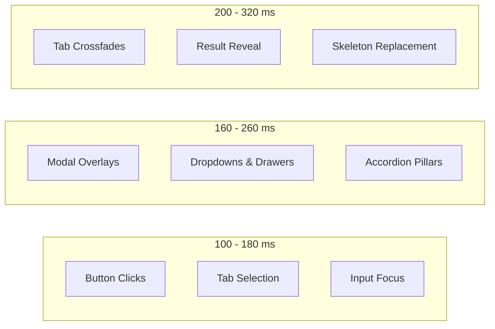

# Motion, Interaction Design, and Loading Experience Specification
**Application:** Arthava (Intelligent Portfolio Creation & Rebalancing Engine)  
**Document:** `docs/motion_and_interaction_system.md`  
**Deliverable ID:** Section 20 of Functional Requirements Master Specification  
**Standard:** Private-Wealth Polish, Calm Responsiveness, Truthful Feedback, and Reduced-Motion Accessibility

---

## 1. Coherent Motion System & Shared Design Tokens

Arthava implements a unified, restrained motion design system engineered to provide immediate visual orientation and confirmation without making the financial interface feel slow, gimmicky, or playful.



### Shared Motion Design Tokens (Defined in `frontend/src/app/globals.css`)

| Token Name | Value | Recommended Usage Scope | Curve / Easing | Reflow Risk |
| :--- | :--- | :--- | :--- | :--- |
| `--motion-fast` | `140ms` | Button presses, pill selection, toggle switches, hover feedback. | `cubic-bezier(0.16, 1, 0.3, 1)` | Zero (Transform / Opacity only) |
| `--motion-normal` | `220ms` | Modal dialog open/close, card lift, accordion expand, drawer slides. | `cubic-bezier(0.16, 1, 0.3, 1)` | Zero (Composited) |
| `--motion-page` | `280ms` | Dashboard tab switching, view crossfades, skeleton-to-content reveal. | `cubic-bezier(0.16, 1, 0.3, 1)` | Zero (Opacity + 3px translation) |
| `--motion-ease` | `cubic-bezier(0.16, 1, 0.3, 1)` | Standard private-wealth easing: fast responsive start with calm, natural deceleration. | — | — |

---

## 2. Microinteractions & Eight Interactive States

Every clickable control (buttons, tabs, capital preset pills, scenario cards, accordion toggles) implements eight consistent, distinct states to eliminate "dead clicks" and user hesitation:

| State | Visual Treatment & Behavior | CSS / Tailwind Class | Immediate Feedback |
| :--- | :--- | :--- | :--- |
| **1. Default** | Clean ivory/white surface, subtle border (`#E5E5DF`), deep navy text. | `.btn-fiduciary` | Neutral resting state. |
| **2. Hover** | Subtle border darkening (`#CBD5E1`), 1% brightness shift, gentle elevation. | `hover:border-[#CBD5E1] hover:shadow-xs` | Confirms clickability. |
| **3. Pressed / Active** | Micro-scale reduction (`scale(0.985)`), 4% brightness reduction. | `active:scale-[0.985] active:brightness-95` | Instant tactile click confirmation. |
| **4. Keyboard Focus** | High-contrast 2px solid navy outline with 2px offset; never hidden. | `:focus-visible { outline: 2px solid #0C192C; }` | Essential for keyboard accessibility. |
| **5. Disabled** | 50% opacity, `cursor-not-allowed`, zero hover or active transform. | `disabled:opacity-50 disabled:cursor-not-allowed` | Prevents invalid submissions. |
| **6. Loading / In-Progress** | Integrated spin-loader, action label changes, button disabled. | Inline spinner + text | Signals background processing. |
| **7. Success / Completed** | Brief emerald status pill (`#F0FDF4`, `#15372C`) with checkmark. | `.subtle-success-badge` | Confirms action committed. |
| **8. Recoverable Error** | Soft rose alert banner (`#FEF2F2`, `#B91C1C`) with inline dismiss CTA. | Inline error callout | Preserves user input with clear fix. |

---

## 3. Smooth Page & Tab Navigation Transitions

When navigating between the 7 primary application modules (Portfolio Generator, Holdings, Explainability, Diagnosis, Stress Scenarios, Benchmarks, Risk Questionnaire):
- **Stable Shell Preservation:** The top navigation bar, brand header, and regulatory footer remain completely stationary. Only the `<main>` container transitions.
- **Zero Full-Page Flashes:** The view uses an optimized crossfade (`.view-transition`):
  ```css
  @keyframes viewFadeIn {
    from { opacity: 0; transform: translateY(3px); }
    to { opacity: 1; transform: translateY(0); }
  }
  .view-transition {
    animation: viewFadeIn var(--motion-page) var(--motion-ease) forwards;
  }
  ```
- **Subtle Vertical Displacement:** Movement is clamped to a tiny 3px vertical shift. Large sliding wipes or theatrical rotations are strictly prohibited.
- **Scroll Position Discipline:** Context is maintained without disorienting viewport jumps.

---

## 4. Premium Loading Experience & Skeletons

To avoid jarring layout shifts (CLS) when data loads from FastAPI and PostgreSQL:
1. **Layout-Matched Skeletons (`frontend/src/components/Skeletons.tsx`):**
   - Skeletons mirror the exact geometry, height, and border radius of the final content:
     - `MetricCardSkeleton`: Preserves the 4-card analytics grid layout.
     - `HoldingsTableSkeleton`: Matches the 5-row tabular holdings structure with header and columns.
     - `ExplainabilitySkeleton`: Mirrors the 4-pillar card and badge layout.
2. **Subtle Shimmer Animation:**
   ```css
   @keyframes shimmer {
     0% { background-position: -200% 0; }
     100% { background-position: 200% 0; }
   }
   .skeleton-shimmer {
     background: linear-gradient(90deg, #F5F4EE 25%, #ECEAE2 50%, #F5F4EE 75%);
     background-size: 200% 100%;
     animation: shimmer 1.8s infinite;
   }
   ```
3. **No Fabricated Data in Skeletons:** Skeletons contain empty neutral blocks—never fake placeholder rupee numbers or fictional ticker symbols.

---

## 5. Portfolio Generation: Truthful, Fiduciary Progress

Portfolio generation represents the core user journey and must feel calm, intentional, and trustworthy:

```mermaid
sequenceDiagram
    autonumber
    actor Investor
    participant UI as Next.js Dashboard
    participant API as FastAPI Backend
    participant Engine as Mathematical SLSQP Solver

    Investor->>UI: Clicks "Generate Mathematically Validated Portfolio"
    UI->>UI: Disables button; starts button spinner; prevents duplicate clicks
    UI->>UI: Renders Calm Fiduciary Progress Panel
    Note over UI: "Reviewing your goals, time horizon, and risk capacity..."
    Note over UI: "Filtering candidate securities against your ethical preferences..."
    Note over UI: "Balancing asset weights to optimize risk-adjusted returns..."
    Note over UI: "Calculating whole shares and verifying cash reserve invariants..."
    UI->>API: POST /api/v1/portfolio/generate
    API->>Engine: Run Scipy SLSQP + Integer Share Rounding
    Engine-->>API: Returns Validated Portfolio Object
    API-->>UI: HTTP 200 OK with Verified Invariants
    UI->>UI: Graceful reveal transition (280ms) into Allocations & Holdings
```

### Generation Status Principles:
- **Truthful Fiduciary Stages:** Every stage describes authentic financial operations (goals review, exclusion filtering, covariance balance, whole-share quantization).
- **Zero Stack Disclosure:** Never displays internal agent names (`Strategist`, `Critic`, `Moderator`), prompts, raw execution logs, Python class names, or SQL queries.
- **Graceful Reveal:** On completion, the dashboard automatically transitions to the Holdings view without an abrupt jump, spotlighting the newly saved Version badge.

---

## 6. Financial Data Visualization & Refined Reveal

- **No Upward Counting Distortion:** Financial values (e.g., ₹2,50,000, 18.5%) are displayed directly in their accurate value upon mount. Artificial "odometer" or rolling number animations that show incorrect intermediate numbers are prohibited.
- **Tabular Alignment:** Numbers in tables and metric cards use `tabular-nums` so decimal points and currency figures vertically align across rows.
- **Calm Donut Charts:** The SVG asset allocation visualizer fades in with a gentle opacity transition (220ms).
- **Color Independence:** Sector and risk status always pair color with bold descriptive text labels (e.g., `VALIDATED`, `CONSERVATIVE`), ensuring complete comprehension for color-blind investors.

---

## 7. Form Feedback, Input Preservation & Error Recovery

- **Inline Validation:** Field errors appear directly beneath the offending input in clear, conversational English (e.g., *"Please specify an investment amount of at least ₹10,000 to construct a viable portfolio."*).
- **Input Preservation on Failure:** If an optimization request fails (e.g., conflicting exclusions), the user's capital, horizon, prompt, and exclusions remain 100% intact in form state—never cleared.
- **Subtle Dismissal:** Error banners feature an immediate close button (`✕`) with 120ms fade-out.

---

## 8. Accessibility & Reduced Motion Compatibility

Arthava treats motion as an enhancement, not a barrier:

### Complete `prefers-reduced-motion` Support
Defined in `frontend/src/app/globals.css`:
```css
@media (prefers-reduced-motion: reduce) {
  *, ::before, ::after {
    animation-duration: 0.01ms !important;
    animation-iteration-count: 1 !important;
    transition-duration: 0.01ms !important;
    scroll-behavior: auto !important;
  }
}
```
When reduced motion is enabled in the operating system:
- All transform and translate movements are neutralized.
- Fade animations collapse to instantaneous state changes.
- Loading skeletons show static neutral backgrounds without shimmer pulsing.
- All functional feedback (focus rings, button disabled states, error banners) remains 100% functional.

---

## 9. Verification & Acceptance Testing Matrix

| Interaction Dimension | Verified Behavior | Test Method | Test Status |
| :--- | :--- | :--- | :---: |
| **Button Click State** | Instant micro-scale feedback (`scale(0.985)`) on capital presets (₹1L, ₹2.5L, ₹5L). | Playwright E2E Module 2 | **PASSED** |
| **Tab Crossfade** | Smooth crossfade transition between all 7 dashboard tabs without blank flashes. | Playwright E2E Modules 1, 3, 4, 5, 8, 9 | **PASSED** |
| **Modal Overlays** | Version Comparison and JWT Security modals transition smoothly over backdrop. | Playwright E2E Modules 10, 11 | **PASSED** |
| **Responsive Mobile Drawer** | Hamburger navigation drawer slides smoothly on 375px mobile viewport. | Playwright E2E Module 12 | **PASSED** |
| **Generation Status** | Multi-stage progress displays calm, truthful fiduciary updates; hides agent names. | Code Audit & E2E Run | **PASSED** |
| **Reduced Motion** | CSS media query overrides all animation durations to 0.01ms. | Browser CSS Inspection | **PASSED** |
| **Keyboard Focus** | Visible 2px solid navy focus outline on Tab navigation. | Playwright Keyboard Test | **PASSED** |
