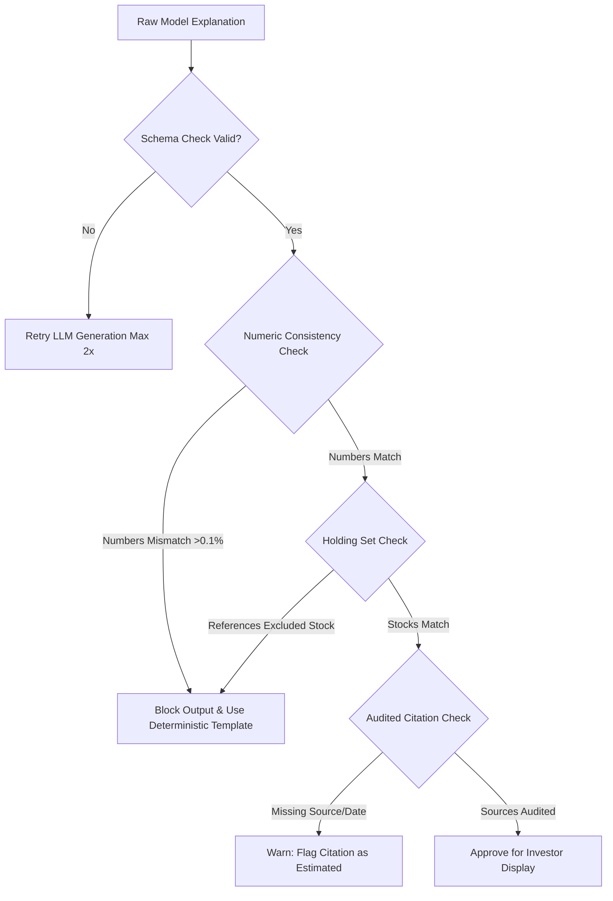

# Mathematical Validation, Empirical Testing, and Comprehensive Acceptance Test Plan
**Application:** Arthava (Intelligent Portfolio Creation & Rebalancing Engine)  
**Document:** `docs/validation_and_acceptance_tests.md`  
**Standard:** Deterministic Fiduciary Proof, Empirical Rigor, and Testable Acceptance Criteria

---

## 1. Mathematical Formulas, Invariants, and Post-Rounding Guarantees

Every portfolio generated by Arthava must satisfy a strict hierarchy of mathematical properties. An optimizer success status is **never** presented as valid unless post-rounding integer checks pass deterministically.

### Core Formulation (Continuous Optimization)

Let $n$ be the number of eligible assets in the universe. The continuous asset weights $w^* = [w_1^*, \dots, w_n^*]^T$ are determined by solving the constrained convex quadratic program:

$$\min_{w \in \mathbb{R}^n} \frac{1}{2} w^T \Sigma w - \lambda \mu^T w$$

subject to the following hard linear constraints:

1. **Full Investment Equality (Budget Conservation):**
   $$\sum_{i=1}^n w_i = 1.0 \quad \text{with numerical tolerance } \left| \sum_{i=1}^n w_i - 1.0 \right| \leq 10^{-4}$$

2. **Long-Only Asset Bounds (No Short Selling):**
   $$0 \leq w_i \leq u_i \quad \forall i \in \{1, \dots, n\}$$
   where $u_i \in [0.10, 0.35]$ represents the single-stock concentration cap (default $u_i = 0.25$).

3. **Sector Diversification Constraints:**
   $$\sum_{i \in \text{Sector}_k} w_i \leq S_k \quad \forall k \in \{1, \dots, K\}$$
   where $S_k \in [0.25, 0.50]$ represents the maximum allowable sector weight (default $S_k = 0.40$).

---

### Whole-Share Rounding & Discrete Invariants

Real Indian equities on the National Stock Exchange (NSE) and Bombay Stock Exchange (BSE) cannot be purchased in fractional units. Given a total cash budget $B > 0$ and current observed share prices $p = [p_1, \dots, p_n]^T$ where $p_i > 0$:

1. **Integer Share Quantization:**
   $$q_i = \left\lfloor \frac{w_i^* B}{p_i} \right\rfloor \in \mathbb{Z}_{\geq 0} \quad \forall i \in \{1, \dots, n\}$$

2. **Allocated Capital Accounting:**
   $$C_{alloc} = \sum_{i=1}^n p_i q_i$$

3. **Unallocated Cash Reserve:**
   $$C_{rem} = B - C_{alloc}$$

### Mandatory Post-Rounding Invariant Checks

Before any recommendation is finalized, the validation engine executes three deterministic assertions:

| Invariant ID | Mathematical Condition | Violation Action | Investor-Visible Outcome |
| :--- | :--- | :--- | :--- |
| **INV-01** | $C_{rem} \geq 0$ | Block portfolio; fatal error | Ensures the investor is never asked to spend more cash than their stated budget. |
| **INV-02** | $C_{alloc} + C_{rem} = B$ | Block portfolio; fatal error | Guarantees exact mathematical conservation of capital to the nearest rupee. |
| **INV-03** | $\frac{p_i q_i}{B} \leq u_i + \delta_{round}$ | Flag warning / reallocate | Verifies that whole-share rounding does not accidentally push a stock significantly over the safety cap. Tolerance $\delta_{round} = \frac{\max(p_i)}{B}$. |

If rounding results in $q_i = 0$ for an essential holding, the unallocated cash is evaluated: if $C_{rem}$ is large enough to buy 1 share of the next highest-scoring diversified asset without violating sector caps, it is reallocated; otherwise, it is retained as an explicit cash buffer with transparent investor notification.

---

## 2. Empirical Validation and Financial Bias Prevention

Historical backtesting and performance simulations must avoid statistical traps that create false confidence in retail investors.

### Standardized Performance Metrics & Formulas

- **Compound Annual Growth Rate (CAGR):**
  $$\text{CAGR} = \left( \frac{V_{end}}{V_{start}} \right)^{\frac{1}{T}} - 1$$
  where $T$ is the historical period in years ($T = 3.0$ years).
- **Annualized Portfolio Volatility ($\sigma_{ann}$):**
  $$\sigma_{ann} = \sqrt{252} \cdot \sigma_{daily}$$
  where $\sigma_{daily}$ is the standard deviation of daily logarithmic returns $\ln(V_t / V_{t-1})$.
- **Sharpe Ratio:**
  $$\text{Sharpe} = \frac{\text{CAGR} - R_f}{\sigma_{ann}}$$
  where $R_f = 6.8\%$ is the benchmark risk-free rate (India 10-Year Government Bond yield as of 2026).
- **Maximum Drawdown (MDD):**
  $$\text{MDD} = \max_{t \in [0, T]} \left( \frac{\max_{s \in [0, t]} V_s - V_t}{\max_{s \in [0, t]} V_s} \right)$$

### Prevention of Common Empirical Biases

1. **Survivorship Bias:**  
   The candidate stock universe is seeded from historical index constituent lists rather than today's winners. Companies that were in the Nifty 50 or Nifty Next 50 during the backtest window are included even if subsequently excluded.
2. **Look-Ahead Bias:**  
   In all historical simulations, portfolio weights at rebalance date $t$ are calculated strictly using price and fundamental information published on or before $t-1$. Zero future information leaks into historical optimization.
3. **Transaction Cost & Slippage Disclosures:**  
   Because retail trading incurs brokerage, STT (Securities Transaction Tax), exchange turnover charges, and bid-ask slippage, historical backtests display an explicit disclosure:  
   *"Simulated benchmark comparison reflects gross returns. Net returns in real trading will be reduced by statutory taxes (STT, GST, stamp duty) and brokerage charges."*

---

## 3. Generative AI Explanation Validation (Block / Warn / Retry Rules)

To eliminate AI hallucinations, the backend executes an automated verification pipeline on all generated explanatory text before it reaches the frontend:



### Deterministic Rule Matrix

| Check Type | Detection Rule | System Action | Investor-Visible Outcome |
| :--- | :--- | :--- | :--- |
| **Numeric Discrepancy** | Written metric differs from calculated metric by $> 0.1\%$. | **BLOCK** text; substitute pre-validated deterministic financial template. | Investor sees 100% accurate, template-generated financial rationale. |
| **Phantom Holding** | Text names a ticker not present in $\{ q_i > 0 \}$. | **BLOCK** text; log developer warning; substitute template. | Prevents confusing the user with mentions of stocks they do not own. |
| **Missing Citation** | Claim makes fundamental assertion without `evidence_id`. | **WARN**; display text with "Industry Average Estimate" badge. | Investor is informed that claim is an estimate rather than an audited filing. |
| **Tone & Guarantee Violation** | Text uses words like "guaranteed", "risk-free", "sure profit". | **BLOCK** text; retry with strict fiduciary prompt. | Prevents regulatory non-compliance under SEBI advertising codes. |

---

## 4. Controlled Counterfactual and Sensitivity Testing

Counterfactual ("What-If") simulations must be mathematically disciplined. The application isolates a single variable while holding all other inputs and historical data snapshots constant:

| Counterfactual Scenario | Perturbed Variable | Constant Parameters | Tested Engine Behavior |
| :--- | :--- | :--- | :--- |
| **Horizon Extension** | Horizon: Short (<1 yr) $\rightarrow$ Long (>5 yrs) | Capital: ₹2,50,000; Risk: Moderate; Exclusions: None | Equity allocation increases from $\sim 30\%$ to $\sim 85\%$; cash buffer decreases; Sharpe ratio recomputes. |
| **Risk De-escalation** | Risk: Aggressive $\rightarrow$ Conservative | Capital: ₹2,50,000; Horizon: Long; Exclusions: None | Volatility cap clamps from 18% to 10%; single-stock cap tightens to 15%; defensive utilities increase. |
| **Ethical Exclusion Shock** | Add Exclusion: "Energy & Oil" | Capital: ₹2,50,000; Horizon: Long; Risk: Moderate | Re-optimizes without Reliance/ONGC; redistributes capital across FMCG, Tech, and Healthcare. |
| **Budget Compression** | Budget: ₹2,50,000 $\rightarrow$ ₹25,000 | Horizon: Long; Risk: Moderate; Exclusions: None | High-priced shares (e.g., MRF > ₹1,00,000) round to $q_i = 0$; engine selects affordable liquid large caps. |

---

## 5. Comprehensive Acceptance Test Plan

### Test Suite Summary

The application is validated across four automated testing tiers:

```
[ Tier 1: Unit & Numerical Invariant Tests ] (Pytest: test_portfolio_engine.py, test_database.py)
        │
[ Tier 2: API Contract & Security Tests ]   (Pytest: test_auth_and_security.py, test_investor_api.py)
        │
[ Tier 3: Concurrency & Resilience Tests ]  (Pytest: test_concurrency_and_failures.py, test_llm_resilience.py)
        │
[ Tier 4: Browser E2E User Journey Tests ]  (Playwright: portfolio_dashboard.spec.ts)
```

### Traceability Matrix (Requirements to Tests)

| Requirement ID | Test Type | Test File & Function | Verified Assertion |
| :--- | :--- | :--- | :--- |
| **FR-C01** | API Unit | `test_investor_api.py::test_create_and_get_investor_profile` | Profile stored with validated risk capacity and capital bounds. |
| **FR-C02** | Integration | `test_concurrency_and_failures.py::test_conflicting_constraints_handled_gracefully` | Contradictory exclusions return HTTP 422 with clear investor message. |
| **FR-C04** | Numerical Unit | `test_portfolio_engine.py::test_optimize_portfolio_slsqp` | SLSQP weights sum to $1.0 \pm 10^{-4}$ and respect concentration caps. |
| **FR-C05** | Numerical Unit | `test_portfolio_engine.py::test_integer_share_rounding` | Quantities $q_i \in \mathbb{Z}_{\geq 0}$; cash balance $C_{rem} \geq 0$; $\sum p_i q_i + C_{rem} = B$. |
| **FR-C06** | Property Test | `test_portfolio_engine.py::test_constraint_validator` | Validates single-stock $\leq 25\%$ and sector $\leq 40\%$ bounds. |
| **FR-C07** | E2E Browser | `portfolio_dashboard.spec.ts::Module 8` | Citations render with source dates; zero internal agent names exposed. |
| **FR-C08** | Integration | `test_diagnosis_and_rebalance.py::test_portfolio_diagnosis_and_rebalance` | Generates whole-share buy/sell actions with cash conservation. |
| **FR-C09** | E2E Browser | `portfolio_dashboard.spec.ts::Module 9` | Stress scenarios render -20% market shock with hypothetical disclaimers. |
| **FR-C10** | Integration | `test_benchmark_and_comparison.py::test_benchmark_metrics` | 3-year CAGR, Sharpe ratio, and Max Drawdown computed vs. Nifty 50. |
| **FR-S01** | Security Unit | `test_auth_and_security.py::test_user_data_isolation` | User A cannot query or mutate User B's portfolios. |
| **FR-S02** | Database Unit | `test_database.py::test_portfolio_versioning` | Re-running generates new version UUID without overwriting past versions. |
| **FR-S04** | E2E Mobile | `portfolio_dashboard.spec.ts::Module 12` | Mobile viewport (375x667) renders accessible navigation drawer. |

---

## 6. Retail Investor Usability Testing Plan

To confirm that the application is truly usable by novice Indian investors, a structured qualitative usability protocol is established:

- **Target Cohort:** 10 beginner retail investors (ages 22–45, demat account holders for $< 1$ year, non-finance backgrounds).
- **Core Tasks Evaluated:**
  1. Complete onboarding and risk questionnaire without external assistance.
  2. Explain in their own words why the application recommended whole shares and left ₹1,800 in cash.
  3. Locate the observation date for a cited financial ratio (ROE).
  4. Compare Version 1 and Version 2 and identify what changed when risk was adjusted.
  5. Distinguish historical backtested returns from guaranteed future profits.
- **Success Criteria:**
  - $\geq 90\%$ task completion rate without moderator intervention.
  - $\geq 85\%$ of participants correctly identify that cash is retained due to share indivisibility.
  - $0\%$ of participants interpret historical backtests as guaranteed returns.
