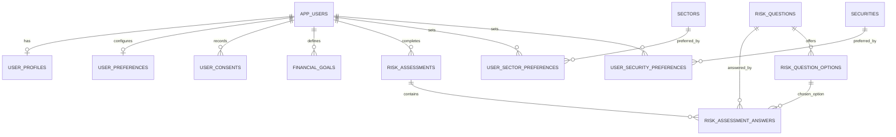
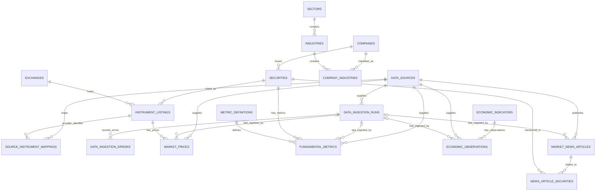
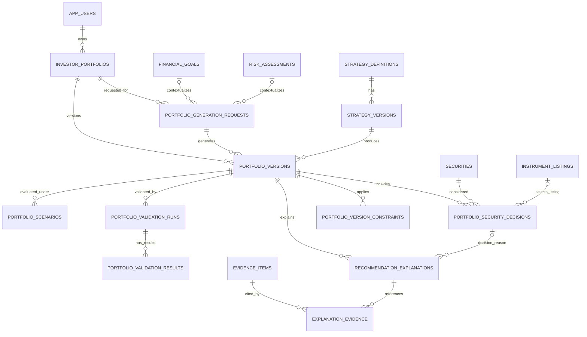
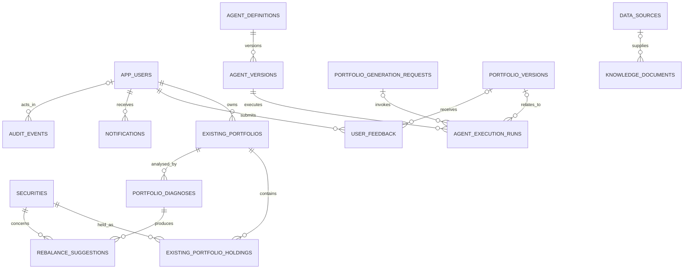

# Complete Database Design — Intelligent Portfolio Creation Application

**Backend:** Python + FastAPI + LangGraph  
**Primary relational database:** PostgreSQL 14+  
**Persistence tools:** SQLAlchemy + Alembic  
**Optional supporting components:** Neo4j (only for graph traversal needs), FAISS (document similarity search), AWS Cognito/identity provider (authentication), object storage for licensed source documents/raw files.

The design is generated from the same column definitions as `portfolio_creation_schema.sql`; use the SQL file as the executable source of truth. This document adds purpose, data dictionary, mappings, normalization rationale, ER diagrams, sample queries and implementation rules. The schema is comprehensive for the stated application but still requires validation in a fresh local PostgreSQL instance before production use.

## 1. Understanding, assumptions and boundaries

The application helps Indian retail investors create portfolios using investor goals, risk assessment, preferences and financial data. A key boundary is **AI-supported explanation and research, with deterministic Python calculations and validations controlling mathematical safety**. The database records inputs, references, outputs and validation evidence; it does not itself choose investments or prove a recommendation is suitable.

Design principles:

- PostgreSQL is the structured source of truth for application identity mapping, goals, risk assessments, canonical securities, data lineage, portfolio versions and validation history.
- Authentication passwords are handled by an identity provider; no passwords are stored here.
- API keys and broker tokens belong in a secret manager. Database fields hold references only.
- Recommendations, user-reported holdings, broker orders and completed executions are different concepts.
- Past versions remain queryable. User-facing explanations and cited evidence are persisted, not private model chain-of-thought.
- JSONB is reserved for variable configuration, structured snapshots, summaries and operational metadata, not to hide core relational entities.
- Onboarding and profile information should be limited to data actually needed by the product.

### Scope classification

| Scope | Capabilities / entities | Implementation note |
|---|---|---|
| Core | Users, profile, preferences, consents, financial goals, risk question bank and risk assessment history | Needed for personalization and traceability. |
| Core | Companies, securities, exchanges, listings, sectors, industries and user exclusions/preferences | Canonical master data; listing symbol is not the same thing as a security. |
| Core | Providers, ingestion runs, prices, fundamentals, economic observations and news associations | Store only data permitted by provider terms; track freshness and provenance. |
| Core | Generation requests, strategy versions, portfolio versions, security decisions and constraints | Keep request inputs separate from generated output versions. |
| Core | Evidence, explanations, validation runs/results and scenarios | Makes the recommendation reviewable and mathematically testable. |
| Core 06 | Existing portfolios/holdings, diagnoses and rebalance suggestions | User-reported holdings are not broker-verified ownership. Suggestions do not execute trades. |
| Core support | Agent definitions/versions/execution runs, feedback, notifications, audit events | Store structured summaries and operational telemetry, not unrestricted reasoning. |
| Optional | Knowledge-document metadata / FAISS references | Actual embedding vectors and chunks live outside the relational tables unless a later requirement says otherwise. |
| Optional future | Broker accounts, order submission, executions and performance snapshots | Defined in `portfolio_optional_extensions.sql`; keep out of the first prototype unless required. |
| Not included by default | Payment/subscription tables, tax lots, accounting ledger, automated trade engine | Add only after the feature and associated obligations are confirmed. |

## 2. Complete table inventory

- **`app_users`** — *User & access mapping*. Maps the application account to an external identity provider subject; it intentionally stores no password.
- **`user_profiles`** — *User & access mapping*. One-to-one user profile with only the relatively stable personal and investment-experience information needed by the product.
- **`user_preferences`** — *User & access mapping*. One-to-one presentation and communication preferences, separate from identity/profile facts.
- **`user_consents`** — *User & access mapping*. Append-only record of consent grants and withdrawals by consent category and policy version.
- **`financial_goals`** — *Investor profile & risk*. User-owned financial goals, target amounts, currency, dates, priorities and lifecycle status.
- **`risk_questions`** — *Investor profile & risk*. Versioned risk questionnaire questions, answer types, display order and scoring configuration.
- **`risk_question_options`** — *Investor profile & risk*. Normalized selectable answer options for a particular versioned risk question.
- **`risk_assessments`** — *Investor profile & risk*. A single attempt to assess a user’s risk tolerance/capacity, with a historical result.
- **`risk_assessment_answers`** — *Investor profile & risk*. One answer value per assessment and question; a selected option must belong to that question.
- **`companies`** — *Security master & preferences*. Issuer/company identity and descriptive information shared across securities.
- **`exchanges`** — *Security master & preferences*. Reference data for exchanges/markets and their country/currency defaults.
- **`sectors`** — *Security master & preferences*. Canonical sector taxonomy; sector names are stored once.
- **`industries`** — *Security master & preferences*. Canonical industry taxonomy; every industry belongs to one sector.
- **`company_industries`** — *Security master & preferences*. Effective-dated mapping of companies to industries; sector membership is derived through industries.
- **`securities`** — *Security master & preferences*. Canonical instrument identity, independent of an exchange-specific symbol or listing.
- **`instrument_listings`** — *Security master & preferences*. Exchange-specific listing and symbol for a canonical security; supports cross-listings.
- **`user_sector_preferences`** — *Security master & preferences*. Junction between users and sectors for include/exclude preferences.
- **`user_security_preferences`** — *Security master & preferences*. Junction between users and canonical securities for include/exclude preferences.
- **`data_sources`** — *Market, fundamental & economic data*. Registry of upstream market-data, fundamental, news, economic or manual/internal sources; stores secret references only.
- **`data_ingestion_runs`** — *Market, fundamental & economic data*. Operational record for a data import, including counts, status, timing and error summary.
- **`data_ingestion_errors`** — *Market, fundamental & economic data*. Individual ingestion errors linked to a run, with a redacted message and optional structured diagnostics.
- **`source_instrument_mappings`** — *Market, fundamental & economic data*. Maps provider-specific instrument identifiers to canonical exchange listings without putting provider symbols on listing master rows.
- **`market_prices`** — *Market, fundamental & economic data*. Daily OHLC/adjusted-close/volume facts for one exchange listing and one data provider.
- **`metric_definitions`** — *Market, fundamental & economic data*. Canonical dictionary defining the meaning and units of a fundamental metric code.
- **`fundamental_metrics`** — *Market, fundamental & economic data*. Periodic or point-in-time numeric fundamentals for a security and metric definition.
- **`economic_indicators`** — *Market, fundamental & economic data*. Canonical definitions for macroeconomic indicator series such as inflation or policy rates.
- **`economic_observations`** — *Market, fundamental & economic data*. Dated numeric observations of an economic indicator from a provider.
- **`market_news_articles`** — *Market, fundamental & economic data*. News article metadata, attribution and optional sentiment; article content storage depends on license.
- **`news_article_securities`** — *Market, fundamental & economic data*. Junction linking one news article to each security considered relevant to it.
- **`investor_portfolios`** — *Portfolio generation & validation*. User-owned logical portfolio that groups generated versions over time.
- **`portfolio_generation_requests`** — *Portfolio generation & validation*. A generation/revision attempt with links to a user-owned goal/risk assessment and historical input snapshots.
- **`strategy_definitions`** — *Portfolio generation & validation*. Stable identity for an optimisation or portfolio-generation strategy.
- **`strategy_versions`** — *Portfolio generation & validation*. Immutable-ish versioned implementation/configuration of a strategy or optimizer.
- **`portfolio_versions`** — *Portfolio generation & validation*. A versioned portfolio result linked to the generation request and exact strategy version used.
- **`portfolio_security_decisions`** — *Portfolio generation & validation*. One selected, excluded or watchlist decision per security within a portfolio version, including target weight for selected securities.
- **`portfolio_version_constraints`** — *Portfolio generation & validation*. The concrete constraints applied to a particular portfolio version, with value/unit and mandatory/applied flags.
- **`evidence_items`** — *Portfolio generation & validation*. Attributable evidence/citation records and optional value snapshots to support user-facing explanations.
- **`recommendation_explanations`** — *Portfolio generation & validation*. Human-readable portfolio-level or security-level explanations linked to a version and, optionally, one decision.
- **`explanation_evidence`** — *Portfolio generation & validation*. Many-to-many junction connecting explanations to supporting, contradicting or contextual evidence.
- **`portfolio_validation_runs`** — *Portfolio generation & validation*. One deterministic validation pass/version per portfolio output and rule-set/calculation engine version.
- **`portfolio_validation_results`** — *Portfolio generation & validation*. Individual rule outcomes within a validation run, optionally scoped to a security and numeric values.
- **`portfolio_scenarios`** — *Portfolio generation & validation*. Stored stress-test, what-if, regime or sensitivity results for a portfolio version.
- **`existing_portfolios`** — *Existing portfolio diagnosis*. User-reported or imported set of holdings at a point in time, kept separate from recommendations.
- **`existing_portfolio_holdings`** — *Existing portfolio diagnosis*. Security-level holdings within an existing portfolio, with quantity and optional snapshot values.
- **`portfolio_diagnoses`** — *Existing portfolio diagnosis*. An analysis attempt of an existing portfolio with a summary, metrics and market-context timestamp.
- **`rebalance_suggestions`** — *Existing portfolio diagnosis*. Proposed buy/sell/hold changes from a diagnosis; these are previews, not executed trades.
- **`agent_definitions`** — *Agent execution & application operations*. Stable identity and purpose for a LangGraph agent role or other orchestration component.
- **`agent_versions`** — *Agent execution & application operations*. Versioned provider/model/prompt/output-schema/configuration metadata for an agent.
- **`agent_execution_runs`** — *Agent execution & application operations*. Operational trace for an agent execution: status, input fingerprint, structured summary, tokens, latency and error metadata.
- **`knowledge_documents`** — *Agent execution & application operations*. Optional metadata about documents and their embedding/index locations; actual vectors live in FAISS or another index.
- **`user_feedback`** — *Agent execution & application operations*. User-provided rating or text feedback on an application area or portfolio version.
- **`notifications`** — *Agent execution & application operations*. Notification content and delivery/read status for in-app or external channels.
- **`audit_events`** — *Agent execution & application operations*. Application-level action records for accountability and incident investigation; redact sensitive data.

## 3. Data dictionary and table-by-table attributes

Notation: `NN` means `NOT NULL`; `NULL` means optional; `PK` primary key; `FK` foreign key; `UQ` uniqueness. A column-level `DEFAULT` is shown when present. A table-level check/unique/composite key is listed beneath the relevant table so it is not lost in the dictionary. `ON UPDATE` is PostgreSQL's default `NO ACTION` unless otherwise noted. Most `ON DELETE` policies are encoded in the DDL; history rows generally use `RESTRICT`, while dependent/junction records use `CASCADE` where removing the parent should remove the child relationship.

### `app_users`

**Purpose:** Maps the application account to an external identity provider subject; it intentionally stores no password.

| Column | Type | Null/default | Key and constraints | Example value | Meaning / example guidance |
|---|---|---|---|---|---|
| `user_id` | `UUID` | NN; `gen_random_uuid()` | PK | `UUID` (generated or supplied by test fixture) | User account this record belongs to. |
| `identity_provider` | `VARCHAR(40)` | NN; `'cognito'` | part of UQ/candidate key | `example_code` / allowed code | Name of the identity service that authenticated the user; not a password or credential. |
| `identity_subject` | `VARCHAR(255)` | NN; `—` | part of UQ/candidate key | `example_code` / allowed code | Stable subject/user identifier returned by the identity provider. |
| `email` | `VARCHAR(320)` | NULL; `—` | — | `investor@example.invalid` | Optional contact email; uniqueness is case-insensitive when populated. |
| `account_status` | `VARCHAR(20)` | NN; `'active'` | CHECK | `active` / an allowed status value | Categorization/code for account status, restricted by the table’s CHECK/UNIQUE rules where defined. |
| `created_at` | `TIMESTAMPTZ` | NN; `now()` | — | `2026-10-17 10:00:00+05:30` | Record creation time in UTC-aware form. |
| `updated_at` | `TIMESTAMPTZ` | NN; `now()` | — | `2026-10-17 10:00:00+05:30` | Timestamp of the most recent update. |

**Table-level constraints:**

- `CONSTRAINT uq_app_users_identity UNIQUE (identity_provider, identity_subject)`

**Indexes:**

- `uq_app_users_email_lower` — unique on `lower(email)` where `email IS NOT NULL`.
- `ix_app_users_status` — non-unique on `account_status`.


### `user_profiles`

**Purpose:** One-to-one user profile with only the relatively stable personal and investment-experience information needed by the product.

| Column | Type | Null/default | Key and constraints | Example value | Meaning / example guidance |
|---|---|---|---|---|---|
| `user_id` | `UUID` | NN; `—` | PK; FK → app_users.user_id (delete CASCADE) | `UUID` (generated or supplied by test fixture) | User account this record belongs to. |
| `display_name` | `VARCHAR(120)` | NULL; `—` | — | `Illustrative name` | User-visible display name; avoid collecting legal names unless needed. |
| `country_code` | `CHAR(2)` | NN; `'IN'` | — | `IN` | ISO-style two-letter country code. |
| `preferred_currency` | `CHAR(3)` | NN; `'INR'` | — | `INR` | Three-letter currency code used for display/default inputs. |
| `investment_experience` | `VARCHAR(20)` | NULL; `—` | CHECK | `Illustrative text` | Stores investment experience. |
| `investment_knowledge_level` | `VARCHAR(20)` | NULL; `—` | CHECK | `Illustrative text` | Stores investment knowledge level. |
| `created_at` | `TIMESTAMPTZ` | NN; `now()` | — | `2026-10-17 10:00:00+05:30` | Record creation time in UTC-aware form. |
| `updated_at` | `TIMESTAMPTZ` | NN; `now()` | — | `2026-10-17 10:00:00+05:30` | Timestamp of the most recent update. |


### `user_preferences`

**Purpose:** One-to-one presentation and communication preferences, separate from identity/profile facts.

| Column | Type | Null/default | Key and constraints | Example value | Meaning / example guidance |
|---|---|---|---|---|---|
| `user_id` | `UUID` | NN; `—` | PK; FK → app_users.user_id (delete CASCADE) | `UUID` (generated or supplied by test fixture) | User account this record belongs to. |
| `preferred_language` | `VARCHAR(12)` | NN; `'en-IN'` | — | `Illustrative text` | Stores preferred language. |
| `timezone_name` | `VARCHAR(80)` | NN; `'Asia/Kolkata'` | — | `Illustrative name` | Human-readable name/title for timezone name. |
| `email_notifications_enabled` | `BOOLEAN` | NN; `TRUE` | — | `TRUE` | Boolean flag indicating whether email notifications applies. |
| `in_app_notifications_enabled` | `BOOLEAN` | NN; `TRUE` | — | `TRUE` | Boolean flag indicating whether in app notifications applies. |
| `created_at` | `TIMESTAMPTZ` | NN; `now()` | — | `2026-10-17 10:00:00+05:30` | Record creation time in UTC-aware form. |
| `updated_at` | `TIMESTAMPTZ` | NN; `now()` | — | `2026-10-17 10:00:00+05:30` | Timestamp of the most recent update. |


### `user_consents`

**Purpose:** Append-only record of consent grants and withdrawals by consent category and policy version.

| Column | Type | Null/default | Key and constraints | Example value | Meaning / example guidance |
|---|---|---|---|---|---|
| `consent_id` | `UUID` | NN; `gen_random_uuid()` | PK | `UUID` (generated or supplied by test fixture) | Identifier/reference for the related consent. |
| `user_id` | `UUID` | NN; `—` | FK → app_users.user_id (delete CASCADE) | `UUID` (generated or supplied by test fixture) | User account this record belongs to. |
| `consent_type` | `VARCHAR(60)` | NN; `—` | — | `example_code` / allowed code | Categorization/code for consent type, restricted by the table’s CHECK/UNIQUE rules where defined. |
| `policy_version` | `VARCHAR(80)` | NN; `—` | — | `Illustrative text` | Stores policy version. |
| `consent_status` | `VARCHAR(12)` | NN; `—` | CHECK | `active` / an allowed status value | Categorization/code for consent status, restricted by the table’s CHECK/UNIQUE rules where defined. |
| `recorded_at` | `TIMESTAMPTZ` | NN; `now()` | — | `2026-10-17 10:00:00+05:30` | Timestamp/date associated with recorded. |
| `capture_source` | `VARCHAR(40)` | NN; `'application'` | — | `Illustrative text` | Stores capture source. |
| `evidence_reference` | `VARCHAR(300)` | NULL; `—` | — | `Illustrative text` | Stores evidence reference. |
| `metadata` | `JSONB` | NN; `'{}'::jsonb` | — | `{"demo": true}` | Flexible supporting metadata; keep the JSON structure documented and avoid duplicating relational facts. |

**Indexes:**

- `ix_user_consents_user_time` — non-unique on `user_id, recorded_at DESC`.


### `financial_goals`

**Purpose:** User-owned financial goals, target amounts, currency, dates, priorities and lifecycle status.

| Column | Type | Null/default | Key and constraints | Example value | Meaning / example guidance |
|---|---|---|---|---|---|
| `goal_id` | `UUID` | NN; `gen_random_uuid()` | PK; part of UQ/candidate key | `UUID` (generated or supplied by test fixture) | Foreign key to a user financial goal. |
| `user_id` | `UUID` | NN; `—` | FK → app_users.user_id (delete CASCADE); part of UQ/candidate key | `UUID` (generated or supplied by test fixture) | User account this record belongs to. |
| `goal_name` | `VARCHAR(120)` | NN; `—` | — | `Illustrative name` | Human-readable name/title for goal name. |
| `goal_type` | `VARCHAR(40)` | NN; `—` | — | `example_code` / allowed code | Categorization/code for goal type, restricted by the table’s CHECK/UNIQUE rules where defined. |
| `target_amount` | `NUMERIC(20,2)` | NN; `—` | CHECK | `100000.00` (illustrative; currency/unit applies) | Target amount of the goal, expressed in the row’s currency_code. |
| `amount_already_saved` | `NUMERIC(20,2)` | NN; `0` | CHECK | `100000.00` (illustrative; currency/unit applies) | Amount the investor says is already set aside toward this goal. |
| `currency_code` | `CHAR(3)` | NN; `'INR'` | — | `INR` | Currency in which the target and saved amounts are expressed; defaults to INR. |
| `target_date` | `DATE` | NULL; `—` | — | `2026-10-16` | Timestamp/date associated with target. |
| `priority` | `SMALLINT` | NN; `3` | CHECK | `1` | Relative user-defined priority from 1 (highest) to 5 (lowest, per product convention). |
| `goal_status` | `VARCHAR(20)` | NN; `'active'` | CHECK | `active` / an allowed status value | Categorization/code for goal status, restricted by the table’s CHECK/UNIQUE rules where defined. |
| `notes` | `TEXT` | NULL; `—` | — | `Illustrative text` | Optional free-text note. |
| `created_at` | `TIMESTAMPTZ` | NN; `now()` | — | `2026-10-17 10:00:00+05:30` | Record creation time in UTC-aware form. |
| `updated_at` | `TIMESTAMPTZ` | NN; `now()` | — | `2026-10-17 10:00:00+05:30` | Timestamp of the most recent update. |

**Table-level constraints:**

- `CONSTRAINT uq_financial_goals_id_user UNIQUE (goal_id, user_id)`

**Indexes:**

- `ix_financial_goals_user_status` — non-unique on `user_id, goal_status`.


### `risk_questions`

**Purpose:** Versioned risk questionnaire questions, answer types, display order and scoring configuration.

| Column | Type | Null/default | Key and constraints | Example value | Meaning / example guidance |
|---|---|---|---|---|---|
| `question_id` | `UUID` | NN; `gen_random_uuid()` | PK; part of UQ/candidate key | `UUID` (generated or supplied by test fixture) | Identifier/reference for the related question. |
| `question_code` | `VARCHAR(80)` | NN; `—` | part of UQ/candidate key | `example_code` / allowed code | Categorization/code for question code, restricted by the table’s CHECK/UNIQUE rules where defined. |
| `question_version` | `INTEGER` | NN; `—` | part of UQ/candidate key; CHECK | `1` | Stores question version. |
| `question_text` | `TEXT` | NN; `—` | — | `Illustrative text` | Stores question text. |
| `answer_type` | `VARCHAR(20)` | NN; `—` | CHECK | `example_code` / allowed code | Categorization/code for answer type, restricted by the table’s CHECK/UNIQUE rules where defined. |
| `is_required` | `BOOLEAN` | NN; `TRUE` | — | `TRUE` | Boolean flag indicating whether required applies. |
| `is_active` | `BOOLEAN` | NN; `TRUE` | — | `TRUE` | Whether the reference/configuration record is currently active. |
| `display_order` | `INTEGER` | NN; `0` | — | `1` | Stores display order. |
| `scoring_config` | `JSONB` | NN; `'{}'::jsonb` | — | `{"demo": true}` | Versioned scoring metadata; define and validate its JSON shape in application code. |
| `created_at` | `TIMESTAMPTZ` | NN; `now()` | — | `2026-10-17 10:00:00+05:30` | Record creation time in UTC-aware form. |

**Table-level constraints:**

- `CONSTRAINT uq_risk_question_version UNIQUE (question_code, question_version)`
- `CONSTRAINT uq_risk_question_id_code_version UNIQUE (question_id, question_code, question_version)`


### `risk_question_options`

**Purpose:** Normalized selectable answer options for a particular versioned risk question.

| Column | Type | Null/default | Key and constraints | Example value | Meaning / example guidance |
|---|---|---|---|---|---|
| `option_id` | `UUID` | NN; `gen_random_uuid()` | PK; part of UQ/candidate key | `UUID` (generated or supplied by test fixture) | Identifier/reference for the related option. |
| `question_id` | `UUID` | NN; `—` | FK → risk_questions.question_id (delete RESTRICT); part of UQ/candidate key | `UUID` (generated or supplied by test fixture) | Identifier/reference for the related question. |
| `option_code` | `VARCHAR(60)` | NN; `—` | part of UQ/candidate key | `example_code` / allowed code | Categorization/code for option code, restricted by the table’s CHECK/UNIQUE rules where defined. |
| `option_label` | `TEXT` | NN; `—` | — | `Illustrative text` | Categorization/code for option label, restricted by the table’s CHECK/UNIQUE rules where defined. |
| `score` | `NUMERIC(8,3)` | NULL; `—` | — | `10.000000` (illustrative) | Optional numeric scoring contribution for this answer option. |
| `display_order` | `INTEGER` | NN; `0` | — | `1` | Stores display order. |

**Table-level constraints:**

- `CONSTRAINT uq_risk_option_code UNIQUE (question_id, option_code)`
- `CONSTRAINT uq_risk_option_question UNIQUE (option_id, question_id)`


### `risk_assessments`

**Purpose:** A single attempt to assess a user’s risk tolerance/capacity, with a historical result.

| Column | Type | Null/default | Key and constraints | Example value | Meaning / example guidance |
|---|---|---|---|---|---|
| `risk_assessment_id` | `UUID` | NN; `gen_random_uuid()` | PK; part of UQ/candidate key | `UUID` (generated or supplied by test fixture) | Foreign key to a user risk-assessment attempt. |
| `user_id` | `UUID` | NN; `—` | FK → app_users.user_id (delete CASCADE); part of UQ/candidate key | `UUID` (generated or supplied by test fixture) | User account this record belongs to. |
| `questionnaire_version` | `VARCHAR(80)` | NN; `—` | — | `Illustrative text` | Stores questionnaire version. |
| `assessment_status` | `VARCHAR(20)` | NN; `'in_progress'` | CHECK | `active` / an allowed status value | Categorization/code for assessment status, restricted by the table’s CHECK/UNIQUE rules where defined. |
| `risk_tolerance_score` | `NUMERIC(8,3)` | NULL; `—` | — | `10.000000` (illustrative) | Calculated score for willingness to accept market risk. |
| `risk_capacity_score` | `NUMERIC(8,3)` | NULL; `—` | — | `10.000000` (illustrative) | Calculated score for financial ability to withstand loss. |
| `risk_category` | `VARCHAR(30)` | NULL; `—` | CHECK | `Illustrative text` | Stores risk category. |
| `started_at` | `TIMESTAMPTZ` | NN; `now()` | — | `2026-10-17 10:00:00+05:30` | Start time of this attempt/run. |
| `completed_at` | `TIMESTAMPTZ` | NULL; `—` | — | `2026-10-17 10:00:00+05:30` | Completion time of this attempt/run, if completed. |
| `created_at` | `TIMESTAMPTZ` | NN; `now()` | — | `2026-10-17 10:00:00+05:30` | Record creation time in UTC-aware form. |

**Table-level constraints:**

- `CONSTRAINT ck_risk_assessment_dates CHECK (completed_at IS NULL OR completed_at >= started_at)`
- `CONSTRAINT ck_risk_assessment_completed CHECK (assessment_status <> 'completed' OR completed_at IS NOT NULL)`
- `CONSTRAINT uq_risk_assessment_id_user UNIQUE (risk_assessment_id, user_id)`

**Indexes:**

- `ix_risk_assessments_user_date` — non-unique on `user_id, started_at DESC`.
- `ix_risk_assessments_status` — non-unique on `assessment_status`.


### `risk_assessment_answers`

**Purpose:** One answer value per assessment and question; a selected option must belong to that question.

| Column | Type | Null/default | Key and constraints | Example value | Meaning / example guidance |
|---|---|---|---|---|---|
| `answer_id` | `UUID` | NN; `gen_random_uuid()` | PK | `UUID` (generated or supplied by test fixture) | Identifier/reference for the related answer. |
| `risk_assessment_id` | `UUID` | NN; `—` | FK → risk_assessments.risk_assessment_id (delete CASCADE); part of UQ/candidate key | `UUID` (generated or supplied by test fixture) | Foreign key to a user risk-assessment attempt. |
| `question_id` | `UUID` | NN; `—` | FK → risk_question_options.option_id,question_id (delete RESTRICT); risk_questions.question_id (delete RESTRICT); part of UQ/candidate key | `UUID` (generated or supplied by test fixture) | Identifier/reference for the related question. |
| `selected_option_id` | `UUID` | NULL; `—` | FK → risk_question_options.option_id,question_id (delete RESTRICT) | `UUID` (generated or supplied by test fixture) | Option selected for this question; composite FK ensures it belongs to the same question. |
| `answer_text` | `TEXT` | NULL; `—` | — | `Illustrative text` | Text answer when the question type is text. |
| `answer_numeric` | `NUMERIC(18,6)` | NULL; `—` | — | `1` | Numeric answer when the question type is numeric. |
| `answer_boolean` | `BOOLEAN` | NULL; `—` | — | `FALSE` | True/false answer; false is still a non-null answer. |
| `created_at` | `TIMESTAMPTZ` | NN; `now()` | — | `2026-10-17 10:00:00+05:30` | Record creation time in UTC-aware form. |

**Table-level constraints:**

- `CONSTRAINT uq_risk_answer_per_question UNIQUE (risk_assessment_id, question_id)`
- `CONSTRAINT fk_risk_answer_option_question FOREIGN KEY (selected_option_id, question_id) REFERENCES risk_question_options(option_id, question_id) ON DELETE RESTRICT`
- `CONSTRAINT ck_risk_answer_one_value CHECK ( num_nonnulls(selected_option_id, answer_text, answer_numeric, answer_boolean) = 1 )`

**Indexes:**

- `ix_risk_answers_assessment` — non-unique on `risk_assessment_id`.


### `companies`

**Purpose:** Issuer/company identity and descriptive information shared across securities.

| Column | Type | Null/default | Key and constraints | Example value | Meaning / example guidance |
|---|---|---|---|---|---|
| `company_id` | `UUID` | NN; `gen_random_uuid()` | PK | `UUID` (generated or supplied by test fixture) | Foreign key to the company/issuer record. |
| `legal_name` | `VARCHAR(240)` | NN; `—` | — | `Illustrative name` | Human-readable name/title for legal name. |
| `common_name` | `VARCHAR(180)` | NULL; `—` | — | `Illustrative name` | Human-readable name/title for common name. |
| `country_code` | `CHAR(2)` | NN; `'IN'` | — | `IN` | Categorization/code for country code, restricted by the table’s CHECK/UNIQUE rules where defined. |
| `website_url` | `TEXT` | NULL; `—` | — | `https://example.invalid/...` | Stores website url. |
| `created_at` | `TIMESTAMPTZ` | NN; `now()` | — | `2026-10-17 10:00:00+05:30` | Record creation time in UTC-aware form. |
| `updated_at` | `TIMESTAMPTZ` | NN; `now()` | — | `2026-10-17 10:00:00+05:30` | Timestamp of the most recent update. |

**Indexes:**

- `ix_companies_legal_name` — non-unique on `lower(legal_name)`.


### `exchanges`

**Purpose:** Reference data for exchanges/markets and their country/currency defaults.

| Column | Type | Null/default | Key and constraints | Example value | Meaning / example guidance |
|---|---|---|---|---|---|
| `exchange_id` | `UUID` | NN; `gen_random_uuid()` | PK | `UUID` (generated or supplied by test fixture) | Foreign key to the exchange record. |
| `exchange_code` | `VARCHAR(20)` | NN; `—` | part of UQ/candidate key | `example_code` / allowed code | Categorization/code for exchange code, restricted by the table’s CHECK/UNIQUE rules where defined. |
| `exchange_name` | `VARCHAR(120)` | NN; `—` | — | `Illustrative name` | Human-readable name/title for exchange name. |
| `country_code` | `CHAR(2)` | NN; `'IN'` | — | `IN` | Categorization/code for country code, restricted by the table’s CHECK/UNIQUE rules where defined. |
| `currency_code` | `CHAR(3)` | NN; `'INR'` | — | `INR` | Categorization/code for currency code, restricted by the table’s CHECK/UNIQUE rules where defined. |
| `is_active` | `BOOLEAN` | NN; `TRUE` | — | `TRUE` | Whether the reference/configuration record is currently active. |


### `sectors`

**Purpose:** Canonical sector taxonomy; sector names are stored once.

| Column | Type | Null/default | Key and constraints | Example value | Meaning / example guidance |
|---|---|---|---|---|---|
| `sector_id` | `UUID` | NN; `gen_random_uuid()` | PK | `UUID` (generated or supplied by test fixture) | Foreign key to the central sector taxonomy. |
| `sector_code` | `VARCHAR(80)` | NN; `—` | part of UQ/candidate key | `example_code` / allowed code | Categorization/code for sector code, restricted by the table’s CHECK/UNIQUE rules where defined. |
| `sector_name` | `VARCHAR(120)` | NN; `—` | — | `Illustrative name` | Human-readable name/title for sector name. |
| `taxonomy_source` | `VARCHAR(120)` | NULL; `—` | — | `Illustrative text` | Stores taxonomy source. |
| `is_active` | `BOOLEAN` | NN; `TRUE` | — | `TRUE` | Whether the reference/configuration record is currently active. |


### `industries`

**Purpose:** Canonical industry taxonomy; every industry belongs to one sector.

| Column | Type | Null/default | Key and constraints | Example value | Meaning / example guidance |
|---|---|---|---|---|---|
| `industry_id` | `UUID` | NN; `gen_random_uuid()` | PK | `UUID` (generated or supplied by test fixture) | Identifier/reference for the related industry. |
| `sector_id` | `UUID` | NN; `—` | FK → sectors.sector_id (delete RESTRICT) | `UUID` (generated or supplied by test fixture) | Foreign key to the central sector taxonomy. |
| `industry_code` | `VARCHAR(100)` | NN; `—` | part of UQ/candidate key | `example_code` / allowed code | Categorization/code for industry code, restricted by the table’s CHECK/UNIQUE rules where defined. |
| `industry_name` | `VARCHAR(160)` | NN; `—` | — | `Illustrative name` | Human-readable name/title for industry name. |
| `taxonomy_source` | `VARCHAR(120)` | NULL; `—` | — | `Illustrative text` | Stores taxonomy source. |
| `is_active` | `BOOLEAN` | NN; `TRUE` | — | `TRUE` | Whether the reference/configuration record is currently active. |

**Indexes:**

- `ix_industries_sector` — non-unique on `sector_id, industry_name`.


### `company_industries`

**Purpose:** Effective-dated mapping of companies to industries; sector membership is derived through industries.

| Column | Type | Null/default | Key and constraints | Example value | Meaning / example guidance |
|---|---|---|---|---|---|
| `company_id` | `UUID` | NN; `—` | PK; FK → companies.company_id (delete CASCADE) | `UUID` (generated or supplied by test fixture) | Foreign key to the company/issuer record. |
| `industry_id` | `UUID` | NN; `—` | PK; FK → industries.industry_id (delete RESTRICT) | `UUID` (generated or supplied by test fixture) | Identifier/reference for the related industry. |
| `effective_from` | `DATE` | NN; `CURRENT_DATE` | PK | `2026-10-16` | Stores effective from. |
| `effective_to` | `DATE` | NULL; `—` | — | `2026-10-16` | Stores effective to. |
| `classification_source` | `VARCHAR(120)` | NULL; `—` | — | `Illustrative text` | Stores classification source. |

**Table-level constraints:**

- `PRIMARY KEY (company_id, industry_id, effective_from)`
- `CHECK (effective_to IS NULL OR effective_to >= effective_from)`

**Indexes:**

- `ix_company_industries_industry` — non-unique on `industry_id, company_id`.


### `securities`

**Purpose:** Canonical instrument identity, independent of an exchange-specific symbol or listing.

| Column | Type | Null/default | Key and constraints | Example value | Meaning / example guidance |
|---|---|---|---|---|---|
| `security_id` | `UUID` | NN; `gen_random_uuid()` | PK | `UUID` (generated or supplied by test fixture) | Foreign key to the canonical security record. |
| `company_id` | `UUID` | NULL; `—` | FK → companies.company_id (delete RESTRICT) | `UUID` (generated or supplied by test fixture) | Foreign key to the company/issuer record. |
| `security_name` | `VARCHAR(240)` | NN; `—` | — | `Illustrative name` | Human-readable name/title for security name. |
| `isin` | `CHAR(12)` | NULL; `—` | part of UQ/candidate key | `ABC` | Optional international security identifier; unique when supplied. |
| `security_type` | `VARCHAR(30)` | NN; `—` | CHECK | `example_code` / allowed code | Categorization/code for security type, restricted by the table’s CHECK/UNIQUE rules where defined. |
| `currency_code` | `CHAR(3)` | NN; `'INR'` | — | `INR` | Categorization/code for currency code, restricted by the table’s CHECK/UNIQUE rules where defined. |
| `security_status` | `VARCHAR(20)` | NN; `'active'` | CHECK | `active` / an allowed status value | Categorization/code for security status, restricted by the table’s CHECK/UNIQUE rules where defined. |
| `created_at` | `TIMESTAMPTZ` | NN; `now()` | — | `2026-10-17 10:00:00+05:30` | Record creation time in UTC-aware form. |
| `updated_at` | `TIMESTAMPTZ` | NN; `now()` | — | `2026-10-17 10:00:00+05:30` | Timestamp of the most recent update. |

**Indexes:**

- `uq_securities_isin` — unique on `isin` where `isin IS NOT NULL`.
- `ix_securities_company` — non-unique on `company_id`.
- `ix_securities_type_status` — non-unique on `security_type, security_status`.


### `instrument_listings`

**Purpose:** Exchange-specific listing and symbol for a canonical security; supports cross-listings.

| Column | Type | Null/default | Key and constraints | Example value | Meaning / example guidance |
|---|---|---|---|---|---|
| `listing_id` | `UUID` | NN; `gen_random_uuid()` | PK; part of UQ/candidate key | `UUID` (generated or supplied by test fixture) | Foreign key to an exchange-specific listing. |
| `security_id` | `UUID` | NN; `—` | FK → securities.security_id (delete RESTRICT); part of UQ/candidate key | `UUID` (generated or supplied by test fixture) | Foreign key to the canonical security record. |
| `exchange_id` | `UUID` | NN; `—` | FK → exchanges.exchange_id (delete RESTRICT); part of UQ/candidate key | `UUID` (generated or supplied by test fixture) | Foreign key to the exchange record. |
| `symbol` | `VARCHAR(80)` | NN; `—` | part of UQ/candidate key | `Illustrative text` | Exchange-specific trading symbol, unique within that exchange. |
| `trading_status` | `VARCHAR(20)` | NN; `'active'` | CHECK | `active` / an allowed status value | Categorization/code for trading status, restricted by the table’s CHECK/UNIQUE rules where defined. |
| `listed_on` | `DATE` | NULL; `—` | — | `2026-10-16` | Stores listed on. |
| `delisted_on` | `DATE` | NULL; `—` | — | `2026-10-16` | Stores delisted on. |
| `created_at` | `TIMESTAMPTZ` | NN; `now()` | — | `2026-10-17 10:00:00+05:30` | Record creation time in UTC-aware form. |
| `updated_at` | `TIMESTAMPTZ` | NN; `now()` | — | `2026-10-17 10:00:00+05:30` | Timestamp of the most recent update. |

**Table-level constraints:**

- `CONSTRAINT uq_listing_exchange_symbol UNIQUE (exchange_id, symbol)`
- `CONSTRAINT uq_listing_id_security UNIQUE (listing_id, security_id)`
- `CHECK (delisted_on IS NULL OR listed_on IS NULL OR delisted_on >= listed_on)`

**Indexes:**

- `ix_listings_security` — non-unique on `security_id`.
- `ix_listings_status` — non-unique on `trading_status, exchange_id`.


### `user_sector_preferences`

**Purpose:** Junction between users and sectors for include/exclude preferences.

| Column | Type | Null/default | Key and constraints | Example value | Meaning / example guidance |
|---|---|---|---|---|---|
| `user_id` | `UUID` | NN; `—` | PK; FK → app_users.user_id (delete CASCADE) | `UUID` (generated or supplied by test fixture) | User account this record belongs to. |
| `sector_id` | `UUID` | NN; `—` | PK; FK → sectors.sector_id (delete RESTRICT) | `UUID` (generated or supplied by test fixture) | Foreign key to the central sector taxonomy. |
| `preference_type` | `VARCHAR(12)` | NN; `—` | CHECK | `example_code` / allowed code | Categorization/code for preference type, restricted by the table’s CHECK/UNIQUE rules where defined. |
| `created_at` | `TIMESTAMPTZ` | NN; `now()` | — | `2026-10-17 10:00:00+05:30` | Record creation time in UTC-aware form. |

**Table-level constraints:**

- `PRIMARY KEY (user_id, sector_id)`


### `user_security_preferences`

**Purpose:** Junction between users and canonical securities for include/exclude preferences.

| Column | Type | Null/default | Key and constraints | Example value | Meaning / example guidance |
|---|---|---|---|---|---|
| `user_id` | `UUID` | NN; `—` | PK; FK → app_users.user_id (delete CASCADE) | `UUID` (generated or supplied by test fixture) | User account this record belongs to. |
| `security_id` | `UUID` | NN; `—` | PK; FK → securities.security_id (delete RESTRICT) | `UUID` (generated or supplied by test fixture) | Foreign key to the canonical security record. |
| `preference_type` | `VARCHAR(12)` | NN; `—` | CHECK | `example_code` / allowed code | Categorization/code for preference type, restricted by the table’s CHECK/UNIQUE rules where defined. |
| `reason` | `TEXT` | NULL; `—` | — | `Illustrative text` | Optional reason supplied/recorded for the decision. |
| `created_at` | `TIMESTAMPTZ` | NN; `now()` | — | `2026-10-17 10:00:00+05:30` | Record creation time in UTC-aware form. |

**Table-level constraints:**

- `PRIMARY KEY (user_id, security_id)`


### `data_sources`

**Purpose:** Registry of upstream market-data, fundamental, news, economic or manual/internal sources; stores secret references only.

| Column | Type | Null/default | Key and constraints | Example value | Meaning / example guidance |
|---|---|---|---|---|---|
| `data_source_id` | `UUID` | NN; `gen_random_uuid()` | PK | `UUID` (generated or supplied by test fixture) | Foreign key to the provider/source registry. |
| `source_code` | `VARCHAR(80)` | NN; `—` | part of UQ/candidate key | `example_code` / allowed code | Categorization/code for source code, restricted by the table’s CHECK/UNIQUE rules where defined. |
| `display_name` | `VARCHAR(160)` | NN; `—` | — | `Illustrative name` | Human-readable name/title for display name. |
| `source_type` | `VARCHAR(30)` | NN; `—` | CHECK | `example_code` / allowed code | Categorization/code for source type, restricted by the table’s CHECK/UNIQUE rules where defined. |
| `base_url` | `TEXT` | NULL; `—` | — | `https://example.invalid/...` | Stores base url. |
| `secret_parameter_name` | `VARCHAR(300)` | NULL; `—` | — | `Illustrative name` | Reference/name of a secret-manager entry; never store the secret itself here. |
| `terms_url` | `TEXT` | NULL; `—` | — | `https://example.invalid/...` | Stores terms url. |
| `license_notes` | `TEXT` | NULL; `—` | — | `Illustrative text` | Stores license notes. |
| `is_active` | `BOOLEAN` | NN; `TRUE` | — | `TRUE` | Whether the reference/configuration record is currently active. |
| `created_at` | `TIMESTAMPTZ` | NN; `now()` | — | `2026-10-17 10:00:00+05:30` | Record creation time in UTC-aware form. |


### `data_ingestion_runs`

**Purpose:** Operational record for a data import, including counts, status, timing and error summary.

| Column | Type | Null/default | Key and constraints | Example value | Meaning / example guidance |
|---|---|---|---|---|---|
| `ingestion_run_id` | `UUID` | NN; `gen_random_uuid()` | PK; part of UQ/candidate key | `UUID` (generated or supplied by test fixture) | Identifier/reference for the related ingestion run. |
| `data_source_id` | `UUID` | NN; `—` | FK → data_sources.data_source_id (delete RESTRICT); part of UQ/candidate key | `UUID` (generated or supplied by test fixture) | Foreign key to the provider/source registry. |
| `data_type` | `VARCHAR(60)` | NN; `—` | — | `example_code` / allowed code | Categorization/code for data type, restricted by the table’s CHECK/UNIQUE rules where defined. |
| `run_status` | `VARCHAR(20)` | NN; `'running'` | CHECK | `active` / an allowed status value | Categorization/code for run status, restricted by the table’s CHECK/UNIQUE rules where defined. |
| `started_at` | `TIMESTAMPTZ` | NN; `now()` | — | `2026-10-17 10:00:00+05:30` | Start time of this attempt/run. |
| `finished_at` | `TIMESTAMPTZ` | NULL; `—` | — | `2026-10-17 10:00:00+05:30` | Finish time of this ingestion run, if completed. |
| `records_seen` | `BIGINT` | NN; `0` | CHECK | `1` | Stores records seen. |
| `records_inserted` | `BIGINT` | NN; `0` | CHECK | `1` | Stores records inserted. |
| `records_updated` | `BIGINT` | NN; `0` | CHECK | `1` | Stores records updated. |
| `error_code` | `VARCHAR(100)` | NULL; `—` | — | `example_code` / allowed code | Categorization/code for error code, restricted by the table’s CHECK/UNIQUE rules where defined. |
| `error_summary` | `TEXT` | NULL; `—` | — | `Illustrative text` | Redacted, concise error description; do not include secrets. |
| `metadata` | `JSONB` | NN; `'{}'::jsonb` | — | `{"demo": true}` | Small operational metadata or object-storage references; avoid placing large raw responses here. |

**Table-level constraints:**

- `CHECK (finished_at IS NULL OR finished_at >= started_at)`
- `CONSTRAINT uq_ingestion_run_source UNIQUE (ingestion_run_id, data_source_id)`

**Indexes:**

- `ix_ingestion_source_time` — non-unique on `data_source_id, started_at DESC`.
- `ix_ingestion_status_time` — non-unique on `run_status, started_at DESC`.


### `data_ingestion_errors`

**Purpose:** Individual ingestion errors linked to a run, with a redacted message and optional structured diagnostics.

| Column | Type | Null/default | Key and constraints | Example value | Meaning / example guidance |
|---|---|---|---|---|---|
| `ingestion_error_id` | `UUID` | NN; `gen_random_uuid()` | PK | `UUID` (generated or supplied by test fixture) | Identifier/reference for the related ingestion error. |
| `ingestion_run_id` | `UUID` | NN; `—` | FK → data_ingestion_runs.ingestion_run_id (delete CASCADE) | `UUID` (generated or supplied by test fixture) | Identifier/reference for the related ingestion run. |
| `error_code` | `VARCHAR(100)` | NULL; `—` | — | `example_code` / allowed code | Categorization/code for error code, restricted by the table’s CHECK/UNIQUE rules where defined. |
| `error_message` | `TEXT` | NN; `—` | — | `Illustrative text` | Stores error message. |
| `record_reference` | `VARCHAR(300)` | NULL; `—` | — | `Illustrative text` | Stores record reference. |
| `is_retryable` | `BOOLEAN` | NN; `FALSE` | — | `TRUE` | Boolean flag indicating whether retryable applies. |
| `error_details` | `JSONB` | NN; `'{}'::jsonb` | — | `{"demo": true}` | Optional structured error metadata; redact credentials, tokens and personal information. |
| `occurred_at` | `TIMESTAMPTZ` | NN; `now()` | — | `2026-10-17 10:00:00+05:30` | Time the external/provider event occurred. |

**Indexes:**

- `ix_ingestion_errors_run_time` — non-unique on `ingestion_run_id, occurred_at DESC`.


### `source_instrument_mappings`

**Purpose:** Maps provider-specific instrument identifiers to canonical exchange listings without putting provider symbols on listing master rows.

| Column | Type | Null/default | Key and constraints | Example value | Meaning / example guidance |
|---|---|---|---|---|---|
| `source_instrument_mapping_id` | `UUID` | NN; `gen_random_uuid()` | PK | `UUID` (generated or supplied by test fixture) | Identifier/reference for the related source instrument mapping. |
| `data_source_id` | `UUID` | NN; `—` | FK → data_sources.data_source_id (delete RESTRICT); part of UQ/candidate key | `UUID` (generated or supplied by test fixture) | Foreign key to the provider/source registry. |
| `listing_id` | `UUID` | NN; `—` | FK → instrument_listings.listing_id (delete RESTRICT); part of UQ/candidate key | `UUID` (generated or supplied by test fixture) | Foreign key to an exchange-specific listing. |
| `external_instrument_code` | `VARCHAR(200)` | NN; `—` | part of UQ/candidate key | `example_code` / allowed code | Provider-specific identifier mapped to a canonical listing; keep separate from the listing’s exchange symbol. |
| `external_symbol` | `VARCHAR(100)` | NULL; `—` | — | `Illustrative text` | Stores external symbol. |
| `created_at` | `TIMESTAMPTZ` | NN; `now()` | — | `2026-10-17 10:00:00+05:30` | Record creation time in UTC-aware form. |
| `updated_at` | `TIMESTAMPTZ` | NN; `now()` | — | `2026-10-17 10:00:00+05:30` | Timestamp of the most recent update. |

**Table-level constraints:**

- `CONSTRAINT uq_source_external_instrument UNIQUE (data_source_id, external_instrument_code)`
- `CONSTRAINT uq_source_listing_mapping UNIQUE (data_source_id, listing_id)`

**Indexes:**

- `ix_source_instrument_listing` — non-unique on `listing_id, data_source_id`.


### `market_prices`

**Purpose:** Daily OHLC/adjusted-close/volume facts for one exchange listing and one data provider.

| Column | Type | Null/default | Key and constraints | Example value | Meaning / example guidance |
|---|---|---|---|---|---|
| `market_price_id` | `UUID` | NN; `gen_random_uuid()` | PK | `UUID` (generated or supplied by test fixture) | Identifier/reference for the related market price. |
| `listing_id` | `UUID` | NN; `—` | FK → instrument_listings.listing_id (delete RESTRICT); part of UQ/candidate key | `UUID` (generated or supplied by test fixture) | Foreign key to an exchange-specific listing. |
| `data_source_id` | `UUID` | NN; `—` | FK → data_ingestion_runs.ingestion_run_id,data_source_id (delete RESTRICT); data_sources.data_source_id (delete RESTRICT); part of UQ/candidate key | `UUID` (generated or supplied by test fixture) | Foreign key to the provider/source registry. |
| `ingestion_run_id` | `UUID` | NULL; `—` | FK → data_ingestion_runs.ingestion_run_id,data_source_id (delete RESTRICT) | `UUID` (generated or supplied by test fixture) | Optional ingestion run that last supplied this price row; a composite FK checks that source and run match. |
| `price_date` | `DATE` | NN; `—` | part of UQ/candidate key | `2026-10-16` | Market date to which the price record applies. |
| `open_price` | `NUMERIC(20,6)` | NULL; `—` | — | `100000.00` (illustrative; currency/unit applies) | Numeric amount/value/quantity recorded for open price. Use the defined currency/unit and calculation convention. |
| `high_price` | `NUMERIC(20,6)` | NULL; `—` | — | `100000.00` (illustrative; currency/unit applies) | Numeric amount/value/quantity recorded for high price. Use the defined currency/unit and calculation convention. |
| `low_price` | `NUMERIC(20,6)` | NULL; `—` | — | `100000.00` (illustrative; currency/unit applies) | Numeric amount/value/quantity recorded for low price. Use the defined currency/unit and calculation convention. |
| `close_price` | `NUMERIC(20,6)` | NN; `—` | CHECK | `100000.00` (illustrative; currency/unit applies) | Numeric amount/value/quantity recorded for close price. Use the defined currency/unit and calculation convention. |
| `adjusted_close_price` | `NUMERIC(20,6)` | NULL; `—` | CHECK | `100000.00` (illustrative; currency/unit applies) | Numeric amount/value/quantity recorded for adjusted close price. Use the defined currency/unit and calculation convention. |
| `volume` | `BIGINT` | NULL; `—` | CHECK | `100` | Stores volume. |
| `currency_code` | `CHAR(3)` | NN; `'INR'` | — | `INR` | Categorization/code for currency code, restricted by the table’s CHECK/UNIQUE rules where defined. |
| `provider_timestamp` | `TIMESTAMPTZ` | NULL; `—` | — | `2026-10-17 10:00:00+05:30` | Stores provider timestamp. |
| `retrieved_at` | `TIMESTAMPTZ` | NN; `now()` | — | `2026-10-17 10:00:00+05:30` | When the application collected this record, distinct from the market date/provider timestamp. |

**Table-level constraints:**

- `CONSTRAINT uq_market_price_listing_date_source UNIQUE (listing_id, price_date, data_source_id)`
- `CONSTRAINT fk_market_price_ingestion_source FOREIGN KEY (ingestion_run_id, data_source_id) REFERENCES data_ingestion_runs(ingestion_run_id, data_source_id) ON DELETE RESTRICT`
- `CHECK (open_price IS NULL OR open_price >= 0)`
- `CHECK (high_price IS NULL OR high_price >= 0)`
- `CHECK (low_price IS NULL OR low_price >= 0)`
- `CHECK (high_price IS NULL OR low_price IS NULL OR high_price >= low_price)`
- `CHECK (high_price IS NULL OR open_price IS NULL OR high_price >= open_price)`
- `CHECK (high_price IS NULL OR high_price >= close_price)`
- `CHECK (low_price IS NULL OR open_price IS NULL OR low_price <= open_price)`
- `CHECK (low_price IS NULL OR low_price <= close_price)`

**Indexes:**

- `ix_market_prices_listing_date` — non-unique on `listing_id, price_date DESC`.
- `ix_market_prices_source_retrieved` — non-unique on `data_source_id, retrieved_at DESC`.


### `metric_definitions`

**Purpose:** Canonical dictionary defining the meaning and units of a fundamental metric code.

| Column | Type | Null/default | Key and constraints | Example value | Meaning / example guidance |
|---|---|---|---|---|---|
| `metric_definition_id` | `UUID` | NN; `gen_random_uuid()` | PK | `UUID` (generated or supplied by test fixture) | Identifier/reference for the related metric definition. |
| `metric_code` | `VARCHAR(100)` | NN; `—` | part of UQ/candidate key | `example_code` / allowed code | Categorization/code for metric code, restricted by the table’s CHECK/UNIQUE rules where defined. |
| `metric_name` | `VARCHAR(180)` | NN; `—` | — | `Illustrative name` | Human-readable name/title for metric name. |
| `unit_code` | `VARCHAR(40)` | NN; `—` | — | `example_code` / allowed code | Canonical unit such as INR, percent, ratio, shares or currency-per-share. |
| `value_kind` | `VARCHAR(20)` | NN; `'numeric'` | CHECK | `Illustrative text` | Stores value kind. |
| `description` | `TEXT` | NULL; `—` | — | `Illustrative text` | Human-readable description. |
| `is_active` | `BOOLEAN` | NN; `TRUE` | — | `TRUE` | Whether the reference/configuration record is currently active. |


### `fundamental_metrics`

**Purpose:** Periodic or point-in-time numeric fundamentals for a security and metric definition.

| Column | Type | Null/default | Key and constraints | Example value | Meaning / example guidance |
|---|---|---|---|---|---|
| `fundamental_metric_id` | `UUID` | NN; `gen_random_uuid()` | PK | `UUID` (generated or supplied by test fixture) | Identifier/reference for the related fundamental metric. |
| `security_id` | `UUID` | NN; `—` | FK → securities.security_id (delete RESTRICT); part of UQ/candidate key | `UUID` (generated or supplied by test fixture) | Foreign key to the canonical security record. |
| `metric_definition_id` | `UUID` | NN; `—` | FK → metric_definitions.metric_definition_id (delete RESTRICT); part of UQ/candidate key | `UUID` (generated or supplied by test fixture) | Identifier/reference for the related metric definition. |
| `data_source_id` | `UUID` | NN; `—` | FK → data_ingestion_runs.ingestion_run_id,data_source_id (delete RESTRICT); data_sources.data_source_id (delete RESTRICT); part of UQ/candidate key | `UUID` (generated or supplied by test fixture) | Foreign key to the provider/source registry. |
| `ingestion_run_id` | `UUID` | NULL; `—` | FK → data_ingestion_runs.ingestion_run_id,data_source_id (delete RESTRICT) | `UUID` (generated or supplied by test fixture) | Optional ingestion run that last supplied this metric observation. |
| `period_type` | `VARCHAR(20)` | NN; `—` | part of UQ/candidate key; CHECK | `example_code` / allowed code | Categorization/code for period type, restricted by the table’s CHECK/UNIQUE rules where defined. |
| `period_end_date` | `DATE` | NN; `—` | part of UQ/candidate key | `2026-10-16` | End date of the period to which the metric value relates. |
| `metric_value` | `NUMERIC(24,8)` | NN; `—` | — | `100000.00` (illustrative; currency/unit applies) | Numeric amount/value/quantity recorded for metric value. Use the defined currency/unit and calculation convention. |
| `currency_code` | `CHAR(3)` | NULL; `—` | — | `INR` | Categorization/code for currency code, restricted by the table’s CHECK/UNIQUE rules where defined. |
| `reported_at` | `TIMESTAMPTZ` | NULL; `—` | — | `2026-10-17 10:00:00+05:30` | Timestamp/date associated with reported. |
| `retrieved_at` | `TIMESTAMPTZ` | NN; `now()` | — | `2026-10-17 10:00:00+05:30` | Time the application retrieved the data from its source. |

**Table-level constraints:**

- `CONSTRAINT uq_fundamental_fact UNIQUE (security_id, metric_definition_id, period_type, period_end_date, data_source_id)`
- `CONSTRAINT fk_fundamental_ingestion_source FOREIGN KEY (ingestion_run_id, data_source_id) REFERENCES data_ingestion_runs(ingestion_run_id, data_source_id) ON DELETE RESTRICT`

**Indexes:**

- `ix_fundamentals_security_metric_date` — non-unique on `security_id, metric_definition_id, period_end_date DESC`.


### `economic_indicators`

**Purpose:** Canonical definitions for macroeconomic indicator series such as inflation or policy rates.

| Column | Type | Null/default | Key and constraints | Example value | Meaning / example guidance |
|---|---|---|---|---|---|
| `economic_indicator_id` | `UUID` | NN; `gen_random_uuid()` | PK | `UUID` (generated or supplied by test fixture) | Identifier/reference for the related economic indicator. |
| `indicator_code` | `VARCHAR(100)` | NN; `—` | part of UQ/candidate key | `example_code` / allowed code | Categorization/code for indicator code, restricted by the table’s CHECK/UNIQUE rules where defined. |
| `indicator_name` | `VARCHAR(200)` | NN; `—` | — | `Illustrative name` | Human-readable name/title for indicator name. |
| `country_code` | `CHAR(2)` | NN; `'IN'` | — | `IN` | Categorization/code for country code, restricted by the table’s CHECK/UNIQUE rules where defined. |
| `unit_code` | `VARCHAR(60)` | NULL; `—` | — | `example_code` / allowed code | Categorization/code for unit code, restricted by the table’s CHECK/UNIQUE rules where defined. |
| `frequency` | `VARCHAR(20)` | NULL; `—` | CHECK | `Illustrative text` | Stores frequency. |
| `description` | `TEXT` | NULL; `—` | — | `Illustrative text` | Human-readable description. |


### `economic_observations`

**Purpose:** Dated numeric observations of an economic indicator from a provider.

| Column | Type | Null/default | Key and constraints | Example value | Meaning / example guidance |
|---|---|---|---|---|---|
| `economic_observation_id` | `UUID` | NN; `gen_random_uuid()` | PK | `UUID` (generated or supplied by test fixture) | Identifier/reference for the related economic observation. |
| `economic_indicator_id` | `UUID` | NN; `—` | FK → economic_indicators.economic_indicator_id (delete RESTRICT); part of UQ/candidate key | `UUID` (generated or supplied by test fixture) | Identifier/reference for the related economic indicator. |
| `data_source_id` | `UUID` | NN; `—` | FK → data_ingestion_runs.ingestion_run_id,data_source_id (delete RESTRICT); data_sources.data_source_id (delete RESTRICT); part of UQ/candidate key | `UUID` (generated or supplied by test fixture) | Foreign key to the provider/source registry. |
| `ingestion_run_id` | `UUID` | NULL; `—` | FK → data_ingestion_runs.ingestion_run_id,data_source_id (delete RESTRICT) | `UUID` (generated or supplied by test fixture) | Optional ingestion run that last supplied this observation. |
| `observation_date` | `DATE` | NN; `—` | part of UQ/candidate key | `2026-10-16` | Date represented by the economic observation, distinct from the release date. |
| `observation_value` | `NUMERIC(24,8)` | NN; `—` | — | `100000.00` (illustrative; currency/unit applies) | Numeric amount/value/quantity recorded for observation value. Use the defined currency/unit and calculation convention. |
| `release_date` | `DATE` | NULL; `—` | — | `2026-10-16` | Timestamp/date associated with release. |
| `retrieved_at` | `TIMESTAMPTZ` | NN; `now()` | — | `2026-10-17 10:00:00+05:30` | Time the application retrieved the data from its source. |

**Table-level constraints:**

- `CONSTRAINT uq_economic_fact UNIQUE (economic_indicator_id, observation_date, data_source_id)`
- `CONSTRAINT fk_economic_ingestion_source FOREIGN KEY (ingestion_run_id, data_source_id) REFERENCES data_ingestion_runs(ingestion_run_id, data_source_id) ON DELETE RESTRICT`

**Indexes:**

- `ix_economic_indicator_date` — non-unique on `economic_indicator_id, observation_date DESC`.


### `market_news_articles`

**Purpose:** News article metadata, attribution and optional sentiment; article content storage depends on license.

| Column | Type | Null/default | Key and constraints | Example value | Meaning / example guidance |
|---|---|---|---|---|---|
| `news_article_id` | `UUID` | NN; `gen_random_uuid()` | PK | `UUID` (generated or supplied by test fixture) | Identifier/reference for the related news article. |
| `data_source_id` | `UUID` | NN; `—` | FK → data_ingestion_runs.ingestion_run_id,data_source_id (delete RESTRICT); data_sources.data_source_id (delete RESTRICT); part of UQ/candidate key | `UUID` (generated or supplied by test fixture) | Foreign key to the provider/source registry. |
| `ingestion_run_id` | `UUID` | NULL; `—` | FK → data_ingestion_runs.ingestion_run_id,data_source_id (delete RESTRICT) | `UUID` (generated or supplied by test fixture) | Optional ingestion run that last imported this article metadata. |
| `provider_article_id` | `VARCHAR(300)` | NULL; `—` | part of UQ/candidate key | `UUID` (generated or supplied by test fixture) | Identifier/reference for the related provider article. |
| `article_url` | `TEXT` | NULL; `—` | part of UQ/candidate key | `https://example.invalid/...` | Stores article url. |
| `headline` | `TEXT` | NN; `—` | — | `Illustrative name` | Stores headline. |
| `summary` | `TEXT` | NULL; `—` | — | `Illustrative text` | Human-readable summary of the result. |
| `language_code` | `VARCHAR(12)` | NULL; `—` | — | `example_code` / allowed code | Categorization/code for language code, restricted by the table’s CHECK/UNIQUE rules where defined. |
| `published_at` | `TIMESTAMPTZ` | NULL; `—` | — | `2026-10-17 10:00:00+05:30` | Time the provider says this content was published. |
| `retrieved_at` | `TIMESTAMPTZ` | NN; `now()` | — | `2026-10-17 10:00:00+05:30` | Time the application retrieved the data from its source. |
| `sentiment_score` | `NUMERIC(8,5)` | NULL; `—` | CHECK | `10.000000` (illustrative) | Optional computed sentiment score in range -1 to 1; model/version provenance should be recorded where material. |
| `sentiment_label` | `VARCHAR(20)` | NULL; `—` | CHECK | `Illustrative text` | Categorization/code for sentiment label, restricted by the table’s CHECK/UNIQUE rules where defined. |
| `licensing_notes` | `TEXT` | NULL; `—` | — | `Illustrative text` | Stores licensing notes. |

**Table-level constraints:**

- `CONSTRAINT uq_news_provider_article UNIQUE (data_source_id, provider_article_id)`
- `CONSTRAINT fk_news_ingestion_source FOREIGN KEY (ingestion_run_id, data_source_id) REFERENCES data_ingestion_runs(ingestion_run_id, data_source_id) ON DELETE RESTRICT`

**Indexes:**

- `uq_news_source_url` — unique on `data_source_id, article_url` where `article_url IS NOT NULL`.
- `ix_news_published_at` — non-unique on `published_at DESC`.
- `ix_news_source_retrieved` — non-unique on `data_source_id, retrieved_at DESC`.


### `news_article_securities`

**Purpose:** Junction linking one news article to each security considered relevant to it.

| Column | Type | Null/default | Key and constraints | Example value | Meaning / example guidance |
|---|---|---|---|---|---|
| `news_article_id` | `UUID` | NN; `—` | PK; FK → market_news_articles.news_article_id (delete CASCADE) | `UUID` (generated or supplied by test fixture) | Identifier/reference for the related news article. |
| `security_id` | `UUID` | NN; `—` | PK; FK → securities.security_id (delete RESTRICT) | `UUID` (generated or supplied by test fixture) | Foreign key to the canonical security record. |
| `relevance_score` | `NUMERIC(6,5)` | NULL; `—` | CHECK | `10.000000` (illustrative) | Calculated percentage/score; its scale and algorithm must be documented. |
| `link_method` | `VARCHAR(30)` | NN; `'provider'` | CHECK | `Illustrative text` | Stores link method. |

**Table-level constraints:**

- `PRIMARY KEY (news_article_id, security_id)`

**Indexes:**

- `ix_news_security` — non-unique on `security_id, news_article_id`.


### `investor_portfolios`

**Purpose:** User-owned logical portfolio that groups generated versions over time.

| Column | Type | Null/default | Key and constraints | Example value | Meaning / example guidance |
|---|---|---|---|---|---|
| `portfolio_id` | `UUID` | NN; `gen_random_uuid()` | PK; part of UQ/candidate key | `UUID` (generated or supplied by test fixture) | Foreign key to the logical portfolio. |
| `user_id` | `UUID` | NN; `—` | FK → app_users.user_id (delete CASCADE); part of UQ/candidate key | `UUID` (generated or supplied by test fixture) | User account this record belongs to. |
| `portfolio_name` | `VARCHAR(160)` | NN; `—` | — | `Illustrative name` | Human-readable name/title for portfolio name. |
| `portfolio_status` | `VARCHAR(20)` | NN; `'draft'` | CHECK | `active` / an allowed status value | Lifecycle status of the logical portfolio, not execution/trading status. |
| `created_at` | `TIMESTAMPTZ` | NN; `now()` | — | `2026-10-17 10:00:00+05:30` | Record creation time in UTC-aware form. |
| `updated_at` | `TIMESTAMPTZ` | NN; `now()` | — | `2026-10-17 10:00:00+05:30` | Timestamp of the most recent update. |

**Table-level constraints:**

- `CONSTRAINT uq_portfolio_id_user UNIQUE (portfolio_id, user_id)`

**Indexes:**

- `ix_portfolios_user_updated` — non-unique on `user_id, updated_at DESC`.


### `portfolio_generation_requests`

**Purpose:** A generation/revision attempt with links to a user-owned goal/risk assessment and historical input snapshots.

| Column | Type | Null/default | Key and constraints | Example value | Meaning / example guidance |
|---|---|---|---|---|---|
| `generation_request_id` | `UUID` | NN; `gen_random_uuid()` | PK; part of UQ/candidate key | `UUID` (generated or supplied by test fixture) | Foreign key to the generation/revision request. |
| `portfolio_id` | `UUID` | NN; `—` | FK → investor_portfolios.portfolio_id,user_id (delete RESTRICT); part of UQ/candidate key | `UUID` (generated or supplied by test fixture) | Foreign key to the logical portfolio. |
| `user_id` | `UUID` | NN; `—` | FK → investor_portfolios.portfolio_id,user_id (delete RESTRICT); financial_goals.goal_id,user_id (delete RESTRICT); risk_assessments.risk_assessment_id,user_id (delete RESTRICT) | `UUID` (generated or supplied by test fixture) | User account this record belongs to. |
| `goal_id` | `UUID` | NULL; `—` | FK → financial_goals.goal_id,user_id (delete RESTRICT) | `UUID` (generated or supplied by test fixture) | Foreign key to a user financial goal. |
| `risk_assessment_id` | `UUID` | NULL; `—` | FK → risk_assessments.risk_assessment_id,user_id (delete RESTRICT) | `UUID` (generated or supplied by test fixture) | Foreign key to a user risk-assessment attempt. |
| `request_type` | `VARCHAR(20)` | NN; `'create'` | CHECK | `example_code` / allowed code | Categorization/code for request type, restricted by the table’s CHECK/UNIQUE rules where defined. |
| `request_status` | `VARCHAR(20)` | NN; `'queued'` | CHECK | `active` / an allowed status value | Categorization/code for request status, restricted by the table’s CHECK/UNIQUE rules where defined. |
| `user_prompt` | `TEXT` | NULL; `—` | — | `Illustrative text` | Stores user prompt. |
| `requested_amount` | `NUMERIC(20,2)` | NN; `—` | CHECK | `100000.00` (illustrative; currency/unit applies) | Numeric amount/value/quantity recorded for requested amount. Use the defined currency/unit and calculation convention. |
| `currency_code` | `CHAR(3)` | NN; `'INR'` | — | `INR` | Categorization/code for currency code, restricted by the table’s CHECK/UNIQUE rules where defined. |
| `investment_horizon_months` | `INTEGER` | NULL; `—` | CHECK | `1` | Stores investment horizon months. |
| `normalized_inputs` | `JSONB` | NN; `'{}'::jsonb` | — | `{"demo": true}` | Structured, validated form of the natural-language request and other generation inputs. |
| `investor_snapshot` | `JSONB` | NN; `'{}'::jsonb` | — | `{"demo": true}` | Minimal historical investor/profile snapshot used to reproduce why this request was generated. |
| `market_context_as_of` | `TIMESTAMPTZ` | NULL; `—` | — | `2026-10-17 10:00:00+05:30` | Timestamp describing the market-data cutoff/context used by the request. |
| `started_at` | `TIMESTAMPTZ` | NULL; `—` | — | `2026-10-17 10:00:00+05:30` | Start time of this attempt/run. |
| `completed_at` | `TIMESTAMPTZ` | NULL; `—` | — | `2026-10-17 10:00:00+05:30` | Completion time of this attempt/run, if completed. |
| `error_code` | `VARCHAR(100)` | NULL; `—` | — | `example_code` / allowed code | Categorization/code for error code, restricted by the table’s CHECK/UNIQUE rules where defined. |
| `error_summary` | `TEXT` | NULL; `—` | — | `Illustrative text` | Redacted, concise error description; do not include secrets. |
| `created_at` | `TIMESTAMPTZ` | NN; `now()` | — | `2026-10-17 10:00:00+05:30` | Record creation time in UTC-aware form. |

**Table-level constraints:**

- `CONSTRAINT fk_generation_portfolio_owner FOREIGN KEY (portfolio_id, user_id) REFERENCES investor_portfolios(portfolio_id, user_id) ON DELETE RESTRICT`
- `CONSTRAINT fk_generation_goal_owner FOREIGN KEY (goal_id, user_id) REFERENCES financial_goals(goal_id, user_id) ON DELETE RESTRICT`
- `CONSTRAINT fk_generation_risk_owner FOREIGN KEY (risk_assessment_id, user_id) REFERENCES risk_assessments(risk_assessment_id, user_id) ON DELETE RESTRICT`
- `CONSTRAINT uq_generation_request_portfolio UNIQUE (generation_request_id, portfolio_id)`
- `CHECK (completed_at IS NULL OR started_at IS NULL OR completed_at >= started_at)`

**Indexes:**

- `ix_generation_user_time` — non-unique on `user_id, created_at DESC`.
- `ix_generation_status_time` — non-unique on `request_status, created_at DESC`.
- `ix_generation_portfolio_time` — non-unique on `portfolio_id, created_at DESC`.


### `strategy_definitions`

**Purpose:** Stable identity for an optimisation or portfolio-generation strategy.

| Column | Type | Null/default | Key and constraints | Example value | Meaning / example guidance |
|---|---|---|---|---|---|
| `strategy_id` | `UUID` | NN; `gen_random_uuid()` | PK | `UUID` (generated or supplied by test fixture) | Identifier/reference for the related strategy. |
| `strategy_code` | `VARCHAR(100)` | NN; `—` | part of UQ/candidate key | `example_code` / allowed code | Categorization/code for strategy code, restricted by the table’s CHECK/UNIQUE rules where defined. |
| `strategy_name` | `VARCHAR(180)` | NN; `—` | — | `Illustrative name` | Human-readable name/title for strategy name. |
| `description` | `TEXT` | NULL; `—` | — | `Illustrative text` | Human-readable description. |
| `is_active` | `BOOLEAN` | NN; `TRUE` | — | `TRUE` | Whether the reference/configuration record is currently active. |
| `created_at` | `TIMESTAMPTZ` | NN; `now()` | — | `2026-10-17 10:00:00+05:30` | Record creation time in UTC-aware form. |


### `strategy_versions`

**Purpose:** Immutable-ish versioned implementation/configuration of a strategy or optimizer.

| Column | Type | Null/default | Key and constraints | Example value | Meaning / example guidance |
|---|---|---|---|---|---|
| `strategy_version_id` | `UUID` | NN; `gen_random_uuid()` | PK | `UUID` (generated or supplied by test fixture) | Foreign key to the strategy/optimizer version. |
| `strategy_id` | `UUID` | NN; `—` | FK → strategy_definitions.strategy_id (delete RESTRICT); part of UQ/candidate key | `UUID` (generated or supplied by test fixture) | Identifier/reference for the related strategy. |
| `version_label` | `VARCHAR(80)` | NN; `—` | part of UQ/candidate key | `example_code` / allowed code | Categorization/code for version label, restricted by the table’s CHECK/UNIQUE rules where defined. |
| `optimizer_name` | `VARCHAR(160)` | NN; `—` | — | `Illustrative name` | Human-readable name/title for optimizer name. |
| `implementation_revision` | `VARCHAR(160)` | NULL; `—` | — | `Illustrative text` | Stores implementation revision. |
| `configuration` | `JSONB` | NN; `'{}'::jsonb` | — | `{"demo": true}` | Versioned configuration; structure is validated by application code. |
| `constraint_set_version` | `VARCHAR(100)` | NULL; `—` | — | `Illustrative text` | Stores constraint set version. |
| `created_at` | `TIMESTAMPTZ` | NN; `now()` | — | `2026-10-17 10:00:00+05:30` | Record creation time in UTC-aware form. |

**Table-level constraints:**

- `CONSTRAINT uq_strategy_version UNIQUE (strategy_id, version_label)`


### `portfolio_versions`

**Purpose:** A versioned portfolio result linked to the generation request and exact strategy version used.

| Column | Type | Null/default | Key and constraints | Example value | Meaning / example guidance |
|---|---|---|---|---|---|
| `portfolio_version_id` | `UUID` | NN; `gen_random_uuid()` | PK; part of UQ/candidate key | `UUID` (generated or supplied by test fixture) | Foreign key to a specific generated portfolio version. |
| `portfolio_id` | `UUID` | NN; `—` | FK → portfolio_generation_requests.generation_request_id,portfolio_id (delete RESTRICT); part of UQ/candidate key | `UUID` (generated or supplied by test fixture) | Foreign key to the logical portfolio. |
| `generation_request_id` | `UUID` | NN; `—` | FK → portfolio_generation_requests.generation_request_id,portfolio_id (delete RESTRICT) | `UUID` (generated or supplied by test fixture) | Foreign key to the generation/revision request. |
| `strategy_version_id` | `UUID` | NN; `—` | FK → strategy_versions.strategy_version_id (delete RESTRICT) | `UUID` (generated or supplied by test fixture) | Exact strategy/optimizer version used to create this result. |
| `version_number` | `INTEGER` | NN; `—` | part of UQ/candidate key; CHECK | `1` | Count or sequence number used for version number. |
| `version_status` | `VARCHAR(20)` | NN; `'generated'` | CHECK | `active` / an allowed status value | Categorization/code for version status, restricted by the table’s CHECK/UNIQUE rules where defined. |
| `investment_amount` | `NUMERIC(20,2)` | NN; `—` | CHECK | `100000.00` (illustrative; currency/unit applies) | Numeric amount/value/quantity recorded for investment amount. Use the defined currency/unit and calculation convention. |
| `currency_code` | `CHAR(3)` | NN; `'INR'` | — | `INR` | Categorization/code for currency code, restricted by the table’s CHECK/UNIQUE rules where defined. |
| `investment_horizon_months` | `INTEGER` | NULL; `—` | CHECK | `1` | Stores investment horizon months. |
| `risk_category` | `VARCHAR(30)` | NULL; `—` | CHECK | `Illustrative text` | Stores risk category. |
| `expected_return_pct` | `NUMERIC(9,4)` | NULL; `—` | — | `10.000000` (illustrative) | Stored forecast output at generation time; it is not a guaranteed return. |
| `expected_volatility_pct` | `NUMERIC(9,4)` | NULL; `—` | — | `10.000000` (illustrative) | Stored risk-estimate output at generation time; define estimator/time period separately. |
| `diversification_score` | `NUMERIC(8,4)` | NULL; `—` | CHECK | `10.000000` (illustrative) | Optional computed score on a documented 0–100 scale. |
| `market_context_as_of` | `TIMESTAMPTZ` | NULL; `—` | — | `2026-10-17 10:00:00+05:30` | Stores market context as of. |
| `generation_context` | `JSONB` | NN; `'{}'::jsonb` | — | `{"demo": true}` | Selective result snapshot such as optimizer inputs, market cutoff and reproducibility fingerprint. |
| `generated_at` | `TIMESTAMPTZ` | NN; `now()` | — | `2026-10-17 10:00:00+05:30` | Timestamp/date associated with generated. |
| `created_at` | `TIMESTAMPTZ` | NN; `now()` | — | `2026-10-17 10:00:00+05:30` | Record creation time in UTC-aware form. |

**Table-level constraints:**

- `CONSTRAINT fk_version_request_portfolio FOREIGN KEY (generation_request_id, portfolio_id) REFERENCES portfolio_generation_requests(generation_request_id, portfolio_id) ON DELETE RESTRICT`
- `CONSTRAINT uq_portfolio_version_number UNIQUE (portfolio_id, version_number)`
- `CONSTRAINT uq_version_id_portfolio UNIQUE (portfolio_version_id, portfolio_id)`

**Indexes:**

- `ix_portfolio_versions_recent` — non-unique on `portfolio_id, version_number DESC`.
- `ix_portfolio_versions_generated` — non-unique on `generated_at DESC`.


### `portfolio_security_decisions`

**Purpose:** One selected, excluded or watchlist decision per security within a portfolio version, including target weight for selected securities.

| Column | Type | Null/default | Key and constraints | Example value | Meaning / example guidance |
|---|---|---|---|---|---|
| `decision_id` | `UUID` | NN; `gen_random_uuid()` | PK; part of UQ/candidate key | `UUID` (generated or supplied by test fixture) | Identifier/reference for the related decision. |
| `portfolio_version_id` | `UUID` | NN; `—` | FK → portfolio_versions.portfolio_version_id (delete RESTRICT); part of UQ/candidate key | `UUID` (generated or supplied by test fixture) | Foreign key to a specific generated portfolio version. |
| `security_id` | `UUID` | NN; `—` | FK → instrument_listings.listing_id,security_id (delete RESTRICT); securities.security_id (delete RESTRICT); part of UQ/candidate key | `UUID` (generated or supplied by test fixture) | Foreign key to the canonical security record. |
| `listing_id` | `UUID` | NULL; `—` | FK → instrument_listings.listing_id,security_id (delete RESTRICT) | `UUID` (generated or supplied by test fixture) | Foreign key to an exchange-specific listing. |
| `decision_status` | `VARCHAR(20)` | NN; `—` | CHECK | `active` / an allowed status value | Categorization/code for decision status, restricted by the table’s CHECK/UNIQUE rules where defined. |
| `target_weight_pct` | `NUMERIC(9,6)` | NULL; `—` | — | `10.000000` (illustrative) | Target allocation in percentage points, e.g. 12.5 means 12.5%; sum of selected weights must be checked across rows. |
| `decision_reason` | `TEXT` | NN; `—` | — | `Illustrative text` | Concise reason for selecting, excluding or watchlisting the security. |
| `created_at` | `TIMESTAMPTZ` | NN; `now()` | — | `2026-10-17 10:00:00+05:30` | Record creation time in UTC-aware form. |

**Table-level constraints:**

- `CONSTRAINT uq_version_security UNIQUE (portfolio_version_id, security_id)`
- `CONSTRAINT uq_decision_version UNIQUE (decision_id, portfolio_version_id)`
- `CONSTRAINT fk_decision_listing_security FOREIGN KEY (listing_id, security_id) REFERENCES instrument_listings(listing_id, security_id) ON DELETE RESTRICT`
- `CHECK ( (decision_status = 'selected' AND target_weight_pct IS NOT NULL AND target_weight_pct > 0 AND target_weight_pct <= 100) OR (decision_status IN ('excluded', 'watchlist') AND target_weight_pct IS NULL) )`

**Indexes:**

- `ix_decisions_security` — non-unique on `security_id, portfolio_version_id`.
- `ix_decisions_version_status` — non-unique on `portfolio_version_id, decision_status`.


### `portfolio_version_constraints`

**Purpose:** The concrete constraints applied to a particular portfolio version, with value/unit and mandatory/applied flags.

| Column | Type | Null/default | Key and constraints | Example value | Meaning / example guidance |
|---|---|---|---|---|---|
| `portfolio_constraint_id` | `UUID` | NN; `gen_random_uuid()` | PK | `UUID` (generated or supplied by test fixture) | Identifier/reference for the related portfolio constraint. |
| `portfolio_version_id` | `UUID` | NN; `—` | FK → portfolio_versions.portfolio_version_id (delete RESTRICT); part of UQ/candidate key | `UUID` (generated or supplied by test fixture) | Foreign key to a specific generated portfolio version. |
| `constraint_code` | `VARCHAR(100)` | NN; `—` | part of UQ/candidate key | `example_code` / allowed code | Categorization/code for constraint code, restricted by the table’s CHECK/UNIQUE rules where defined. |
| `operator` | `VARCHAR(12)` | NN; `—` | CHECK | `Illustrative text` | Stores operator. |
| `comparison_value` | `NUMERIC(24,8)` | NULL; `—` | — | `100000.00` (illustrative; currency/unit applies) | Threshold for <=, >= or =; for between, this is the lower bound. |
| `upper_value` | `NUMERIC(24,8)` | NULL; `—` | — | `100000.00` (illustrative; currency/unit applies) | Upper bound used for a between constraint; otherwise null. |
| `unit_code` | `VARCHAR(40)` | NULL; `—` | — | `example_code` / allowed code | Categorization/code for unit code, restricted by the table’s CHECK/UNIQUE rules where defined. |
| `is_mandatory` | `BOOLEAN` | NN; `TRUE` | — | `TRUE` | Boolean flag indicating whether mandatory applies. |
| `applied` | `BOOLEAN` | NN; `TRUE` | — | `TRUE` | Stores applied. |
| `description` | `TEXT` | NULL; `—` | — | `Illustrative text` | Human-readable description. |
| `created_at` | `TIMESTAMPTZ` | NN; `now()` | — | `2026-10-17 10:00:00+05:30` | Record creation time in UTC-aware form. |

**Table-level constraints:**

- `CONSTRAINT uq_version_constraint UNIQUE (portfolio_version_id, constraint_code)`
- `CHECK (operator <> 'between' OR (comparison_value IS NOT NULL AND upper_value IS NOT NULL AND comparison_value <= upper_value))`
- `CHECK (operator = 'between' OR comparison_value IS NOT NULL)`
- `CHECK (operator = 'between' OR upper_value IS NULL)`

**Indexes:**

- `ix_version_constraints_code` — non-unique on `constraint_code, portfolio_version_id`.


### `evidence_items`

**Purpose:** Attributable evidence/citation records and optional value snapshots to support user-facing explanations.

| Column | Type | Null/default | Key and constraints | Example value | Meaning / example guidance |
|---|---|---|---|---|---|
| `evidence_item_id` | `UUID` | NN; `gen_random_uuid()` | PK | `UUID` (generated or supplied by test fixture) | Identifier/reference for the related evidence item. |
| `data_source_id` | `UUID` | NULL; `—` | FK → data_sources.data_source_id (delete RESTRICT) | `UUID` (generated or supplied by test fixture) | Foreign key to the provider/source registry. |
| `security_id` | `UUID` | NULL; `—` | FK → securities.security_id (delete RESTRICT) | `UUID` (generated or supplied by test fixture) | Foreign key to the canonical security record. |
| `market_price_id` | `UUID` | NULL; `—` | FK → market_prices.market_price_id (delete RESTRICT) | `UUID` (generated or supplied by test fixture) | Identifier/reference for the related market price. |
| `fundamental_metric_id` | `UUID` | NULL; `—` | FK → fundamental_metrics.fundamental_metric_id (delete RESTRICT) | `UUID` (generated or supplied by test fixture) | Identifier/reference for the related fundamental metric. |
| `economic_observation_id` | `UUID` | NULL; `—` | FK → economic_observations.economic_observation_id (delete RESTRICT) | `UUID` (generated or supplied by test fixture) | Identifier/reference for the related economic observation. |
| `news_article_id` | `UUID` | NULL; `—` | FK → market_news_articles.news_article_id (delete RESTRICT) | `UUID` (generated or supplied by test fixture) | Identifier/reference for the related news article. |
| `evidence_type` | `VARCHAR(40)` | NN; `—` | — | `example_code` / allowed code | Categorization/code for evidence type, restricted by the table’s CHECK/UNIQUE rules where defined. |
| `title` | `VARCHAR(300)` | NN; `—` | — | `Illustrative name` | Stores title. |
| `evidence_summary` | `TEXT` | NULL; `—` | — | `Illustrative text` | Stores evidence summary. |
| `source_url` | `TEXT` | NULL; `—` | — | `https://example.invalid/...` | URL or citation location for the source. |
| `source_record_reference` | `VARCHAR(300)` | NULL; `—` | — | `Illustrative text` | Stores source record reference. |
| `published_at` | `TIMESTAMPTZ` | NULL; `—` | — | `2026-10-17 10:00:00+05:30` | Time the provider says this content was published. |
| `observed_at` | `TIMESTAMPTZ` | NULL; `—` | — | `2026-10-17 10:00:00+05:30` | Time the cited value/context was observed or valid. |
| `cited_value_snapshot` | `JSONB` | NN; `'{}'::jsonb` | — | `{"demo": true}` | Selective evidence values captured at recommendation time so later source updates do not erase context. |
| `created_at` | `TIMESTAMPTZ` | NN; `now()` | — | `2026-10-17 10:00:00+05:30` | Record creation time in UTC-aware form. |

**Table-level constraints:**

- `CHECK (num_nonnulls(market_price_id, fundamental_metric_id, economic_observation_id, news_article_id) <= 1)`

**Indexes:**

- `ix_evidence_security_time` — non-unique on `security_id, observed_at DESC`.
- `ix_evidence_source_time` — non-unique on `data_source_id, observed_at DESC`.


### `recommendation_explanations`

**Purpose:** Human-readable portfolio-level or security-level explanations linked to a version and, optionally, one decision.

| Column | Type | Null/default | Key and constraints | Example value | Meaning / example guidance |
|---|---|---|---|---|---|
| `explanation_id` | `UUID` | NN; `gen_random_uuid()` | PK | `UUID` (generated or supplied by test fixture) | Identifier/reference for the related explanation. |
| `portfolio_version_id` | `UUID` | NN; `—` | FK → portfolio_security_decisions.decision_id,portfolio_version_id (delete RESTRICT); portfolio_versions.portfolio_version_id (delete RESTRICT) | `UUID` (generated or supplied by test fixture) | Foreign key to a specific generated portfolio version. |
| `decision_id` | `UUID` | NULL; `—` | FK → portfolio_security_decisions.decision_id,portfolio_version_id (delete RESTRICT) | `UUID` (generated or supplied by test fixture) | Identifier/reference for the related decision. |
| `explanation_type` | `VARCHAR(30)` | NN; `—` | CHECK | `example_code` / allowed code | Categorization/code for explanation type, restricted by the table’s CHECK/UNIQUE rules where defined. |
| `title` | `VARCHAR(240)` | NN; `—` | — | `Illustrative name` | Stores title. |
| `explanation_text` | `TEXT` | NN; `—` | — | `Illustrative text` | User-facing explanation, not hidden model chain-of-thought. |
| `display_order` | `INTEGER` | NN; `0` | — | `1` | Stores display order. |
| `created_at` | `TIMESTAMPTZ` | NN; `now()` | — | `2026-10-17 10:00:00+05:30` | Record creation time in UTC-aware form. |

**Table-level constraints:**

- `CONSTRAINT fk_explanation_decision_version FOREIGN KEY (decision_id, portfolio_version_id) REFERENCES portfolio_security_decisions(decision_id, portfolio_version_id) ON DELETE RESTRICT`

**Indexes:**

- `ix_explanations_version_order` — non-unique on `portfolio_version_id, display_order`.


### `explanation_evidence`

**Purpose:** Many-to-many junction connecting explanations to supporting, contradicting or contextual evidence.

| Column | Type | Null/default | Key and constraints | Example value | Meaning / example guidance |
|---|---|---|---|---|---|
| `explanation_id` | `UUID` | NN; `—` | PK; FK → recommendation_explanations.explanation_id (delete RESTRICT) | `UUID` (generated or supplied by test fixture) | Identifier/reference for the related explanation. |
| `evidence_item_id` | `UUID` | NN; `—` | PK; FK → evidence_items.evidence_item_id (delete RESTRICT) | `UUID` (generated or supplied by test fixture) | Identifier/reference for the related evidence item. |
| `relationship_label` | `VARCHAR(40)` | NN; `'supports'` | CHECK | `Illustrative text` | Categorization/code for relationship label, restricted by the table’s CHECK/UNIQUE rules where defined. |

**Table-level constraints:**

- `PRIMARY KEY (explanation_id, evidence_item_id)`

**Indexes:**

- `ix_explanation_evidence_evidence` — non-unique on `evidence_item_id`.


### `portfolio_validation_runs`

**Purpose:** One deterministic validation pass/version per portfolio output and rule-set/calculation engine version.

| Column | Type | Null/default | Key and constraints | Example value | Meaning / example guidance |
|---|---|---|---|---|---|
| `validation_run_id` | `UUID` | NN; `gen_random_uuid()` | PK | `UUID` (generated or supplied by test fixture) | Identifier/reference for the related validation run. |
| `portfolio_version_id` | `UUID` | NN; `—` | FK → portfolio_versions.portfolio_version_id (delete RESTRICT) | `UUID` (generated or supplied by test fixture) | Foreign key to a specific generated portfolio version. |
| `rule_set_version` | `VARCHAR(100)` | NN; `—` | — | `Illustrative text` | Stores rule set version. |
| `calculation_engine_version` | `VARCHAR(100)` | NN; `—` | — | `Illustrative text` | Version identifier for the deterministic checks/calculations. |
| `validation_status` | `VARCHAR(24)` | NN; `—` | CHECK | `active` / an allowed status value | Categorization/code for validation status, restricted by the table’s CHECK/UNIQUE rules where defined. |
| `started_at` | `TIMESTAMPTZ` | NN; `now()` | — | `2026-10-17 10:00:00+05:30` | Start time of this attempt/run. |
| `completed_at` | `TIMESTAMPTZ` | NULL; `—` | — | `2026-10-17 10:00:00+05:30` | Completion time of this attempt/run, if completed. |
| `summary` | `JSONB` | NN; `'{}'::jsonb` | — | `{"demo": true}` | Human-readable summary of the result. |

**Table-level constraints:**

- `CHECK (completed_at IS NULL OR completed_at >= started_at)`

**Indexes:**

- `ix_validation_runs_version_time` — non-unique on `portfolio_version_id, started_at DESC`.


### `portfolio_validation_results`

**Purpose:** Individual rule outcomes within a validation run, optionally scoped to a security and numeric values.

| Column | Type | Null/default | Key and constraints | Example value | Meaning / example guidance |
|---|---|---|---|---|---|
| `validation_result_id` | `UUID` | NN; `gen_random_uuid()` | PK | `UUID` (generated or supplied by test fixture) | Identifier/reference for the related validation result. |
| `validation_run_id` | `UUID` | NN; `—` | FK → portfolio_validation_runs.validation_run_id (delete RESTRICT) | `UUID` (generated or supplied by test fixture) | Identifier/reference for the related validation run. |
| `rule_code` | `VARCHAR(100)` | NN; `—` | — | `example_code` / allowed code | Categorization/code for rule code, restricted by the table’s CHECK/UNIQUE rules where defined. |
| `result_status` | `VARCHAR(20)` | NN; `—` | CHECK | `active` / an allowed status value | Categorization/code for result status, restricted by the table’s CHECK/UNIQUE rules where defined. |
| `severity` | `VARCHAR(20)` | NN; `'info'` | CHECK | `Illustrative text` | Stores severity. |
| `security_id` | `UUID` | NULL; `—` | FK → securities.security_id (delete RESTRICT) | `UUID` (generated or supplied by test fixture) | Foreign key to the canonical security record. |
| `actual_value` | `NUMERIC(24,8)` | NULL; `—` | — | `100000.00` (illustrative; currency/unit applies) | Observed result of a validation rule, if numeric. |
| `threshold_value` | `NUMERIC(24,8)` | NULL; `—` | — | `100000.00` (illustrative; currency/unit applies) | Comparison threshold recorded at validation time, if numeric. |
| `result_message` | `TEXT` | NN; `—` | — | `Illustrative text` | Explanation of the validation outcome. |
| `details` | `JSONB` | NN; `'{}'::jsonb` | — | `{"demo": true}` | Additional structured facts about this result. |
| `created_at` | `TIMESTAMPTZ` | NN; `now()` | — | `2026-10-17 10:00:00+05:30` | Record creation time in UTC-aware form. |

**Indexes:**

- `ix_validation_results_run_status` — non-unique on `validation_run_id, result_status`.
- `ix_validation_results_rule_status` — non-unique on `rule_code, result_status`.


### `portfolio_scenarios`

**Purpose:** Stored stress-test, what-if, regime or sensitivity results for a portfolio version.

| Column | Type | Null/default | Key and constraints | Example value | Meaning / example guidance |
|---|---|---|---|---|---|
| `portfolio_scenario_id` | `UUID` | NN; `gen_random_uuid()` | PK | `UUID` (generated or supplied by test fixture) | Identifier/reference for the related portfolio scenario. |
| `portfolio_version_id` | `UUID` | NN; `—` | FK → portfolio_versions.portfolio_version_id (delete RESTRICT); part of UQ/candidate key | `UUID` (generated or supplied by test fixture) | Foreign key to a specific generated portfolio version. |
| `scenario_code` | `VARCHAR(80)` | NN; `—` | part of UQ/candidate key | `example_code` / allowed code | Categorization/code for scenario code, restricted by the table’s CHECK/UNIQUE rules where defined. |
| `scenario_name` | `VARCHAR(180)` | NN; `—` | — | `Illustrative name` | Human-readable name/title for scenario name. |
| `scenario_type` | `VARCHAR(30)` | NN; `—` | CHECK | `example_code` / allowed code | Categorization/code for scenario type, restricted by the table’s CHECK/UNIQUE rules where defined. |
| `assumptions` | `JSONB` | NN; `'{}'::jsonb` | — | `{"demo": true}` | Scenario assumptions in a documented, versioned JSON structure. |
| `estimated_portfolio_value` | `NUMERIC(20,2)` | NULL; `—` | CHECK | `100000.00` (illustrative; currency/unit applies) | Numeric amount/value/quantity recorded for estimated portfolio value. Use the defined currency/unit and calculation convention. |
| `estimated_change_amount` | `NUMERIC(20,2)` | NULL; `—` | — | `100000.00` (illustrative; currency/unit applies) | Numeric amount/value/quantity recorded for estimated change amount. Use the defined currency/unit and calculation convention. |
| `estimated_change_pct` | `NUMERIC(9,4)` | NULL; `—` | — | `10.000000` (illustrative) | Calculated percentage/score; its scale and algorithm must be documented. |
| `result_summary` | `TEXT` | NULL; `—` | — | `Illustrative text` | Stores result summary. |
| `calculation_version` | `VARCHAR(100)` | NULL; `—` | — | `Illustrative text` | Stores calculation version. |
| `created_at` | `TIMESTAMPTZ` | NN; `now()` | — | `2026-10-17 10:00:00+05:30` | Record creation time in UTC-aware form. |

**Table-level constraints:**

- `CONSTRAINT uq_scenario_code_per_version UNIQUE (portfolio_version_id, scenario_code)`

**Indexes:**

- `ix_scenarios_version_time` — non-unique on `portfolio_version_id, created_at DESC`.


### `existing_portfolios`

**Purpose:** User-reported or imported set of holdings at a point in time, kept separate from recommendations.

| Column | Type | Null/default | Key and constraints | Example value | Meaning / example guidance |
|---|---|---|---|---|---|
| `existing_portfolio_id` | `UUID` | NN; `gen_random_uuid()` | PK; part of UQ/candidate key | `UUID` (generated or supplied by test fixture) | Identifier/reference for the related existing portfolio. |
| `user_id` | `UUID` | NN; `—` | FK → app_users.user_id (delete CASCADE); part of UQ/candidate key | `UUID` (generated or supplied by test fixture) | User account this record belongs to. |
| `portfolio_name` | `VARCHAR(160)` | NN; `—` | — | `Illustrative name` | Human-readable name/title for portfolio name. |
| `source_type` | `VARCHAR(20)` | NN; `'manual'` | CHECK | `example_code` / allowed code | Indicates whether data was manually entered, imported from a file, or received through a broker integration. |
| `source_name` | `VARCHAR(160)` | NULL; `—` | — | `Illustrative name` | Human-readable name/title for source name. |
| `as_of_date` | `DATE` | NN; `CURRENT_DATE` | — | `2026-10-16` | Timestamp/date associated with as of. |
| `currency_code` | `CHAR(3)` | NN; `'INR'` | — | `INR` | Categorization/code for currency code, restricted by the table’s CHECK/UNIQUE rules where defined. |
| `portfolio_status` | `VARCHAR(20)` | NN; `'active'` | CHECK | `active` / an allowed status value | Categorization/code for portfolio status, restricted by the table’s CHECK/UNIQUE rules where defined. |
| `created_at` | `TIMESTAMPTZ` | NN; `now()` | — | `2026-10-17 10:00:00+05:30` | Record creation time in UTC-aware form. |
| `updated_at` | `TIMESTAMPTZ` | NN; `now()` | — | `2026-10-17 10:00:00+05:30` | Timestamp of the most recent update. |

**Table-level constraints:**

- `CONSTRAINT uq_existing_portfolio_id_user UNIQUE (existing_portfolio_id, user_id)`

**Indexes:**

- `ix_existing_portfolios_user_date` — non-unique on `user_id, as_of_date DESC`.


### `existing_portfolio_holdings`

**Purpose:** Security-level holdings within an existing portfolio, with quantity and optional snapshot values.

| Column | Type | Null/default | Key and constraints | Example value | Meaning / example guidance |
|---|---|---|---|---|---|
| `existing_portfolio_holding_id` | `UUID` | NN; `gen_random_uuid()` | PK | `UUID` (generated or supplied by test fixture) | Identifier/reference for the related existing portfolio holding. |
| `existing_portfolio_id` | `UUID` | NN; `—` | FK → existing_portfolios.existing_portfolio_id (delete CASCADE); part of UQ/candidate key | `UUID` (generated or supplied by test fixture) | Identifier/reference for the related existing portfolio. |
| `security_id` | `UUID` | NN; `—` | FK → instrument_listings.listing_id,security_id (delete RESTRICT); securities.security_id (delete RESTRICT); part of UQ/candidate key | `UUID` (generated or supplied by test fixture) | Foreign key to the canonical security record. |
| `listing_id` | `UUID` | NULL; `—` | FK → instrument_listings.listing_id,security_id (delete RESTRICT) | `UUID` (generated or supplied by test fixture) | Foreign key to an exchange-specific listing. |
| `quantity` | `NUMERIC(24,8)` | NN; `—` | CHECK | `100` | Stores quantity. |
| `average_purchase_price` | `NUMERIC(20,6)` | NULL; `—` | CHECK | `100000.00` (illustrative; currency/unit applies) | Numeric amount/value/quantity recorded for average purchase price. Use the defined currency/unit and calculation convention. |
| `market_value` | `NUMERIC(20,2)` | NULL; `—` | CHECK | `100000.00` (illustrative; currency/unit applies) | Optional point-in-time valuation snapshot; useful for reproducing diagnosis, not the authoritative live price. |
| `currency_code` | `CHAR(3)` | NN; `'INR'` | — | `INR` | Categorization/code for currency code, restricted by the table’s CHECK/UNIQUE rules where defined. |
| `source_detail` | `JSONB` | NN; `'{}'::jsonb` | — | `{"demo": true}` | Source-specific metadata for how this holding was entered/imported. |

**Table-level constraints:**

- `CONSTRAINT uq_existing_holding_security UNIQUE (existing_portfolio_id, security_id)`
- `CONSTRAINT fk_existing_holding_listing_security FOREIGN KEY (listing_id, security_id) REFERENCES instrument_listings(listing_id, security_id) ON DELETE RESTRICT`

**Indexes:**

- `ix_existing_holdings_security` — non-unique on `security_id`.


### `portfolio_diagnoses`

**Purpose:** An analysis attempt of an existing portfolio with a summary, metrics and market-context timestamp.

| Column | Type | Null/default | Key and constraints | Example value | Meaning / example guidance |
|---|---|---|---|---|---|
| `portfolio_diagnosis_id` | `UUID` | NN; `gen_random_uuid()` | PK | `UUID` (generated or supplied by test fixture) | Identifier/reference for the related portfolio diagnosis. |
| `existing_portfolio_id` | `UUID` | NN; `—` | FK → existing_portfolios.existing_portfolio_id (delete RESTRICT) | `UUID` (generated or supplied by test fixture) | Identifier/reference for the related existing portfolio. |
| `diagnosis_status` | `VARCHAR(20)` | NN; `'completed'` | CHECK | `active` / an allowed status value | Categorization/code for diagnosis status, restricted by the table’s CHECK/UNIQUE rules where defined. |
| `summary` | `TEXT` | NULL; `—` | — | `Illustrative text` | Human-readable summary of the result. |
| `metrics` | `JSONB` | NN; `'{}'::jsonb` | — | `{"demo": true}` | Stores metrics. |
| `market_context_as_of` | `TIMESTAMPTZ` | NULL; `—` | — | `2026-10-17 10:00:00+05:30` | Stores market context as of. |
| `started_at` | `TIMESTAMPTZ` | NN; `now()` | — | `2026-10-17 10:00:00+05:30` | Start time of this attempt/run. |
| `completed_at` | `TIMESTAMPTZ` | NULL; `—` | — | `2026-10-17 10:00:00+05:30` | Completion time of this attempt/run, if completed. |

**Table-level constraints:**

- `CHECK (completed_at IS NULL OR completed_at >= started_at)`

**Indexes:**

- `ix_diagnoses_existing_portfolio_time` — non-unique on `existing_portfolio_id, started_at DESC`.


### `rebalance_suggestions`

**Purpose:** Proposed buy/sell/hold changes from a diagnosis; these are previews, not executed trades.

| Column | Type | Null/default | Key and constraints | Example value | Meaning / example guidance |
|---|---|---|---|---|---|
| `rebalance_suggestion_id` | `UUID` | NN; `gen_random_uuid()` | PK | `UUID` (generated or supplied by test fixture) | Identifier/reference for the related rebalance suggestion. |
| `portfolio_diagnosis_id` | `UUID` | NN; `—` | FK → portfolio_diagnoses.portfolio_diagnosis_id (delete RESTRICT); part of UQ/candidate key | `UUID` (generated or supplied by test fixture) | Identifier/reference for the related portfolio diagnosis. |
| `security_id` | `UUID` | NN; `—` | FK → securities.security_id (delete RESTRICT); part of UQ/candidate key | `UUID` (generated or supplied by test fixture) | Foreign key to the canonical security record. |
| `suggested_action` | `VARCHAR(10)` | NN; `—` | CHECK | `Illustrative text` | Stores suggested action. |
| `current_quantity` | `NUMERIC(24,8)` | NULL; `—` | CHECK | `100` | Numeric amount/value/quantity recorded for current quantity. Use the defined currency/unit and calculation convention. |
| `target_quantity` | `NUMERIC(24,8)` | NULL; `—` | CHECK | `100` | Numeric amount/value/quantity recorded for target quantity. Use the defined currency/unit and calculation convention. |
| `current_value` | `NUMERIC(20,2)` | NULL; `—` | CHECK | `100000.00` (illustrative; currency/unit applies) | Numeric amount/value/quantity recorded for current value. Use the defined currency/unit and calculation convention. |
| `target_value` | `NUMERIC(20,2)` | NULL; `—` | CHECK | `100000.00` (illustrative; currency/unit applies) | Numeric amount/value/quantity recorded for target value. Use the defined currency/unit and calculation convention. |
| `change_value` | `NUMERIC(20,2)` | NULL; `—` | — | `100000.00` (illustrative; currency/unit applies) | Optional signed proposed value change under a documented convention; verify consistency in service logic. |
| `explanation` | `TEXT` | NN; `—` | — | `Illustrative text` | Stores explanation. |
| `created_at` | `TIMESTAMPTZ` | NN; `now()` | — | `2026-10-17 10:00:00+05:30` | Record creation time in UTC-aware form. |

**Table-level constraints:**

- `CONSTRAINT uq_rebalance_security_per_diagnosis UNIQUE (portfolio_diagnosis_id, security_id)`


### `agent_definitions`

**Purpose:** Stable identity and purpose for a LangGraph agent role or other orchestration component.

| Column | Type | Null/default | Key and constraints | Example value | Meaning / example guidance |
|---|---|---|---|---|---|
| `agent_id` | `UUID` | NN; `gen_random_uuid()` | PK | `UUID` (generated or supplied by test fixture) | Identifier/reference for the related agent. |
| `agent_code` | `VARCHAR(80)` | NN; `—` | part of UQ/candidate key | `example_code` / allowed code | Categorization/code for agent code, restricted by the table’s CHECK/UNIQUE rules where defined. |
| `agent_name` | `VARCHAR(160)` | NN; `—` | — | `Illustrative name` | Human-readable name/title for agent name. |
| `purpose` | `TEXT` | NN; `—` | — | `Illustrative text` | Stores purpose. |
| `is_active` | `BOOLEAN` | NN; `TRUE` | — | `TRUE` | Whether the reference/configuration record is currently active. |
| `created_at` | `TIMESTAMPTZ` | NN; `now()` | — | `2026-10-17 10:00:00+05:30` | Record creation time in UTC-aware form. |


### `agent_versions`

**Purpose:** Versioned provider/model/prompt/output-schema/configuration metadata for an agent.

| Column | Type | Null/default | Key and constraints | Example value | Meaning / example guidance |
|---|---|---|---|---|---|
| `agent_version_id` | `UUID` | NN; `gen_random_uuid()` | PK | `UUID` (generated or supplied by test fixture) | Foreign key to the exact version of an agent. |
| `agent_id` | `UUID` | NN; `—` | FK → agent_definitions.agent_id (delete RESTRICT); part of UQ/candidate key | `UUID` (generated or supplied by test fixture) | Identifier/reference for the related agent. |
| `version_label` | `VARCHAR(80)` | NN; `—` | part of UQ/candidate key | `example_code` / allowed code | Categorization/code for version label, restricted by the table’s CHECK/UNIQUE rules where defined. |
| `llm_provider` | `VARCHAR(80)` | NULL; `—` | — | `Illustrative text` | Stores llm provider. |
| `model_name` | `VARCHAR(160)` | NULL; `—` | — | `Illustrative name` | Human-readable name/title for model name. |
| `prompt_version` | `VARCHAR(100)` | NULL; `—` | — | `Illustrative text` | Stores prompt version. |
| `prompt_hash` | `VARCHAR(128)` | NULL; `—` | — | `Illustrative text` | Hash of the exact prompt/template version for repeatability without duplicating hidden reasoning. |
| `structured_output_schema_version` | `VARCHAR(100)` | NULL; `—` | — | `Illustrative text` | Stores structured output schema version. |
| `configuration` | `JSONB` | NN; `'{}'::jsonb` | — | `{"demo": true}` | Versioned configuration; structure is validated by application code. |
| `is_active` | `BOOLEAN` | NN; `TRUE` | — | `TRUE` | Whether the reference/configuration record is currently active. |
| `created_at` | `TIMESTAMPTZ` | NN; `now()` | — | `2026-10-17 10:00:00+05:30` | Record creation time in UTC-aware form. |

**Table-level constraints:**

- `CONSTRAINT uq_agent_version UNIQUE (agent_id, version_label)`


### `agent_execution_runs`

**Purpose:** Operational trace for an agent execution: status, input fingerprint, structured summary, tokens, latency and error metadata.

| Column | Type | Null/default | Key and constraints | Example value | Meaning / example guidance |
|---|---|---|---|---|---|
| `agent_execution_run_id` | `UUID` | NN; `gen_random_uuid()` | PK | `UUID` (generated or supplied by test fixture) | Identifier/reference for the related agent execution run. |
| `generation_request_id` | `UUID` | NULL; `—` | FK → portfolio_generation_requests.generation_request_id (delete RESTRICT) | `UUID` (generated or supplied by test fixture) | Foreign key to the generation/revision request. |
| `portfolio_version_id` | `UUID` | NULL; `—` | FK → portfolio_versions.portfolio_version_id (delete RESTRICT) | `UUID` (generated or supplied by test fixture) | Foreign key to a specific generated portfolio version. |
| `agent_version_id` | `UUID` | NN; `—` | FK → agent_versions.agent_version_id (delete RESTRICT) | `UUID` (generated or supplied by test fixture) | Foreign key to the exact version of an agent. |
| `execution_status` | `VARCHAR(20)` | NN; `—` | CHECK | `active` / an allowed status value | Categorization/code for execution status, restricted by the table’s CHECK/UNIQUE rules where defined. |
| `input_fingerprint` | `VARCHAR(128)` | NULL; `—` | — | `Illustrative text` | Stores input fingerprint. |
| `output_summary` | `JSONB` | NN; `'{}'::jsonb` | — | `{"demo": true}` | Structured, minimized output useful for traceability/debugging; do not store unrestricted chain-of-thought or secrets. |
| `input_token_count` | `BIGINT` | NULL; `—` | CHECK | `100` | Count or sequence number used for input token count. |
| `output_token_count` | `BIGINT` | NULL; `—` | CHECK | `100` | Count or sequence number used for output token count. |
| `latency_ms` | `BIGINT` | NULL; `—` | CHECK | `1` | Stores latency ms. |
| `error_code` | `VARCHAR(100)` | NULL; `—` | — | `example_code` / allowed code | Categorization/code for error code, restricted by the table’s CHECK/UNIQUE rules where defined. |
| `error_summary` | `TEXT` | NULL; `—` | — | `Illustrative text` | Redacted, concise error description; do not include secrets. |
| `started_at` | `TIMESTAMPTZ` | NN; `now()` | — | `2026-10-17 10:00:00+05:30` | Start time of this attempt/run. |
| `completed_at` | `TIMESTAMPTZ` | NULL; `—` | — | `2026-10-17 10:00:00+05:30` | Completion time of this attempt/run, if completed. |

**Table-level constraints:**

- `CHECK (completed_at IS NULL OR completed_at >= started_at)`
- `CHECK (generation_request_id IS NOT NULL OR portfolio_version_id IS NOT NULL)`

**Indexes:**

- `ix_agent_runs_request` — non-unique on `generation_request_id, started_at DESC`.
- `ix_agent_runs_version` — non-unique on `portfolio_version_id, started_at DESC`.
- `ix_agent_runs_status_time` — non-unique on `execution_status, started_at DESC`.


### `knowledge_documents`

**Purpose:** Optional metadata about documents and their embedding/index locations; actual vectors live in FAISS or another index.

| Column | Type | Null/default | Key and constraints | Example value | Meaning / example guidance |
|---|---|---|---|---|---|
| `knowledge_document_id` | `UUID` | NN; `gen_random_uuid()` | PK | `UUID` (generated or supplied by test fixture) | Identifier/reference for the related knowledge document. |
| `data_source_id` | `UUID` | NULL; `—` | FK → data_sources.data_source_id (delete RESTRICT) | `UUID` (generated or supplied by test fixture) | Foreign key to the provider/source registry. |
| `external_document_id` | `VARCHAR(300)` | NULL; `—` | — | `UUID` (generated or supplied by test fixture) | Identifier/reference for the related external document. |
| `document_title` | `VARCHAR(300)` | NN; `—` | — | `Illustrative name` | Human-readable name/title for document title. |
| `document_type` | `VARCHAR(40)` | NN; `—` | — | `example_code` / allowed code | Categorization/code for document type, restricted by the table’s CHECK/UNIQUE rules where defined. |
| `source_url` | `TEXT` | NULL; `—` | — | `https://example.invalid/...` | URL or citation location for the source. |
| `content_hash` | `VARCHAR(128)` | NN; `—` | part of UQ/candidate key | `Illustrative text` | Fingerprint used to detect duplicate or changed source document content. |
| `object_storage_uri` | `TEXT` | NULL; `—` | — | `Illustrative text` | Stores object storage uri. |
| `embedding_model` | `VARCHAR(160)` | NN; `—` | part of UQ/candidate key | `Illustrative text` | Stores embedding model. |
| `vector_index_reference` | `VARCHAR(300)` | NULL; `—` | — | `Illustrative text` | Identifier of the corresponding document/vector or FAISS index entry. |
| `index_status` | `VARCHAR(20)` | NN; `'pending'` | CHECK | `active` / an allowed status value | Categorization/code for index status, restricted by the table’s CHECK/UNIQUE rules where defined. |
| `published_at` | `TIMESTAMPTZ` | NULL; `—` | — | `2026-10-17 10:00:00+05:30` | Time the provider says this content was published. |
| `indexed_at` | `TIMESTAMPTZ` | NULL; `—` | — | `2026-10-17 10:00:00+05:30` | Timestamp/date associated with indexed. |
| `metadata` | `JSONB` | NN; `'{}'::jsonb` | — | `{"demo": true}` | Flexible supporting metadata; keep the JSON structure documented and avoid duplicating relational facts. |
| `created_at` | `TIMESTAMPTZ` | NN; `now()` | — | `2026-10-17 10:00:00+05:30` | Record creation time in UTC-aware form. |

**Table-level constraints:**

- `CONSTRAINT uq_knowledge_document_embedding UNIQUE (content_hash, embedding_model)`

**Indexes:**

- `ix_knowledge_documents_status` — non-unique on `index_status, created_at DESC`.


### `user_feedback`

**Purpose:** User-provided rating or text feedback on an application area or portfolio version.

| Column | Type | Null/default | Key and constraints | Example value | Meaning / example guidance |
|---|---|---|---|---|---|
| `user_feedback_id` | `UUID` | NN; `gen_random_uuid()` | PK | `UUID` (generated or supplied by test fixture) | Identifier/reference for the related user feedback. |
| `user_id` | `UUID` | NN; `—` | FK → app_users.user_id (delete CASCADE) | `UUID` (generated or supplied by test fixture) | User account this record belongs to. |
| `portfolio_version_id` | `UUID` | NULL; `—` | FK → portfolio_versions.portfolio_version_id (delete RESTRICT) | `UUID` (generated or supplied by test fixture) | Foreign key to a specific generated portfolio version. |
| `feedback_type` | `VARCHAR(30)` | NN; `—` | CHECK | `example_code` / allowed code | Categorization/code for feedback type, restricted by the table’s CHECK/UNIQUE rules where defined. |
| `rating` | `SMALLINT` | NULL; `—` | CHECK | `1` | Stores rating. |
| `feedback_text` | `TEXT` | NULL; `—` | — | `Illustrative text` | Stores feedback text. |
| `created_at` | `TIMESTAMPTZ` | NN; `now()` | — | `2026-10-17 10:00:00+05:30` | Record creation time in UTC-aware form. |

**Indexes:**

- `ix_user_feedback_user_time` — non-unique on `user_id, created_at DESC`.


### `notifications`

**Purpose:** Notification content and delivery/read status for in-app or external channels.

| Column | Type | Null/default | Key and constraints | Example value | Meaning / example guidance |
|---|---|---|---|---|---|
| `notification_id` | `UUID` | NN; `gen_random_uuid()` | PK | `UUID` (generated or supplied by test fixture) | Identifier/reference for the related notification. |
| `user_id` | `UUID` | NN; `—` | FK → app_users.user_id (delete CASCADE) | `UUID` (generated or supplied by test fixture) | User account this record belongs to. |
| `notification_type` | `VARCHAR(40)` | NN; `—` | — | `example_code` / allowed code | Categorization/code for notification type, restricted by the table’s CHECK/UNIQUE rules where defined. |
| `title` | `VARCHAR(200)` | NN; `—` | — | `Illustrative name` | Stores title. |
| `message` | `TEXT` | NN; `—` | — | `Illustrative text` | Stores message. |
| `delivery_channel` | `VARCHAR(20)` | NN; `'in_app'` | CHECK | `Illustrative text` | Stores delivery channel. |
| `delivery_status` | `VARCHAR(20)` | NN; `'pending'` | CHECK | `active` / an allowed status value | Categorization/code for delivery status, restricted by the table’s CHECK/UNIQUE rules where defined. |
| `created_at` | `TIMESTAMPTZ` | NN; `now()` | — | `2026-10-17 10:00:00+05:30` | Record creation time in UTC-aware form. |
| `sent_at` | `TIMESTAMPTZ` | NULL; `—` | — | `2026-10-17 10:00:00+05:30` | Timestamp/date associated with sent. |
| `read_at` | `TIMESTAMPTZ` | NULL; `—` | — | `2026-10-17 10:00:00+05:30` | Timestamp/date associated with read. |
| `dismissed_at` | `TIMESTAMPTZ` | NULL; `—` | — | `2026-10-17 10:00:00+05:30` | Timestamp/date associated with dismissed. |
| `metadata` | `JSONB` | NN; `'{}'::jsonb` | — | `{"demo": true}` | Flexible supporting metadata; keep the JSON structure documented and avoid duplicating relational facts. |

**Table-level constraints:**

- `CHECK (sent_at IS NULL OR sent_at >= created_at)`
- `CHECK (read_at IS NULL OR read_at >= created_at)`
- `CHECK (dismissed_at IS NULL OR dismissed_at >= created_at)`

**Indexes:**

- `ix_notifications_user_status_time` — non-unique on `user_id, delivery_status, created_at DESC`.


### `audit_events`

**Purpose:** Application-level action records for accountability and incident investigation; redact sensitive data.

| Column | Type | Null/default | Key and constraints | Example value | Meaning / example guidance |
|---|---|---|---|---|---|
| `audit_event_id` | `UUID` | NN; `gen_random_uuid()` | PK | `UUID` (generated or supplied by test fixture) | Identifier/reference for the related audit event. |
| `actor_user_id` | `UUID` | NULL; `—` | FK → app_users.user_id (delete SET NULL) | `UUID` (generated or supplied by test fixture) | Identifier/reference for the related actor user. |
| `action_code` | `VARCHAR(100)` | NN; `—` | — | `example_code` / allowed code | Categorization/code for action code, restricted by the table’s CHECK/UNIQUE rules where defined. |
| `resource_type` | `VARCHAR(100)` | NN; `—` | — | `example_code` / allowed code | Categorization/code for resource type, restricted by the table’s CHECK/UNIQUE rules where defined. |
| `resource_id` | `UUID` | NULL; `—` | — | `UUID` (generated or supplied by test fixture) | Identifier/reference for the related resource. |
| `outcome` | `VARCHAR(20)` | NN; `'success'` | CHECK | `Illustrative text` | Stores outcome. |
| `request_id` | `VARCHAR(128)` | NULL; `—` | — | `UUID` (generated or supplied by test fixture) | Identifier/reference for the related request. |
| `ip_address` | `INET` | NULL; `—` | — | `192.0.2.10` (documentation address) | Client IP address for security/audit purposes, subject to privacy policy. |
| `user_agent` | `TEXT` | NULL; `—` | — | `Illustrative text` | Client user-agent metadata for security/audit investigations. |
| `event_metadata` | `JSONB` | NN; `'{}'::jsonb` | — | `{"demo": true}` | Small, redacted event context; never include credentials or unnecessary sensitive prompt content. |
| `created_at` | `TIMESTAMPTZ` | NN; `now()` | — | `2026-10-17 10:00:00+05:30` | Record creation time in UTC-aware form. |

**Indexes:**

- `ix_audit_resource_time` — non-unique on `resource_type, resource_id, created_at DESC`.
- `ix_audit_actor_time` — non-unique on `actor_user_id, created_at DESC`.


## 4. Primary keys, foreign keys and relationship map

All standalone entities use UUID surrogate primary keys. True junction tables use composite primary keys where the pair uniquely identifies the relationship: `company_industries`, `user_sector_preferences`, `user_security_preferences`, `news_article_securities`, and `explanation_evidence`. Unique constraints are used to prevent repeated natural relationships, such as one security appearing twice in the same portfolio version.

Composite foreign keys intentionally validate same-owner references on generation requests: `portfolio_id + user_id`, `goal_id + user_id`, and `risk_assessment_id + user_id`. That prevents a request record from validly pointing to another user's portfolio/goal/risk record merely because the referenced ID exists. The exact foreign keys and delete behaviours are in the SQL and the detailed map below.

| Source table/columns | Referenced table/columns | Cardinality | Optionality | Delete behaviour / practical meaning |
|---|---|---|---|---|
| `user_profiles.user_id` | `app_users.user_id` | N:1 from child to parent | Required (non-null FK) | `ON DELETE CASCADE`; many child rows may reference one parent row. `ON UPDATE NO ACTION` by default. |
| `user_preferences.user_id` | `app_users.user_id` | N:1 from child to parent | Required (non-null FK) | `ON DELETE CASCADE`; many child rows may reference one parent row. `ON UPDATE NO ACTION` by default. |
| `user_consents.user_id` | `app_users.user_id` | N:1 from child to parent | Required (non-null FK) | `ON DELETE CASCADE`; many child rows may reference one parent row. `ON UPDATE NO ACTION` by default. |
| `financial_goals.user_id` | `app_users.user_id` | N:1 from child to parent | Required (non-null FK) | `ON DELETE CASCADE`; many child rows may reference one parent row. `ON UPDATE NO ACTION` by default. |
| `risk_question_options.question_id` | `risk_questions.question_id` | N:1 from child to parent | Required (non-null FK) | `ON DELETE RESTRICT`; many child rows may reference one parent row. `ON UPDATE NO ACTION` by default. |
| `risk_assessments.user_id` | `app_users.user_id` | N:1 from child to parent | Required (non-null FK) | `ON DELETE CASCADE`; many child rows may reference one parent row. `ON UPDATE NO ACTION` by default. |
| `risk_assessment_answers.selected_option_id, question_id` | `risk_question_options.option_id, question_id` | N:1 from child to parent | Required (non-null FK) | `ON DELETE RESTRICT`; many child rows may reference one parent row; composite FK also enforces same-owner/related-row consistency. `ON UPDATE NO ACTION` by default. |
| `risk_assessment_answers.risk_assessment_id` | `risk_assessments.risk_assessment_id` | N:1 from child to parent | Required (non-null FK) | `ON DELETE CASCADE`; many child rows may reference one parent row. `ON UPDATE NO ACTION` by default. |
| `risk_assessment_answers.question_id` | `risk_questions.question_id` | N:1 from child to parent | Required (non-null FK) | `ON DELETE RESTRICT`; many child rows may reference one parent row. `ON UPDATE NO ACTION` by default. |
| `industries.sector_id` | `sectors.sector_id` | N:1 from child to parent | Required (non-null FK) | `ON DELETE RESTRICT`; many child rows may reference one parent row. `ON UPDATE NO ACTION` by default. |
| `company_industries.company_id` | `companies.company_id` | N:1 from child to parent | Required (non-null FK) | `ON DELETE CASCADE`; many child rows may reference one parent row. `ON UPDATE NO ACTION` by default. |
| `company_industries.industry_id` | `industries.industry_id` | N:1 from child to parent | Required (non-null FK) | `ON DELETE RESTRICT`; many child rows may reference one parent row. `ON UPDATE NO ACTION` by default. |
| `securities.company_id` | `companies.company_id` | N:1 from child to parent | Optional (nullable FK) | `ON DELETE RESTRICT`; many child rows may reference one parent row. `ON UPDATE NO ACTION` by default. |
| `instrument_listings.security_id` | `securities.security_id` | N:1 from child to parent | Required (non-null FK) | `ON DELETE RESTRICT`; many child rows may reference one parent row. `ON UPDATE NO ACTION` by default. |
| `instrument_listings.exchange_id` | `exchanges.exchange_id` | N:1 from child to parent | Required (non-null FK) | `ON DELETE RESTRICT`; many child rows may reference one parent row. `ON UPDATE NO ACTION` by default. |
| `user_sector_preferences.user_id` | `app_users.user_id` | N:1 from child to parent | Required (non-null FK) | `ON DELETE CASCADE`; many child rows may reference one parent row. `ON UPDATE NO ACTION` by default. |
| `user_sector_preferences.sector_id` | `sectors.sector_id` | N:1 from child to parent | Required (non-null FK) | `ON DELETE RESTRICT`; many child rows may reference one parent row. `ON UPDATE NO ACTION` by default. |
| `user_security_preferences.user_id` | `app_users.user_id` | N:1 from child to parent | Required (non-null FK) | `ON DELETE CASCADE`; many child rows may reference one parent row. `ON UPDATE NO ACTION` by default. |
| `user_security_preferences.security_id` | `securities.security_id` | N:1 from child to parent | Required (non-null FK) | `ON DELETE RESTRICT`; many child rows may reference one parent row. `ON UPDATE NO ACTION` by default. |
| `data_ingestion_runs.data_source_id` | `data_sources.data_source_id` | N:1 from child to parent | Required (non-null FK) | `ON DELETE RESTRICT`; many child rows may reference one parent row. `ON UPDATE NO ACTION` by default. |
| `data_ingestion_errors.ingestion_run_id` | `data_ingestion_runs.ingestion_run_id` | N:1 from child to parent | Required (non-null FK) | `ON DELETE CASCADE`; many child rows may reference one parent row. `ON UPDATE NO ACTION` by default. |
| `source_instrument_mappings.data_source_id` | `data_sources.data_source_id` | N:1 from child to parent | Required (non-null FK) | `ON DELETE RESTRICT`; many child rows may reference one parent row. `ON UPDATE NO ACTION` by default. |
| `source_instrument_mappings.listing_id` | `instrument_listings.listing_id` | N:1 from child to parent | Required (non-null FK) | `ON DELETE RESTRICT`; many child rows may reference one parent row. `ON UPDATE NO ACTION` by default. |
| `market_prices.ingestion_run_id, data_source_id` | `data_ingestion_runs.ingestion_run_id, data_source_id` | N:1 from child to parent | Required (non-null FK) | `ON DELETE RESTRICT`; many child rows may reference one parent row; composite FK also enforces same-owner/related-row consistency. `ON UPDATE NO ACTION` by default. |
| `market_prices.listing_id` | `instrument_listings.listing_id` | N:1 from child to parent | Required (non-null FK) | `ON DELETE RESTRICT`; many child rows may reference one parent row. `ON UPDATE NO ACTION` by default. |
| `market_prices.data_source_id` | `data_sources.data_source_id` | N:1 from child to parent | Required (non-null FK) | `ON DELETE RESTRICT`; many child rows may reference one parent row. `ON UPDATE NO ACTION` by default. |
| `fundamental_metrics.ingestion_run_id, data_source_id` | `data_ingestion_runs.ingestion_run_id, data_source_id` | N:1 from child to parent | Required (non-null FK) | `ON DELETE RESTRICT`; many child rows may reference one parent row; composite FK also enforces same-owner/related-row consistency. `ON UPDATE NO ACTION` by default. |
| `fundamental_metrics.security_id` | `securities.security_id` | N:1 from child to parent | Required (non-null FK) | `ON DELETE RESTRICT`; many child rows may reference one parent row. `ON UPDATE NO ACTION` by default. |
| `fundamental_metrics.metric_definition_id` | `metric_definitions.metric_definition_id` | N:1 from child to parent | Required (non-null FK) | `ON DELETE RESTRICT`; many child rows may reference one parent row. `ON UPDATE NO ACTION` by default. |
| `fundamental_metrics.data_source_id` | `data_sources.data_source_id` | N:1 from child to parent | Required (non-null FK) | `ON DELETE RESTRICT`; many child rows may reference one parent row. `ON UPDATE NO ACTION` by default. |
| `economic_observations.ingestion_run_id, data_source_id` | `data_ingestion_runs.ingestion_run_id, data_source_id` | N:1 from child to parent | Required (non-null FK) | `ON DELETE RESTRICT`; many child rows may reference one parent row; composite FK also enforces same-owner/related-row consistency. `ON UPDATE NO ACTION` by default. |
| `economic_observations.economic_indicator_id` | `economic_indicators.economic_indicator_id` | N:1 from child to parent | Required (non-null FK) | `ON DELETE RESTRICT`; many child rows may reference one parent row. `ON UPDATE NO ACTION` by default. |
| `economic_observations.data_source_id` | `data_sources.data_source_id` | N:1 from child to parent | Required (non-null FK) | `ON DELETE RESTRICT`; many child rows may reference one parent row. `ON UPDATE NO ACTION` by default. |
| `market_news_articles.ingestion_run_id, data_source_id` | `data_ingestion_runs.ingestion_run_id, data_source_id` | N:1 from child to parent | Required (non-null FK) | `ON DELETE RESTRICT`; many child rows may reference one parent row; composite FK also enforces same-owner/related-row consistency. `ON UPDATE NO ACTION` by default. |
| `market_news_articles.data_source_id` | `data_sources.data_source_id` | N:1 from child to parent | Required (non-null FK) | `ON DELETE RESTRICT`; many child rows may reference one parent row. `ON UPDATE NO ACTION` by default. |
| `news_article_securities.news_article_id` | `market_news_articles.news_article_id` | N:1 from child to parent | Required (non-null FK) | `ON DELETE CASCADE`; many child rows may reference one parent row. `ON UPDATE NO ACTION` by default. |
| `news_article_securities.security_id` | `securities.security_id` | N:1 from child to parent | Required (non-null FK) | `ON DELETE RESTRICT`; many child rows may reference one parent row. `ON UPDATE NO ACTION` by default. |
| `investor_portfolios.user_id` | `app_users.user_id` | N:1 from child to parent | Required (non-null FK) | `ON DELETE CASCADE`; many child rows may reference one parent row. `ON UPDATE NO ACTION` by default. |
| `portfolio_generation_requests.portfolio_id, user_id` | `investor_portfolios.portfolio_id, user_id` | N:1 from child to parent | Required (non-null FK) | `ON DELETE RESTRICT`; many child rows may reference one parent row; composite FK also enforces same-owner/related-row consistency. `ON UPDATE NO ACTION` by default. |
| `portfolio_generation_requests.goal_id, user_id` | `financial_goals.goal_id, user_id` | N:1 from child to parent | Required (non-null FK) | `ON DELETE RESTRICT`; many child rows may reference one parent row; composite FK also enforces same-owner/related-row consistency. `ON UPDATE NO ACTION` by default. |
| `portfolio_generation_requests.risk_assessment_id, user_id` | `risk_assessments.risk_assessment_id, user_id` | N:1 from child to parent | Required (non-null FK) | `ON DELETE RESTRICT`; many child rows may reference one parent row; composite FK also enforces same-owner/related-row consistency. `ON UPDATE NO ACTION` by default. |
| `strategy_versions.strategy_id` | `strategy_definitions.strategy_id` | N:1 from child to parent | Required (non-null FK) | `ON DELETE RESTRICT`; many child rows may reference one parent row. `ON UPDATE NO ACTION` by default. |
| `portfolio_versions.generation_request_id, portfolio_id` | `portfolio_generation_requests.generation_request_id, portfolio_id` | N:1 from child to parent | Required (non-null FK) | `ON DELETE RESTRICT`; many child rows may reference one parent row; composite FK also enforces same-owner/related-row consistency. `ON UPDATE NO ACTION` by default. |
| `portfolio_versions.strategy_version_id` | `strategy_versions.strategy_version_id` | N:1 from child to parent | Required (non-null FK) | `ON DELETE RESTRICT`; many child rows may reference one parent row. `ON UPDATE NO ACTION` by default. |
| `portfolio_security_decisions.listing_id, security_id` | `instrument_listings.listing_id, security_id` | N:1 from child to parent | Required (non-null FK) | `ON DELETE RESTRICT`; many child rows may reference one parent row; composite FK also enforces same-owner/related-row consistency. `ON UPDATE NO ACTION` by default. |
| `portfolio_security_decisions.portfolio_version_id` | `portfolio_versions.portfolio_version_id` | N:1 from child to parent | Required (non-null FK) | `ON DELETE RESTRICT`; many child rows may reference one parent row. `ON UPDATE NO ACTION` by default. |
| `portfolio_security_decisions.security_id` | `securities.security_id` | N:1 from child to parent | Required (non-null FK) | `ON DELETE RESTRICT`; many child rows may reference one parent row. `ON UPDATE NO ACTION` by default. |
| `portfolio_version_constraints.portfolio_version_id` | `portfolio_versions.portfolio_version_id` | N:1 from child to parent | Required (non-null FK) | `ON DELETE RESTRICT`; many child rows may reference one parent row. `ON UPDATE NO ACTION` by default. |
| `evidence_items.data_source_id` | `data_sources.data_source_id` | N:1 from child to parent | Optional (nullable FK) | `ON DELETE RESTRICT`; many child rows may reference one parent row. `ON UPDATE NO ACTION` by default. |
| `evidence_items.security_id` | `securities.security_id` | N:1 from child to parent | Optional (nullable FK) | `ON DELETE RESTRICT`; many child rows may reference one parent row. `ON UPDATE NO ACTION` by default. |
| `evidence_items.market_price_id` | `market_prices.market_price_id` | N:1 from child to parent | Optional (nullable FK) | `ON DELETE RESTRICT`; many child rows may reference one parent row. `ON UPDATE NO ACTION` by default. |
| `evidence_items.fundamental_metric_id` | `fundamental_metrics.fundamental_metric_id` | N:1 from child to parent | Optional (nullable FK) | `ON DELETE RESTRICT`; many child rows may reference one parent row. `ON UPDATE NO ACTION` by default. |
| `evidence_items.economic_observation_id` | `economic_observations.economic_observation_id` | N:1 from child to parent | Optional (nullable FK) | `ON DELETE RESTRICT`; many child rows may reference one parent row. `ON UPDATE NO ACTION` by default. |
| `evidence_items.news_article_id` | `market_news_articles.news_article_id` | N:1 from child to parent | Optional (nullable FK) | `ON DELETE RESTRICT`; many child rows may reference one parent row. `ON UPDATE NO ACTION` by default. |
| `recommendation_explanations.decision_id, portfolio_version_id` | `portfolio_security_decisions.decision_id, portfolio_version_id` | N:1 from child to parent | Required (non-null FK) | `ON DELETE RESTRICT`; many child rows may reference one parent row; composite FK also enforces same-owner/related-row consistency. `ON UPDATE NO ACTION` by default. |
| `recommendation_explanations.portfolio_version_id` | `portfolio_versions.portfolio_version_id` | N:1 from child to parent | Required (non-null FK) | `ON DELETE RESTRICT`; many child rows may reference one parent row. `ON UPDATE NO ACTION` by default. |
| `explanation_evidence.explanation_id` | `recommendation_explanations.explanation_id` | N:1 from child to parent | Required (non-null FK) | `ON DELETE RESTRICT`; many child rows may reference one parent row. `ON UPDATE NO ACTION` by default. |
| `explanation_evidence.evidence_item_id` | `evidence_items.evidence_item_id` | N:1 from child to parent | Required (non-null FK) | `ON DELETE RESTRICT`; many child rows may reference one parent row. `ON UPDATE NO ACTION` by default. |
| `portfolio_validation_runs.portfolio_version_id` | `portfolio_versions.portfolio_version_id` | N:1 from child to parent | Required (non-null FK) | `ON DELETE RESTRICT`; many child rows may reference one parent row. `ON UPDATE NO ACTION` by default. |
| `portfolio_validation_results.validation_run_id` | `portfolio_validation_runs.validation_run_id` | N:1 from child to parent | Required (non-null FK) | `ON DELETE RESTRICT`; many child rows may reference one parent row. `ON UPDATE NO ACTION` by default. |
| `portfolio_validation_results.security_id` | `securities.security_id` | N:1 from child to parent | Optional (nullable FK) | `ON DELETE RESTRICT`; many child rows may reference one parent row. `ON UPDATE NO ACTION` by default. |
| `portfolio_scenarios.portfolio_version_id` | `portfolio_versions.portfolio_version_id` | N:1 from child to parent | Required (non-null FK) | `ON DELETE RESTRICT`; many child rows may reference one parent row. `ON UPDATE NO ACTION` by default. |
| `existing_portfolios.user_id` | `app_users.user_id` | N:1 from child to parent | Required (non-null FK) | `ON DELETE CASCADE`; many child rows may reference one parent row. `ON UPDATE NO ACTION` by default. |
| `existing_portfolio_holdings.listing_id, security_id` | `instrument_listings.listing_id, security_id` | N:1 from child to parent | Required (non-null FK) | `ON DELETE RESTRICT`; many child rows may reference one parent row; composite FK also enforces same-owner/related-row consistency. `ON UPDATE NO ACTION` by default. |
| `existing_portfolio_holdings.existing_portfolio_id` | `existing_portfolios.existing_portfolio_id` | N:1 from child to parent | Required (non-null FK) | `ON DELETE CASCADE`; many child rows may reference one parent row. `ON UPDATE NO ACTION` by default. |
| `existing_portfolio_holdings.security_id` | `securities.security_id` | N:1 from child to parent | Required (non-null FK) | `ON DELETE RESTRICT`; many child rows may reference one parent row. `ON UPDATE NO ACTION` by default. |
| `portfolio_diagnoses.existing_portfolio_id` | `existing_portfolios.existing_portfolio_id` | N:1 from child to parent | Required (non-null FK) | `ON DELETE RESTRICT`; many child rows may reference one parent row. `ON UPDATE NO ACTION` by default. |
| `rebalance_suggestions.portfolio_diagnosis_id` | `portfolio_diagnoses.portfolio_diagnosis_id` | N:1 from child to parent | Required (non-null FK) | `ON DELETE RESTRICT`; many child rows may reference one parent row. `ON UPDATE NO ACTION` by default. |
| `rebalance_suggestions.security_id` | `securities.security_id` | N:1 from child to parent | Required (non-null FK) | `ON DELETE RESTRICT`; many child rows may reference one parent row. `ON UPDATE NO ACTION` by default. |
| `agent_versions.agent_id` | `agent_definitions.agent_id` | N:1 from child to parent | Required (non-null FK) | `ON DELETE RESTRICT`; many child rows may reference one parent row. `ON UPDATE NO ACTION` by default. |
| `agent_execution_runs.generation_request_id` | `portfolio_generation_requests.generation_request_id` | N:1 from child to parent | Optional (nullable FK) | `ON DELETE RESTRICT`; many child rows may reference one parent row. `ON UPDATE NO ACTION` by default. |
| `agent_execution_runs.portfolio_version_id` | `portfolio_versions.portfolio_version_id` | N:1 from child to parent | Optional (nullable FK) | `ON DELETE RESTRICT`; many child rows may reference one parent row. `ON UPDATE NO ACTION` by default. |
| `agent_execution_runs.agent_version_id` | `agent_versions.agent_version_id` | N:1 from child to parent | Required (non-null FK) | `ON DELETE RESTRICT`; many child rows may reference one parent row. `ON UPDATE NO ACTION` by default. |
| `knowledge_documents.data_source_id` | `data_sources.data_source_id` | N:1 from child to parent | Optional (nullable FK) | `ON DELETE RESTRICT`; many child rows may reference one parent row. `ON UPDATE NO ACTION` by default. |
| `user_feedback.user_id` | `app_users.user_id` | N:1 from child to parent | Required (non-null FK) | `ON DELETE CASCADE`; many child rows may reference one parent row. `ON UPDATE NO ACTION` by default. |
| `user_feedback.portfolio_version_id` | `portfolio_versions.portfolio_version_id` | N:1 from child to parent | Optional (nullable FK) | `ON DELETE RESTRICT`; many child rows may reference one parent row. `ON UPDATE NO ACTION` by default. |
| `notifications.user_id` | `app_users.user_id` | N:1 from child to parent | Required (non-null FK) | `ON DELETE CASCADE`; many child rows may reference one parent row. `ON UPDATE NO ACTION` by default. |
| `audit_events.actor_user_id` | `app_users.user_id` | N:1 from child to parent | Optional (nullable FK) | `ON DELETE SET NULL`; many child rows may reference one parent row. `ON UPDATE NO ACTION` by default. |

### Cardinality highlights

- `app_users` → `user_profiles` and `user_preferences`: 1:0..1, enforced by `user_id` being both primary key and foreign key.
- `app_users` → `financial_goals`, `risk_assessments`, `investor_portfolios`, `existing_portfolios`: 1:N.
- `risk_assessments` → `risk_assessment_answers`: 1:N; the unique `(risk_assessment_id, question_id)` ensures at most one current answer for each question in a given attempt.
- `companies` → `securities`: 1:N; `securities` → `instrument_listings`: 1:N. This avoids incorrectly treating an exchange ticker symbol as the security's global identity.
- `instrument_listings` → `market_prices`: 1:N; `securities` → `fundamental_metrics`: 1:N.
- `market_news_articles` ↔ `securities`: M:N through `news_article_securities`.
- `investor_portfolios` → `portfolio_generation_requests` and `portfolio_versions`: 1:N. One request may generate multiple versions for alternatives; each version belongs to one request and one logical portfolio.
- `portfolio_versions` → `portfolio_security_decisions`: 1:N; a security may appear in many portfolio versions, but only once per version.
- `recommendation_explanations` ↔ `evidence_items`: M:N through `explanation_evidence`.
- `portfolio_versions` → validation runs and scenario results: 1:N.
- `existing_portfolios` → `existing_portfolio_holdings` and diagnoses: 1:N; each diagnosis may produce many rebalance suggestions.
- `agent_definitions` → `agent_versions` → `agent_execution_runs`: 1:N at each stage.

## 5. Normalization analysis

### First Normal Form (1NF)

Every column stores one value. Each risk answer is a separate row; each portfolio security decision is a separate row; sector preferences and article-to-security links are junction rows. No comma-separated security, goal, source or constraint lists are stored in a single column.

### Second Normal Form (2NF)

Most main entities use UUID primary keys. Composite-key junctions (`company_industries`, `user_sector_preferences`, `user_security_preferences`, `news_article_securities`, `explanation_evidence`) hold attributes that describe the complete association, such as effective date, preference type, relevance or relationship label. They do not repeat descriptive fields that depend solely on one side of the relationship.

### Third Normal Form (3NF)

- Company names/metadata live in `companies`; exchange metadata in `exchanges`; security identity in `securities`; trading symbols in `instrument_listings`.
- Sector and industry definitions are centralized in `sectors` and `industries`; companies map to industries through `company_industries`, and each industry belongs to one sector.
- Fundamental metric definitions/units are centralized in `metric_definitions` rather than re-typing the meaning/unit for every observation.
- Data-source descriptive facts are centralized in `data_sources`; imported facts refer to provider IDs.
- Risk-question options belong to the question, not a risk answer's repeated text.
- Portfolio data are split into logical portfolio, generation request, version, security decision, constraints, explanation/evidence and validation results.
- Agent role metadata, version configuration and each execution attempt are separate.

### BCNF considerations

The unique constraints define candidate keys for provider identity, exchange+symbol, ISIN when present, question code+version, metric code, strategy code/version, per-version portfolio allocation, and per-user relation rows. For the scope represented, these design choices support BCNF where the candidate-key dependencies are straightforward; verify any new attributes against functional dependencies before adding them.

### Snapshots and JSONB are deliberate exceptions

`portfolio_generation_requests.normalized_inputs` and `investor_snapshot`, `portfolio_versions.generation_context`, `evidence_items.cited_value_snapshot`, validation/scenario summaries and agent outputs are historical snapshots or genuinely variable structured payloads. They let a past recommendation remain explainable if the user's profile, market prices, prompt, or strategy configuration changes. They should be schema-versioned and kept minimal, not used to duplicate the regular profile or market tables wholesale.

### Derived values and aggregate rules

Target amount is not a separate stored field: it can be displayed as `portfolio_versions.investment_amount * target_weight_pct / 100`, rounded using the application's documented monetary convention. The sum of selected weights across multiple rows cannot be enforced by a simple row-level CHECK; FastAPI must check the total in the same transaction before setting a version to reviewed/accepted. Use a deferred constraint trigger only if it is worth maintaining that rule at the database layer.

## 6. Mermaid entity-relationship diagrams

The diagrams below are split by module for readability. They are entity diagrams, not system workflow diagrams. All names match the SQL table names, shown in uppercase because Mermaid renders entity labels that way.

### 6.1 Users, goals and risk



### 6.2 Company/security/listing and market data



### 6.3 Portfolio generation, explanation and validation



### 6.4 Existing holdings, diagnosis and operations




## 7. End-to-end fictional example

A fictional investor `Demo Investor` registers and sets a long-term goal. A completed risk assessment records the risk category and the scores used by the recommendation process. The application creates a logical portfolio, a generation request with a normalized-input snapshot, and a `portfolio_versions` row tied to an exact `strategy_version_id`. Three `portfolio_security_decisions` rows record selected securities with target weights of 40%, 35% and 25%. A user-facing explanation links to an `evidence_items` record that references a fictional daily price row. A validation run records that the sum is 100%.

Use `portfolio_schema_demo.sql` to insert this fictional example after creating a fresh database with `portfolio_creation_schema.sql`. All identifiers, company names and prices in that seed are illustrative and not market recommendations.

## 8. Important SQL query examples

### Investor goals and latest completed risk assessment

```sql
SELECT g.goal_id, g.goal_name, g.target_amount, g.target_date, g.priority,
       r.risk_assessment_id, r.risk_category, r.risk_tolerance_score,
       r.risk_capacity_score, r.completed_at
FROM financial_goals AS g
LEFT JOIN LATERAL (
    SELECT ra.risk_assessment_id, ra.risk_category, ra.risk_tolerance_score,
           ra.risk_capacity_score, ra.completed_at
    FROM risk_assessments AS ra
    WHERE ra.user_id = g.user_id AND ra.assessment_status = 'completed'
    ORDER BY ra.completed_at DESC LIMIT 1
) AS r ON TRUE
WHERE g.user_id = :user_id
ORDER BY g.priority, g.target_date NULLS LAST;
```

### Latest portfolio version and selected allocation rows

```sql
SELECT p.portfolio_id, p.portfolio_name, pv.portfolio_version_id, pv.version_number,
       s.security_name, il.symbol, d.target_weight_pct,
       round(pv.investment_amount * d.target_weight_pct / 100, 2) AS calculated_target_amount,
       pv.currency_code, d.decision_reason
FROM investor_portfolios p
JOIN portfolio_versions pv ON pv.portfolio_id = p.portfolio_id
JOIN portfolio_security_decisions d ON d.portfolio_version_id = pv.portfolio_version_id
JOIN securities s ON s.security_id = d.security_id
LEFT JOIN instrument_listings il ON il.listing_id = d.listing_id AND il.security_id = d.security_id
WHERE p.user_id = :user_id
  AND pv.version_number = (SELECT MAX(pv2.version_number) FROM portfolio_versions pv2 WHERE pv2.portfolio_id=p.portfolio_id)
  AND d.decision_status = 'selected'
ORDER BY d.target_weight_pct DESC;
```

### Retrieve the explanation and linked evidence

```sql
SELECT e.explanation_type, e.title, e.explanation_text,
       ev.title AS evidence_title, ev.source_url, ds.display_name AS source_name,
       ev.observed_at, ev.published_at, ev.cited_value_snapshot
FROM recommendation_explanations e
LEFT JOIN explanation_evidence ee ON ee.explanation_id = e.explanation_id
LEFT JOIN evidence_items ev ON ev.evidence_item_id = ee.evidence_item_id
LEFT JOIN data_sources ds ON ds.data_source_id = ev.data_source_id
WHERE e.portfolio_version_id = :portfolio_version_id
ORDER BY e.display_order, ev.observed_at DESC;
```

### Latest available close price for a selected listing

```sql
SELECT mp.price_date, mp.close_price, mp.adjusted_close_price, mp.currency_code,
       ds.display_name AS source_name, mp.retrieved_at
FROM market_prices mp
JOIN data_sources ds ON ds.data_source_id = mp.data_source_id
WHERE mp.listing_id = :listing_id
ORDER BY mp.price_date DESC, mp.retrieved_at DESC
LIMIT 1;
```

### Find failed/partial data imports and failed agent executions

```sql
SELECT 'ingestion' AS record_type, dir.data_type AS component,
       dir.run_status AS status, dir.started_at, dir.error_summary
FROM data_ingestion_runs dir
WHERE dir.run_status IN ('failed', 'partial')
UNION ALL
SELECT 'agent' AS record_type, av.version_label AS component,
       aer.execution_status AS status, aer.started_at, aer.error_summary
FROM agent_execution_runs aer
JOIN agent_versions av ON av.agent_version_id = aer.agent_version_id
WHERE aer.execution_status = 'failed'
ORDER BY started_at DESC;
```

### Compare two portfolio versions

```sql
SELECT COALESCE(a.security_id, b.security_id) AS security_id,
       s.security_name,
       a.target_weight_pct AS weight_version_a,
       b.target_weight_pct AS weight_version_b,
       COALESCE(b.target_weight_pct, 0) - COALESCE(a.target_weight_pct, 0) AS weight_change_pct_points
FROM portfolio_security_decisions a
FULL OUTER JOIN portfolio_security_decisions b
  ON a.security_id = b.security_id
 AND a.portfolio_version_id = :version_a
 AND b.portfolio_version_id = :version_b
LEFT JOIN securities s ON s.security_id = COALESCE(a.security_id, b.security_id)
WHERE a.portfolio_version_id = :version_a OR b.portfolio_version_id = :version_b
ORDER BY abs(COALESCE(b.target_weight_pct,0) - COALESCE(a.target_weight_pct,0)) DESC;
```

## 9. Index and performance strategy

Indexes included in the DDL support common access patterns: user timelines, current goal/assessment queries, symbol lookups, latest price by listing/date, fundamental observations by security/metric/date, ingestion status, portfolio version history, decisions by security/version, validation results by run/rule, and agent run history. Unique indexes are also integrity constraints.

Do not add indexes on every column. Validate high-volume query plans with `EXPLAIN (ANALYZE, BUFFERS)` using representative data. Consider date partitioning, BRIN indexes or TimescaleDB only if price/observation volumes prove that the simpler schema is insufficient. Check provider licensing before storing or redistributing raw news/price payloads.

## 10. Application-level rules that the DDL cannot fully enforce

1. Sum of selected `target_weight_pct` values per version must be 100% within an explicitly defined decimal tolerance.
2. A version cannot be marked `reviewed`/`accepted` until required deterministic validation runs pass (or have permitted warnings).
3. Risk answer values must match the referenced question's `answer_type`; use FastAPI validation and tests, since a normal CHECK cannot look up another row.
4. Verify goal/risk-assessment ownership on every read/write. Generation-request composite FKs provide an additional same-user integrity barrier.
5. Validate data freshness, allowed security universes, concentration/diversification limits, cash/rounding policies and optimizer assumptions before recommending.
6. Preserve history after publication; make later revisions create new versions rather than mutate old decision rows.
7. A security preference conflict (both an include and exclude request) must be resolved by an explicit product rule.
8. Broker-reported holdings/orders/executions must be distinguishable from manual claims and recommendations.
9. Use documented rules for target amount rounding, currency conversion and tax/transaction costs if those features are implemented.

## 11. Security and privacy

- Use a dedicated least-privileged PostgreSQL role for FastAPI; never connect as a superuser.
- Keep production PostgreSQL private and accessible only from trusted backend networks; use TLS where applicable.
- Store API/broker credentials in a managed secret store. The `secret_parameter_name` and optional broker `secret_reference` columns are pointers only.
- Authorize by authenticated user identity and ownership; random UUIDs are not access control.
- Redact tokens, private personal information, prompts containing sensitive data and request headers from error/audit logs.
- Define account closure, data deletion/anonymization, retention and backup/restore policies. Some `RESTRICT` relationships intentionally protect history and require an explicit deletion/retention workflow.
- Protect consent and audit trails from casual update/delete and meet applicable retention requirements based on the real product's legal review.
- Respect market data/news terms and redistribution restrictions.

## 12. Python implementation recommendations

Use a virtual environment, SQLAlchemy 2.x, a PostgreSQL driver (for example `psycopg`), and Alembic migrations. Define ORM relationships to mirror the FK rules; use explicit transactions when creating a request, versions, decisions and validation results. Store schema migrations in source control. Test inserts, FK rejection, cross-user reference rejection, unique listing/security constraints, snapshot retention and allocation validation. Do not make the schema changes by manually editing production tables.

## 13. Optional extension

`portfolio_optional_extensions.sql` adds tables for broker providers, user-broker links, order status events, executions and point-in-time portfolio performance snapshots. It references the core tables. Do not run it until the application has a confirmed broker/performance requirement, broker API terms are reviewed and secret management is configured.

### 13.1 Optional table-by-table data dictionary

The following tables are fully defined in `portfolio_optional_extensions.sql`. They are not required for a portfolio-generation prototype that only produces recommendations and diagnosis previews. Add them only after broker connectivity, order lifecycle and performance tracking are in the approved scope.

#### `broker_providers`

Purpose: registry of broker integrations supported by the application.

| Column | Type | Null/default | Key/constraints | Meaning |
|---|---|---|---|---|
| `broker_provider_id` | `UUID` | NOT NULL; `gen_random_uuid()` | PK | Internal provider identifier. |
| `provider_code` | `VARCHAR(80)` | NOT NULL | UNIQUE | Stable internal provider code. |
| `provider_name` | `VARCHAR(160)` | NOT NULL | — | Display name for the broker. |
| `developer_docs_url` | `TEXT` | NULL | — | Provider developer-documentation URL. |
| `is_active` | `BOOLEAN` | NOT NULL; `TRUE` | — | Whether new account connections are allowed. |
| `created_at` | `TIMESTAMPTZ` | NOT NULL; `now()` | — | Creation time. |

#### `user_broker_accounts`

Purpose: links a user to an external broker account. A secret reference may point to managed secret storage; no access token or password is stored in the row.

| Column | Type | Null/default | Key/constraints | Meaning |
|---|---|---|---|---|
| `user_broker_account_id` | `UUID` | NOT NULL; `gen_random_uuid()` | PK | Internal connection identifier. |
| `user_id` | `UUID` | NOT NULL | FK → `app_users.user_id`, `ON DELETE RESTRICT` | Application user who authorised the connection. |
| `broker_provider_id` | `UUID` | NOT NULL | FK → `broker_providers.broker_provider_id`, `ON DELETE RESTRICT` | Broker/provider. |
| `external_account_reference` | `VARCHAR(240)` | NULL | Part of table-level UNIQUE | Provider account identifier, when supplied. |
| `account_label` | `VARCHAR(120)` | NULL | — | User-friendly label. |
| `connection_status` | `VARCHAR(20)` | NOT NULL; `'pending'` | CHECK: pending/connected/expired/revoked/error | Connection lifecycle status. |
| `granted_permissions` | `JSONB` | NOT NULL; `'[]'::jsonb` | — | Permissions granted, as a structured list. |
| `secret_reference` | `VARCHAR(400)` | NULL | — | Pointer to a secret manager entry only. |
| `connected_at` | `TIMESTAMPTZ` | NULL | — | Time the connection became active. |
| `last_synced_at` | `TIMESTAMPTZ` | NULL | — | Most recent successful account sync. |
| `created_at` | `TIMESTAMPTZ` | NOT NULL; `now()` | — | Row creation time. |
| `updated_at` | `TIMESTAMPTZ` | NOT NULL; `now()` | Trigger maintained | Most recent update time. |

Index: `ix_user_broker_accounts_user` on `(user_id, connection_status)`. Table-level uniqueness: `UNIQUE (user_id, broker_provider_id, external_account_reference)`. Because `external_account_reference` can be `NULL`, PostgreSQL permits multiple rows with a null value under this standard UNIQUE constraint; if the product needs stricter behaviour, add an explicit partial unique index after deciding how multiple accounts at the same broker should work.

#### `broker_orders`

Purpose: records order submission and current status from a broker. A row is not proof that the order executed; executions are stored separately.

| Column | Type | Null/default | Key/constraints | Meaning |
|---|---|---|---|---|
| `broker_order_id` | `UUID` | NOT NULL; `gen_random_uuid()` | PK | Internal order identifier. |
| `user_broker_account_id` | `UUID` | NOT NULL | FK → `user_broker_accounts.user_broker_account_id`, `ON DELETE RESTRICT` | Broker account used for the order. |
| `security_id` | `UUID` | NOT NULL | FK → `securities.security_id`, `ON DELETE RESTRICT` | Canonical security being traded. |
| `listing_id` | `UUID` | NULL | Composite FK with `security_id` → `instrument_listings(listing_id, security_id)`, `ON DELETE RESTRICT` | Optional exchange listing; the composite FK ensures the listing belongs to the same security. |
| `provider_order_reference` | `VARCHAR(240)` | NULL | UNIQUE with account ID | Broker-supplied order identifier. |
| `side` | `VARCHAR(8)` | NOT NULL | CHECK: buy/sell | Order direction. |
| `order_type` | `VARCHAR(20)` | NOT NULL | CHECK: market/limit/stop/stop_limit/other | Order instruction type. |
| `order_quantity` | `NUMERIC(24,8)` | NOT NULL | CHECK `> 0` | Requested quantity. |
| `limit_price` | `NUMERIC(20,6)` | NULL | CHECK NULL or `>= 0` | Limit/trigger price when applicable. |
| `order_status` | `VARCHAR(24)` | NOT NULL | CHECK: created/submitted/accepted/partially_filled/filled/cancelled/rejected/expired/unknown | Broker-reported order status. |
| `submitted_at` | `TIMESTAMPTZ` | NULL | — | Submission time. |
| `last_updated_at` | `TIMESTAMPTZ` | NOT NULL; `now()` | — | Last status update from the provider. |
| `created_at` | `TIMESTAMPTZ` | NOT NULL; `now()` | — | Row creation time. |

Table-level uniqueness: the provider order reference is unique within a broker account when non-null. Indexes: `ix_broker_orders_account_time` on `(user_broker_account_id, created_at DESC)` and `ix_broker_orders_status` on `(order_status, last_updated_at DESC)`.

#### `broker_order_events`

Purpose: append-only history of status changes or messages received for an order.

| Column | Type | Null/default | Key/constraints | Meaning |
|---|---|---|---|---|
| `broker_order_event_id` | `UUID` | NOT NULL; `gen_random_uuid()` | PK | Event identifier. |
| `broker_order_id` | `UUID` | NOT NULL | FK → `broker_orders.broker_order_id`, `ON DELETE RESTRICT` | Related order. |
| `event_status` | `VARCHAR(24)` | NOT NULL | — | Status reported for the event. |
| `event_message` | `TEXT` | NULL | — | Redacted provider message. |
| `provider_event_reference` | `VARCHAR(240)` | NULL | UNIQUE with order ID | Provider's event identifier, if provided. |
| `event_payload` | `JSONB` | NOT NULL; `'{}'::jsonb` | — | Small, redacted provider event payload. |
| `occurred_at` | `TIMESTAMPTZ` | NOT NULL; `now()` | — | Event time. |

#### `broker_executions`

Purpose: records fills/partial fills confirmed by the broker, separate from the requested order quantity and current order status.

| Column | Type | Null/default | Key/constraints | Meaning |
|---|---|---|---|---|
| `broker_execution_id` | `UUID` | NOT NULL; `gen_random_uuid()` | PK | Execution/fill identifier. |
| `broker_order_id` | `UUID` | NOT NULL | FK → `broker_orders.broker_order_id`, `ON DELETE RESTRICT` | Order that produced this fill. |
| `provider_execution_reference` | `VARCHAR(240)` | NULL | UNIQUE with order ID | Provider-supplied fill identifier. |
| `executed_quantity` | `NUMERIC(24,8)` | NOT NULL | CHECK `> 0` | Filled quantity for this execution. |
| `execution_price` | `NUMERIC(20,6)` | NOT NULL | CHECK `>= 0` | Execution price. |
| `executed_at` | `TIMESTAMPTZ` | NOT NULL | — | Execution time. |
| `fees_amount` | `NUMERIC(20,2)` | NULL | CHECK NULL or `>= 0` | Fee amount, if reported. |
| `currency_code` | `CHAR(3)` | NOT NULL; `'INR'` | — | Currency for monetary values. |

#### `portfolio_performance_snapshots`

Purpose: records a point-in-time valuation for a portfolio version, with its provenance clearly labeled.

| Column | Type | Null/default | Key/constraints | Meaning |
|---|---|---|---|---|
| `performance_snapshot_id` | `UUID` | NOT NULL; `gen_random_uuid()` | PK | Snapshot identifier. |
| `portfolio_version_id` | `UUID` | NOT NULL | FK → `portfolio_versions.portfolio_version_id`, `ON DELETE RESTRICT` | Portfolio version valued. |
| `snapshot_date` | `DATE` | NOT NULL | UNIQUE with version and source type | Valuation date. |
| `valuation_amount` | `NUMERIC(20,2)` | NOT NULL | CHECK `>= 0` | Total value at snapshot. |
| `currency_code` | `CHAR(3)` | NOT NULL; `'INR'` | — | Currency used for valuation. |
| `return_since_previous_pct` | `NUMERIC(12,6)` | NULL | — | Return since the previous recorded snapshot. |
| `cumulative_return_pct` | `NUMERIC(12,6)` | NULL | — | Cumulative return under a documented calculation convention. |
| `source_type` | `VARCHAR(20)` | NOT NULL | CHECK: simulated/user_reported/broker_confirmed | Provenance of the valuation. |
| `created_at` | `TIMESTAMPTZ` | NOT NULL; `now()` | — | Row creation time. |

Table-level uniqueness: one record per `(portfolio_version_id, snapshot_date, source_type)`. Index: `ix_performance_snapshot_date` on `(portfolio_version_id, snapshot_date DESC)`. This does not imply that a recommendation was bought; the `source_type` must remain visible wherever performance is displayed.

### 13.2 Optional-module relationship map

| Parent | Child | Cardinality | Key mapping | Meaning |
|---|---|---|---|---|
| `broker_providers` | `user_broker_accounts` | 1:N | `user_broker_accounts.broker_provider_id` | One provider can have many user connections. |
| `app_users` | `user_broker_accounts` | 1:N | `user_broker_accounts.user_id` | A user can connect broker accounts, subject to product policy. |
| `user_broker_accounts` | `broker_orders` | 1:N | `broker_orders.user_broker_account_id` | A connected account can submit many orders. |
| `securities` + `instrument_listings` | `broker_orders` | 1:N each | `security_id`; optional composite `(listing_id, security_id)` | Orders refer to canonical security and, when known, a matching listing. |
| `broker_orders` | `broker_order_events` | 1:N | `broker_order_events.broker_order_id` | Keeps the provider's status history. |
| `broker_orders` | `broker_executions` | 1:N | `broker_executions.broker_order_id` | One order can be filled by multiple executions. |
| `portfolio_versions` | `portfolio_performance_snapshots` | 1:N | `portfolio_performance_snapshots.portfolio_version_id` | A version can have dated performance observations. |

Refer to `portfolio_optional_extensions.sql` for exact DDL, indexes, and update trigger. Apply the optional DDL only after the feature scope, broker-provider terms, permissions and secret-management design have been reviewed.

## 14. Final consistency and implementation checklist

- [ ] Apply core DDL to a fresh PostgreSQL 14+ database.
- [ ] Apply optional DDL only if required by product scope.
- [ ] Run the fictional seed script and its final SELECT query.
- [ ] Confirm all 53 core tables are created and all references resolve.
- [ ] Verify cross-user portfolio/goal/risk links are rejected by composite FKs.
- [ ] Verify two exchange listings can point to one canonical security, while exchange+symbol remains unique.
- [ ] Test all four risk answer kinds, including `answer_boolean = FALSE`.
- [ ] Generate a second version and confirm the first is retained.
- [ ] Test that excluded/watchlist decisions cannot have a target weight and selected decisions must have one.
- [ ] Add application tests for 100% aggregate weights and validation-gated publication.
- [ ] Confirm source provenance, freshness and reproducibility information are persisted.
- [ ] Review hard-delete/account-closure behaviour against privacy and retention policy.
- [ ] Verify backup/restore and role permissions before production use.
- [ ] Benchmark with representative data before adding database extensions.
